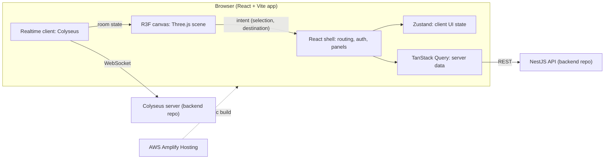

# Frontend Architecture Overview

Overview of the frontend. Normative constraints are in the [rules](../rules/README.md); the product-wide architecture is in [project document, section 6](../master-document.md#6-arquitectura-general-actualizada). This repository currently holds documentation only; the diagram describes the agreed design, not existing code.

## Structure

## Responsibilities

| Part | Owns | Rules |
|---|---|---|
| React shell | Navigation, authentication UI, panels, forms, dialogs | [Frontend conventions](../rules/frontend-conventions.md), [UI and accessibility](../rules/ui-and-accessibility.md) |
| R3F scene | 3D world, camera, avatars, object picking; surfaces intent only | [3D world and camera](../rules/3d-world-and-camera.md), [Art direction](../rules/art-direction.md) |
| Client state (Zustand) | UI coordination and local preferences | [State management](../rules/state-management.md) |
| Server data (TanStack Query) | Persistent data cache and invalidation | [State management](../rules/state-management.md) |
| Realtime client | Room connection, presence, synchronized state | [Realtime and presence](../rules/realtime-and-presence.md) |

## Boundaries

- Business rules and permissions are enforced by the backend; the frontend never treats a visible object or panel as authorization ([Security](../rules/security.md)).
- API and realtime access go through explicit integration boundaries, not scattered through UI or scene objects ([Architecture](../rules/architecture.md), [API contracts](../rules/api-contracts.md)).
- Live movement and presence come from Colyseus state; persistent effects go through the REST API.
- Essential functions have a DOM-based alternative to 3D-only interaction.

## Open items

- Distribution of contracts between the frontend and backend repositories is undecided.
- Session mechanism details follow [Authentication and session](../rules/authentication-and-session.md) and the backend agreement.
