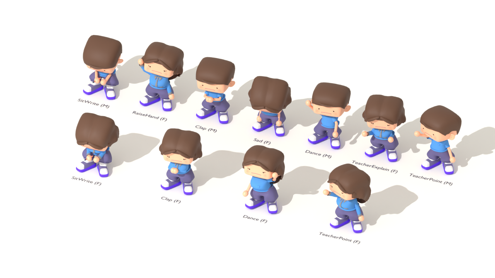
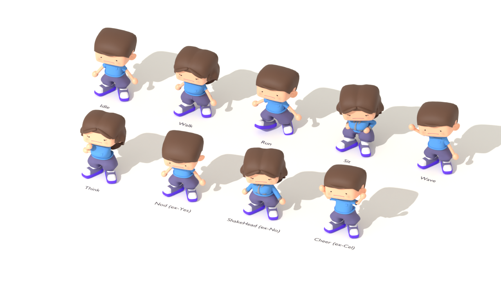
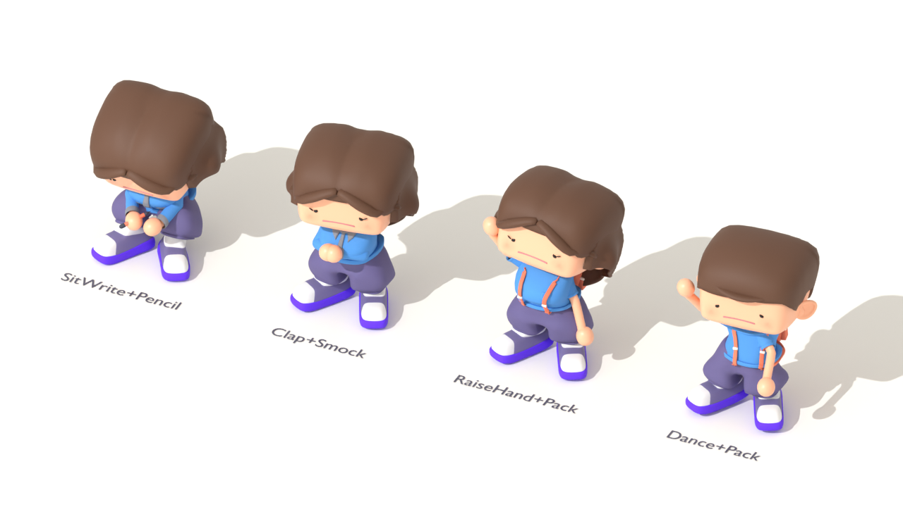

# Avatar Character Animations (Section 1)

Complete Section 1 **Animations** clip suite (`16` canonical clips + `4` transition clips) from the [asset wishlist](asset-wishlist.md#animations), authored and verified on **both** canonical base avatar bodies ([`male/body.glb`](../../public/models/avatars/male/body.glb) and [`female/body.glb`](../../public/models/avatars/female/body.glb)) under [modular avatar assets](../../rules/modular-avatar-assets.md#animations-and-facial-expressions), [art direction](../../rules/art-direction.md), and [3D world and camera](../../rules/3d-world-and-camera.md).

## Asset Summary

| Asset | Path | Size | Skeleton / Morphs | Clips Exported |
|---|---|---:|---|---|
| Male body master | [`male-body.blend`](../../assets/blender/avatars/base/male-body.blend) | — | `34` canonical Rigify `DEF-*` + `neutral_bone`; `4` facial morphs (`Blink`, `Happy`, `Sad`, `Angry`) | `20` skeletal/combined NLA tracks + `3` morph clips (`Angry`, `Blink`, `Happy`) |
| Male body GLB (Draco) | [`male/body.glb`](../../public/models/avatars/male/body.glb) | `729,192` B (`712.1` KB) | `34` joints (`0` rest-transform delta vs. baseline); `69.5%` of `1 MB` FD8 budget | `23` (`16` canonical + `4` transitions + `3` morph clips) |
| Female body master | [`female-body.blend`](../../assets/blender/avatars/base/female-body.blend) | — | `41` joints (identical `34` shared canonical joints + `7` legacy secondary joints); `4` facial morphs | `20` skeletal/combined NLA tracks |
| Female body GLB (Draco) | [`female/body.glb`](../../public/models/avatars/female/body.glb) | `887,008` B (`866.2` KB) | `41` joints (`0` rest-transform delta vs. baseline); `84.6%` of `1 MB` FD8 budget | `20` (`16` canonical + `4` transitions) |

- Standalone verification test: [`scripts/assets/test-avatar-animations.mjs`](../../scripts/assets/test-avatar-animations.mjs).
- **Compatibility preserved**: Every existing mesh, material, facial morph target (`Blink`, `Happy`, `Sad`, `Angry`), and canonical joint rest transform (`34` male / `41` female) matches `origin/develop` within `< 1e-4`. All existing modular hair, top, head, face, back, hand, and neck/ear wearable tests pass unchanged.
- **FD8 budget exceptions retired (`#91`)**: Draco mesh compression (`level = 6`), rest-only channel pruning, and linear keyframe thinning (Ramer-Douglas-Peucker chord tolerance `0.5 mm` / `0.004 rad`) bring both `body.glb` files under `1,048,576` B, retiring the legacy `#91` entries from [`scripts/assets/check-asset-budget.mjs`](../../scripts/assets/check-asset-budget.mjs) and [3D assets](../3d-assets.md).

## Canonical Animation Inventory (`16` Wishlist Clips + `4` Transitions)

| Wishlist item | Canonical clip | Duration (24 fps) | Channels (M / F) | Source / notes |
|---|---|---:|---:|---|
| Idle | `Idle` | `2.042` s | `42` / `49` | Preserved baseline standing idle loop |
| Walk | `Walk` | `1.042` s | `46` / `58` | Preserved baseline walk cycle |
| Run | `Run` | `0.708` s | `42` / `54` | Preserved baseline run cycle |
| Sit | `Sit` | `4.042` s | `38` / `38` | Preserved baseline seated loop (plus `SitStart` `1.500` s / `SitEnd` `1.250` s) |
| Sit and write | `SitWrite` | `3.000` s | `35` / `35` | **New** — anchored to `Sit` pelvis/legs; forward torso/head lean, left hand steadying, right hand writing strokes |
| Raise hand | `RaiseHand` | `2.500` s | `28` / `28` | **New** — grounded stance, right arm lifted laterally-forward above head clearing wide hair/hats |
| Wave | `Wave` | `2.500` s | `46` / `46` | Preserved baseline wave cycle |
| Cheer | `Cheer` | `2.667` s | `42` / `42` | **Migrated** from legacy `Celebrate` after visual verification |
| Clap | `Clap` | `1.500` s | `24` / `24` | **New** — 3 crisp chest-forward claps with subtle knee bounce and bust/smock clearance |
| Think | `Think` | `4.042` s | `44` / `44` | Preserved baseline thinking loop (plus `ThinkStart` `0.833` s / `ThinkEnd` `0.750` s) |
| Nod | `Nod` | `1.500` s | `36` / `36` | **Migrated** from legacy `Yes` after visual verification |
| Shake head | `ShakeHead` | `1.667` s | `42` / `42` | **Migrated** from legacy `No` after visual verification |
| Sad / frustrated | `Sad` | `3.000` s | `29` / `29` | **New** — slumped shoulders/spine, bowed head sway, plus synchronized `Sad` facial morph curves on both bodies |
| Dance | `Dance` | `2.000` s | `25` / `25` | **New** — 4-beat rhythmic hip sway, knee bounce (`Y >= 0`), and alternating arm pumps |
| Teacher: explain at the board | `TeacherExplain` | `3.500` s | `31` / `31` | **New** — open single-hand and balanced two-hand lecturing gestures with subtle torso turn |
| Teacher: point | `TeacherPoint` | `2.000` s | `29` / `29` | **New** — purposeful torso turn and extended right-arm pointing silhouette with 2 emphasis beats |

## Resting face

Both body GLBs ship with the `Sad` facial morph on (`0.72`). Avatar composition ([`compose-avatar.ts`](../../src/features/world/avatar/compose-avatar.ts)) overrides it on each avatar's own clone: neutral everywhere (`Blink`, `Happy`, `Sad`, `Angry` at `0`), and slightly happy (`Happy` `0.4`) on the welcome scene and the profile preview. `Sad`, `Angry`, `Happy` and `Blink` clips still drive the morphs when played, and the face returns to rest when they stop. The GLB files are unchanged.

## Legacy Clip Migration Verification

Per [modular avatar assets](../../rules/modular-avatar-assets.md#animations-and-facial-expressions):

- **Visual inspection**: `Yes`, `No`, and `Celebrate` were rendered on both bodies (`odd/previews/legacy-clips-check.png`) and verified to depict head-nodding, head-shaking, and two-arm cheering respectively before renaming to `Nod`, `ShakeHead`, and `Cheer`.
- **Caller audit**: `src/` and `e2e/` reference only `Idle`, `Walk`, `Run`, and `Wave` (`0` runtime callers for `Yes`, `No`, or `Celebrate`), so renaming the clips breaks zero runtime code.
- **`Sad` unification**: Male's previous morph-only `Sad` clip was merged into the unified full-body + `Sad` facial morph clip on both `male/body.glb` and `female/body.glb`; `Blink`, `Happy`, and `Angry` morph clips remain intact on `male/body.glb`.

## Visual Evidence & Wearable Clip-Checks

All `16` animations were visually inspected in Blender 5.2.2 LTS Cycles (`1280×720`) with representative committed wearables (`top-basic-tshirt`, `top-school-smock`, `hair-classic-short`, `hair-long-straight`, `back-backpack`, and `hand-pencil`).







## Verification

```sh
node scripts/assets/test-avatar-animations.mjs
pnpm assets:check
pnpm test
python scripts/ci/check_docs.py
git diff --check origin/develop..HEAD --
```
