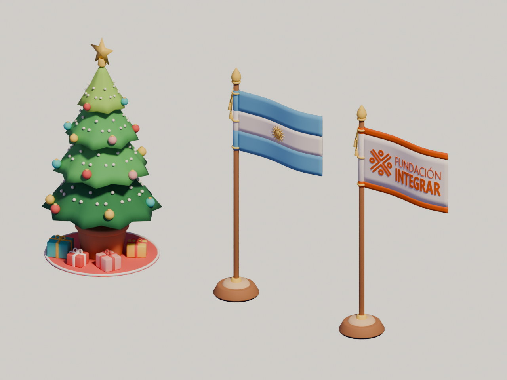
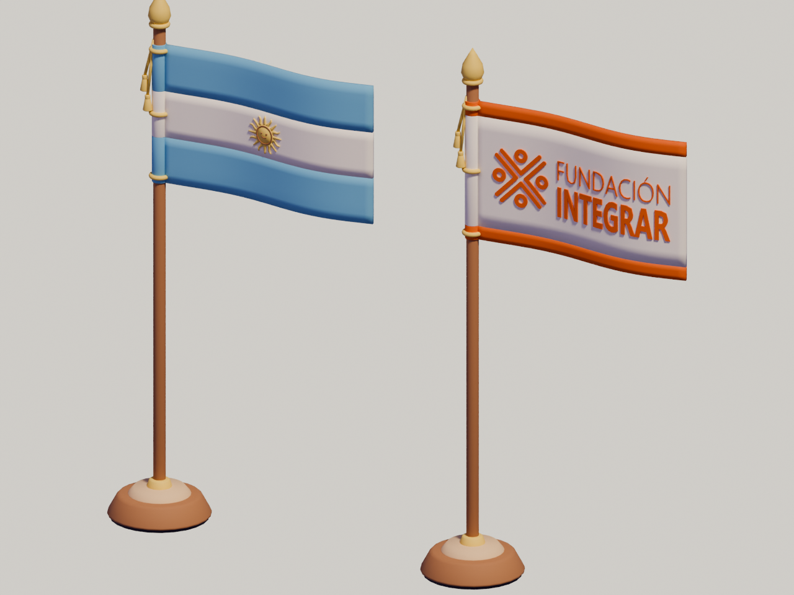
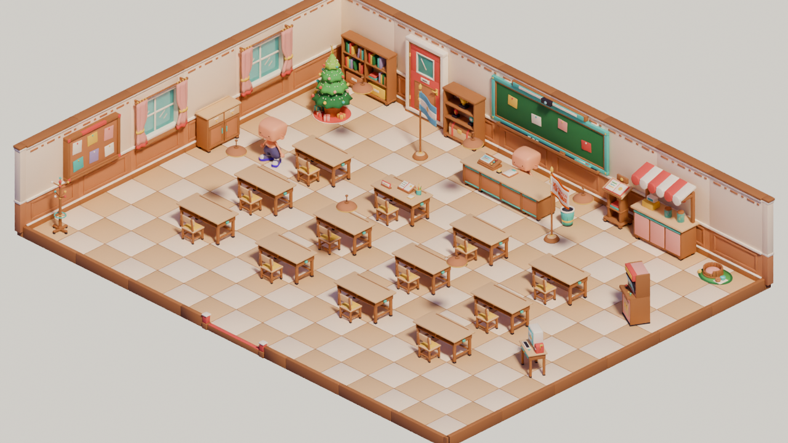
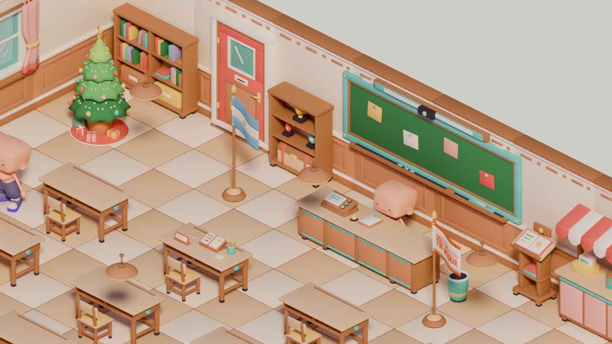
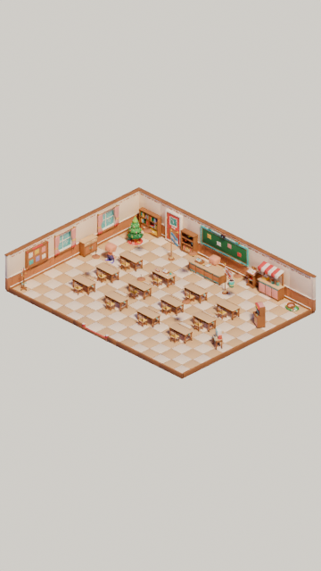
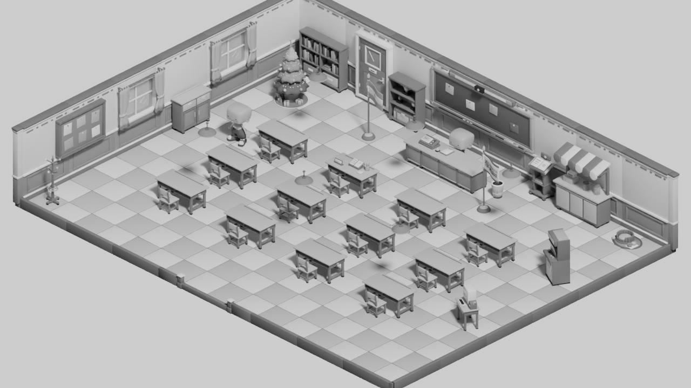

# Classroom Decoration — Modular Kit (3 reusable seasonal & institutional assets)

Three modular classroom decoration assets authored in Blender 5.2.2 LTS under [art direction](../../rules/art-direction.md) and [3D world and camera](../../rules/3d-world-and-camera.md): a festive **Christmas tree** (`christmas-tree`), the **Argentine national flag** (`flag-argentina`), and the **Fundación Integrar institutional flag** (`flag-integrar`). Each asset uses origin-centered floor grounding (`Y = 0`), matte/satin non-metallic (`metallic = 0.0`) palette materials, and Draco-compressed GLB 2.0 exports.

> **Scope note:** This slice delivers the 3 `.blend` masters, Draco-compressed `.glb` runtime assets, structural verification tests, and visual renders on `feat/interactive-objects-assets` without modifying `src/`, `e2e/`, or any of the existing 11 Section 4 interactive assets. Wiring them into `src/features/world/classroom/build-classroom-scene.ts` belongs to the runtime integration follow-up.

## Modular Catalog (`3` masters & `3` Draco GLBs)

| Item                    | Module ID        | Master (`.blend`)                                                                                  | Runtime GLB (`.glb`)                                                                     |                         Size |       Meshes / Tris | Dimensions / Pivot                                                                                                                                                 |
| ----------------------- | ---------------- | -------------------------------------------------------------------------------------------------- | ---------------------------------------------------------------------------------------- | ---------------------------: | ------------------: | ------------------------------------------------------------------------------------------------------------------------------------------------------------------ |
| Christmas tree          | `christmas-tree` | [christmas-tree.blend](../../assets/blender/environment/classroom-decoration/christmas-tree.blend) | [christmas-tree.glb](../../public/models/scenes/classroom/decoration/christmas-tree.glb) |                   `63,552` B |     `11` / `20,396` | `1.12 × 2.20 × 1.07 m`, floor pivot (`Y = 0`), coral/cream skirt, terracotta pot, 4 scalloped green tiers, pearl garland, ornaments, 4 gifts & 5-point star topper |
| Argentine flag          | `flag-argentina` | [flag-argentina.blend](../../assets/blender/environment/classroom-decoration/flag-argentina.blend) | [flag-argentina.glb](../../public/models/scenes/classroom/decoration/flag-argentina.glb) |                   `29,016` B |       `6` / `8,660` | `1.20 × 2.29 × 0.43 m`, stand floor pivot (`Y = 0`), wavy `#75B7DA` / `#FFF9EB` stripes & double-sided Sol de Mayo                                                 |
| Fundación Integrar flag | `flag-integrar`  | [flag-integrar.blend](../../assets/blender/environment/classroom-decoration/flag-integrar.blend)   | [flag-integrar.glb](../../public/models/scenes/classroom/decoration/flag-integrar.glb)   |                   `96,948` B |      `8` / `12,632` | `1.20 × 2.29 × 0.43 m`, stand floor pivot (`Y = 0`), cream banner with `#E86B22` borders & double-sided 3D Fundación Integrar emblem + `FUNDACIÓN INTEGRAR` lockup |
| **Total**               | **3 modules**    | **3 masters**                                                                                      | **3 Draco GLBs**                                                                         | **`189,516` B (`185.1` KB)** | **`25` / `41,688`** | **All `3` verified**                                                                                                                                               |

- Standalone structural test: [`scripts/assets/test-classroom-decoration.mjs`](../../scripts/assets/test-classroom-decoration.mjs).

## Visual Previews

### Modular Kit & Hero Close-ups (`1280×960`)

| View                                                                  | Preview                                                                                              |
| --------------------------------------------------------------------- | ---------------------------------------------------------------------------------------------------- |
| All `3` standalone decoration pieces side-by-side (`1280×960`)        |                 |
| Christmas tree close-up (`1280×960`)                                  |     |
| Argentine & Fundación Integrar ceremonial flags (`1280×960`)          |            |
| Fundación Integrar flag emblem & wordmark front close-up (`1280×960`) |  |

### Full Classroom Assembly (`1280px`, Close-up, `360px` Mobile, Grayscale)

| View                                                                                           | Preview                                                                                              |
| ---------------------------------------------------------------------------------------------- | ---------------------------------------------------------------------------------------------------- |
| Full `16 m × 12 m` classroom with shell, furniture, interactive & decoration GLBs (`1280×720`) |             |
| Teaching zone & NW corner close-up (`1280×720`)                                                |     |
| Portrait mobile readability (`360×640`)                                                        |          |
| Grayscale value-separation check (`1280×720`)                                                  |  |

## Three.js Modular Assembly Contract

Every GLB uses `1 unit = 1 meter`, `+Y` up, `Y = 0` floor contact, applied identity transforms, and faces `+Z` in local space:

- `christmas-tree.glb`: Place in the NW reading/storage corner at `(-6.60, 0, -4.25)` (`rotation.y = -Math.PI * 25 / 180`), clear of `bookshelf.glb`, windows, and student desks.
- `flag-argentina.glb`: Place on the left flank of the teaching zone at `(-3.30, 0, -4.30)` (`rotation.y = -Math.PI * 20 / 180`), clear of `door.glb`, `trophy-shelf.glb`, and `teacher-desk.glb`.
- `flag-integrar.glb`: Place on the right flank of the teaching zone at `(2.35, 0, -3.65)` (`rotation.y = -Math.PI * 18 / 180`), clear of `teacher-desk.glb`, `trash-bin.glb`, `report-card-stand.glb`, student desks, and ceiling pendant sightlines.
- **Lighting & shadow flags**: Follow [the Classroom Shell lighting reference](classroom-shell.md#threejs-lighting--tone-mapping-reference) (`THREE.AgXToneMapping`, warm `#FFF0D8` key + cool `#B5A7D6` shadow fill) with `castShadow = true` and `receiveShadow = true` on all opaque meshes.

## Palette & Materials

| Material            | Color / Purpose                                                                            | Roughness | Metallic |
| ------------------- | ------------------------------------------------------------------------------------------ | --------: | -------: |
| `DecWood`           | `#AF7B52` tree trunk, flagpole, stepped stand base, Sol de Mayo face lines                 |    `0.78` |    `0.0` |
| `DecWoodLight`      | `#E9C99B` ceremonial stand middle collar                                                   |    `0.80` |    `0.0` |
| `DecTerracotta`     | `#C88D65` Christmas tree planter pot & rim                                                 |    `0.80` |    `0.0` |
| `DecCreamPale`      | `#FFF9EB` skirt trim, pearl garland, ribbon bow, flag white stripe & banner field          |    `0.82` |    `0.0` |
| `DecButter`         | `#F7D86B` star topper, ornaments, gift box/ribbons, finials, rings, tassels, Sol de Mayo   |    `0.66` |    `0.0` |
| `DecCoral`          | `#E66861` tree skirt, ornaments, gift box & ribbons                                        |    `0.76` |    `0.0` |
| `DecPeach`          | `#F5B5AB` ornaments & gift box                                                             |    `0.80` |    `0.0` |
| `DecTurquoise`      | `#62CFC7` ornaments & gift box                                                             |    `0.74` |    `0.0` |
| `DecGrassGreen`     | `#A6D96A` upper conifer crown tier                                                         |    `0.82` |    `0.0` |
| `DecLeafGreen`      | `#65B96A` mid conifer tiers                                                                |    `0.84` |    `0.0` |
| `DecDeepGreen`      | `#3E8654` bottom conifer tier                                                              |    `0.86` |    `0.0` |
| `DecSlateDark`      | `#382F3F` recessed floor glide pads & planter soil                                         |    `0.64` |    `0.0` |
| `DecArgentinaBlue`  | `#75B7DA` Argentine flag sky-blue stripes                                                  |    `0.82` |    `0.0` |
| `DecIntegrarOrange` | `#E86B22` Fundación Integrar banner borders, 4-fold emblem & `FUNDACIÓN INTEGRAR` wordmark |    `0.74` |    `0.0` |

Rules: [art direction](../../rules/art-direction.md), [3D world and camera](../../rules/3d-world-and-camera.md).
