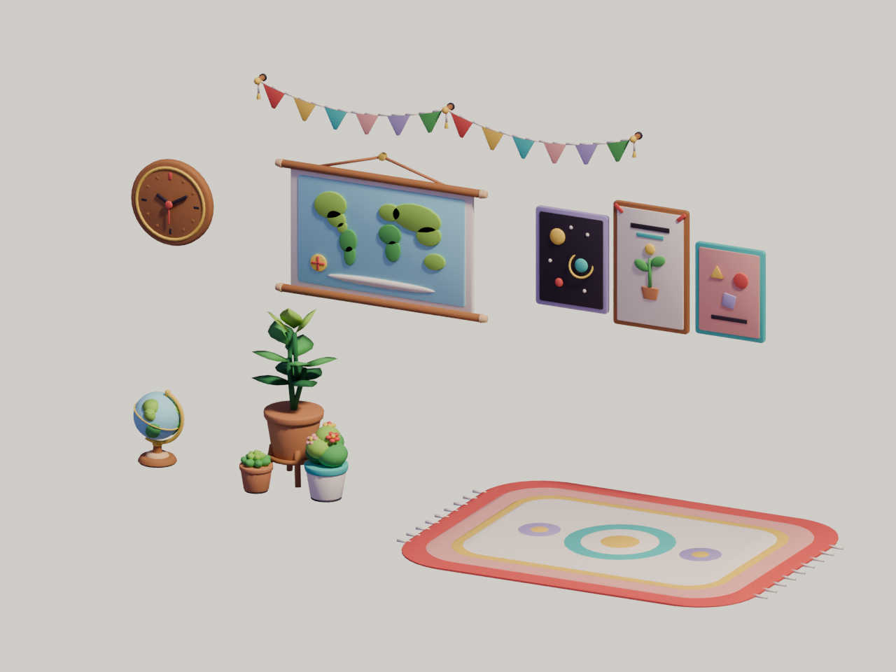
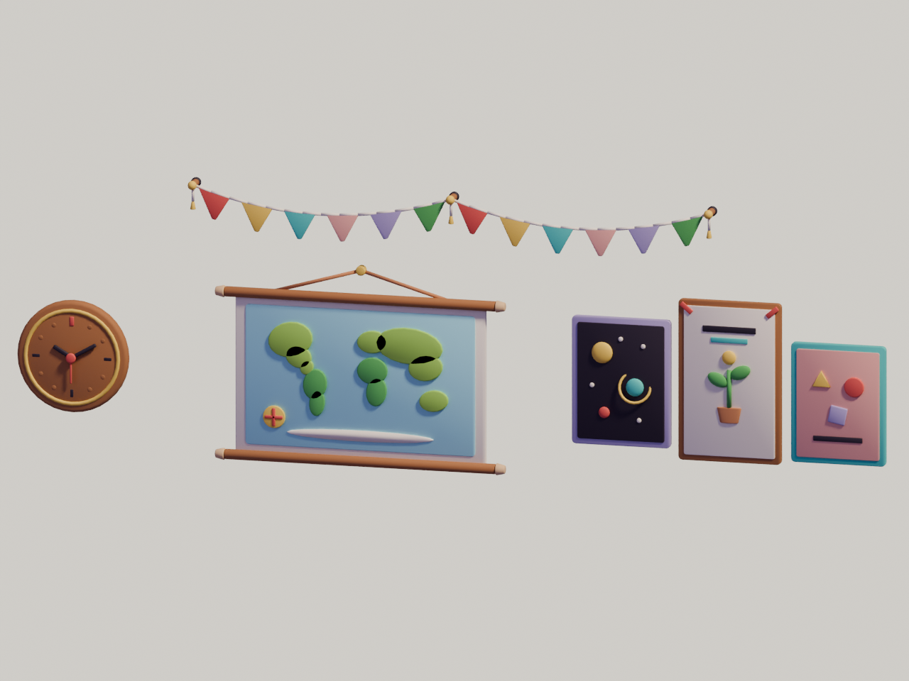
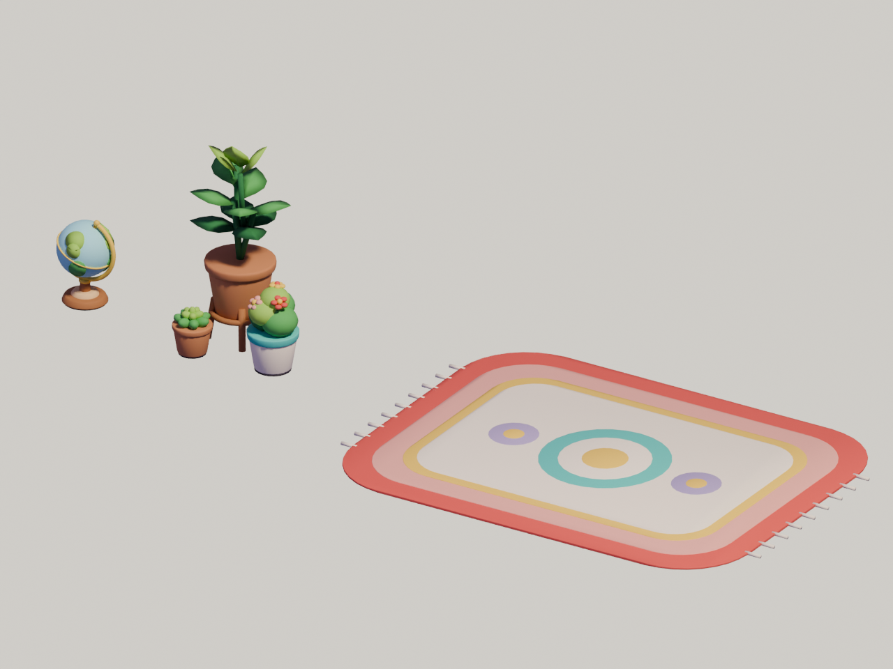
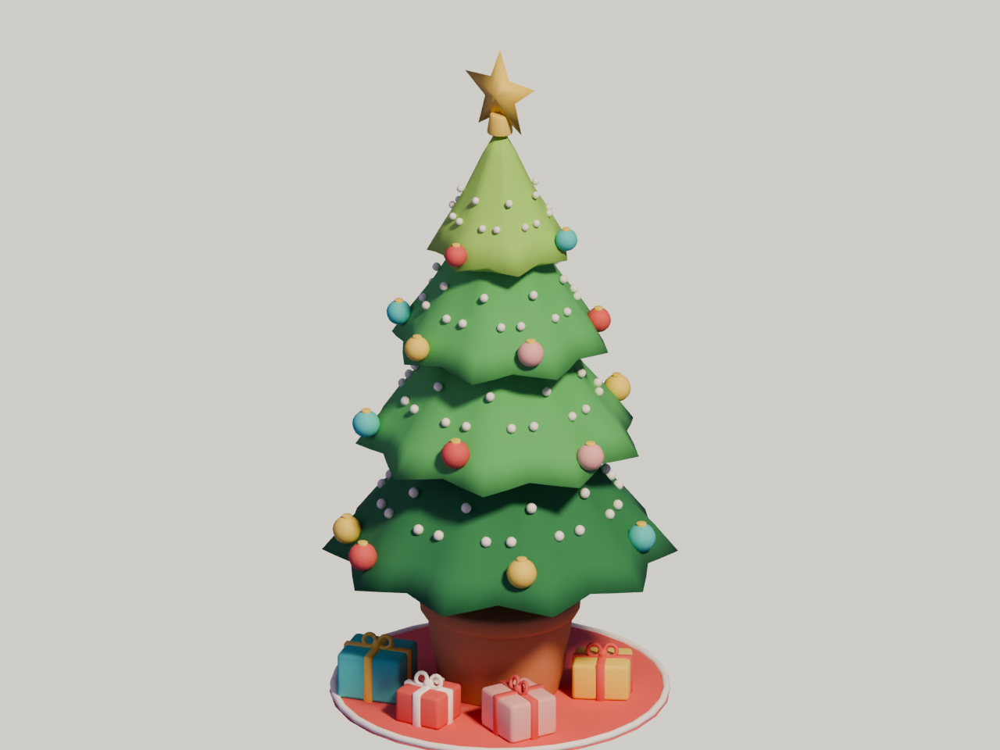
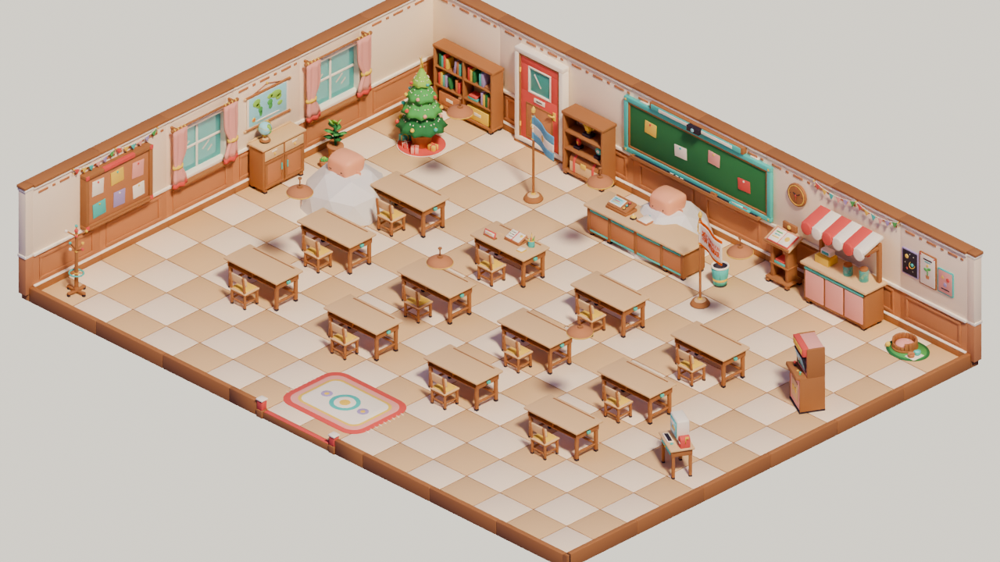
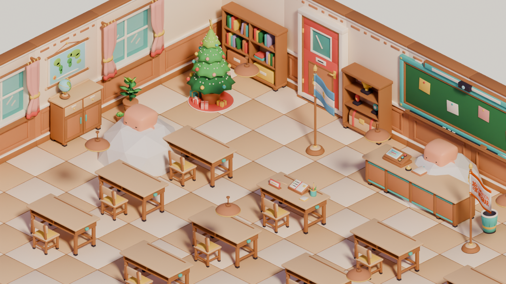
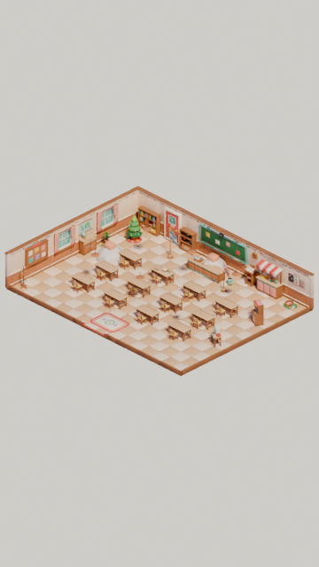
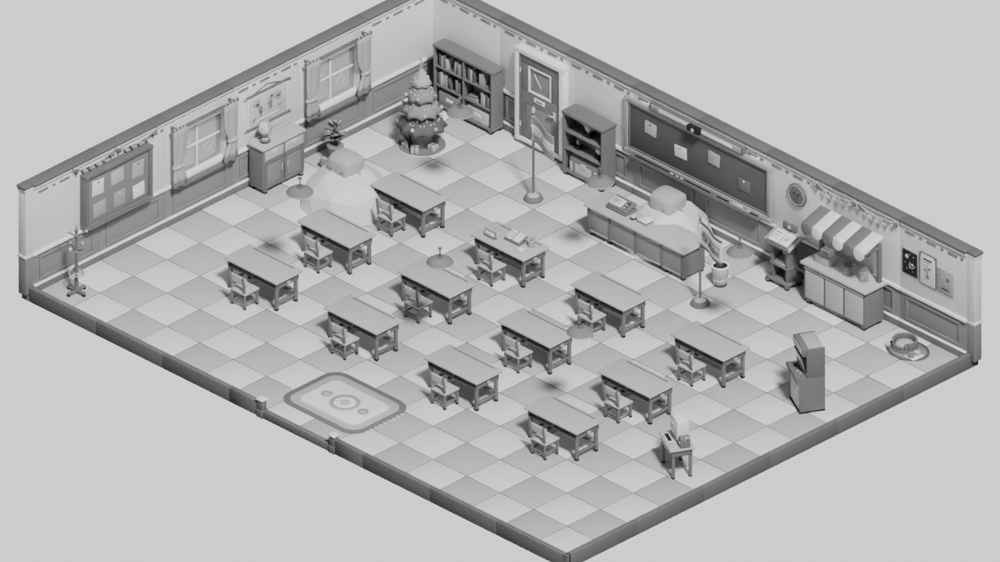

# Classroom Decoration — Modular Kit (10 reusable seasonal, institutional & room assets)

All ten modular **Classroom decoration** assets from the [asset wishlist](asset-wishlist.md) — **3 seasonal & institutional pieces** (`christmas-tree`, `flag-argentina`, `flag-integrar`) plus **7 classroom environment decorations** (`wall-clock`, `wall-map`, `globe`, `wall-posters`, `plants-and-pots`, `rug`, `garlands`) — authored in Blender 5.2.2 LTS under [art direction](../../rules/art-direction.md) and [3D world and camera](../../rules/3d-world-and-camera.md). Floor/tabletop props use `Y = 0` bottom contact, wall-mounted props use `Z = 0` flush backing, and every asset uses matte/satin non-metallic (`metallic = 0.0`) palette materials and Draco-compressed GLB 2.0 exports.

> **Scope note:** This documentation covers the 10 `.blend` masters, Draco-compressed `.glb` runtime assets, structural verification tests, and visual renders without modifying `src/` or `e2e/`. Wiring the modules into `src/features/world/classroom/build-classroom-scene.ts` belongs to the runtime integration follow-up.

## Modular Catalog (`10` masters & `10` Draco GLBs)

| Wishlist Item        | Module ID         | Master (`.blend`)                                                                                    | Runtime GLB (`.glb`)                                                                       |                         Size |       Meshes / Tris | Dimensions / Pivot                                                                                                                                  |
| -------------------- | ----------------- | ---------------------------------------------------------------------------------------------------- | ------------------------------------------------------------------------------------------ | ---------------------------: | ------------------: | --------------------------------------------------------------------------------------------------------------------------------------------------- |
| Christmas tree       | `christmas-tree`  | [christmas-tree.blend](../../assets/blender/environment/classroom-decoration/christmas-tree.blend)   | [christmas-tree.glb](../../public/models/scenes/classroom/decoration/christmas-tree.glb)   |                   `63,552` B |     `11` / `20,396` | `1.12 × 2.20 × 1.07 m`, floor pivot (`Y = 0`), coral/cream skirt, terracotta pot, 4 scalloped green tiers, pearl garland, ornaments, 4 gifts & star |
| Flag (national)      | `flag-argentina`  | [flag-argentina.blend](../../assets/blender/environment/classroom-decoration/flag-argentina.blend)   | [flag-argentina.glb](../../public/models/scenes/classroom/decoration/flag-argentina.glb)   |                   `29,016` B |       `6` / `8,660` | `1.20 × 2.29 × 0.43 m`, stand floor pivot (`Y = 0`), wavy `#75B7DA` / `#FFF9EB` stripes & double-sided Sol de Mayo                                  |
| Flag (institutional) | `flag-integrar`   | [flag-integrar.blend](../../assets/blender/environment/classroom-decoration/flag-integrar.blend)     | [flag-integrar.glb](../../public/models/scenes/classroom/decoration/flag-integrar.glb)     |                   `96,948` B |      `8` / `12,632` | `1.20 × 2.29 × 0.43 m`, stand floor pivot (`Y = 0`), cream banner with `#E86B22` borders & double-sided Fundación Integrar emblem + wordmark        |
| Wall clock           | `wall-clock`      | [wall-clock.blend](../../assets/blender/environment/classroom-decoration/wall-clock.blend)           | [wall-clock.glb](../../public/models/scenes/classroom/decoration/wall-clock.glb)           |                   `16,372` B |       `5` / `3,788` | `0.54 × 0.54 × 0.10 m`, wall-mounted (`Z = 0` flush), wood bezel, butter ring, cream dial, coral 12 marker & 10:10 hands                            |
| Map                  | `wall-map`        | [wall-map.blend](../../assets/blender/environment/classroom-decoration/wall-map.blend)               | [wall-map.glb](../../public/models/scenes/classroom/decoration/wall-map.glb)               |                   `38,948` B |      `10` / `9,856` | `1.42 × 0.98 × 0.07 m`, wall-mounted (`Z = 0` flush), wooden scroll rollers, terracotta cord, sky-blue ocean, raised 3D continents & compass rose   |
| Globe                | `globe`           | [globe.blend](../../assets/blender/environment/classroom-decoration/globe.blend)                     | [globe.glb](../../public/models/scenes/classroom/decoration/globe.glb)                     |                   `20,528` B |       `7` / `4,264` | `0.33 × 0.47 × 0.31 m`, surface pivot (`Y = 0`), stepped wood stand, 23.5° butter C-meridian, sky-blue ocean sphere & raised spherical continents   |
| Wall posters         | `wall-posters`    | [wall-posters.blend](../../assets/blender/environment/classroom-decoration/wall-posters.blend)       | [wall-posters.glb](../../public/models/scenes/classroom/decoration/wall-posters.glb)       |                   `33,676` B |      `10` / `8,220` | `1.53 × 0.78 × 0.07 m`, wall-mounted (`Z = 0` flush), 3-frame cluster (Astronomy, Botany & Study, Shapes & Art)                                     |
| Plants and pots      | `plants-and-pots` | [plants-and-pots.blend](../../assets/blender/environment/classroom-decoration/plants-and-pots.blend) | [plants-and-pots.glb](../../public/models/scenes/classroom/decoration/plants-and-pots.glb) |                   `39,052` B |      `11` / `8,276` | `0.69 × 1.13 × 0.61 m`, floor pivot (`Y = 0`), trio cluster: tall ficus on wood stand, flowering cream/turquoise pot & small terracotta succulent   |
| Rug                  | `rug`             | [rug.blend](../../assets/blender/environment/classroom-decoration/rug.blend)                         | [rug.glb](../../public/models/scenes/classroom/decoration/rug.glb)                         |                   `26,132` B |       `7` / `6,360` | `2.48 × 0.024 × 1.80 m`, walkable floor pivot (`Y = 0`), coral braided rim, peach/butter bands, cream center, circular medallions & side fringe     |
| Garlands             | `garlands`        | [garlands.blend](../../assets/blender/environment/classroom-decoration/garlands.blend)               | [garlands.glb](../../public/models/scenes/classroom/decoration/garlands.glb)               |                   `19,880` B |       `9` / `3,688` | `2.57 × 0.25 × 0.10 m`, wall-mounted (`Z = 0` flush), 3 wood/butter tie pegs, twin catenary cords & 12 beveled multi-color pennants                 |
| **Total**            | **10 modules**    | **10 masters**                                                                                       | **10 Draco GLBs**                                                                          | **`384,104` B (`375.1` KB)** | **`84` / `86,140`** | **All `10` verified**                                                                                                                               |

- Standalone structural test: [`scripts/assets/test-classroom-decoration.mjs`](../../scripts/assets/test-classroom-decoration.mjs).

## Visual Previews

### Decoration Pack Modular Showcase & Close-ups (`1280×960`)

| View                                                                                  | Preview                                                                                                     |
| ------------------------------------------------------------------------------------- | ----------------------------------------------------------------------------------------------------------- |
| All `7` classroom environment decoration pieces side-by-side (`1280×960`)             |                  |
| Wall decor close-up (`wall-clock`, `wall-map`, `wall-posters`, `garlands`)            |                    |
| Floor & tabletop close-up (`globe`, `plants-and-pots`, `rug`)                         |  |
| Seasonal & institutional pieces (`christmas-tree`, `flag-argentina`, `flag-integrar`) |                        |
| Christmas tree close-up (`1280×960`)                                                  |            |
| Argentine & Fundación Integrar ceremonial flags (`1280×960`)                          |                   |
| Fundación Integrar flag emblem & wordmark front close-up (`1280×960`)                 |         |

### Full Classroom Assembly (`1280px`, Close-up, `360px` Mobile, Grayscale)

| View                                                                                                    | Preview                                                                                                        |
| ------------------------------------------------------------------------------------------------------- | -------------------------------------------------------------------------------------------------------------- |
| Full `16 m × 12 m` classroom with shell, furniture, interactive & all `10` decoration GLBs (`1280×720`) |             |
| West wall, cabinet globe, map, plants & front corner close-up (`1280×720`)                              |     |
| Portrait mobile readability (`360×640`)                                                                 |          |
| Grayscale value-separation check (`1280×720`)                                                           |  |

## Three.js Modular Assembly Contract

Every GLB uses `1 unit = 1 meter`, `+Y` up, applied identity transforms, and faces `+Z` in local space:

- `christmas-tree.glb`: Place in the NW reading/storage corner at `(-6.60, 0, -4.25)` (`rotation.y = -Math.PI * 25 / 180`), clear of `bookshelf.glb`, windows, and student desks.
- `flag-argentina.glb`: Place on the left flank of the teaching zone at `(-3.30, 0, -4.30)` (`rotation.y = -Math.PI * 20 / 180`), clear of `door.glb`, `trophy-shelf.glb`, and `teacher-desk.glb`.
- `flag-integrar.glb`: Place on the right flank of the teaching zone at `(2.35, 0, -3.65)` (`rotation.y = -Math.PI * 18 / 180`), clear of `teacher-desk.glb`, `trash-bin.glb`, `report-card-stand.glb`, student desks, and ceiling pendant sightlines.
- `wall-clock.glb`: Mount on the North wall (`minZ = -6`) above `report-card-stand.glb` at `(2.95, 1.98, -6.0)` (`rotation.y = 0`), centered between `board.glb` and `shop-kiosk.glb`.
- `wall-map.glb`: Mount on the solid West wall (`minX = -8`) above `cabinet.glb` at `(-8.0, 1.80, -1.0)` (`rotation.y = +Math.PI / 2`), between the two window bays.
- `globe.glb`: Rest flush atop `cabinet.glb` (`topY = 1.14 m`) at `(-7.69, 1.14, -0.65)` (`rotation.y = +Math.PI / 2`), positioned forward of `wall-map.glb` without obstructing its continents.
- `wall-posters.glb`: Mount on the North wall above `pet-bed.glb` at `(6.85, 1.66, -6.0)` (`rotation.y = 0`).
- `plants-and-pots.glb`: Place beside the sunlit West window at `(-7.22, 0, -2.35)` (`rotation.y = Math.PI * 15 / 180`), clear of `cabinet.glb`, `christmas-tree.glb`, and student desks.
- `rug.glb`: Place centered in the entrance gathering zone at `(0.0, 0, 4.65)` (`rotation.y = 0`), clear of the doorway threshold and rear row of student chairs.
- `garlands.glb`: Mount high on the North wall above `shop-kiosk.glb` at `(4.75, 2.52, -6.0)` (`rotation.y = 0`) and on the West wall above `bulletin-board.glb` at `(-8.0, 2.54, 3.60)` (`rotation.y = +Math.PI / 2`), clearing all wall reliefs and door/bulletin frames.
- **Lighting & shadow flags**: Follow [the Classroom Shell lighting reference](classroom-shell.md#threejs-lighting--tone-mapping-reference) (`THREE.AgXToneMapping`, warm `#FFF0D8` key + cool `#B5A7D6` shadow fill) with `castShadow = true` and `receiveShadow = true` on all opaque meshes.

## Palette & Materials

| Material            | Color / Purpose                                                                             | Roughness | Metallic |
| ------------------- | ------------------------------------------------------------------------------------------- | --------: | -------: |
| `DecWood`           | `#AF7B52` tree trunk, flagpoles, clock bezel, map rollers, globe stand, plant stand, frames |    `0.78` |    `0.0` |
| `DecWoodLight`      | `#E9C99B` ceremonial stand middle collar, map finials, globe collar                         |    `0.80` |    `0.0` |
| `DecTerracotta`     | `#C88D65` planters, map hanging cord, poster sprout pot                                     |    `0.80` |    `0.0` |
| `DecCreamPale`      | `#FFF9EB` skirt trim, pearl garland, flags, clock dial, map canvas, rug center, cords       |    `0.82` |    `0.0` |
| `DecButter`         | `#F7D86B` star topper, finials, clock ring, globe meridian, compass, rug trim, pennants     |    `0.66` |    `0.0` |
| `DecCoral`          | `#E66861` tree skirt, ornaments, clock 12 marker, rug outer rim, flowers, pennants          |    `0.76` |    `0.0` |
| `DecPeach`          | `#F5B5AB` ornaments, gift box, art poster backing, rug band, blossoms, pennants             |    `0.80` |    `0.0` |
| `DecTurquoise`      | `#62CFC7` ornaments, gift box, pot band, rug medallion, frames, pennants                    |    `0.74` |    `0.0` |
| `DecSkyBlue`        | `#A9E7F4` world map ocean field & globe ocean sphere                                        |    `0.74` |    `0.0` |
| `DecGrassGreen`     | `#A6D96A` upper conifer crown, raised continents, sunlit leaves & succulents                |    `0.82` |    `0.0` |
| `DecLeafGreen`      | `#65B96A` mid conifer tiers, continents, broad foliage, pennants                            |    `0.84` |    `0.0` |
| `DecDeepGreen`      | `#3E8654` bottom conifer tier, shaded inner leaves & plant stems                            |    `0.86` |    `0.0` |
| `DecLavender`       | `#B5A7D6` astronomy poster frame, rug side dots & bunting pennants                          |    `0.80` |    `0.0` |
| `DecSlateDark`      | `#382F3F` recessed floor/wall pads, soil, clock hands & astronomy poster backing            |    `0.64` |    `0.0` |
| `DecArgentinaBlue`  | `#75B7DA` Argentine flag sky-blue stripes                                                   |    `0.82` |    `0.0` |
| `DecIntegrarOrange` | `#E86B22` Fundación Integrar banner borders, 4-fold emblem & `FUNDACIÓN INTEGRAR` wordmark  |    `0.74` |    `0.0` |

Rules: [art direction](../../rules/art-direction.md), [3D world and camera](../../rules/3d-world-and-camera.md).
