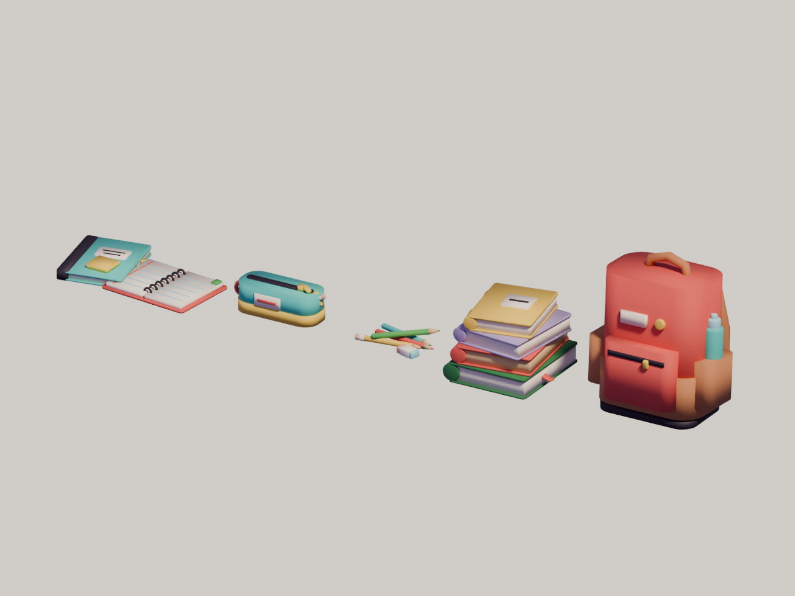
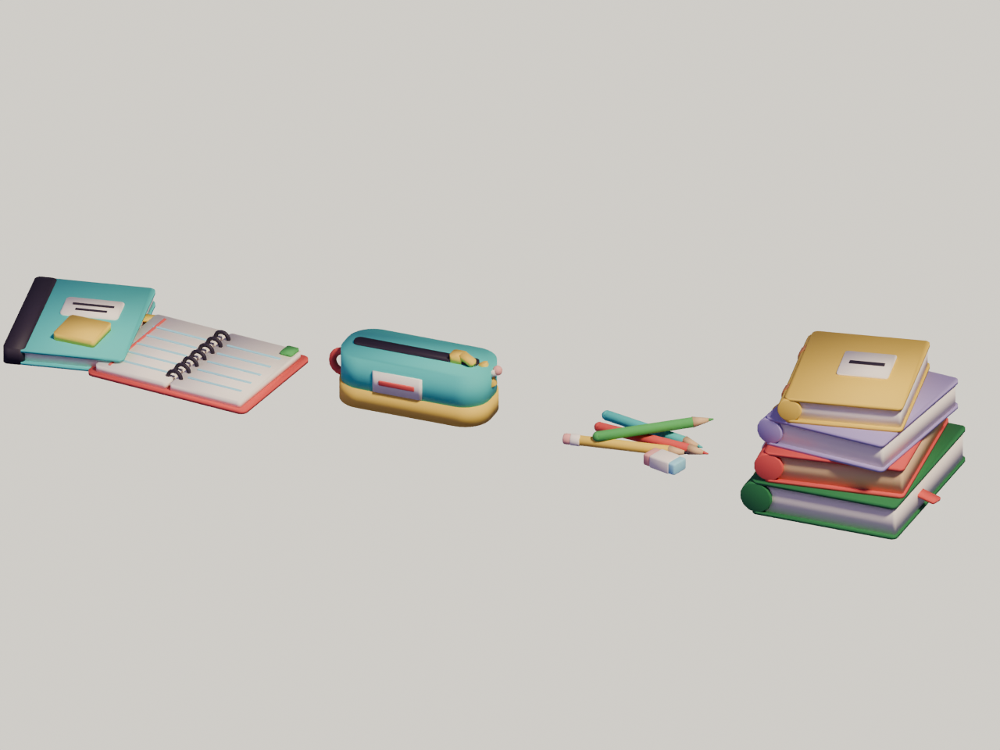
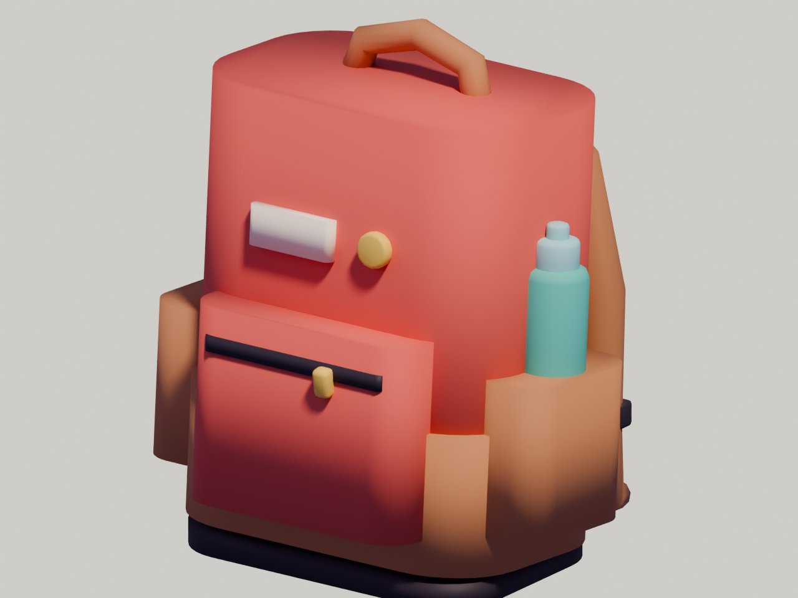
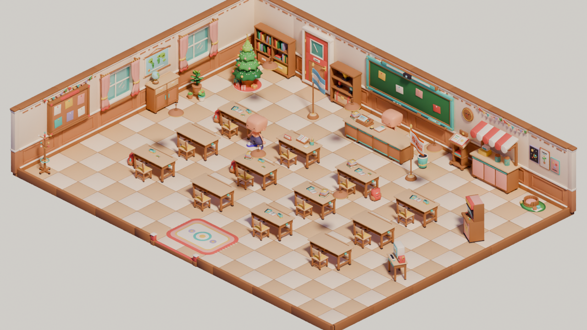
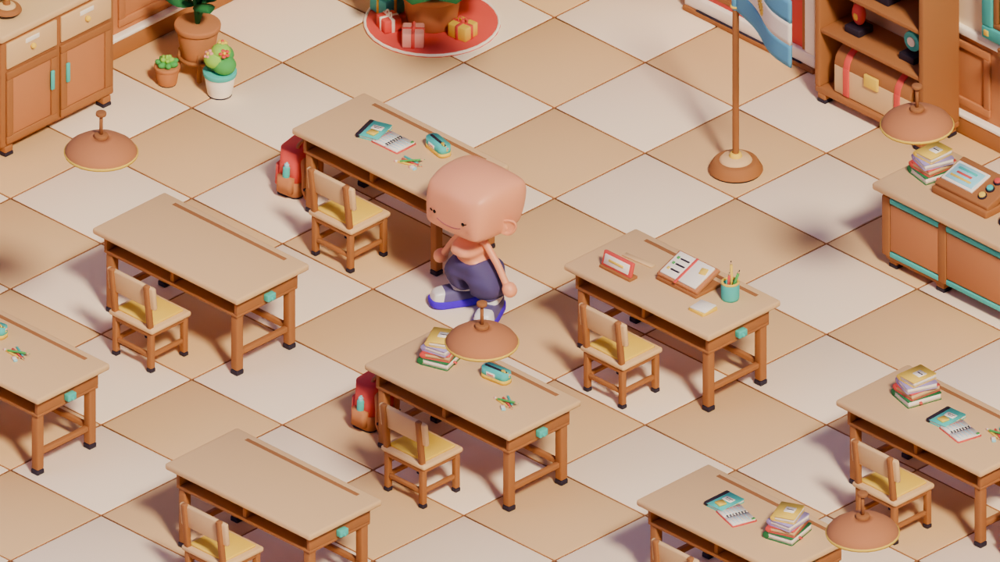
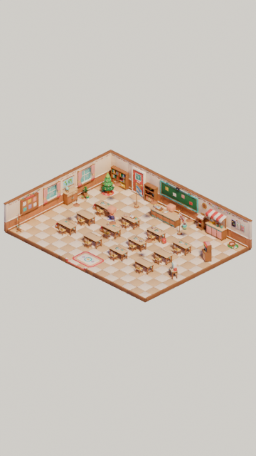
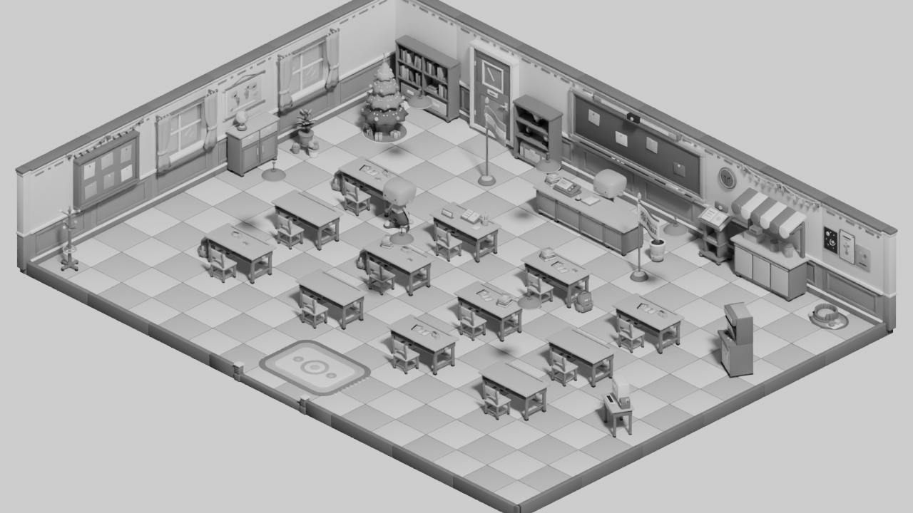

# Classroom Desk Clutter — Modular Kit (5 reusable Section 3 assets)

All five Section 3 **Desk clutter** items from the [asset wishlist](asset-wishlist.md) (`Notebooks`, `Pencil case`, `Pencils`, `Stacked books`, `Backpack on the floor`) are authored as **origin-centered, `Y = 0` grounded modular assets** in Blender 5.2.2 LTS under [art direction](../../rules/art-direction.md) and [3D world and camera](../../rules/3d-world-and-camera.md). Every piece shares the classroom's painted-toy beveled silhouettes, matte/satin `metallic = 0.0` palette materials, and Draco-compressed GLB 2.0 exports.

> **Scope note:** This slice delivers the 5 `.blend` masters, Draco-compressed `.glb` runtime assets, structural verification tests, and visual renders without modifying `src/` or `e2e/`. Wiring the modules into `src/features/world/classroom/build-classroom-scene.ts` belongs to the runtime integration follow-up.

## Modular Catalog (`5` masters & `5` Draco GLBs)

| Wishlist Item         | Module ID        | Master (`.blend`)                                                                                    | Runtime GLB (`.glb`)                                                                       |                       Size |       Meshes / Tris | Dimensions / Pivot                                                                                                       |
| --------------------- | ---------------- | ---------------------------------------------------------------------------------------------------- | ------------------------------------------------------------------------------------------ | -------------------------: | ------------------: | ------------------------------------------------------------------------------------------------------------------------ |
| Notebooks             | `notebooks`      | [notebooks.blend](../../assets/blender/environment/classroom-desk-clutter/notebooks.blend)           | [notebooks.glb](../../public/models/scenes/classroom/desk-clutter/notebooks.glb)           |                 `20,944` B |       `7` / `4,960` | `0.50 × 0.04 × 0.31 m`, tabletop pivot (`Y = 0`), closed turquoise composition notebook, butter sticky pad & open spiral |
| Pencil case           | `pencil-case`    | [pencil-case.blend](../../assets/blender/environment/classroom-desk-clutter/pencil-case.blend)       | [pencil-case.glb](../../public/models/scenes/classroom/desk-clutter/pencil-case.glb)       |                 `11,792` B |       `6` / `1,656` | `0.30 × 0.11 × 0.12 m`, tabletop pivot (`Y = 0`), plump turquoise/butter zippered pouch, front tag, loop & peeking end   |
| Pencils               | `pencils`        | [pencils.blend](../../assets/blender/environment/classroom-desk-clutter/pencils.blend)               | [pencils.glb](../../public/models/scenes/classroom/desk-clutter/pencils.glb)               |                 `14,340` B |       `9` / `1,544` | `0.24 × 0.04 × 0.15 m`, tabletop pivot (`Y = 0`), 4 chunky hexagonal pencils + two-tone sleeve eraser                    |
| Stacked books         | `stacked-books`  | [stacked-books.blend](../../assets/blender/environment/classroom-desk-clutter/stacked-books.blend)   | [stacked-books.glb](../../public/models/scenes/classroom/desk-clutter/stacked-books.glb)   |                 `21,636` B |       `8` / `4,036` | `0.31 × 0.21 × 0.31 m`, surface pivot (`Y = 0`), 4 asymmetrically stacked beveled hardcover books & bookmark ribbon      |
| Backpack on the floor | `backpack-floor` | [backpack-floor.blend](../../assets/blender/environment/classroom-desk-clutter/backpack-floor.blend) | [backpack-floor.glb](../../public/models/scenes/classroom/desk-clutter/backpack-floor.glb) |                 `16,684` B |       `7` / `2,724` | `0.41 × 0.46 × 0.35 m`, floor pivot (`Y = 0`), coral/terracotta school backpack, side water bottle, handle & rear straps |
| **Total**             | **5 modules**    | **5 masters**                                                                                        | **5 Draco GLBs**                                                                           | **`85,396` B (`83.4` KB)** | **`37` / `14,920`** | **All `5` verified**                                                                                                     |

- Standalone structural test: [`scripts/assets/test-classroom-desk-clutter.mjs`](../../scripts/assets/test-classroom-desk-clutter.mjs).

## Visual Previews

### Modular Kit Showcase & Close-ups (`1280×960`)

| View                                                                             | Preview                                                                                       |
| -------------------------------------------------------------------------------- | --------------------------------------------------------------------------------------------- |
| All `5` standalone desk-clutter pieces side-by-side (`1280×960`)                 |      |
| Tabletop props close-up (`notebooks`, `pencil-case`, `pencils`, `stacked-books`) |  |
| Resting floor backpack 3/4 close-up (`backpack-floor`)                           |  |

### Full Classroom Assembly (`1280px`, Close-up, `360px` Mobile, Grayscale)

| View                                                                                                            | Preview                                                                                                  |
| --------------------------------------------------------------------------------------------------------------- | -------------------------------------------------------------------------------------------------------- |
| Full `16 m × 12 m` classroom with shell, furniture, interactive, decoration & all `5` clutter GLBs (`1280×720`) |             |
| Populated student desks & aisle backpacks close-up (`1280×720`)                                                 |     |
| Portrait mobile readability (`360×640`)                                                                         |          |
| Grayscale value-separation check (`1280×720`)                                                                   |  |

## Three.js Modular Assembly Contract

Every GLB uses `1 unit = 1 meter`, `+Y` up, applied identity transforms, and faces `+Z` in local space:

- **Tabletop student-desk props (`notebooks.glb`, `pencil-case.glb`, `pencils.glb`, `stacked-books.glb`)**:
  - Mount at `Y = 0.75 m` (`DESK_HEIGHT` of `student-desk.glb`, leaving the active student's assigned desk open for `own-student-desk-kit.glb`).
  - Keep local offsets within each `1.60 × 0.80 m` tabletop (`|dx| <= 0.48 m`, `|dz| <= 0.14 m`) with varied subtle `rotation.y` (`±6°..18°`) so props sit clear of desk edges and neighbor items.
  - `stacked-books.glb` also fits cleanly on the left corner of `teacher-desk.glb` at `(-1.26, 0.75, -4.44)` (`rotation.y = -Math.PI * 12 / 180`), clear of `teacher-desk-controls.glb` and the Tutor Bot spot.
- **Floor backpack (`backpack-floor.glb`)**:
  - Place grounded at `Y = 0` tucked right outside a student desk's side leg (`deskX ± 1.02`, `deskZ + 0.08`, angled `~±78°..84°` toward the desk) so it clears desk legs (`±0.80`), tucked chairs (`deskZ + 0.56`), and walkable classroom aisles.
- **Lighting & shadow flags**: Follow [the Classroom Shell lighting reference](classroom-shell.md#threejs-lighting--tone-mapping-reference) (`THREE.AgXToneMapping`, warm `#FFF0D8` key + cool `#B5A7D6` shadow fill) with `castShadow = true` and `receiveShadow = true` on all opaque meshes.

## Palette & Materials

| Material         | Color / Purpose                                                                        | Roughness | Metallic |
| ---------------- | -------------------------------------------------------------------------------------- | --------: | -------: |
| `DeskWood`       | `#AF7B52` shared warm wood accent token                                                |    `0.78` |    `0.0` |
| `DeskWoodLight`  | `#E9C99B` sharpened pencil cones & warm book page block                                |    `0.80` |    `0.0` |
| `DeskTerracotta` | `#C88D65` backpack lower panel, side pockets, grab handle, straps & workbook spine     |    `0.80` |    `0.0` |
| `DeskCreamPale`  | `#FFF9EB` notebook/book pages, title plaques, pencil ferrules, eraser sleeve & badge   |    `0.82` |    `0.0` |
| `DeskButter`     | `#F7D86B` sticky pad, pencil-case base/zipper, #2 pencil, workbook cover & pin/buckles |    `0.70` |    `0.0` |
| `DeskCoral`      | `#E66861` open notebook cover, grab loop, coral pencil/book & backpack main pack       |    `0.76` |    `0.0` |
| `DeskPeach`      | `#F5B5AB` pencil erasers & two-tone rectangular eraser end                             |    `0.80` |    `0.0` |
| `DeskTurquoise`  | `#62CFC7` composition notebook cover, pencil-case body, pencil & backpack water bottle |    `0.74` |    `0.0` |
| `DeskSkyBlue`    | `#A9E7F4` notebook ruled lines, eraser blue end & water bottle sports cap              |    `0.74` |    `0.0` |
| `DeskLeafGreen`  | `#65B96A` corner page bookmark & diagonal colored pencil                               |    `0.82` |    `0.0` |
| `DeskDeepGreen`  | `#3E8654` bottom hardcover textbook                                                    |    `0.84` |    `0.0` |
| `DeskLavender`   | `#B5A7D6` third stacked hardcover book                                                 |    `0.80` |    `0.0` |
| `DeskSlateDark`  | `#382F3F` notebook spine/wire rings, zipper tracks, graphite tip, title bar & pack pad |    `0.62` |    `0.0` |

Rules: [art direction](../../rules/art-direction.md), [3D world and camera](../../rules/3d-world-and-camera.md).
