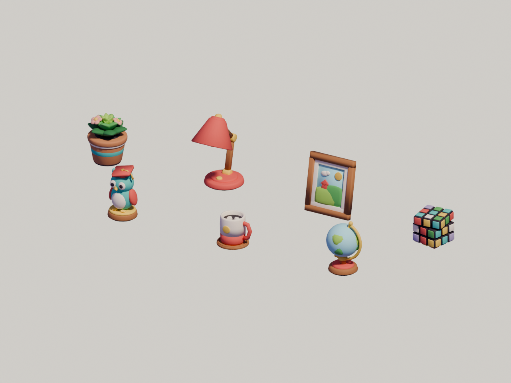
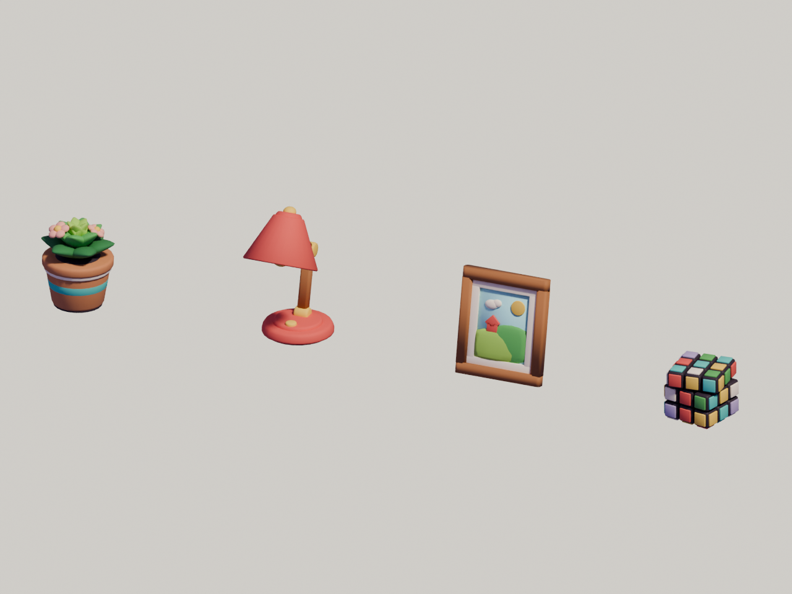
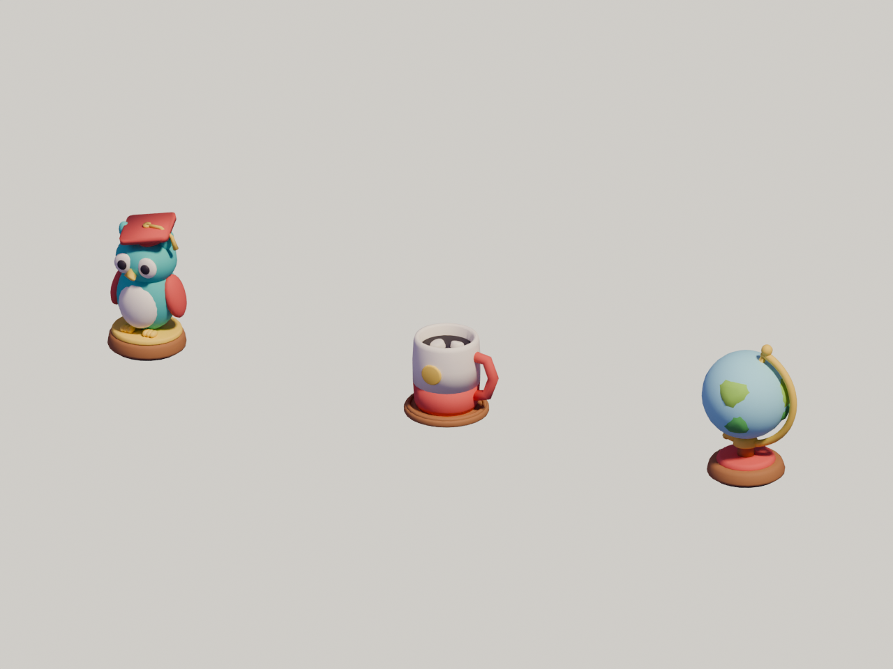
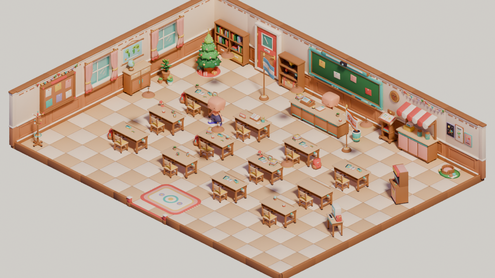
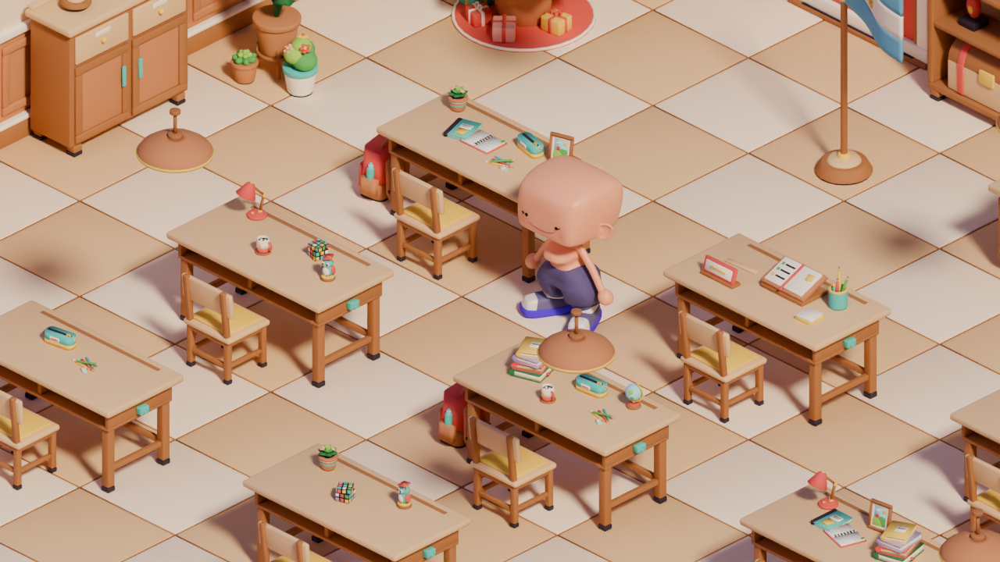
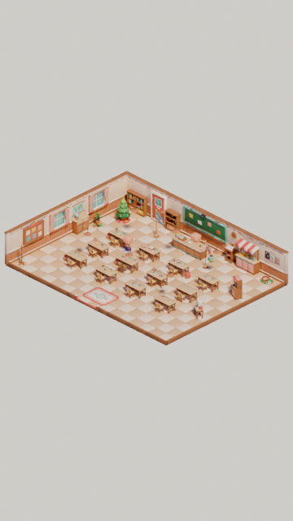
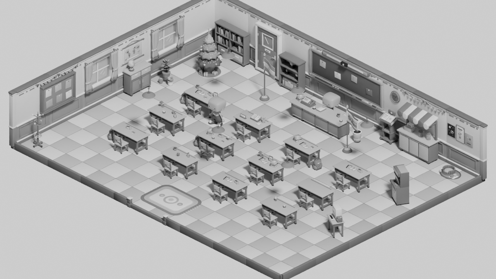

# Classroom Desk Decor (Shop) — Modular Kit (7 reusable Section 3 assets)

All seven Section 3 **Desk decor (shop)** items from the [asset wishlist](asset-wishlist.md) (`Plant`, `Lamp`, `Photo frame`, `Puzzle cube`, `Figurine`, `Mug`, `Mini globe`) are authored as **origin-centered, `Y = 0` grounded modular assets** in Blender 5.2.2 LTS under [art direction](../../rules/art-direction.md) and [3D world and camera](../../rules/3d-world-and-camera.md). Every piece shares the classroom's painted-toy beveled silhouettes, matte/satin `metallic = 0.0` palette materials, and Draco-compressed GLB 2.0 exports.

> **Scope note:** This slice delivers the 7 `.blend` masters, Draco-compressed `.glb` runtime assets, structural verification tests, and visual renders without modifying `src/` or `e2e/`. Wiring shop placement into `src/features/world/classroom/build-classroom-scene.ts` belongs to the runtime integration follow-up.

## Modular Catalog (`7` masters & `7` Draco GLBs)

| Wishlist Item | Module ID     | Master (`.blend`)                                                                            | Runtime GLB (`.glb`)                                                               |                         Size |       Meshes / Tris | Dimensions / Pivot                                                                                                           |
| ------------- | ------------- | -------------------------------------------------------------------------------------------- | ---------------------------------------------------------------------------------- | ---------------------------: | ------------------: | ---------------------------------------------------------------------------------------------------------------------------- |
| Plant         | `plant`       | [plant.blend](../../assets/blender/environment/classroom-desk-decor/plant.blend)             | [plant.glb](../../public/models/scenes/classroom/desk-decor/plant.glb)             |                   `36,252` B |       `9` / `7,900` | `0.15 × 0.19 × 0.15 m`, tabletop pivot (`Y = 0`), terracotta pot with cream/turquoise bands, 3-tier succulent & 2 blossoms   |
| Lamp          | `lamp`        | [lamp.blend](../../assets/blender/environment/classroom-desk-decor/lamp.blend)               | [lamp.glb](../../public/models/scenes/classroom/desk-decor/lamp.glb)               |                   `17,540` B |       `6` / `3,548` | `0.16 × 0.30 × 0.24 m`, tabletop pivot (`Y = 0`), coral base & bell shade, wooden articulated arm, cream reflector & bulb    |
| Photo frame   | `photo-frame` | [photo-frame.blend](../../assets/blender/environment/classroom-desk-decor/photo-frame.blend) | [photo-frame.glb](../../public/models/scenes/classroom/desk-decor/photo-frame.glb) |                   `18,164` B |       `9` / `2,720` | `0.19 × 0.23 × 0.13 m`, tabletop pivot (`Y = 0`), angled wooden frame, terracotta easel strut & 3D landscape postcard relief |
| Puzzle cube   | `puzzle-cube` | [puzzle-cube.blend](../../assets/blender/environment/classroom-desk-decor/puzzle-cube.blend) | [puzzle-cube.glb](../../public/models/scenes/classroom/desk-decor/puzzle-cube.glb) |                   `28,252` B |       `7` / `8,748` | `0.14 × 0.12 × 0.14 m`, tabletop pivot (`Y = 0`), 3×3×3 dark-slate cubies, 16° twisted top tier & 6-color beveled tiles      |
| Figurine      | `figurine`    | [figurine.blend](../../assets/blender/environment/classroom-desk-decor/figurine.blend)       | [figurine.glb](../../public/models/scenes/classroom/desk-decor/figurine.glb)       |                   `24,028` B |       `6` / `5,380` | `0.11 × 0.20 × 0.11 m`, tabletop pivot (`Y = 0`), original painted-toy Scholar Owl on wooden plinth with coral mortarboard   |
| Mug           | `mug`         | [mug.blend](../../assets/blender/environment/classroom-desk-decor/mug.blend)                 | [mug.glb](../../public/models/scenes/classroom/desk-decor/mug.glb)                 |                   `13,012` B |       `5` / `2,252` | `0.14 × 0.12 × 0.12 m`, tabletop pivot (`Y = 0`), wooden coaster, coral dip-glaze ceramic mug, cocoa & twin marshmallows     |
| Mini globe    | `mini-globe`  | [mini-globe.blend](../../assets/blender/environment/classroom-desk-decor/mini-globe.blend)   | [mini-globe.glb](../../public/models/scenes/classroom/desk-decor/mini-globe.glb)   |                   `17,504` B |       `7` / `3,008` | `0.15 × 0.21 × 0.13 m`, tabletop pivot (`Y = 0`), compact wooden stand, coral collar, 23.5° butter meridian & 3D continents  |
| **Total**     | **7 modules** | **7 masters**                                                                                | **7 Draco GLBs**                                                                   | **`154,752` B (`151.1` KB)** | **`49` / `33,556`** | **All `7` verified**                                                                                                         |

- Standalone structural test: [`scripts/assets/test-classroom-desk-decor.mjs`](../../scripts/assets/test-classroom-desk-decor.mjs).

## Runtime placement

Each student desk shows the one item its student equipped in `desk_decor`, matched by shop code (`desk_mug` -> `mug.glb`, and so on) in [`desk-decor.ts`](../../src/features/world/classroom/desk-decor.ts). The value synced by the room (`appearance.items.desk_decor`, empty included) wins for connected students; otherwise `GET /classrooms/{id}/desks` provides `deskDecor`, so offline changes show on the next read. The object sits on the far corner of the top (`dx = 0.5 m`, `dz = -0.2 m`), away from the seated character, and all decor shares one batch separate from the room kit. Unknown codes render nothing and a model that fails to load is left out. The same models drive the shop preview.

## Visual Previews

### Modular Kit Showcase & Close-ups (`1280×960`)

| View                                                                | Preview                                                                                          |
| ------------------------------------------------------------------- | ------------------------------------------------------------------------------------------------ |
| All `7` standalone shop desk-decor pieces side-by-side (`1280×960`) |             |
| Back-row close-up (`plant`, `lamp`, `photo-frame`, `puzzle-cube`)   |   |
| Front-row close-up (`figurine`, `mug`, `mini-globe`)                |  |

### Full Classroom Assembly (`1280px`, Close-up, `360px` Mobile, Grayscale)

| View                                                                                                                   | Preview                                                                                              |
| ---------------------------------------------------------------------------------------------------------------------- | ---------------------------------------------------------------------------------------------------- |
| Full `16 m × 12 m` classroom with shell, furniture, interactive, decoration, clutter & all `7` decor GLBs (`1280×720`) |             |
| Student desk cluster close-up showing all `7` shop decor items alongside clutter (`1280×720`)                          |     |
| Portrait mobile readability (`360×640`)                                                                                |          |
| Grayscale value-separation check (`1280×720`)                                                                          |  |

## Three.js Modular Assembly Contract

Every GLB uses `1 unit = 1 meter`, `+Y` up, applied identity transforms, and faces `+Z` in local space:

- **Tabletop student-desk slots**:
  - Mount any unlocked shop decor item at `Y = 0.75 m` (`DESK_HEIGHT` of `student-desk.glb`) inside the `1.60 × 0.80 m` tabletop footprint (`|dx| <= 0.56 m`, `|dz| <= 0.24 m`), keeping the center-front zone clear for `own-student-desk-kit.glb` on the active student's desk.
  - Because every item has a compact `0.11–0.19 m` footprint and `Y = 0` pivot, up to 2–3 shop items combine cleanly on back corners (`dz ≈ -0.22 m`) or side edges (`dx ≈ ±0.54 m`) alongside `notebooks.glb`, `pencil-case.glb`, and `pencils.glb`.
- **Teacher-desk accent slots**:
  - `plant.glb` and `mug.glb` mount on the right side of `teacher-desk.glb` at `Y = 0.75 m` (`x >= +0.86 m`, `z = -4.54..-4.32 m`), clear of `teacher-desk-controls.glb` and `stacked-books.glb`.
- **Lighting & shadow flags**: Follow [the Classroom Shell lighting reference](classroom-shell.md#threejs-lighting--tone-mapping-reference) (`THREE.AgXToneMapping`, warm `#FFF0D8` key + cool `#B5A7D6` shadow fill) with `castShadow = true` and `receiveShadow = true` on all opaque meshes.

## Palette & Materials

| Material         | Color / Purpose                                                                         | Roughness | Metallic |
| ---------------- | --------------------------------------------------------------------------------------- | --------: | -------: |
| `ShopWood`       | `#AF7B52` lamp arm, photo frame border, figurine plinth, mug coaster & globe stand      |    `0.78` |    `0.0` |
| `ShopTerracotta` | `#C88D65` plant pot body & rim, photo-frame easel strut                                 |    `0.80` |    `0.0` |
| `ShopCreamPale`  | `#FFF9EB` pot rim collar, lamp reflector, frame mat, owl belly/eyes, mug & marshmallows |    `0.82` |    `0.0` |
| `ShopButter`     | `#F7D86B` pot flower centers, lamp joints/switch, cube tiles, owl beak/feet & meridian  |    `0.68` |    `0.0` |
| `ShopBulbWarm`   | `#F7D86B` warm satin lightbulb inside `lamp` shade                                      |    `0.50` |    `0.0` |
| `ShopCoral`      | `#E66861` lamp base/shade, postcard house, cube tiles, owl wings/cap, mug dip & collar  |    `0.76` |    `0.0` |
| `ShopPeach`      | `#F5B5AB` succulent blossoms                                                            |    `0.80` |    `0.0` |
| `ShopTurquoise`  | `#62CFC7` pot belly stripe, puzzle cube tiles & Scholar Owl body                        |    `0.74` |    `0.0` |
| `ShopSkyBlue`    | `#A9E7F4` photo-frame sky backdrop & mini-globe ocean sphere                            |    `0.74` |    `0.0` |
| `ShopGrassGreen` | `#A6D96A` upper succulent crown, foreground postcard hill & sunlit continents           |    `0.82` |    `0.0` |
| `ShopLeafGreen`  | `#65B96A` mid succulent rosette, background hill, cube tiles & mid-tone continents      |    `0.82` |    `0.0` |
| `ShopDeepGreen`  | `#3E8654` lower succulent leaves                                                        |    `0.84` |    `0.0` |
| `ShopLavender`   | `#B5A7D6` puzzle cube tiles                                                             |    `0.80` |    `0.0` |
| `ShopSlateDark`  | `#382F3F` bottom contact pads, soil, frame backing, cube body, owl pupils & hot cocoa   |    `0.62` |    `0.0` |

Rules: [art direction](../../rules/art-direction.md), [3D world and camera](../../rules/3d-world-and-camera.md).
