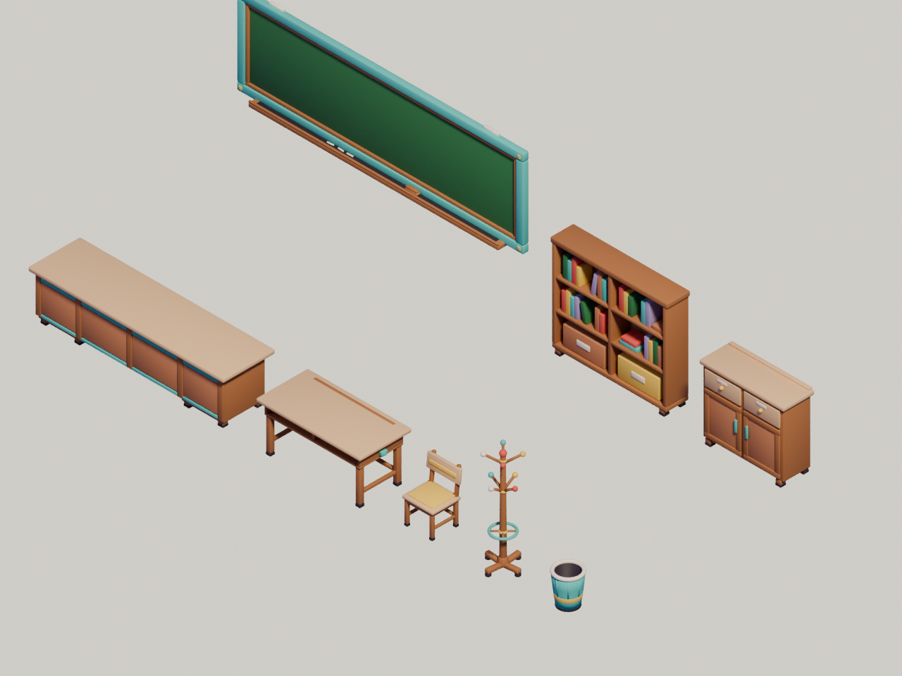
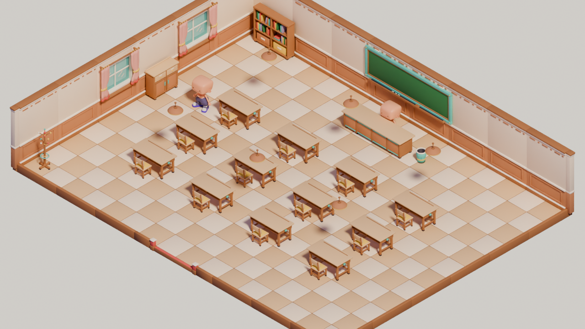
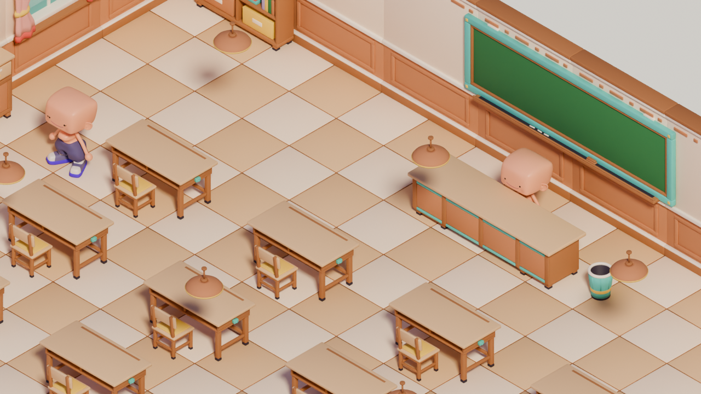
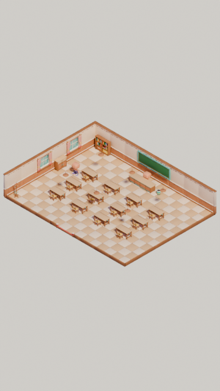
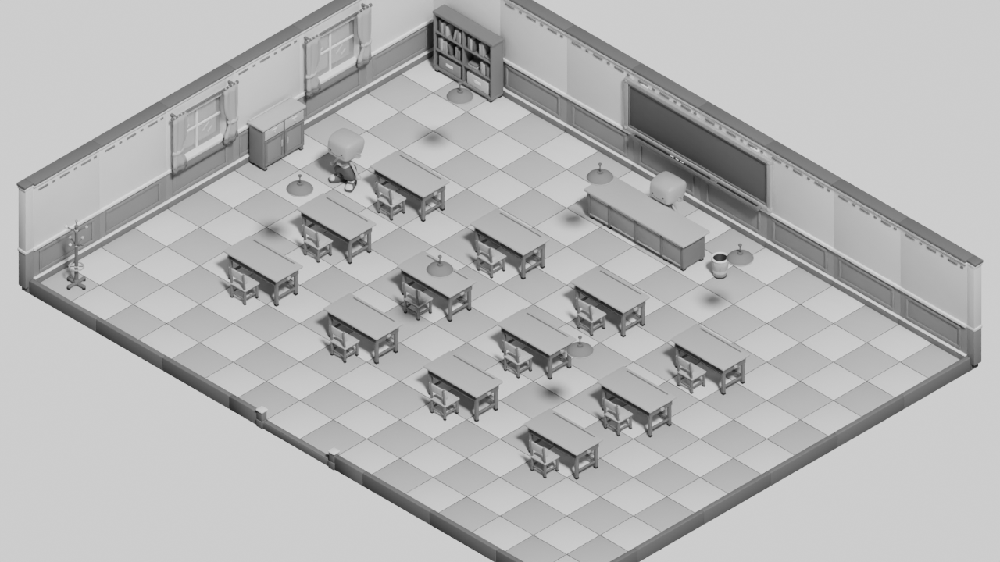
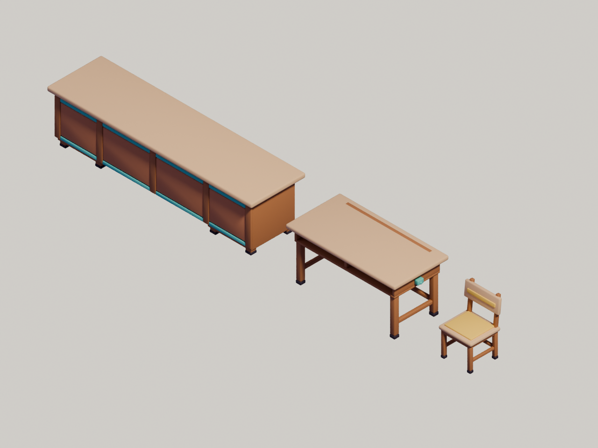
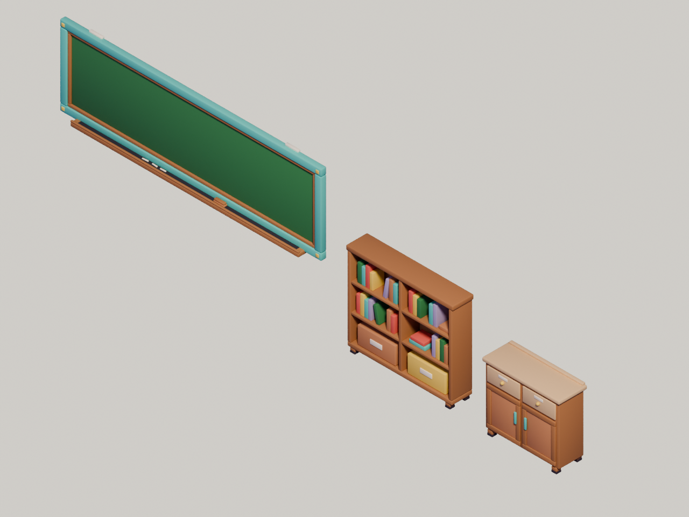
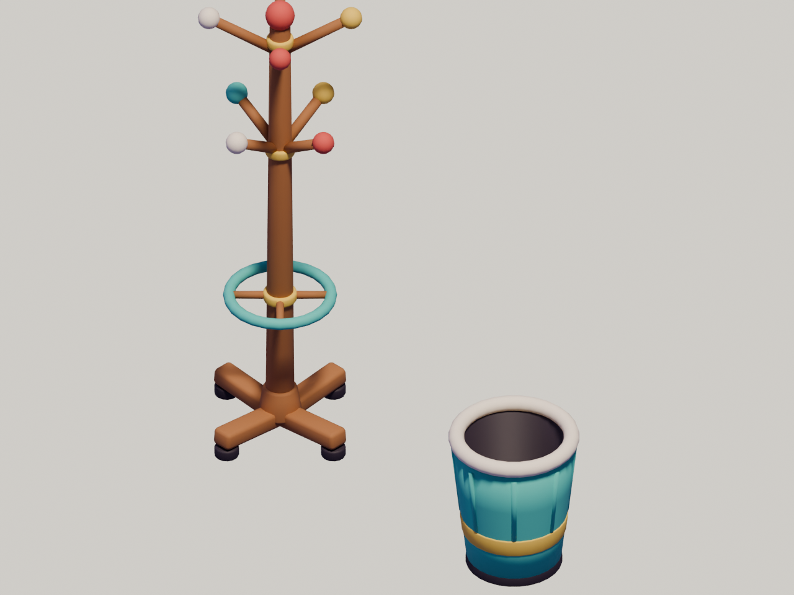

# Classroom Furniture — Modular Kit (8 reusable Section 3 assets)

All eight Section 3 **Furniture** items from the [asset wishlist](asset-wishlist.md) (`Student desk`, `Student chair`, `Teacher desk`, `Board`, `Bookshelf`, `Cabinet`, `Coat rack`, `Trash bin`) are delivered as **origin-centered, grid-snapping modular assets** authored in Blender 5.2.2 LTS under [art direction](../../rules/art-direction.md) and [3D world and camera](../../rules/3d-world-and-camera.md). Every piece shares the classroom shell's warm wood, sand, cream, terracotta, butter, and turquoise palette, rounded beveled silhouettes, and `0.0` metallic matte/satin finish.

> **Scope note:** This slice delivers the `.blend` masters, Draco-compressed `.glb` runtime assets, structural verification tests, and visual renders only; wiring them into `src/features/world/classroom/build-classroom-scene.ts` belongs to a separate integration follow-up.

## Modular Catalog (`8` masters & `8` Draco GLBs)

| Wishlist Item | Module ID       | Master (`.blend`)                                                                               | Runtime GLB (`.glb`)                                                                  |                         Size |       Meshes / Tris | Dimensions / Pivot                                                                        |
| ------------- | --------------- | ----------------------------------------------------------------------------------------------- | ------------------------------------------------------------------------------------- | ---------------------------: | ------------------: | ----------------------------------------------------------------------------------------- |
| Student desk  | `student-desk`  | [student-desk.blend](../../assets/blender/environment/classroom-furniture/student-desk.blend)   | [student-desk.glb](../../public/models/scenes/classroom/furniture/student-desk.glb)   |                   `12,768` B |       `6` / `2,812` | `1.60 × 0.75 × 0.80 m` (`DESK_HEIGHT = 0.75`), floor pivot, twin open cubbies, bag hooks  |
| Student chair | `student-chair` | [student-chair.blend](../../assets/blender/environment/classroom-furniture/student-chair.blend) | [student-chair.glb](../../public/models/scenes/classroom/furniture/student-chair.glb) |                    `9,880` B |       `4` / `2,268` | `0.51 × 0.80 × 0.47 m`, floor pivot facing `+Z`, seat `Y = 0.40 m`, reclined backrest     |
| Teacher desk  | `teacher-desk`  | [teacher-desk.blend](../../assets/blender/environment/classroom-furniture/teacher-desk.blend)   | [teacher-desk.glb](../../public/models/scenes/classroom/furniture/teacher-desk.glb)   |                   `18,536` B |       `6` / `6,372` | `3.00 × 0.75 × 0.80 m`, flat top at `Y = 0.75 m` for Tutor Bot, twin pedestals & drawers  |
| Board         | `board`         | [board.blend](../../assets/blender/environment/classroom-furniture/board.blend)                 | [board.glb](../../public/models/scenes/classroom/furniture/board.glb)                 |                   `12,848` B |       `7` / `2,580` | `4.40 × 1.40 × 0.20 m`, wall-mounted (`Z = 0.0`, `Y ∈ [0.965, 2.368 m]`), chalk & eraser  |
| Bookshelf     | `bookshelf`     | [bookshelf.blend](../../assets/blender/environment/classroom-furniture/bookshelf.blend)         | [bookshelf.glb](../../public/models/scenes/classroom/furniture/bookshelf.glb)         |                   `24,428` B |      `10` / `6,328` | `1.80 × 1.54 × 0.36 m`, floor pivot facing `+Z`, 6 cubbies with books & 2 storage bins    |
| Cabinet       | `cabinet`       | [cabinet.blend](../../assets/blender/environment/classroom-furniture/cabinet.blend)             | [cabinet.glb](../../public/models/scenes/classroom/furniture/cabinet.glb)             |                   `14,744` B |       `7` / `3,420` | `1.30 × 1.14 × 0.51 m`, floor pivot facing `+Z`, twin drawers + framed double doors       |
| Coat rack     | `coat-rack`     | [coat-rack.blend](../../assets/blender/environment/classroom-furniture/coat-rack.blend)         | [coat-rack.glb](../../public/models/scenes/classroom/furniture/coat-rack.glb)         |                   `23,280` B |       `6` / `5,492` | `0.53 × 1.56 × 0.53 m`, floor pivot, 4-leg base, lower bag ring, 8 peg knobs & finial     |
| Trash bin     | `trash-bin`     | [trash-bin.blend](../../assets/blender/environment/classroom-furniture/trash-bin.blend)         | [trash-bin.glb](../../public/models/scenes/classroom/furniture/trash-bin.glb)         |                   `12,132` B |       `4` / `2,296` | `0.40 × 0.48 × 0.40 m`, floor pivot, ribbed turquoise body, rolled rim, hollow dark liner |
| **Total**     | **8 modules**   | **8 masters**                                                                                   | **8 Draco GLBs**                                                                      | **`128,616` B (`125.6` KB)** | **`50` / `31,568`** | **All `8` verified**                                                                      |

- Standalone structural test: [`scripts/assets/test-classroom-furniture.mjs`](../../scripts/assets/test-classroom-furniture.mjs).
- Combined Classroom Shell + Furniture GLB footprint (`pnpm assets:check`): **`191,720` B (`187.2` KB, `2.29%` of the `8 MB` FD8 scene ceiling)** across all `19` environment modules, with `41,280` unique triangles (`20.6%` of the `200k` triangle ceiling; instancing the `12` student desks and `12` chairs stays well inside `<= 200k` triangles and `<= 100` draw calls).

## Visual Previews

### Modular Kit Showcase & Furnished Classroom (`1280px`, Close-up, `360px` Mobile, Grayscale)

| View                                                                                               | Preview                                                                                  |
| -------------------------------------------------------------------------------------------------- | ---------------------------------------------------------------------------------------- |
| All `8` standalone furniture pieces side-by-side (`1280×960`)                                      |       |
| Full `16 m × 12 m` classroom combining `11` shell GLBs + `8` furniture GLBs + avatars (`1280×720`) |             |
| Teaching zone & student-row scale close-up (`1280×720`)                                            |     |
| Portrait mobile readability (`360×640`)                                                            |          |
| Grayscale value-separation check (`1280×720`)                                                      |  |

### Modular Categories (`1280×960`)

| Category                                                          | Preview                                                                                 |
| ----------------------------------------------------------------- | --------------------------------------------------------------------------------------- |
| Desks & seating (`teacher-desk`, `student-desk`, `student-chair`) |      |
| Board & storage (`board`, `bookshelf`, `cabinet`)                 |    |
| Classroom accessories (`coat-rack`, `trash-bin`)                  |  |

## Three.js Modular Assembly Contract

Every GLB uses `1 unit = 1 meter`, `+Y` up, `Y = 0` ground contact (except wall-mounted `board.glb`), applied transforms, and faces `+Z` in local space:

- **Board (`board.glb`)**: Place at `(0, 0, minZ)` (`rotation.y = 0`) on the front `wall-solid` bays (`minZ = -6`). Its back sits flush at `Z = 0` and its frame spans `Y ∈ [0.965, 2.368]`, clearing the shell chair rail (`0.96 m`) below and upper dashed relief (`2.37 m`) above.
- **Teacher desk (`teacher-desk.glb`)**: Place at `(0, 0, -4.4)` (`rotation.y = 0`), matching `CLASSROOM_LAYOUT` obstacle index `0` (`3.0 × 0.8 m`, flat top at `Y = 0.75 m` for the Tutor Bot at `X = +1.0`).
- **Student desks & chairs (`student-desk.glb`, `student-chair.glb`)**: Instance `12` desks at `x ∈ {-4.5, -1.5, 1.5, 4.5}`, `z ∈ {-1.8, 0.4, 2.6}` (`rotation.y = 0`, matching `CLASSROOM_LAYOUT` `1.6 × 0.8 m` footprints and `DESK_HEIGHT = 0.75 m`), and `12` tucked chairs behind each desk at `(x, 0, z + 0.56)` with `rotation.y = Math.PI` facing the board.
- **Storage & accessories**:
  - `bookshelf.glb`: Place at `(-6.7, 0, minZ + 0.25)` (`rotation.y = 0`, matching `propSpecs.shelf` `X = -6.7` while clearing the `0.066 m` wall baseboard).
  - `cabinet.glb`: Place at `(minX + 0.31, 0, -1.0)` (`rotation.y = +Math.PI / 2`), centered on the solid left wall bay between windows (`z = -1.0`), clearing the baseboard.
  - `coat-rack.glb`: Place at `(-7.35, 0, 5.35)` (`rotation.y = 0`) in the front-left entrance corner, clear of the bulletin board and spawn points.
  - `trash-bin.glb`: Place at `(2.05, 0, -4.55)` (`rotation.y = 0`) beside the teacher desk.
- **Lighting & tone mapping**: Follow [the Classroom Shell lighting reference](classroom-shell.md#threejs-lighting--tone-mapping-reference) (`THREE.AgXToneMapping`, warm `#FFF0D8` directional key + cool `#B5A7D6` lavender shadow fill, `castShadow = true` and `receiveShadow = true` on all furniture meshes).

## Palette & Materials

| Material         | Color / Purpose                                                                     | Roughness | Metallic |
| ---------------- | ----------------------------------------------------------------------------------- | --------: | -------: |
| `FurnWood`       | `#AF7B52` desk/chair frames, bookshelf carcass, cabinet carcass, coat-rack pole     |    `0.78` |    `0.0` |
| `FurnWoodLight`  | `#E9C99B` desk tabletops, chair seat & backrest, drawer fronts, cabinet counter     |    `0.80` |    `0.0` |
| `FurnTerracotta` | `#C88D65` modesty panels, cubby backs, framed cabinet doors, eraser felt, cubby bin |    `0.80` |    `0.0` |
| `FurnCreamPale`  | `#FFF9EB` chalk sticks, wall cleats, drawer labels, book pages, trash-bin rim       |    `0.78` |    `0.0` |
| `FurnButter`     | `#F7D86B` desk apron, chair cushion & inlay, drawer knobs, storage bin, bin stripe  |    `0.74` |    `0.0` |
| `FurnTurquoise`  | `#62CFC7` board outer frame, desk hooks, drawer pulls, trash-bin body, book spines  |    `0.72` |    `0.0` |
| `FurnBoardGreen` | `#3E8654` matte chalkboard surface, book spines                                     |    `0.86` |    `0.0` |
| `FurnCoral`      | `#E66861` coat-rack knobs & finial, book spines                                     |    `0.78` |    `0.0` |
| `FurnLavender`   | `#B5A7D6` book spines                                                               |    `0.82` |    `0.0` |
| `FurnSlateDark`  | `#382F3F` furniture foot glides, chalk-tray recess, hollow trash-bin interior       |    `0.62` |    `0.0` |

Rules: [art direction](../../rules/art-direction.md), [3D world and camera](../../rules/3d-world-and-camera.md).
