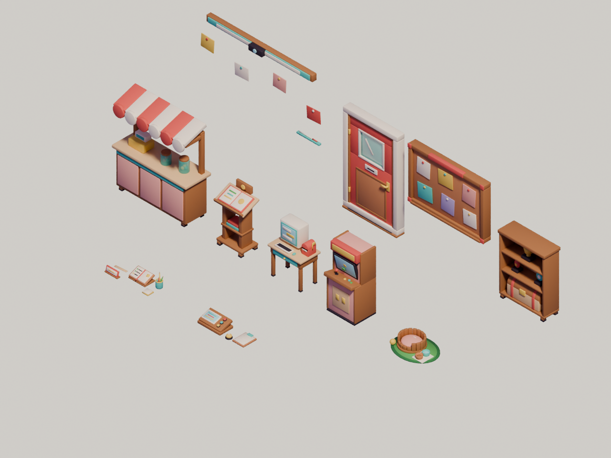
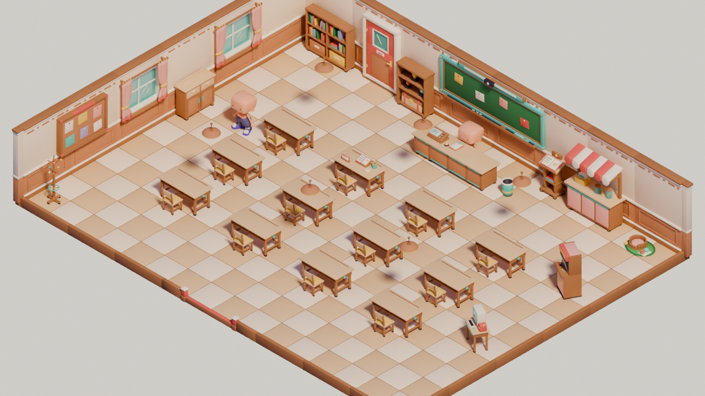
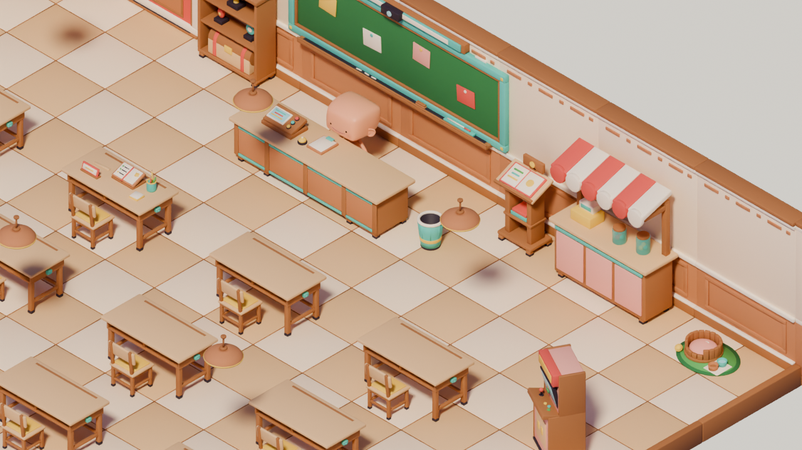
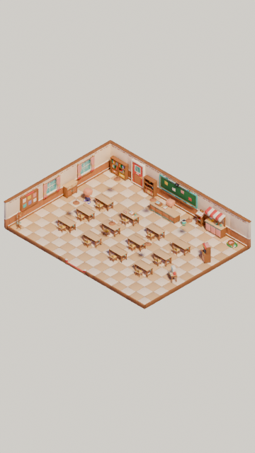
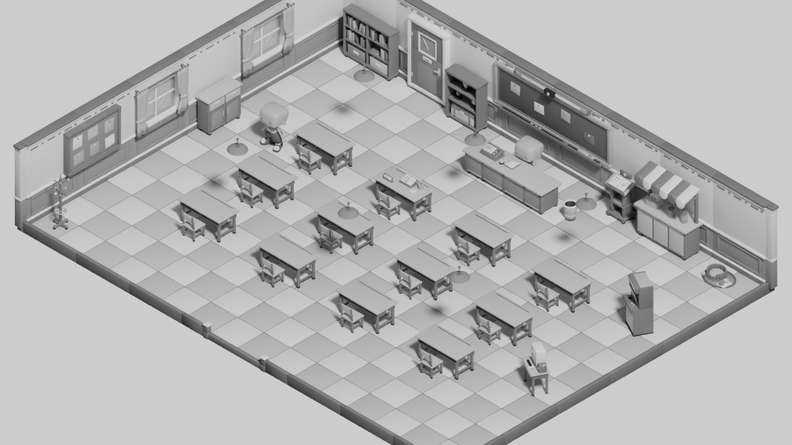
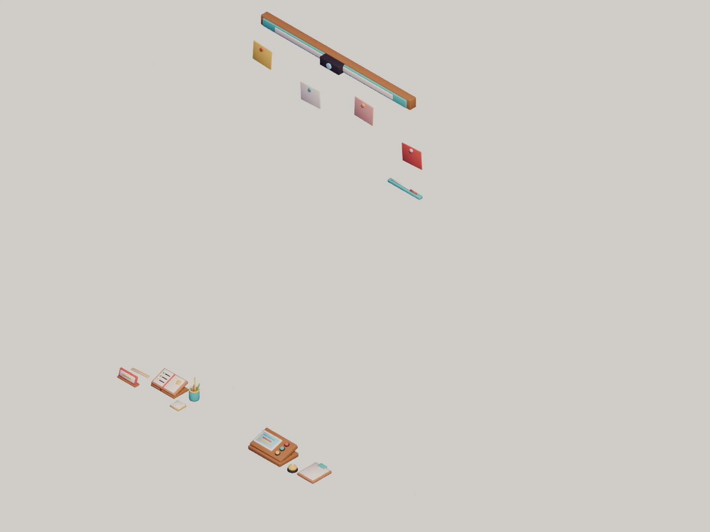
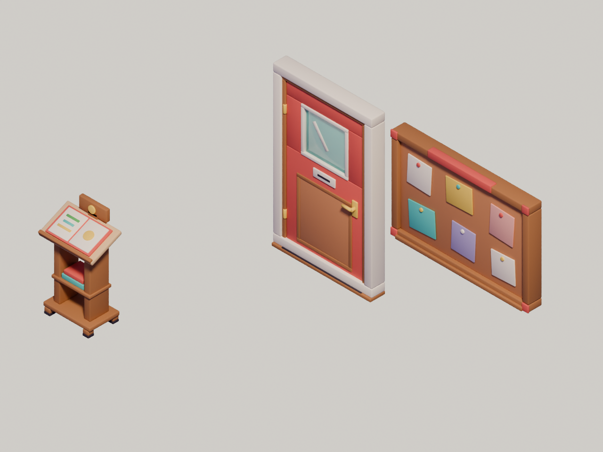
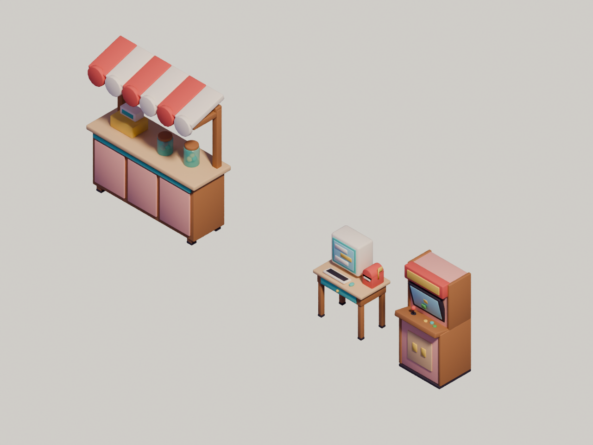
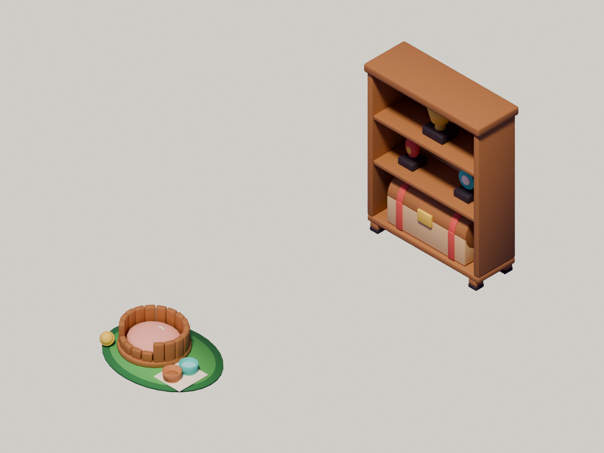

# Classroom Interactive Objects — Modular Kit (11 reusable Section 4 assets)

All eleven Section 4 **Interactive objects** items from the [asset wishlist](asset-wishlist.md) (`Own student desk` through `Trophy shelf / chest`) are delivered as **origin-centered, grid-snapping modular assets** authored in Blender 5.2.2 LTS under [art direction](../../rules/art-direction.md), [3D world and camera](../../rules/3d-world-and-camera.md), and [movement and interactions](../../rules/movement-and-interactions.md). Every piece matches the classroom shell and furniture palette, rounded beveled toy silhouettes, and `0.0` metallic matte/satin finish.

> **Scope note:** This slice delivers the 11 Section 4 interactive `.blend` masters, Draco-compressed `.glb` runtime assets, structural verification tests, and visual renders only. The **Classroom pet (Michi, cat)** subsection remains excluded (`pet-bed.glb` models only the reading/pet corner rug, basket, bowls, and yarn toy), and wiring the assets into `src/features/world/classroom/build-classroom-scene.ts` belongs to a separate integration follow-up.

## Modular Catalog (`11` masters & `11` Draco GLBs)

| Wishlist Item                                  | Module ID               | Master (`.blend`)                                                                                                 | Runtime GLB (`.glb`)                                                                                    |                         Size |       Meshes / Tris | Dimensions / Pivot                                                                           |
| ---------------------------------------------- | ----------------------- | ----------------------------------------------------------------------------------------------------------------- | ------------------------------------------------------------------------------------------------------- | ---------------------------: | ------------------: | -------------------------------------------------------------------------------------------- |
| Own student desk: Pending activities           | `own-student-desk-kit`  | [own-student-desk-kit.blend](../../assets/blender/environment/classroom-interactive/own-student-desk-kit.blend)   | [own-student-desk-kit.glb](../../public/models/scenes/classroom/interactive/own-student-desk-kit.glb)   |                   `16,212` B |       `9` / `2,288` | `1.15 × 0.30 × 0.46 m`, tabletop pivot (`Y = 0` snaps onto `student-desk` `Y = 0.75 m`)      |
| Teacher desk: Classroom controls               | `teacher-desk-controls` | [teacher-desk-controls.blend](../../assets/blender/environment/classroom-interactive/teacher-desk-controls.blend) | [teacher-desk-controls.glb](../../public/models/scenes/classroom/interactive/teacher-desk-controls.glb) |                   `16,664` B |       `8` / `2,752` | `1.18 × 0.21 × 0.41 m`, tabletop pivot (`Y = 0` snaps onto `teacher-desk` `Y = 0.75 m`)      |
| Board: Collaborative tool / announcements      | `board-collaborative`   | [board-collaborative.blend](../../assets/blender/environment/classroom-interactive/board-collaborative.blend)     | [board-collaborative.glb](../../public/models/scenes/classroom/interactive/board-collaborative.glb)     |                   `13,612` B |       `8` / `1,928` | `3.22 × 1.48 × 0.25 m`, wall overlay (`Z = 0`, `Y ∈ [1.03, 2.52 m]`, snaps onto `board.glb`) |
| Door: Move to another classroom                | `door`                  | [door.blend](../../assets/blender/environment/classroom-interactive/door.blend)                                   | [door.glb](../../public/models/scenes/classroom/interactive/door.glb)                                   |                   `15,048` B |       `7` / `3,312` | `1.44 × 2.30 × 0.24 m`, wall-flush floor pivot (`Z = 0`), coral leaf & `BLEND` window        |
| Bulletin board: Forum and notices              | `bulletin-board`        | [bulletin-board.blend](../../assets/blender/environment/classroom-interactive/bulletin-board.blend)               | [bulletin-board.glb](../../public/models/scenes/classroom/interactive/bulletin-board.glb)               |                   `15,608` B |       `8` / `2,820` | `2.01 × 1.34 × 0.23 m`, wall-mounted (`Z = 0`, `Y ∈ [0.99, 2.33 m]`), 6 pinned notes         |
| Report card: Grades                            | `report-card-stand`     | [report-card-stand.blend](../../assets/blender/environment/classroom-interactive/report-card-stand.blend)         | [report-card-stand.glb](../../public/models/scenes/classroom/interactive/report-card-stand.glb)         |                   `15,608` B |       `8` / `2,776` | `0.78 × 1.36 × 0.48 m`, floor pivot, slanted folio lectern with grade bars & seal            |
| Shop kiosk: Shop                               | `shop-kiosk`            | [shop-kiosk.blend](../../assets/blender/environment/classroom-interactive/shop-kiosk.blend)                       | [shop-kiosk.glb](../../public/models/scenes/classroom/interactive/shop-kiosk.glb)                       |                   `27,796` B |       `9` / `6,528` | `1.96 × 2.15 × 0.71 m`, floor pivot, striped scalloped awning, till & `BLEND` jars           |
| Mailbox or computer: Chat                      | `chat-computer`         | [chat-computer.blend](../../assets/blender/environment/classroom-interactive/chat-computer.blend)                 | [chat-computer.glb](../../public/models/scenes/classroom/interactive/chat-computer.glb)                 |                   `16,028` B |       `8` / `2,744` | `0.88 × 1.24 × 0.55 m`, floor pivot, retro chat monitor, keyboard & coral mini-mailbox       |
| Game console / arcade: Minigames               | `arcade-console`        | [arcade-console.blend](../../assets/blender/environment/classroom-interactive/arcade-console.blend)               | [arcade-console.glb](../../public/models/scenes/classroom/interactive/arcade-console.glb)               |                   `16,740` B |       `9` / `2,612` | `0.76 × 1.56 × 0.66 m`, floor pivot, peach/wood cabinet, joystick, buttons & block screen    |
| Pet bed / corner: Pet interaction              | `pet-bed`               | [pet-bed.blend](../../assets/blender/environment/classroom-interactive/pet-bed.blend)                             | [pet-bed.glb](../../public/models/scenes/classroom/interactive/pet-bed.glb)                             |                   `23,436` B |       `9` / `4,504` | `1.04 × 0.23 × 0.80 m`, floor pivot, green rug, basket, cushion, bowls & yarn ball (no pet)  |
| Trophy shelf / chest: Achievements and streaks | `trophy-shelf`          | [trophy-shelf.blend](../../assets/blender/environment/classroom-interactive/trophy-shelf.blend)                   | [trophy-shelf.glb](../../public/models/scenes/classroom/interactive/trophy-shelf.glb)                   |                   `21,976` B |       `8` / `4,896` | `1.24 × 1.54 × 0.44 m`, floor pivot, lower achievement chest & upper trophy/streak awards    |
| **Total**                                      | **11 modules**          | **11 masters**                                                                                                    | **11 Draco GLBs**                                                                                       | **`198,824` B (`194.2` KB)** | **`91` / `37,160`** | **All `11` verified**                                                                        |

- Standalone structural test: [`scripts/assets/test-classroom-interactive.mjs`](../../scripts/assets/test-classroom-interactive.mjs).
- Combined Classroom Shell + Furniture + Interactive GLB footprint (`pnpm assets:check`): **`390,544` B (`381.4` KB, `4.66%` of the `8 MB` FD8 scene ceiling)** across all `30` environment modules, with `78,440` unique triangles (`39.2%` of the `200k` triangle ceiling).

## Visual Previews

### Modular Kit Showcase & Interactive Classroom (`1280px`, Close-up, `360px` Mobile, Grayscale)

| View                                                                                                             | Preview                                                                                                |
| ---------------------------------------------------------------------------------------------------------------- | ------------------------------------------------------------------------------------------------------ |
| All `11` standalone interactive pieces side-by-side (`1280×960`)                                                 |                 |
| Full `16 m × 12 m` classroom combining `11` shell + `8` furniture + `11` interactive GLBs + avatars (`1280×720`) |             |
| Teaching zone, student desk kit, report card & shop corner close-up (`1280×720`)                                 |     |
| Portrait mobile readability (`360×640`)                                                                          |          |
| Grayscale value-separation check (`1280×720`)                                                                    |  |

### Modular Categories (`1280×960`)

| Category                                                                                   | Preview                                                                                       |
| ------------------------------------------------------------------------------------------ | --------------------------------------------------------------------------------------------- |
| Desk & board kits (`own-student-desk-kit`, `teacher-desk-controls`, `board-collaborative`) |    |
| Entrance, notices & grades (`door`, `bulletin-board`, `report-card-stand`)                 |  |
| Shop, chat & minigames (`shop-kiosk`, `chat-computer`, `arcade-console`)                   |  |
| Pet corner & achievements (`pet-bed`, `trophy-shelf`)                                      |  |

## Three.js Modular Assembly Contract

Every GLB uses `1 unit = 1 meter`, `+Y` up, applied identity transforms, and faces `+Z` in local space:

- **Tabletop & board overlays (modular attachment on Section 3 furniture)**:
  - `own-student-desk-kit.glb`: Mount at `(desk.centerX, 0.75, desk.centerZ)` (`rotation.y = 0`) on the active student's assigned `student-desk.glb` (`DESK_HEIGHT = 0.75 m`).
  - `teacher-desk-controls.glb`: Mount at `(-0.48, 0.75, -4.40)` (`rotation.y = 0`) on `teacher-desk.glb`, leaving `X = +1.0` clear for the Tutor Bot.
  - `board-collaborative.glb`: Mount at `(0, 0, minZ)` (`rotation.y = 0`) on the exact same origin as `board.glb`; cards sit `>= 3 mm` proud of the green writing face, header cleats span `X ∈ [-1.40, +1.40]` between `board.glb` mounting cleats (`±1.65`), and the stylus dock sits at `X ∈ [1.02, 1.62]` clear of chalk and eraser.
- **Wall-mounted stations (`Z = 0` flush)**:
  - `door.glb`: Place at `(-4.65, 0, minZ)` (`rotation.y = 0`) on the front-left solid wall bay between `bookshelf.glb` and `trophy-shelf.glb`.
  - `bulletin-board.glb`: Place at `(minX, 0, 3.60)` (`rotation.y = +Math.PI / 2`) on the solid left wall bay near the entrance, clear of window bays and `coat-rack.glb`.
- **Floor-grounded stations (`Y = 0` contact)**:
  - `trophy-shelf.glb`: Place at `(-3.05, 0, minZ + 0.28)` (`rotation.y = 0`).
  - `report-card-stand.glb`: Place at `(2.95, 0, minZ + 0.44)` (`rotation.y = 0`).
  - `shop-kiosk.glb`: Place at `(4.75, 0, minZ + 0.44)` (`rotation.y = 0`).
  - `pet-bed.glb`: Place at `(6.85, 0, minZ + 0.62)` (`rotation.y = 0`) in the front-right reading/pet corner.
  - `arcade-console.glb`: Place at `(6.95, 0, -2.25)` (`rotation.y = Math.PI / 6` / angled toward isometric camera).
  - `chat-computer.glb`: Place at `(6.95, 0, 1.65)` (`rotation.y = Math.PI / 6` / angled toward isometric camera).
- **Lighting & shadow flags**: Follow [the Classroom Shell lighting reference](classroom-shell.md#threejs-lighting--tone-mapping-reference) (`THREE.AgXToneMapping`, warm `#FFF0D8` key + cool `#B5A7D6` shadow fill). Set `castShadow = true` and `receiveShadow = true` on opaque meshes, and `castShadow = false` on translucent `IntGlassTeal` (`BLEND`) meshes (`door` window & `shop-kiosk` display jars).

## Palette & Materials

| Material        | Color / Purpose                                                       | Roughness | Metallic | Alpha   |
| --------------- | --------------------------------------------------------------------- | --------: | -------: | ------- |
| `IntWood`       | `#AF7B52` stands, frames, kiosk carcass, trophy chest lid & basket    |    `0.78` |    `0.0` | `1.0`   |
| `IntWoodLight`  | `#E9C99B` counter/desk tops, lectern deck, coin door, trophy chest    |    `0.80` |    `0.0` | `1.0`   |
| `IntTerracotta` | `#C88D65` bulletin cork, door lower panel, folders, food bowl         |    `0.80` |    `0.0` | `1.0`   |
| `IntCreamPale`  | `#FFF9EB` door frame, monitor shell, awning stripes, checklist pages  |    `0.78` |    `0.0` | `1.0`   |
| `IntButter`     | `#F7D86B` gold trophy, seals, marquee, register, bell, yarn toy       |    `0.72` |    `0.0` | `1.0`   |
| `IntCoral`      | `#E66861` door leaf, awning stripes, mailbox, joystick, freeze button |    `0.76` |    `0.0` | `1.0`   |
| `IntPeach`      | `#F5B5AB` shop panels, arcade cabinet body, pet cushion, notes        |    `0.82` |    `0.0` | `1.0`   |
| `IntTurquoise`  | `#62CFC7` pencil cup, board header, stylus dock, water bowl, buttons  |    `0.72` |    `0.0` | `1.0`   |
| `IntSkyBlue`    | `#A9E7F4` chat/arcade/tablet screens, projector lens, bowl water      |    `0.38` |    `0.0` | `1.0`   |
| `IntLeafGreen`  | `#65B96A` pet corner rug, grade/checklist indicators, arcade button   |    `0.84` |    `0.0` | `1.0`   |
| `IntDeepGreen`  | `#3E8654` pet corner outer rug trim                                   |    `0.86` |    `0.0` | `1.0`   |
| `IntLavender`   | `#B5A7D6` bulletin board pinned note accent                           |    `0.80` |    `0.0` | `1.0`   |
| `IntSlateDark`  | `#382F3F` glides, bases, screen bezels, ink lines, kick plate         |    `0.62` |    `0.0` | `1.0`   |
| `IntGlassTeal`  | `#62CFC7` (`α = 0.54`) door glass window & shop display jars          |    `0.14` |    `0.0` | `BLEND` |

Rules: [art direction](../../rules/art-direction.md), [3D world and camera](../../rules/3d-world-and-camera.md), [movement and interactions](../../rules/movement-and-interactions.md).
