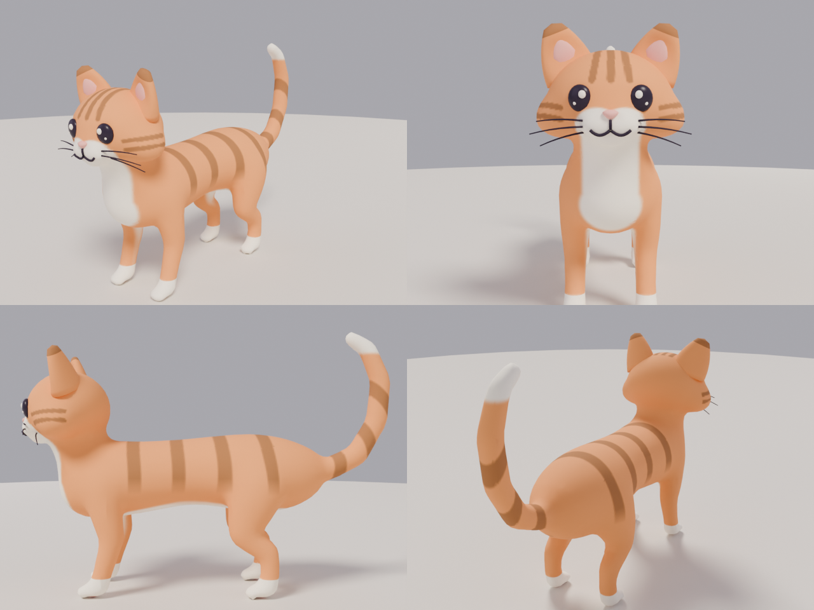
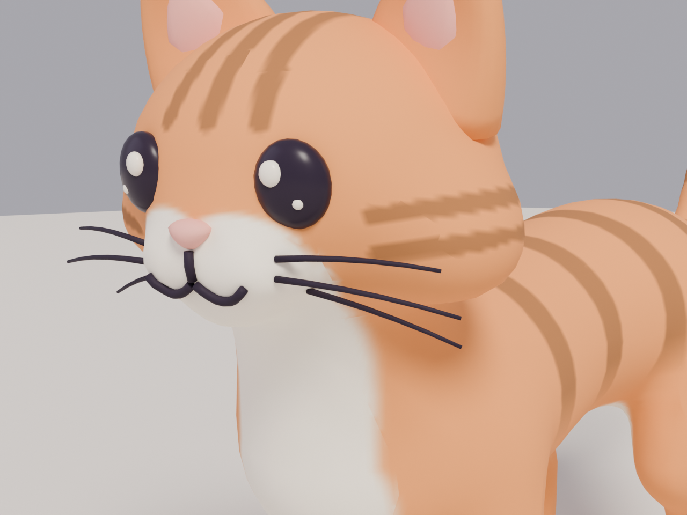
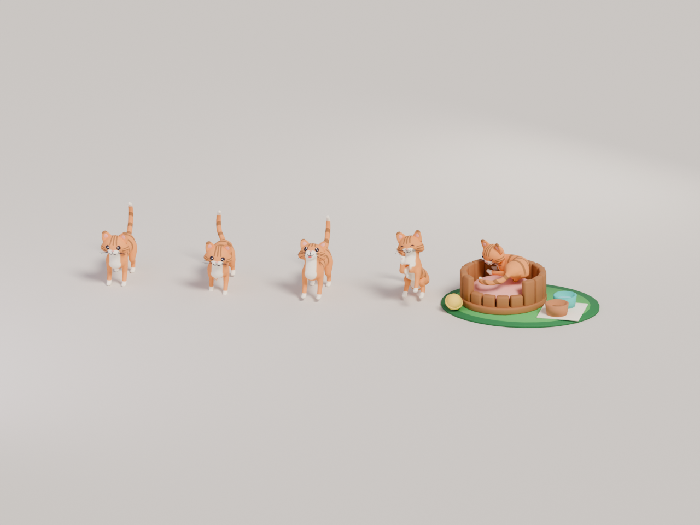
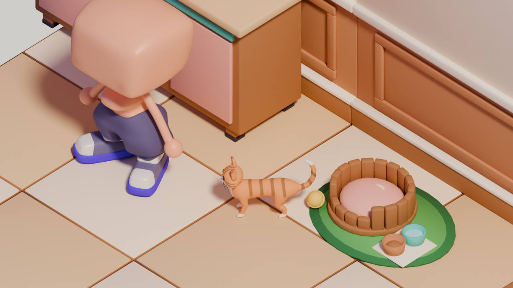
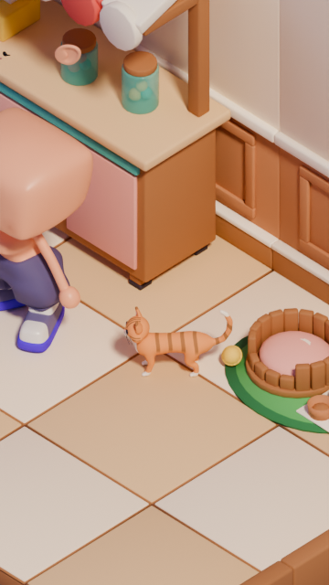
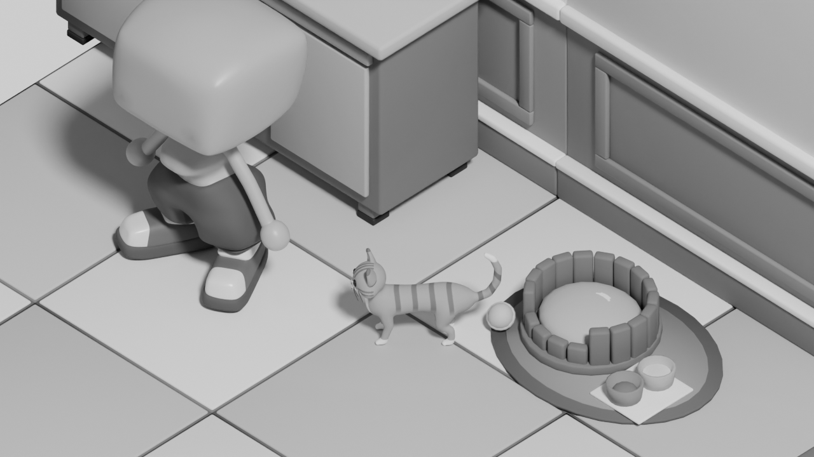

# Classroom Pet ("Michi", Cat) — Modular Base Model

Base 3D model for the Section 4 **Classroom pet (`Pet model`)** item from the [asset wishlist](asset-wishlist.md), authored in Blender 5.2.2 LTS under [art direction](../../rules/art-direction.md), [3D world and camera](../../rules/3d-world-and-camera.md), and [points, streak, shop, pet, and medals](../../rules/points-and-shop.md). Following the modular character pattern in [modular avatar assets](../../rules/modular-avatar-assets.md), Michi is split into `12` semantic `Pet_*` sub-meshes bound to a clean `30`-bone quadruped skeleton (`PetCatRig`) with `4` facial morph targets (`EyesClosed`, `EyesHappy`, `Meow`, `Happy`), ready for the upcoming animations (`Sleep`, `Walk`, `Meow`, `AskForPets`) and pet accessories (`scarf`, `hat`, `bow`, `collar`).

> **Scope note:** This slice delivers only the base **`Pet model`** `.blend` master, Draco-compressed `.glb` runtime asset, structural verification test, and visual renders on `feat/interactive-objects-assets`, checking off `Pet model` in [the asset wishlist](asset-wishlist.md) without modifying `src/`, `e2e/`, or any existing interactive/decoration GLBs. Animation clips and pet accessories belong to the next slices, and runtime wiring in `src/features/world/classroom/build-classroom-scene.ts` belongs to a separate integration follow-up.

## Asset Summary

| Asset               | Path                                                   |                     Size |   Meshes / Tris | Skeleton / Morphs                                             | Dimensions / Pivot                                                                                                      |
| ------------------- | ------------------------------------------------------ | -----------------------: | --------------: | ------------------------------------------------------------- | ----------------------------------------------------------------------------------------------------------------------- |
| Blender master      | [body.blend](../../assets/blender/pets/cat/body.blend) |              `579,039` B | `12` / `12,276` | `PetCatRig` (`30` bones) + `4` shape keys                     | `0.193 × 0.426 × 0.606 m`, rest stand, `Y = 0` grounded paws, facing `+Z` in glTF (`-Y` in Blender), origin `(0, 0, 0)` |
| Runtime GLB (Draco) | [body.glb](../../public/models/pets/cat/body.glb)      | `220,764` B (`215.6` KB) | `12` / `12,276` | `30` joints (`1..4` weights/vert, `0` unweighted), `4` morphs | `21.1%` of the `1 MB` (`1,048,576` B) FD8 avatar/character budget; `0` animations, `0` lights, `0` cameras              |

- Standalone structural test: [`scripts/assets/test-classroom-pet.mjs`](../../scripts/assets/test-classroom-pet.mjs).
- Coat authoring pass: sculpted organically via continuous Metaball fusion, smoothing, decimation, custom-normal preservation across semantic splits, and a packed `512×512` `PetCoat_Albedo` UV coat texture on `PetCoatPrimary`.

## Semantic Sub-Meshes (`12` `Pet_*` objects)

Splitting Michi into semantic regions preserves clean seam continuity during deformation while allowing future accessories (such as collars, scarves, or hats) to layer or anchor cleanly without modifying base geometry:

| Sub-mesh        | Region covered                                                                      | Materials                                             | Morph targets             |
| --------------- | ----------------------------------------------------------------------------------- | ----------------------------------------------------- | ------------------------- |
| `Pet_Head`      | Organic cranium, cheek tufts, cream muzzle pads, chin, forehead & cheek stripes     | `PetCoatPrimary` (`PetCoat_Albedo` UV coat)           | —                         |
| `Pet_Ears`      | Paired rounded-triangle ears with brown tabby tips & recessed pink inner hollows    | `PetCoatPrimary`, `PetInnerEarNose`, `PetCoatMarking` | —                         |
| `Pet_Eyes`      | Expressive slate-dark oval eyes + twin cream catchlight dots                        | `PetEye`, `PetEyeHighlight`                           | `EyesClosed`, `EyesHappy` |
| `Pet_Nose`      | Soft rounded-triangle feline button nose                                            | `PetInnerEarNose`                                     | —                         |
| `Pet_Mouth`     | Cozy `:3` cat smile stroke + tucked coral inner mouth/tongue                        | `PetFaceLine`, `PetMouthInterior`                     | `Meow`, `Happy`           |
| `Pet_Whiskers`  | 3 gently tapered whiskers per cheek                                                 | `PetFaceLine`                                         | —                         |
| `Pet_Neck`      | Continuous collar-ready neck & cream throat ruff                                    | `PetCoatPrimary` (`PetCoat_Albedo` UV coat)           | —                         |
| `Pet_Torso`     | Sculpted ribcage, waist taper, rounded haunches, cream chest bib/belly & tabby back | `PetCoatPrimary` (`PetCoat_Albedo` UV coat)           | —                         |
| `Pet_FrontLegs` | Paired shoulders, upper arms, forearms                                              | `PetCoatPrimary` (`PetCoat_Albedo` UV coat)           | —                         |
| `Pet_HindLegs`  | Paired feline thighs/haunches, knees, angled hocks & ankles                         | `PetCoatPrimary` (`PetCoat_Albedo` UV coat)           | —                         |
| `Pet_Paws`      | 4 flat-grounded cream paw mittens (`Y = 0`), toe lobes & pink toe beans             | `PetCoatSecondary`, `PetInnerEarNose`                 | —                         |
| `Pet_Tail`      | Joyful S/J-curved tail with 3 tabby rings & cream tip                               | `PetCoatPrimary` (`PetCoat_Albedo` UV coat)           | —                         |

## Canonical 30-Bone Skeleton (`PetCatRig`) & Accessory Anchors

Every bone transform is exported in the clean rest stand pose (`Y = 0` paw contact, `+Z` forward in glTF). Adjacent mesh boundaries share smooth analytical blends so seams stay watertight across `Walk`, `Meow`, `AskForPets`, and curled `Sleep` poses:

| Region            | Bones (`PetCatRig`, 30 total)                                                                                               | Primary use & upcoming accessory anchor                                              |
| ----------------- | --------------------------------------------------------------------------------------------------------------------------- | ------------------------------------------------------------------------------------ |
| Root & pelvis     | `DEF-root` → `DEF-pelvis`                                                                                                   | World root anchor and hip/rump center                                                |
| Spine & chest     | `DEF-spine` → `DEF-spine.001` → `DEF-spine.002`                                                                             | Torso flexion/curling (`Sleep`, `AskForPets`); `DEF-spine.002` anchors `scarf` drape |
| Neck & head       | `DEF-neck` → `DEF-head`                                                                                                     | `DEF-neck` anchors `collar` & `scarf` wrap; `DEF-head` anchors `hat` & `bow`         |
| Face & ears       | `DEF-ear.L`, `DEF-ear.R`, `DEF-jaw` (children of `DEF-head`)                                                                | Ear twitches and mouth/chin drop for `Meow`                                          |
| Tail              | `DEF-tail.001` → `DEF-tail.002` → `DEF-tail.003` → `DEF-tail.004` (child of `DEF-pelvis`)                                   | Expressive tail sway, high curl (`Meow`), and flank wrap (`Sleep`)                   |
| Front limbs (L/R) | `DEF-shoulder.{L,R}` → `DEF-front_upper.{L,R}` → `DEF-front_lower.{L,R}` → `DEF-front_paw.{L,R}` (child of `DEF-spine.002`) | Diagonal stride (`Walk`), paw lift (`AskForPets`), tucked paws (`Sleep`)             |
| Hind limbs (L/R)  | `DEF-hind_thigh.{L,R}` → `DEF-hind_shin.{L,R}` → `DEF-hind_hock.{L,R}` → `DEF-hind_paw.{L,R}` (child of `DEF-pelvis`)       | Natural feline hock flexion for `Walk`, seated `AskForPets`, and curled `Sleep`      |

## Facial Morph Targets

| Target mesh | Shape key    | Rest (`0.0`) | Active (`1.0`) behavior                                                            | Intended animations    |
| ----------- | ------------ | -----------: | ---------------------------------------------------------------------------------- | ---------------------- |
| `Pet_Eyes`  | `EyesClosed` |        `0.0` | Smooth downward sleeping crescent arcs (`∪ ∪`), catchlights tucked cleanly inside  | `Sleep`, idle blink    |
| `Pet_Eyes`  | `EyesHappy`  |        `0.0` | Smooth upward smiling crescent arcs (`∩ ∩`), catchlights tucked cleanly inside     | `AskForPets`, greeting |
| `Pet_Mouth` | `Meow`       |        `0.0` | Opens lower `:3` mouth curves downward and brings coral `PetMouthInterior` forward | `Meow`                 |
| `Pet_Mouth` | `Happy`      |        `0.0` | Lifts outer corners of `:3` smile subtly upward                                    | `AskForPets`, greeting |

## Visual Previews

| View                                                                                    | Preview                                                                              |
| --------------------------------------------------------------------------------------- | ------------------------------------------------------------------------------------ |
| 2×2 studio turnaround (`3/4`, `front`, `side`, `rear/top`, `1280×960`)                  |       |
| Face, ears, whiskers, chest bib & paws close-up (`1280×960`)                            |  |
| 5-pose rig stress test (`Rest`, `Walk`, `Meow`, `AskForPets`, `Sleep` on `pet-bed.glb`) |         |
| Classroom pet corner scale check beside `pet-bed.glb` & student avatar (`1280×720`)     |       |
| Portrait mobile readability check (`360×640`)                                           |        |
| Grayscale value-separation check (`1280×720`)                                           |         |

## Palette & Materials

| Material           | Color / Purpose                                                 | Roughness | Metallic |
| ------------------ | --------------------------------------------------------------- | --------: | -------: |
| `PetCoatPrimary`   | `#F2A66B` warm ginger-apricot coat                              |    `0.84` |    `0.0` |
| `PetCoatSecondary` | `#FFF9EB` pale cream muzzle, throat, chest bib, belly & mittens |    `0.84` |    `0.0` |
| `PetCoatMarking`   | `#AF7B52` wood brown tabby forehead, cheek, back & tail bands   |    `0.86` |    `0.0` |
| `PetInnerEarNose`  | `#F5B5AB` peach pink inner ear hollows, nose & paw toe beans    |    `0.80` |    `0.0` |
| `PetEye`           | `#382F3F` slate dark expressive eyes                            |    `0.30` |    `0.0` |
| `PetEyeHighlight`  | `#FFF9EB` pale cream eye catchlights                            |    `0.25` |    `0.0` |
| `PetFaceLine`      | `#382F3F` slate dark `:3` smile & whiskers                      |    `0.65` |    `0.0` |
| `PetMouthInterior` | `#E66861` coral red inner mouth/tongue (`Meow`)                 |    `0.72` |    `0.0` |

## Three.js Integration Contract

- **Transform & scale**: `1 unit = 1 meter`, `+Y` up, standing paws grounded at `Y = 0.0`, facing `+Z`, identity root transforms.
- **Pet corner placement**: Pair beside or on `pet-bed.glb` (`(6.85, 0, minZ + 0.62)` in `PetBed` coordinates; cushion top sits at `Y = 0.170 m` at local offset `(-0.12, 0.17, -0.02)` for curled `Sleep` posing).
- **Rendering & shadows**: Follow [the Classroom Shell lighting reference](classroom-shell.md#threejs-lighting--tone-mapping-reference) (`THREE.AgXToneMapping`, warm `#FFF0D8` key + cool `#B5A7D6` shadow fill) with `castShadow = true` and `receiveShadow = true` on all `12` `Pet_*` meshes.
- **Distinctness from Tutor Bot**: Keep `classroom-pet` visually and functionally distinct from the Section 5 Tutor Bot per [points and shop](../../rules/points-and-shop.md) and [3D world and camera](../../rules/3d-world-and-camera.md).

Rules: [art direction](../../rules/art-direction.md), [3D world and camera](../../rules/3d-world-and-camera.md), [points and shop](../../rules/points-and-shop.md), [modular avatar assets](../../rules/modular-avatar-assets.md).
