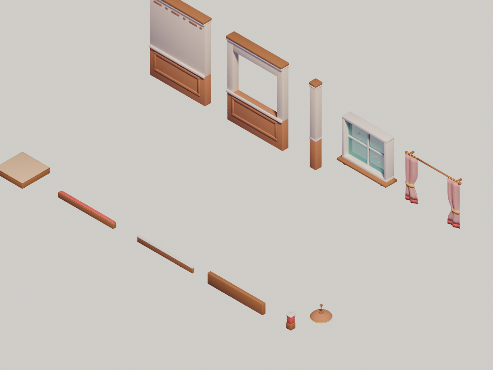
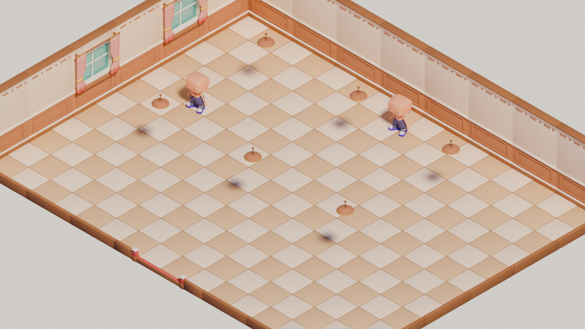
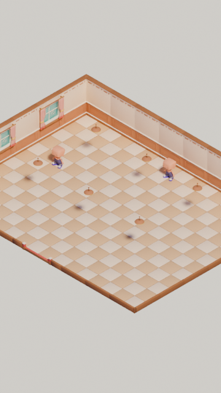
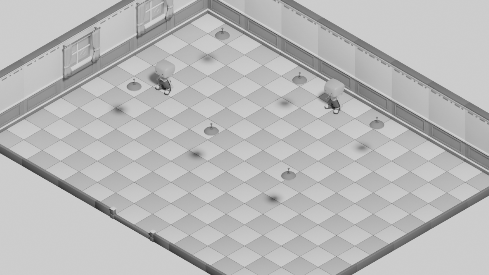
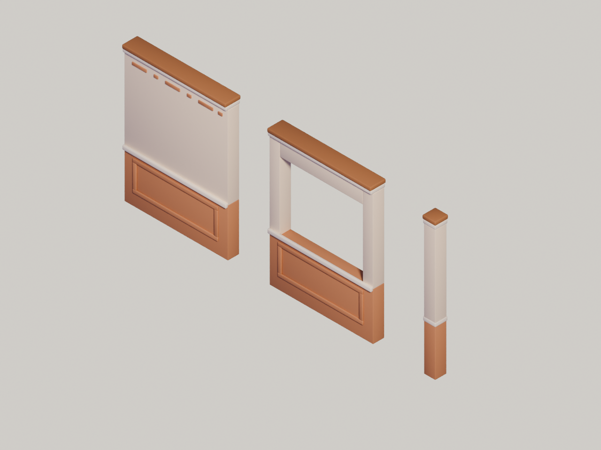
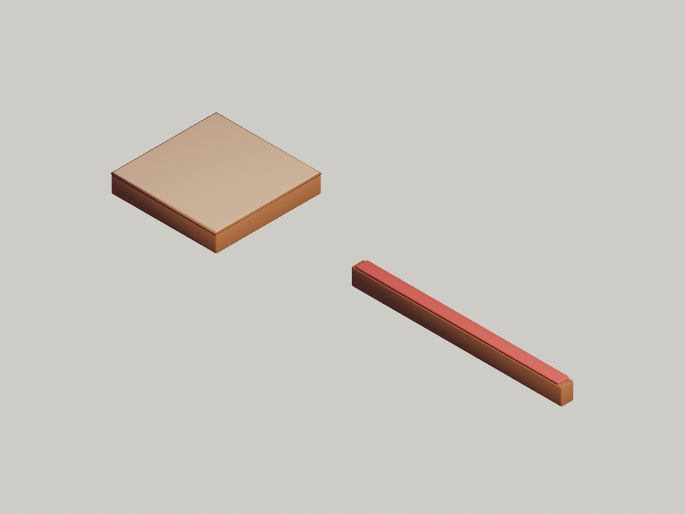
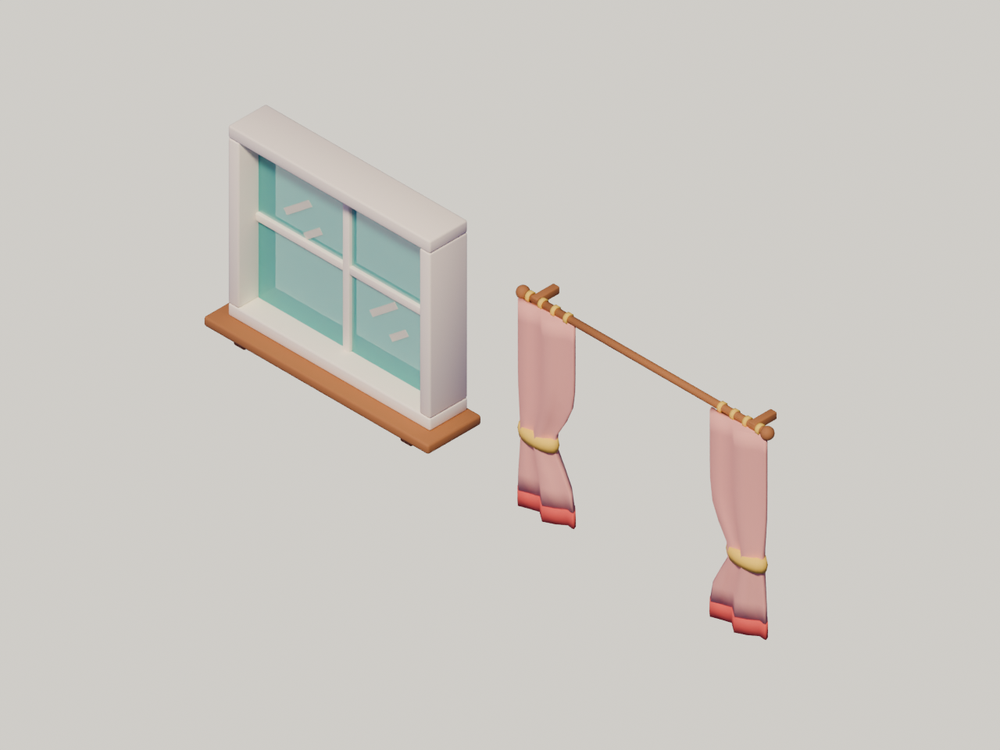
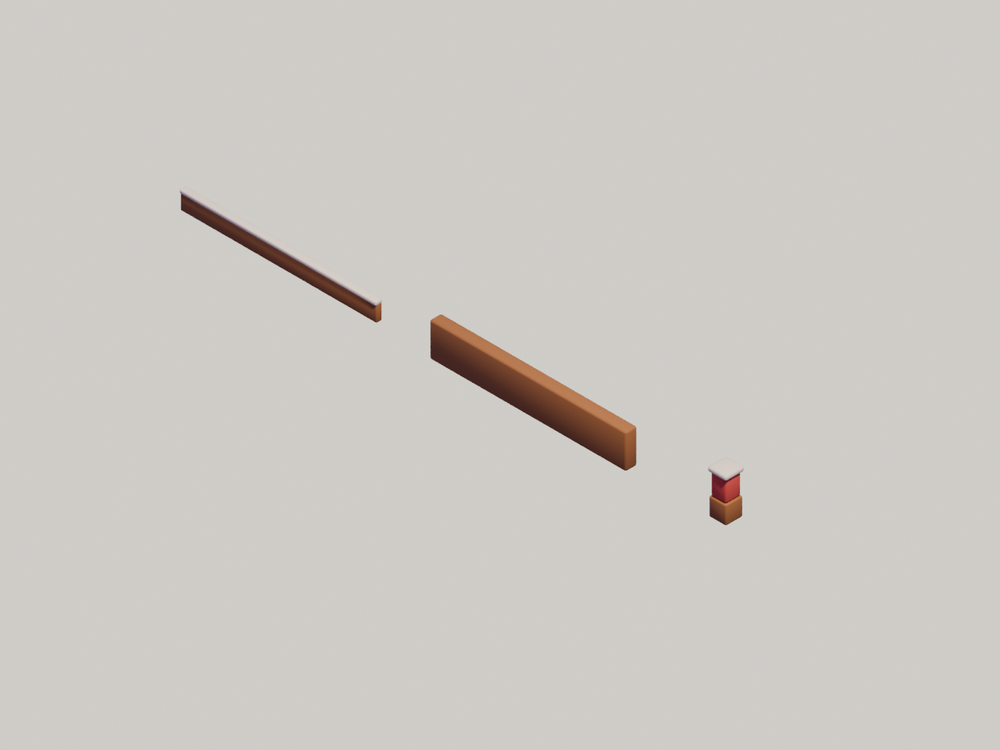
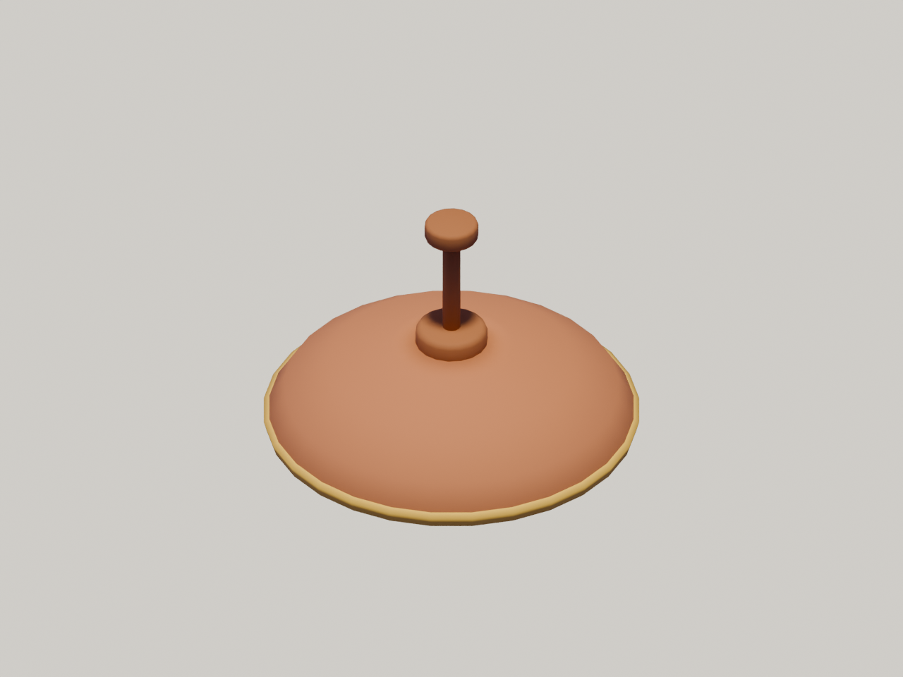

# Classroom Shell — Modular Kit (11 reusable assets covering 5 active wishlist items)

Five active Section 3 **Classroom shell** items from the [asset wishlist](asset-wishlist.md) (`Walls`, `Floor`, `Windows with curtains`, `Baseboards`, `Ceiling lights`) are delivered as **11 origin-centered, grid-snapping modular assets** authored in Blender 5.2.2 LTS under [art direction](../../rules/art-direction.md) and [3D world and camera](../../rules/3d-world-and-camera.md). Per visual review, `Ceiling` (soffit overhang and wooden light beams) was intentionally omitted so nothing obscures avatars from the elevated isometric camera; instead, walls terminate in a finished wood coping + stepped crown molding border, and pendant lamps hang cleanly on slim individual cords.

> **Scope note:** This slice delivers the `.blend` masters, Draco-compressed `.glb` runtime assets, structural verification tests, and visual renders only; wiring them into `src/features/world/classroom/build-classroom-scene.ts` belongs to a separate integration follow-up.

## Modular Catalog (`11` masters & `11` Draco GLBs)

| Wishlist Item         | Module ID                | Master (`.blend`)                                                                                             | Runtime GLB (`.glb`)                                                                                |                       Size |      Meshes / Tris | Grid / Pivot                                                                   |
| --------------------- | ------------------------ | ------------------------------------------------------------------------------------------------------------- | --------------------------------------------------------------------------------------------------- | -------------------------: | -----------------: | ------------------------------------------------------------------------------ |
| Walls                 | `wall-solid`             | [wall-solid.blend](../../assets/blender/environment/classroom-shell/wall-solid.blend)                         | [wall-solid.glb](../../public/models/scenes/classroom/shell/wall-solid.glb)                         |                  `7,460` B |      `4` / `1,620` | `2.0 × 2.65 × 0.22 m`, wood top coping + crown molding + terracotta relief     |
| Walls                 | `wall-window`            | [wall-window.blend](../../assets/blender/environment/classroom-shell/wall-window.blend)                       | [wall-window.glb](../../public/models/scenes/classroom/shell/wall-window.glb)                       |                  `6,888` B |      `4` / `1,188` | `2.0 × 2.65 × 0.22 m` (`1.60 × 1.32 m` open cutout) + matching wood top coping |
| Walls                 | `wall-corner`            | [wall-corner.blend](../../assets/blender/environment/classroom-shell/wall-corner.blend)                       | [wall-corner.glb](../../public/models/scenes/classroom/shell/wall-corner.glb)                       |                  `5,436` B |        `4` / `540` | `0.22 × 2.65 × 0.22 m` finished L-corner & cutaway end-cap                     |
| Floor                 | `floor-tile`             | [floor-tile.blend](../../assets/blender/environment/classroom-shell/floor-tile.blend)                         | [floor-tile.glb](../../public/models/scenes/classroom/shell/floor-tile.glb)                         |                  `3,384` B |        `3` / `228` | `1.0 × 1.0 m`, walkable top `Y = 0.0`, wood grout & plinth (`Y = -0.18`)       |
| Floor                 | `floor-threshold`        | [floor-threshold.blend](../../assets/blender/environment/classroom-shell/floor-threshold.blend)               | [floor-threshold.glb](../../public/models/scenes/classroom/shell/floor-threshold.glb)               |                  `2,772` B |        `2` / `216` | `2.0 m` coral doorway threshold + wood plinth                                  |
| Windows with curtains | `window`                 | [window.blend](../../assets/blender/environment/classroom-shell/window.blend)                                 | [window.glb](../../public/models/scenes/classroom/shell/window.glb)                                 |                  `7,220` B |      `4` / `1,140` | Snaps to `wall-window` (`1.60 × 1.32 m`, sill corbels, `BLEND` glass)          |
| Windows with curtains | `window-curtains`        | [window-curtains.blend](../../assets/blender/environment/classroom-shell/window-curtains.blend)               | [window-curtains.glb](../../public/models/scenes/classroom/shell/window-curtains.glb)               |                 `11,496` B |      `4` / `2,476` | Snaps independently to `wall-window` (`Z = +0.15 m`, coral hem + tiebacks)     |
| Baseboards            | `baseboard-wall`         | [baseboard-wall.blend](../../assets/blender/environment/classroom-shell/baseboard-wall.blend)                 | [baseboard-wall.glb](../../public/models/scenes/classroom/shell/baseboard-wall.glb)                 |                  `2,688` B |        `2` / `216` | `2.0 × 0.19 m`, wood body + pale cream trim, snaps to walls                    |
| Baseboards            | `baseboard-cutaway`      | [baseboard-cutaway.blend](../../assets/blender/environment/classroom-shell/baseboard-cutaway.blend)           | [baseboard-cutaway.glb](../../public/models/scenes/classroom/shell/baseboard-cutaway.glb)           |                  `1,584` B |        `1` / `108` | `2.0 m` cutaway skirting (`Y ∈ [-0.18, +0.17 m]`)                              |
| Baseboards            | `baseboard-doorway-post` | [baseboard-doorway-post.blend](../../assets/blender/environment/classroom-shell/baseboard-doorway-post.blend) | [baseboard-doorway-post.glb](../../public/models/scenes/classroom/shell/baseboard-doorway-post.glb) |                  `4,172` B |        `3` / `324` | `0.19 × 0.445 × 0.19 m` (wood base + coral post + pale cream cap)              |
| Ceiling lights        | `ceiling-light`          | [ceiling-light.blend](../../assets/blender/environment/classroom-shell/ceiling-light.blend)                   | [ceiling-light.glb](../../public/models/scenes/classroom/shell/ceiling-light.glb)                   |                 `10,004` B |      `4` / `1,656` | Standalone hanging pendant (pivot `Y = 0.0..-0.445 m`, terracotta + butter)    |
| **Total**             | **11 modules**           | **11 masters**                                                                                                | **11 Draco GLBs**                                                                                   | **`63,104` B (`61.6` KB)** | **`35` / `9,712`** | **All `11` verified**                                                          |

- Standalone structural test: [`scripts/assets/test-classroom-shell.mjs`](../../scripts/assets/test-classroom-shell.mjs).
- Scene budget compliance (`pnpm assets:check`): **`61.6 KB` total (`0.75%` of the `8 MB` FD8 scene ceiling)** and **`9,712` unique triangles** (`4.9%` of the `200k` triangle ceiling; instancing `192` `floor-tile` blocks + wall bays in the `16 × 12 m` classroom stays well within `<= 200k` triangles and `<= 100` draw calls).

## Visual Previews

### Modular Kit Showcase & Assembled Room (`1280px`, `360px` Mobile, Grayscale)

| View                                                                                              | Preview                                                                             |
| ------------------------------------------------------------------------------------------------- | ----------------------------------------------------------------------------------- |
| All `11` standalone modular pieces side-by-side (`1280×960`)                                      |                |
| Full `16 m × 12 m` room assembled exclusively from the `11` GLBs + reference avatars (`1280×720`) |                      |
| Portrait mobile readability (`360×640`)                                                           |          |
| Grayscale value-separation check (`1280×720`)                                                     |  |

### Modular Categories (`1280×960`)

| Category                                                                     | Preview                                                                                         |
| ---------------------------------------------------------------------------- | ----------------------------------------------------------------------------------------------- |
| Walls (`wall-solid`, `wall-window`, `wall-corner`)                           |                            |
| Floor (`floor-tile`, `floor-threshold`)                                      |                            |
| Windows & curtains (`window`, `window-curtains` — separate GLBs)             |  |
| Baseboards (`baseboard-wall`, `baseboard-cutaway`, `baseboard-doorway-post`) |                  |
| Standalone hanging ceiling light (`ceiling-light`)                           |            |

## Three.js Modular Assembly Contract

Every GLB uses `1 unit = 1 meter`, `+Y` up, applied transforms, and faces `+Z` in local space:

- **Floor (`floor-tile.glb`, `floor-threshold.glb`)**: Place `floor-tile.glb` on `(x + 0.5, 0, z + 0.5)` across `[minX..maxX-1] × [minZ..maxZ-1]` (e.g. `16 × 12` via `InstancedMesh`, alternating `#E9C99B` and `#FFF0D8` on `(ix + iz) % 2`). Place `floor-threshold.glb` at `(0, 0, maxZ)` (`rotation.y = 0`). Keep destination raycasting on the walkable floor plane or `ShellFloorTile_Top` only.
- **Walls, Windows, Curtains & Wall Baseboards (`2.0 m` bays)**:
  - **Far-Z wall (`z = minZ`, `rotation.y = 0`)**: place `wall-solid.glb` (or `wall-window.glb`) and `baseboard-wall.glb` at the **same `(bayX, 0, minZ)`** (`bayX ∈ {-7, -5, -3, -1, +1, +3, +5, +7}`).
  - **Far-X wall (`x = minX`, `rotation.y = +Math.PI / 2`)**: place wall bays at `(-8, 0, bayZ)` (`bayZ ∈ {-5, -3, -1, +1, +3, +5}`). For window bays (`bayZ ∈ {-3, +1}`), use `wall-window.glb` + `window.glb` + `window-curtains.glb` at the **exact same `(-8, 0, bayZ, rotation.y = +Math.PI / 2)`** — leaving `z ∈ [3.2, 5.2]` solid for the bulletin board (`deriveClassroomPropSpecs`).
  - **Corners & ends**: place `wall-corner.glb` at `(-8, 0, -6, 0)` (corner), `(+8, 0, -6, -Math.PI / 2)` (Far-Z end), and `(-8, 0, +6, +Math.PI / 2)` (Far-X end).
- **Near Cutaway Skirting & Entrance**: Place `baseboard-cutaway.glb` along `x = maxX` (`rotation.y = -Math.PI / 2`) and `z = maxZ` (`rotation.y = 0`) leaving the `2.0 m` entrance gap `x ∈ [-1, +1]`, flanked by `baseboard-doorway-post.glb` at `(±1.08, 0, maxZ + 0.06)`.
- **Standalone Ceiling Lights (no beams/ceiling, mount pivot `Y = 0`)**: Hang `ceiling-light.glb` instances directly at `Y = 2.65 m` (`x ∈ {-4.2, 0.0, +4.2}`, `z ∈ {-3.0, +1.8}`). Each lamp hangs `0.445 m`, keeping `>= 2.205 m` headroom above the floor and unobstructed isometric sightlines.

## Palette & Materials

| Material                                 | Color / Purpose                                                                      |       Roughness | Metallic | Alpha   |
| ---------------------------------------- | ------------------------------------------------------------------------------------ | --------------: | -------: | ------- |
| `ShellCreamLight`                        | `#FFF0D8` upper walls (alternate `#FFF0D8` floor tile B)                             |          `0.85` |    `0.0` | `1.0`   |
| `ShellCreamPale`                         | `#FFF9EB` chair rail, crown molding, window frames, baseboard trim, door caps        |          `0.78` |    `0.0` | `1.0`   |
| `ShellSandTileA`                         | `#E9C99B` default floor tile top                                                     |          `0.84` |    `0.0` | `1.0`   |
| `ShellTerracotta`                        | `#C88D65` wainscot band + frame molding, upper wall relief, pendant lamp dome        |          `0.82` |    `0.0` | `1.0`   |
| `ShellWood`                              | `#AF7B52` wall top coping border, floor grout/plinth, baseboards, window sill & rods |          `0.80` |    `0.0` | `1.0`   |
| `ShellCurtainPeach`                      | `#F5B5AB` pleated window curtains                                                    |          `0.88` |    `0.0` | `1.0`   |
| `ShellButter`                            | `#F7D86B` curtain tiebacks & rings, pendant lamp rim band                            |          `0.75` |    `0.0` | `1.0`   |
| `ShellCoralAccent`                       | `#E66861` curtain bottom hem trim, entrance doorway posts & threshold                |          `0.80` |    `0.0` | `1.0`   |
| `ShellGlassTeal` / `ShellGlassHighlight` | `#62CFC7` (`α = 0.54`) / `#FFF9EB` (`α = 0.56`) window glass & wave highlights       | `0.14` / `0.10` |    `0.0` | `BLEND` |
| `ShellBulbGlow`                          | `#F7D86B` base with warm `#FFF0D8` emission (`1.8`)                                  |          `0.28` |    `0.0` | `1.0`   |

Rules: [art direction](../../rules/art-direction.md), [3D world and camera](../../rules/3d-world-and-camera.md).
