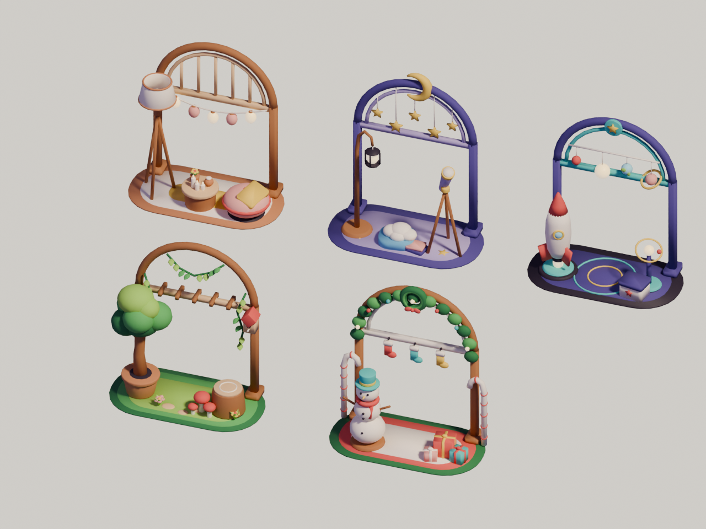
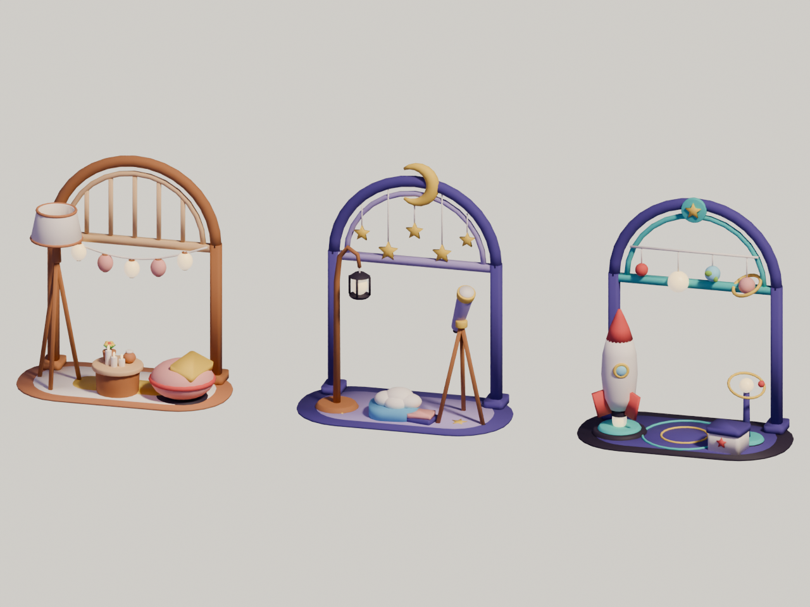
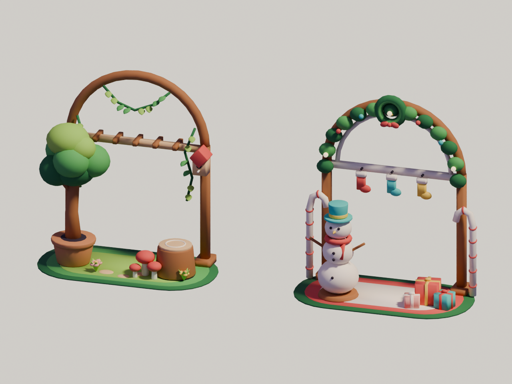
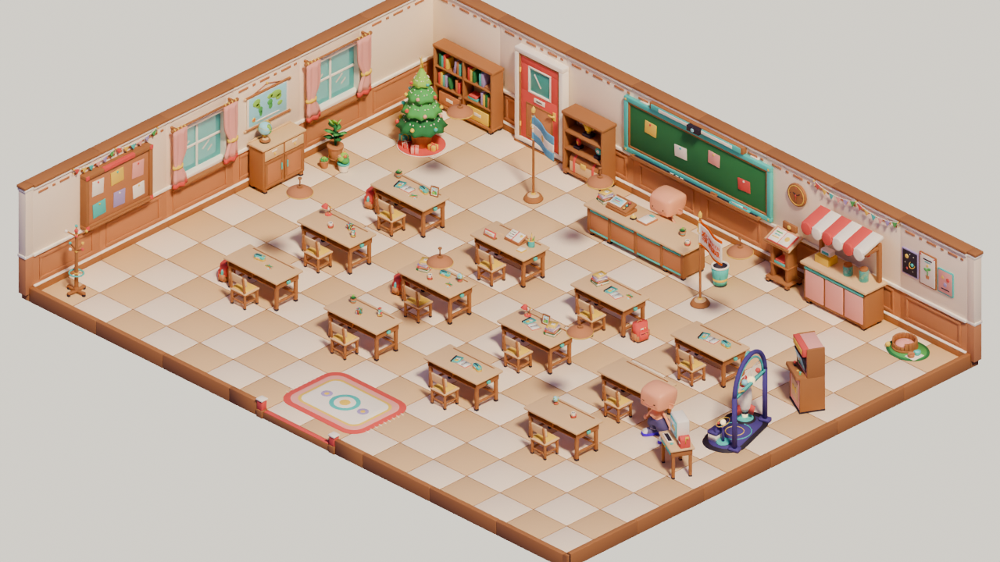
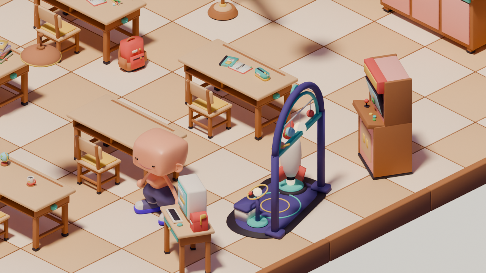
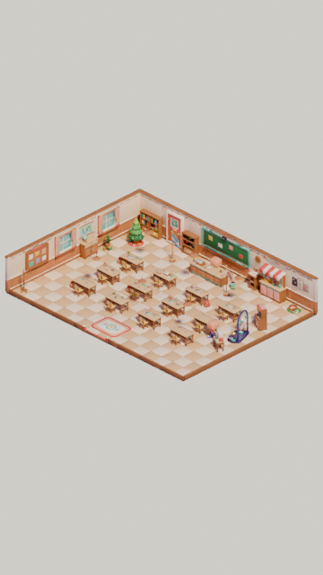
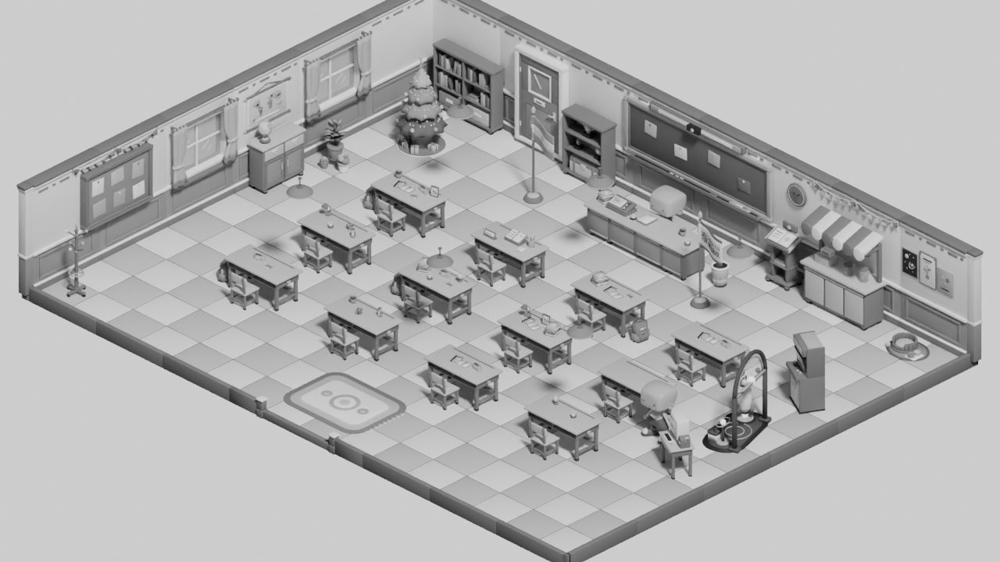

# Classroom Themes — Modular Kit (5 hot-swappable Section 3 assets)

All five Section 3 **Classroom themes** items from the [asset wishlist](asset-wishlist.md) (`Warm`, `Night`, `Space`, `Forest`, `Holiday`) are authored as **origin-centered, `Y = 0` grounded, hot-swappable modular corner kits** in Blender 5.2.2 LTS under [art direction](../../rules/art-direction.md) and [3D world and camera](../../rules/3d-world-and-camera.md). Every theme shares an identical `1.84 × 0.98 m` floor footprint (`Z = ±0.49 m`, `X = ±0.92 m`), painted-toy beveled silhouettes, matte/satin `metallic = 0.0` palette materials, semantic `Theme<Name>_*` sub-meshes, and Draco-compressed GLB 2.0 exports so any theme can swap cleanly into the same Classroom Theme Corner slot without collisions.

> **Scope note:** This slice delivers the 5 `.blend` masters, Draco-compressed `.glb` runtime assets, structural verification tests, and visual renders without modifying `src/` or `e2e/`. Wiring theme selection and optional scene lighting overrides into `src/features/world/classroom/build-classroom-scene.ts` belongs to the runtime integration follow-up.

## Modular Catalog (`5` masters & `5` Draco GLBs)

| Wishlist Item | Module ID  | Master (`.blend`)                                                                | Runtime GLB (`.glb`)                                                   |                         Size |       Meshes / Tris | Dimensions / Pivot                                                                                                                                  |
| ------------- | ---------- | -------------------------------------------------------------------------------- | ---------------------------------------------------------------------- | ---------------------------: | ------------------: | --------------------------------------------------------------------------------------------------------------------------------------------------- |
| Warm          | `warm`     | [warm.blend](../../assets/blender/environment/classroom-themes/warm.blend)       | [warm.glb](../../public/models/scenes/classroom/themes/warm.glb)       |                   `47,684` B |     `10` / `12,120` | `1.84 × 1.97 × 0.98 m`, floor pivot (`Y = 0`), woven terracotta/cream rug, slatted wood arch, 5 glowing lanterns, tripod lamp, pouf & tea table     |
| Night         | `night`    | [night.blend](../../assets/blender/environment/classroom-themes/night.blend)     | [night.glb](../../public/models/scenes/classroom/themes/night.glb)     |                   `29,728` B |       `9` / `6,264` | `1.84 × 2.13 × 0.98 m`, floor pivot (`Y = 0`), star-inlaid indigo rug, crescent-moon & 5-star arch, shepherd lantern, telescope & cloud pillows     |
| Space         | `space`    | [space.blend](../../assets/blender/environment/classroom-themes/space.blend)     | [space.glb](../../public/models/scenes/classroom/themes/space.glb)     |                   `35,740` B |      `10` / `8,088` | `1.84 × 2.05 × 0.98 m`, floor pivot (`Y = 0`), concentric orbit rug, solar-system mobile arch, retro toy rocket, orrery & supply crate              |
| Forest        | `forest`   | [forest.blend](../../assets/blender/environment/classroom-themes/forest.blend)   | [forest.glb](../../public/models/scenes/classroom/themes/forest.glb)   |                   `58,760` B |     `11` / `15,314` | `1.84 × 2.01 × 0.98 m`, floor pivot (`Y = 0`), scalloped meadow rug, vine-draped pergola & birdhouse, woodland tree in pot, stump stool & mushrooms |
| Holiday       | `holiday`  | [holiday.blend](../../assets/blender/environment/classroom-themes/holiday.blend) | [holiday.glb](../../public/models/scenes/classroom/themes/holiday.glb) |                   `54,828` B |     `10` / `14,476` | `1.84 × 2.09 × 0.98 m`, floor pivot (`Y = 0`), festive rug, evergreen swag & wreath arch, 3 stockings, snowman, gifts & twin candy canes            |
| **Total**     | **5 kits** | **5 masters**                                                                    | **5 Draco GLBs**                                                       | **`226,740` B (`221.4` KB)** | **`50` / `56,262`** | **All `5` verified**                                                                                                                                |

- Standalone structural test: [`scripts/assets/test-classroom-themes.mjs`](../../scripts/assets/test-classroom-themes.mjs).

## Visual Previews

### Modular Kit Showcase & Close-ups (`1280×960`)

| View                                                                 | Preview                                                                                            |
| -------------------------------------------------------------------- | -------------------------------------------------------------------------------------------------- |
| All `5` hot-swappable classroom theme kits side-by-side (`1280×960`) |             |
| Row 1 close-up (`warm`, `night`, `space`) (`1280×960`)               |  |
| Row 2 close-up (`forest`, `holiday`) (`1280×960`)                    |  |

### Full Classroom Assembly (`1280px`, Close-up, `360px` Mobile, Grayscale)

| View                                                                                                                   | Preview                                                                                          |
| ---------------------------------------------------------------------------------------------------------------------- | ------------------------------------------------------------------------------------------------ |
| Full `16 m × 12 m` classroom with shell, furniture, interactive, decoration, clutter, decor & Space theme (`1280×720`) |                 |
| East Theme Corner close-up showing `space.glb` between `arcade-console` and `chat-computer` (`1280×720`)               |  |
| Portrait mobile readability (`360×640`)                                                                                |              |
| Grayscale value-separation check (`1280×720`)                                                                          |      |

## Three.js Modular Assembly Contract

Every GLB uses `1 unit = 1 meter`, `+Y` up, applied identity transforms, and faces `+Z` in local space:

- **Hot-swappable East Theme Corner slot**:
  - Mount the active theme GLB at `(6.72, 0, -0.34)` with `rotation.y = -Math.PI * 72 / 180` (Blender `(6.72, 0.34, 0)`, `rot_z = -72°`), angled inward toward the center walkway between `arcade-console.glb` (`0.51 m` clearance) and `chat-computer.glb` (`0.64 m` clearance), while leaving `>= 0.78 m` from student desks `R0C3` / `R1C3` and `0.60 m` from the east cutaway baseboard.
  - Because every module shares the exact `1.84 × 0.98 m` footprint and `Y = 0` pivot, switching `warm` / `night` / `space` / `forest` / `holiday` replaces only the mounted GLB at that single slot without moving any furniture or navigation collider.
- **Modular sub-meshes**:
  - Each GLB exports `9–11` semantic `Theme<Name>_*` meshes grouped by material and element (for example `ThemeWarm_GlowLanternsAndBulb`, `ThemeNight_ButterMoonAndStars`, `ThemeSpace_GlowSunAndThruster`, `ThemeForest_LeafGreenFoliage`, `ThemeHoliday_GlowFestiveBulbs`), enabling optional runtime glow pulses or gentle sway without altering the authored geometry.
- **Recommended Three.js theme lighting & shell accent presets** (consistent with [the Classroom Shell lighting reference](classroom-shell.md#threejs-lighting--tone-mapping-reference) and [art direction](../../rules/art-direction.md)):

| Theme     | Key Light (`DirectionalLight`) | Fill / Ambient (`#B5A7D6` base) | Optional Shell Floor / Wall Accent              |
| --------- | ------------------------------ | ------------------------------- | ----------------------------------------------- |
| `warm`    | `#FFF0D8` (`intensity: 3.2`)   | `#B5A7D6` (`~0.42`)             | Default cream/terracotta/sand base              |
| `night`   | `#A9E7F4` (`intensity: 2.2`)   | `#5B4F96` / `#B5A7D6` (`~0.55`) | Soft dusk wall tint + warm lamp glow            |
| `space`   | `#FFF9EB` (`intensity: 2.8`)   | `#5B4F96` / `#62CFC7` (`~0.48`) | Subtle cool indigo shadow fill                  |
| `forest`  | `#FFF0D8` (`intensity: 3.1`)   | `#A6D96A` / `#B5A7D6` (`~0.45`) | Warm sunlit leaf bounce                         |
| `holiday` | `#FFF0D8` (`intensity: 3.0`)   | `#B5A7D6` (`~0.45`)             | Pair with `christmas-tree.glb` & `garlands.glb` |

## Palette & Materials

| Material          | Color / Purpose                                                                            | Roughness | Metallic |
| ----------------- | ------------------------------------------------------------------------------------------ | --------: | -------: |
| `ThemeWood`       | `#AF7B52` warm/holiday arches, lamp stands, telescope tripod, pergola, tree trunk & stump  |    `0.78` |    `0.0` |
| `ThemeWoodLight`  | `#E9C99B` warm arch slats, tea table top, birdhouse body, stump top & meadow pebbles       |    `0.80` |    `0.0` |
| `ThemeTerracotta` | `#C88D65` warm rug border, shade bands, teapot & forest tree planter                       |    `0.80` |    `0.0` |
| `ThemeCreamPale`  | `#FFF9EB` drum shade, candles, cloud pillow, rocket fuselage, mushroom stems & snowman     |    `0.82` |    `0.0` |
| `ThemeButter`     | `#F7D86B` crescent moon, hanging stars, Saturn ring, wildflowers, stocking & ribbons       |    `0.68` |    `0.0` |
| `ThemeGlowWarm`   | `#F7D86B` (`emissive: #FFF0D8`, `0.85`) warm lanterns, candle flames, solar sun & bulbs    |    `0.42` |    `0.0` |
| `ThemeCoral`      | `#E66861` pouf trim, rocket nose/fins, mushroom caps, birdhouse roof, scarf, gifts & canes |    `0.76` |    `0.0` |
| `ThemePeach`      | `#F5B5AB` paper lanterns, pouf body, star-atlas cover, Saturn body, wildflowers & gift     |    `0.80` |    `0.0` |
| `ThemeTurquoise`  | `#62CFC7` observatory arch trim, launch pad, orrery base, snowman top hat & stocking       |    `0.74` |    `0.0` |
| `ThemeSkyBlue`    | `#A9E7F4` solar-system Earth ocean & rocket porthole glass                                 |    `0.74` |    `0.0` |
| `ThemeCerulean`   | `#75B7DA` night floor cushion                                                              |    `0.76` |    `0.0` |
| `ThemeIndigo`     | `#5B4F96` night & space arches, orbit rug & supply crate lid                               |    `0.78` |    `0.0` |
| `ThemeLavender`   | `#B5A7D6` night rug band, arch inner trim & telescope optical tube                         |    `0.80` |    `0.0` |
| `ThemeGrassGreen` | `#A6D96A` Earth continents, meadow inner rug, sunlit tree crown & grass tufts              |    `0.82` |    `0.0` |
| `ThemeLeafGreen`  | `#65B96A` warm tabletop plant, mid tree crown, vine leaves & holiday wreath                |    `0.82` |    `0.0` |
| `ThemeDeepGreen`  | `#3E8654` shaded tree crown, vine stems, evergreen swag, wreath base & holiday rug rim     |    `0.84` |    `0.0` |
| `ThemeSlateDark`  | `#382F3F` bottom contact pads, lantern cage, rocket nozzle, snowman eyes & buttons         |    `0.64` |    `0.0` |

Rules: [art direction](../../rules/art-direction.md), [3D world and camera](../../rules/3d-world-and-camera.md).
