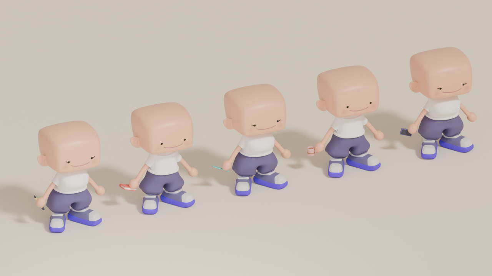
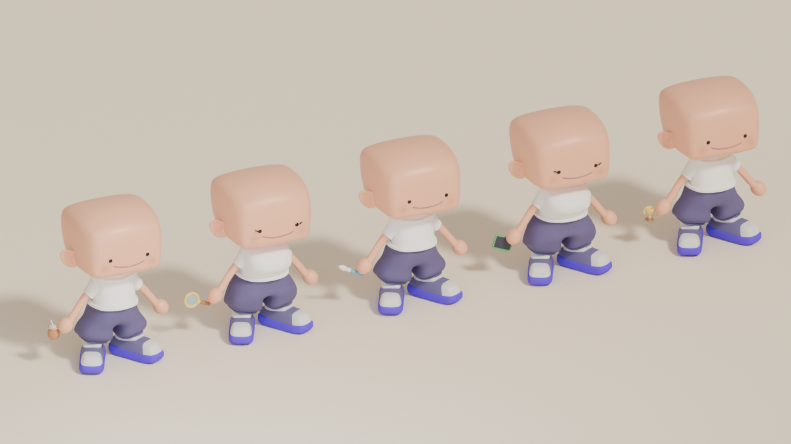
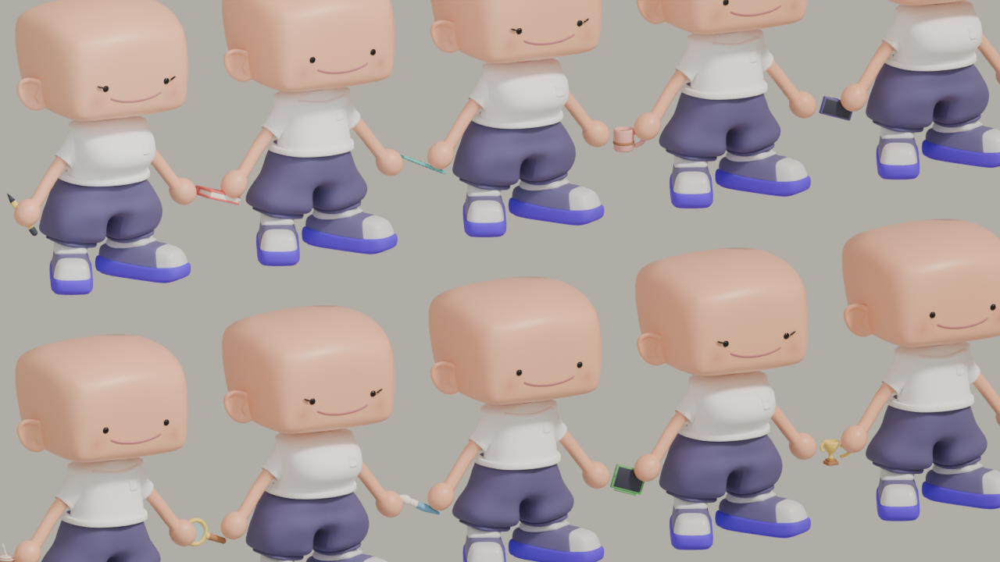
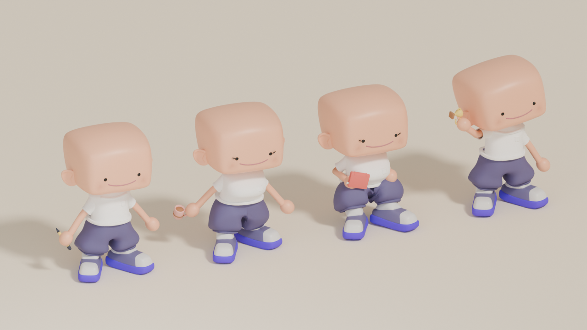
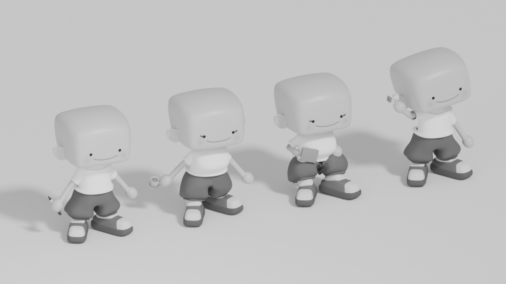
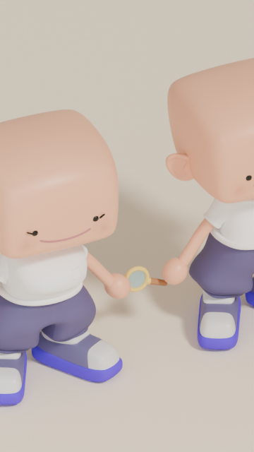

# Hand Items (10 shared styles) — modular asset candidates

**Verified across `Idle`, `Walk`, `Sit`, and `Wave` on both Male and Female avatars and committed locally on `feat/tutor-bot-skins` (not yet pushed, merged, or integrated into the runtime catalog).** All 5 [asset wishlist](asset-wishlist.md#hand-items) hand items plus 5 project-aligned extra hand items are authored once under `shared/`, rigid-weighted `100%` (`1` influence per vertex) to canonical `DEF-hand.R` on the `rig` 34-bone skeleton, and verified without modifying `male/body.glb`, `female/body.glb`, `src/`, or `e2e/`.

## Items, masters, and GLB exports

| Item | Origin | Master (`.blend`) | Shared GLB (`.glb`) | Size | Meshes / Vertices (`min Z`) |
| --- | --- | --- | --- | ---: | --- |
| Pencil | Wishlist | [pencil.blend](../../assets/blender/avatars/shared/hand/pencil.blend) | [hand-pencil.glb](../../public/models/avatars/shared/hand-pencil.glb) | `16,032` B | `2` (`HandPencil_{Body,Detail}`), `404` (`0.2313 m`) |
| Book | Wishlist | [book.blend](../../assets/blender/avatars/shared/hand/book.blend) | [hand-book.glb](../../public/models/avatars/shared/hand-book.glb) | `16,292` B | `2` (`HandBook_{Cover,Pages}`), `444` (`0.2417 m`) |
| Ruler | Wishlist | [ruler.blend](../../assets/blender/avatars/shared/hand/ruler.blend) | [hand-ruler.glb](../../public/models/avatars/shared/hand-ruler.glb) | `16,600` B | `2` (`HandRuler_{Body,Markings}`), `592` (`0.2449 m`) |
| Mug | Wishlist | [mug.blend](../../assets/blender/avatars/shared/hand/mug.blend) | [hand-mug.glb](../../public/models/avatars/shared/hand-mug.glb) | `16,728` B | `2` (`HandMug_{Cup,Detail}`), `494` (`0.2245 m`) |
| Phone | Wishlist | [phone.blend](../../assets/blender/avatars/shared/hand/phone.blend) | [hand-phone.glb](../../public/models/avatars/shared/hand-phone.glb) | `15,200` B | `2` (`HandPhone_{Case,Screen}`), `280` (`0.2298 m`) |
| Mate | Extra | [mate.blend](../../assets/blender/avatars/shared/hand/mate.blend) | [hand-mate.glb](../../public/models/avatars/shared/hand-mate.glb) | `17,212` B | `2` (`HandMate_{Gourd,Bombilla}`), `544` (`0.2220 m`) |
| Magnifying glass | Extra | [magnifying-glass.blend](../../assets/blender/avatars/shared/hand/magnifying-glass.blend) | [hand-magnifying-glass.glb](../../public/models/avatars/shared/hand-magnifying-glass.glb) | `21,560` B | `3` (`HandMagnifyingGlass_{Frame,Handle,Lens}`), `1,020` (`0.2522 m`) |
| Paintbrush | Extra | [paintbrush.blend](../../assets/blender/avatars/shared/hand/paintbrush.blend) | [hand-paintbrush.glb](../../public/models/avatars/shared/hand-paintbrush.glb) | `15,424` B | `2` (`HandPaintbrush_{Handle,Detail}`), `284` (`0.2525 m`) |
| Tablet | Extra | [tablet.blend](../../assets/blender/avatars/shared/hand/tablet.blend) | [hand-tablet.glb](../../public/models/avatars/shared/hand-tablet.glb) | `14,792` B | `2` (`HandTablet_{Body,Screen}`), `220` (`0.2098 m`) |
| Trophy | Extra | [trophy.blend](../../assets/blender/avatars/shared/hand/trophy.blend) | [hand-trophy.glb](../../public/models/avatars/shared/hand-trophy.glb) | `17,908` B | `2` (`HandTrophy_{Cup,Base}`), `714` (`0.2190 m`) |

- Combined compressed size across all `10` GLBs: **`167,748` bytes (`163.8` KB)** (`14.8 KB–21.6 KB` each, all far below the `1 MB` FD8 limit).
- Standalone structural test: [`scripts/assets/test-hand-items.mjs`](../../scripts/assets/test-hand-items.mjs).
- Untracked Blender review scenes: `odd/previews/hand-items-review.blend` (`REVIEW_Hand*_{Male,Female}`) and `odd/previews/hand-items-probador.blend` (`PROBADOR_Hand_{Female,Male}`).

## Visual Previews (Cycles)

| View | Preview |
| --- | --- |
| Wishlist lineup (`pencil`, `book`, `ruler`, `mug`, `phone`, `1280×720`) |  |
| Extra items lineup (`mate`, `magnifying-glass`, `paintbrush`, `tablet`, `trophy`, `1280×720`) |  |
| Close-up hand grips (`10/10` items, `1280×720`) |  |
| Pose clipcheck (`Idle`, `Walk`, `Sit`, `Wave`, `1280×720`) |  |
| Grayscale value separation (`1280×720`) |  |
| Portrait mobile readability (`360×640`) |  |

## Design & Shared Grip Calibration

Both `male/body.glb` and `female/body.glb` share identical `DEF-hand.R` bone transforms and hand mesh geometry (`x ∈ [-0.611, -0.472]`, `y ∈ [-0.088, +0.028]`, `z ∈ [0.612, 0.723]`). Every item is authored at `GRIP_ORIGIN_REST = (-0.574, -0.008, 0.636)` using an `Idle@25`-calibrated orthonormal frame (`delta_r.inverted()`) so:

- Upright vessels (`mug`, `mate`, `trophy`) remain level in `Idle`/`Walk`, with `mug` and `trophy` gripped directly by their inner C-handle so nothing floats detached.
- Forward-angled school & creative tools (`pencil`, `book`, `ruler`, `phone`, `magnifying-glass`, `paintbrush`, `tablet`) tilt cleanly outboard (`-X`) so `Sit@49` clears both `Pants` thighs (`z <= 0.429`) and the Female `DEF-bust.R` silhouette with zero penetrations.
- Every item uses neutral `#FFFFFF` `AvatarAccessoryTint` (non-metallic, `roughness 0.46–0.78`) plus fixed semantic `AvatarDetail`, and `magnifying-glass` adds `AvatarGlass` (`#A9E7F4`, `alpha = 0.28`, `alphaMode: "BLEND"`, `roughness = 0.16`).

## Three.js Runtime Integration Contract

1. Resolve any hand item via `/models/avatars/shared/hand-${handId}.glb`.
2. Clone and tint `AvatarAccessoryTint` using the selected `handColor` (matching `AvatarHairTint` / `AvatarTopTint`); keep `AvatarDetail` and `AvatarGlass` unmodified.
3. Rebind each `SkinnedMesh` onto the body's `34`-bone skeleton by bone name (`DEF-hand.R`, `100%` weight `1.0`, identity mesh transforms `[0,0,0]` / `[0,0,0,1]` / `[1,1,1]`).

## Verification

| Check | Observed result |
| --- | --- |
| Authoring clearance (`Idle 1, 25`, `Walk 13`, `Sit 49`, `Wave 30`) | `0` `Head` hits, `0` non-hand `Body`/`Pants` hits, `min_world_z >= 0.2098 m` across all `10/10` items on both Male and Female (`odd/artifacts/hand-items-author-report.json`) |
| Decoded GLB roundtrips (Blender 5.2.2 LTS) | All `10/10` `shared/hand-*.glb` imports pass exact 34-bone canonical rest matrices (`< 1e-4`), `1` bone influence (`DEF-hand.R`, weight `1.0`, sum error `0.0`), and `0` head/body hits across all `5` tested frames on both genders (`odd/artifacts/hand-items-export.json`) |
| Structural & budget (`test-hand-items.mjs`, `check-asset-budget.mjs`) | Valid Draco-compressed GLBs (`14.8 KB–21.6 KB`, all `<= 1 MB`), zero animations/cameras/lights, neutral `#FFFFFF` `AvatarAccessoryTint` + `AvatarDetail` (+ `AvatarGlass` `BLEND` on `magnifying-glass`) |

**Runtime status (#149):** integrated into the avatar catalog (`src/features/world/avatar/accessory-catalog.ts`) under the `hand` slot, rendered from synced equipped items and previewed in the shop. Fixed colors mirror the backend shop seed; equip and inventory UI is pending.

Rules: [modular avatar assets](../../rules/modular-avatar-assets.md), [art direction](../../rules/art-direction.md).
