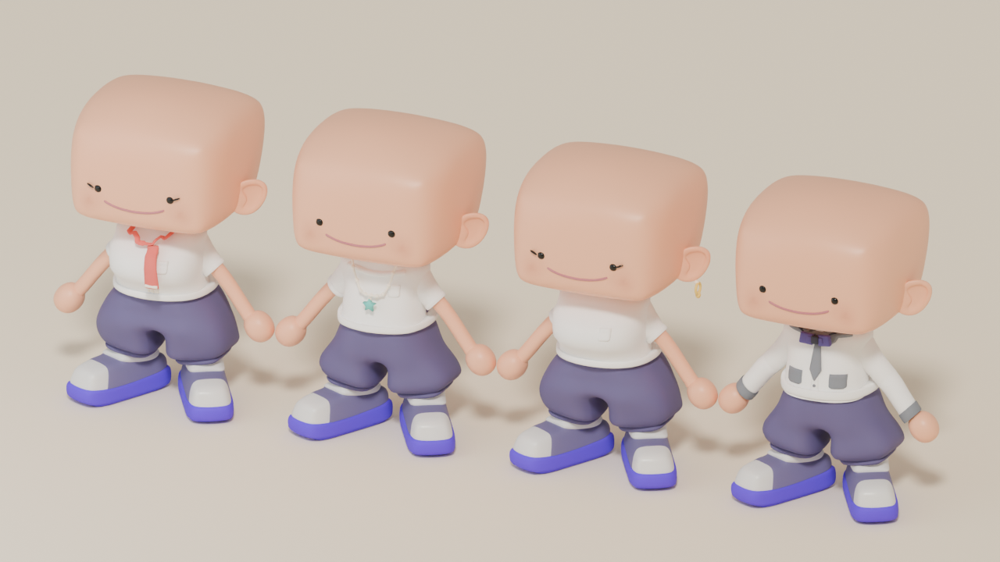
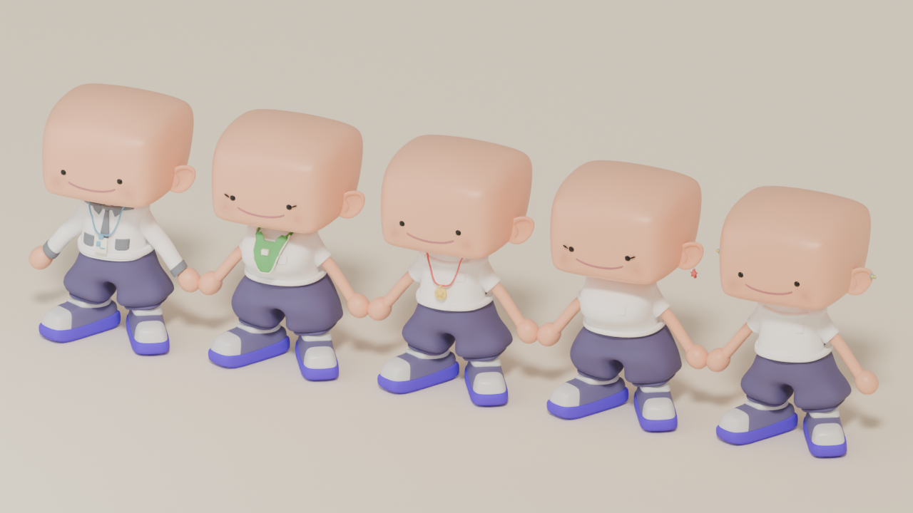
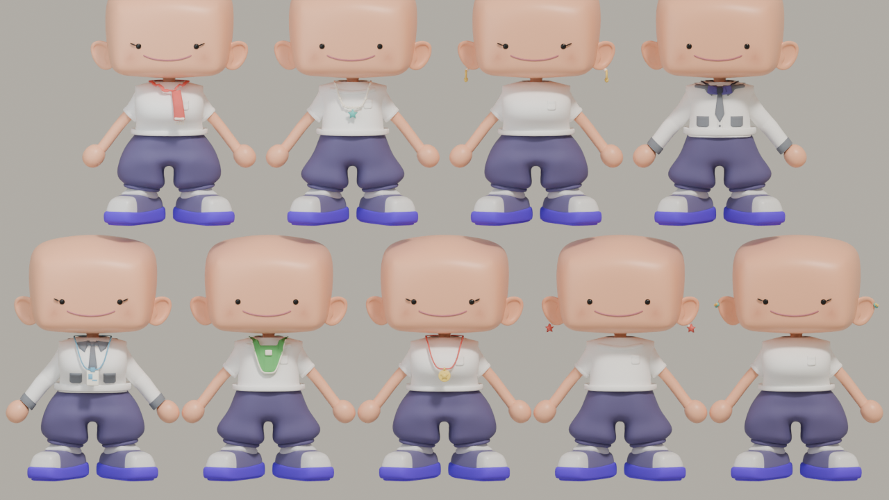
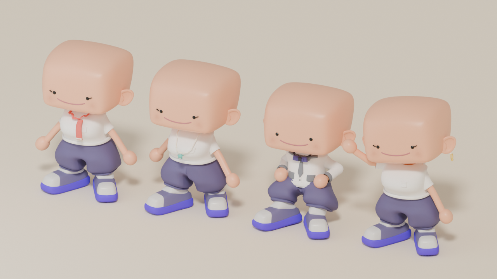
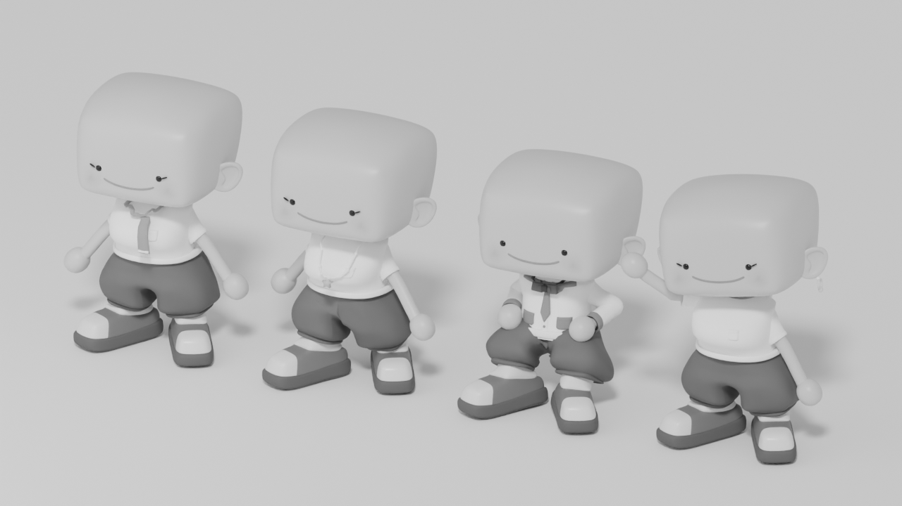
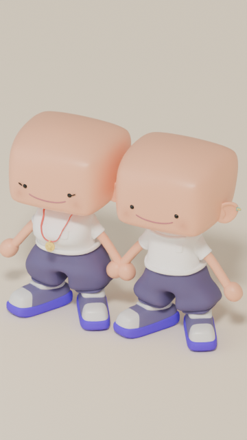

# Neck and Ear Accessories (9 styles: 3 shared ear + 6 body-fitted neck) — modular asset candidates

**Verified across `Idle`, `Walk`, `Sit`, and `Wave` on both Male and Female avatars against the bare body, `TShirt`, and `SchoolSmock`.** All 4 [asset wishlist](asset-wishlist.md#neck-and-ears) items (`scarf`, `necklace`, `earrings`, `bow-tie`) plus 5 project-aligned extra accessories (`lanyard-badge`, `bandana`, `achievement-medal`, `star-earrings`, `ear-cuffs`) are authored modularly on the canonical `rig` 34-bone skeleton without modifying `male/body.glb`, `female/body.glb`, `src/`, or `e2e/`.

## Items, masters, and GLB exports

- **Shared ear accessories (`3` GLBs):** Both bodies share identical `Head` / `Reference_ears` geometry in `DEF-spine.006`, so ear items export once under `shared/` and are `100%` rigid-weighted (`1` influence) to `DEF-spine.006`.
- **Body-fitted neck & chest accessories (`12` GLBs = `6 × {male,female}`):** Chest contours differ markedly across bodies (Female `SchoolSmock`/`TShirt` bust extends forward to `y = -0.283 m` vs. Male `y = -0.179 m`), so neck items follow the reuse-first rule from one shared master `.blend` into fitted `male/` and `female/` GLB exports (`bow-tie` rigid `100%` `DEF-spine.004`; `scarf`, `necklace`, `lanyard-badge`, `bandana`, and `achievement-medal` skinned across `DEF-spine.004`/`003`/`002` matching collar and chest weights).

| Item              | Origin   | Master (`.blend`)                                                                           | Export GLB(s)                                                                                                                                                                                       | Male / Shared Size | Female Size | Meshes / Vertices                                    | Bone binding                            |
| ----------------- | -------- | ------------------------------------------------------------------------------------------- | --------------------------------------------------------------------------------------------------------------------------------------------------------------------------------------------------- | -----------------: | ----------: | ---------------------------------------------------- | --------------------------------------- |
| Scarf             | Wishlist | [scarf.blend](../../assets/blender/avatars/shared/neck/scarf.blend)                         | [male/neck-scarf.glb](../../public/models/avatars/male/neck-scarf.glb) · [female/neck-scarf.glb](../../public/models/avatars/female/neck-scarf.glb)                                                 |         `29,688` B |  `29,612` B | `2` (`NeckScarf_{Wrap,Trim}`), `1,870`               | `DEF-spine.004/.003/.002` (`max 2` inf) |
| Necklace          | Wishlist | [necklace.blend](../../assets/blender/avatars/shared/neck/necklace.blend)                   | [male/neck-necklace.glb](../../public/models/avatars/male/neck-necklace.glb) · [female/neck-necklace.glb](../../public/models/avatars/female/neck-necklace.glb)                                     |         `32,276` B |  `32,216` B | `2` (`NeckNecklace_{Chain,Pendant}`), `1,972`        | `DEF-spine.004/.003/.002` (`max 2` inf) |
| Earrings          | Wishlist | [earrings.blend](../../assets/blender/avatars/shared/neck/earrings.blend)                   | [shared/neck-earrings.glb](../../public/models/avatars/shared/neck-earrings.glb)                                                                                                                    |         `18,708` B |  _(shared)_ | `2` (`NeckEarrings_{Drops,Studs}`), `1,160`          | `DEF-spine.006` (`100%` rigid)          |
| Bow tie           | Wishlist | [bow-tie.blend](../../assets/blender/avatars/shared/neck/bow-tie.blend)                     | [male/neck-bow-tie.glb](../../public/models/avatars/male/neck-bow-tie.glb) · [female/neck-bow-tie.glb](../../public/models/avatars/female/neck-bow-tie.glb)                                         |         `19,524` B |  `19,504` B | `2` (`NeckBowTie_{Bow,Band}`), `1,080`               | `DEF-spine.004` (`100%` rigid)          |
| Lanyard badge     | Extra    | [lanyard-badge.blend](../../assets/blender/avatars/shared/neck/lanyard-badge.blend)         | [male/neck-lanyard-badge.glb](../../public/models/avatars/male/neck-lanyard-badge.glb) · [female/neck-lanyard-badge.glb](../../public/models/avatars/female/neck-lanyard-badge.glb)                 |         `26,368` B |  `26,384` B | `2` (`NeckLanyardBadge_{Strap,Badge}`), `1,312`      | `DEF-spine.004/.003/.002` (`max 2` inf) |
| Bandana           | Extra    | [bandana.blend](../../assets/blender/avatars/shared/neck/bandana.blend)                     | [male/neck-bandana.glb](../../public/models/avatars/male/neck-bandana.glb) · [female/neck-bandana.glb](../../public/models/avatars/female/neck-bandana.glb)                                         |         `32,576` B |  `32,360` B | `2` (`NeckBandana_{Cloth,Trim}`), `2,096`            | `DEF-spine.004/.003/.002` (`max 2` inf) |
| Achievement medal | Extra    | [achievement-medal.blend](../../assets/blender/avatars/shared/neck/achievement-medal.blend) | [male/neck-achievement-medal.glb](../../public/models/avatars/male/neck-achievement-medal.glb) · [female/neck-achievement-medal.glb](../../public/models/avatars/female/neck-achievement-medal.glb) |         `27,248` B |  `27,148` B | `2` (`NeckAchievementMedal_{Ribbon,Medal}`), `1,346` | `DEF-spine.004/.003/.002` (`max 2` inf) |
| Star earrings     | Extra    | [star-earrings.blend](../../assets/blender/avatars/shared/neck/star-earrings.blend)         | [shared/neck-star-earrings.glb](../../public/models/avatars/shared/neck-star-earrings.glb)                                                                                                          |         `13,964` B |  _(shared)_ | `2` (`NeckStarEarrings_{Stars,Posts}`), `100`        | `DEF-spine.006` (`100%` rigid)          |
| Ear cuffs         | Extra    | [ear-cuffs.blend](../../assets/blender/avatars/shared/neck/ear-cuffs.blend)                 | [shared/neck-ear-cuffs.glb](../../public/models/avatars/shared/neck-ear-cuffs.glb)                                                                                                                  |         `17,060` B |  _(shared)_ | `2` (`NeckEarCuffs_{Cuffs,Accents}`), `712`          | `DEF-spine.006` (`100%` rigid)          |

- Combined compressed size across all `15` GLBs: **`384,636` bytes (`375.6` KB)** (`14.0 KB–32.6 KB` each, far below the `1 MB` FD8 budget).
- Standalone structural test: [`scripts/assets/test-neck-ears.mjs`](../../scripts/assets/test-neck-ears.mjs).
- Untracked Blender review scenes: `odd/previews/neck-ears-review.blend` (`REVIEW_Neck*_{Male,Female}`) and `odd/previews/neck-ears-probador.blend` (`PROBADOR_NeckEars_{Female,Male}`).

## Visual Previews (Cycles)

| View                                                                                                           | Preview                                                                               |
| -------------------------------------------------------------------------------------------------------------- | ------------------------------------------------------------------------------------- |
| Wishlist lineup (`scarf`, `necklace`, `earrings`, `bow-tie`, `1280×720`)                                       |  |
| Extra items lineup (`lanyard-badge`, `bandana`, `achievement-medal`, `star-earrings`, `ear-cuffs`, `1280×720`) |        |
| Close-ups (`9/9` neck and ear items, `1280×720`)                                                               |                |
| Pose clipcheck (`Idle`, `Walk`, `Sit`, `Wave`, `1280×720`)                                                     |   |
| Grayscale value separation (`1280×720`)                                                                        |              |
| Portrait mobile readability (`360×640`)                                                                        |                      |

## Collar Channel & Motion Clearance Engineering

Across both avatars, `TShirt_NeckRib` and `SchoolSmock_Collar` top rims rise to `z = 0.738–0.758 m` while `Body_Head` rests above `z = 0.775–0.785 m` (dropping to `z = 0.758 m` laterally during `Wave@30` head tilt while the raised right shoulder narrows the outer gap beyond `r >= 0.115 m`):

- All neck collar loops (`scarf`, `necklace`, `bow-tie`, `lanyard-badge`, `bandana`, `achievement-medal`) route along an elliptical collar channel at `rx = 0.097–0.098 m` inside the shoulder-arm seam so even during `Wave@30` arm raise + head tilt, every ring stays cleanly between collar/top and jaw (`0` hits).
- Front chest drape curves follow each body's evaluated `Body + TShirt + SchoolSmock` forward envelope (including Female bust fullness) with `DEF-spine.003` / `DEF-spine.002` transitions calibrated to the underlying `TShirt` and `SchoolSmock` weights so straps, pendants, medals, and bandanas stay locked outside cloth surfaces during `Walk@13` and `Sit@49`.
- Every asset exposes neutral `#FFFFFF` `AvatarAccessoryTint` (non-metallic, `roughness 0.56–0.84`) plus semantic `AvatarDetail` (`metallic = 0`, stylized parchment/gold/slate tones).

## Three.js Runtime Integration Contract

1. Resolve ear items (`earrings`, `star-earrings`, `ear-cuffs`) via `/models/avatars/shared/neck-${id}.glb` and body-fitted neck items (`scarf`, `necklace`, `bow-tie`, `lanyard-badge`, `bandana`, `achievement-medal`) via `/models/avatars/${bodyId}/neck-${id}.glb`.
2. Clone and tint `AvatarAccessoryTint` with the selected `neckColor`; keep `AvatarDetail` fixed.
3. Rebind all `SkinnedMesh` nodes by bone name onto the body's `34`-bone skeleton (`DEF-spine.006` for ear items, `DEF-spine.004` for `bow-tie`, and `DEF-spine.004`/`003`/`002` for soft-draped neckwear; identity mesh transforms `[0,0,0]` / `[0,0,0,1]` / `[1,1,1]`).

## Verification

| Check                                                                | Observed result                                                                                                                                                                                                                                 |
| -------------------------------------------------------------------- | ----------------------------------------------------------------------------------------------------------------------------------------------------------------------------------------------------------------------------------------------- |
| Authoring clearance (`Idle 1, 25`, `Walk 13`, `Sit 49`, `Wave 30`)   | `0` `Head` hits, `0` `Body` hits, and `0` `TShirt` / `SchoolSmock` hits across all `9/9` items on both Male and Female (`odd/artifacts/neck-ears-author-report.json`)                                                                           |
| Decoded GLB roundtrips (Blender 5.2.2 LTS)                           | All `15/15` exported GLBs pass exact 34-bone canonical rest matrices (`< 1e-4`), normalized bone weights (`<= 2` influences, max sum error `5e-7`), and `0` head/body/top hits on all `5` tested frames (`odd/artifacts/neck-ears-export.json`) |
| Structural & budget (`test-neck-ears.mjs`, `check-asset-budget.mjs`) | Valid Draco-compressed GLBs (`14.0 KB–32.6 KB`, all `<= 1 MB`), zero animations/cameras/lights, neutral `#FFFFFF` `AvatarAccessoryTint` + `AvatarDetail`                                                                                        |

Rules: [modular avatar assets](../../rules/modular-avatar-assets.md), [art direction](../../rules/art-direction.md).
