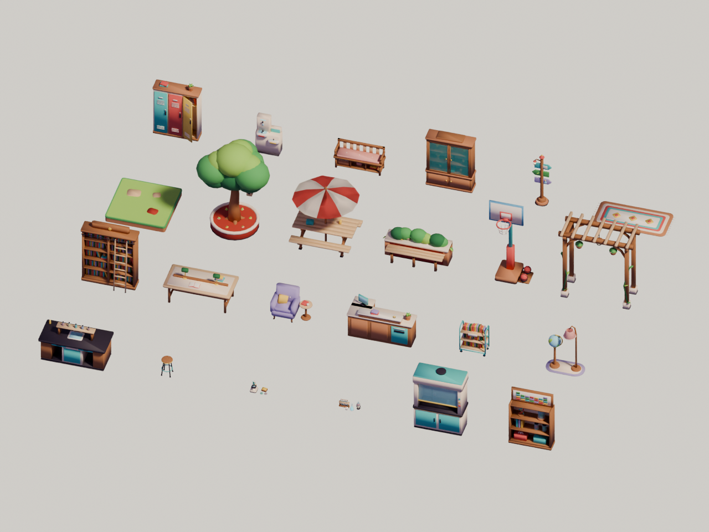
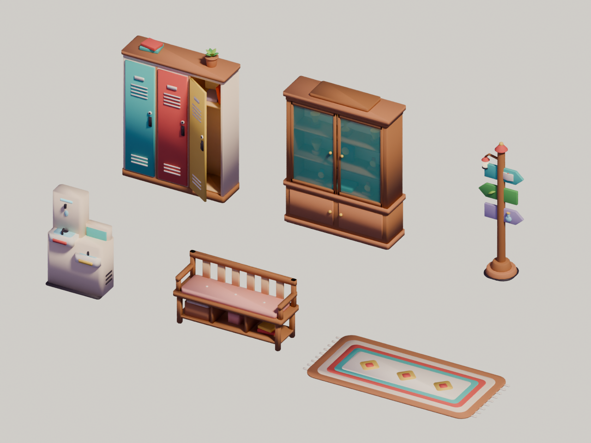
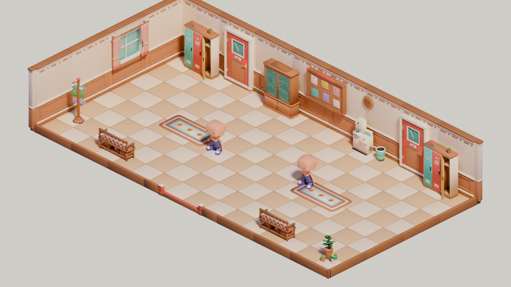
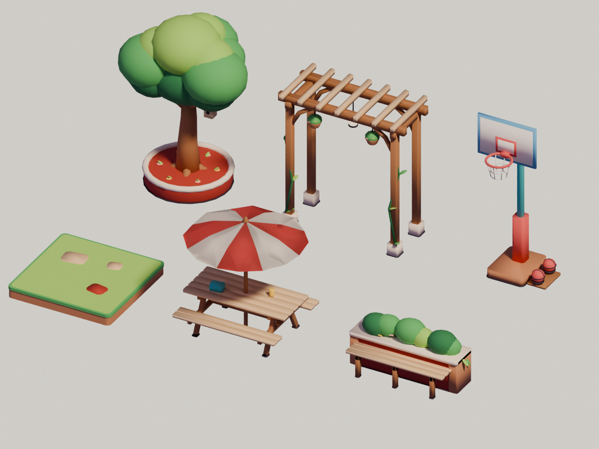
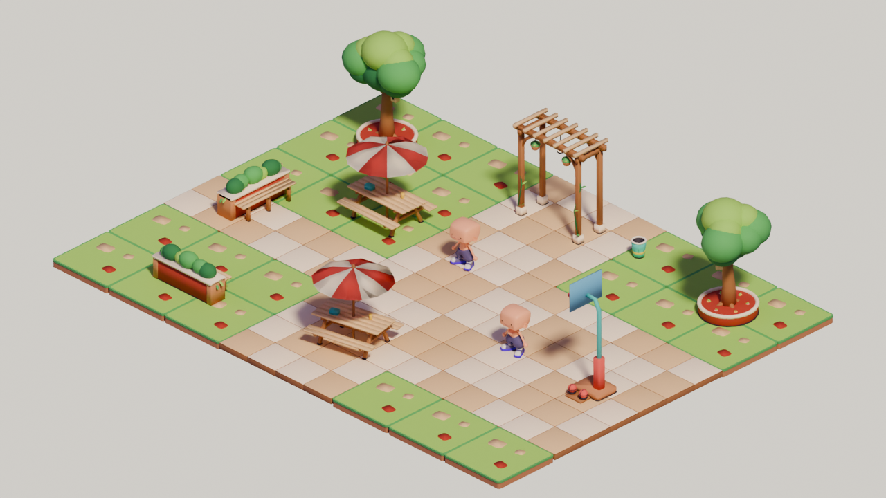
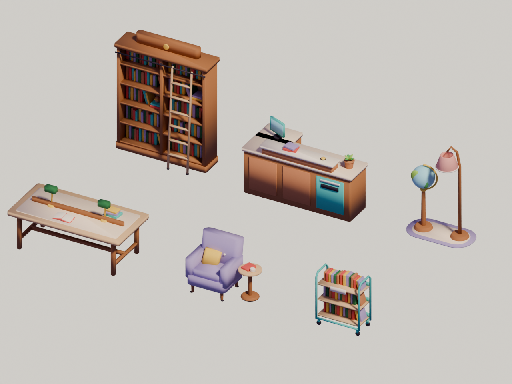
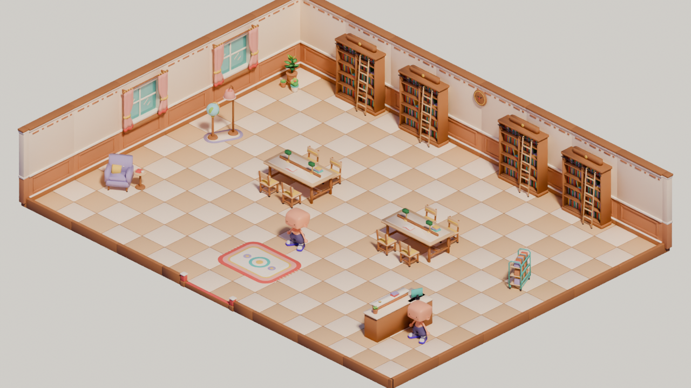
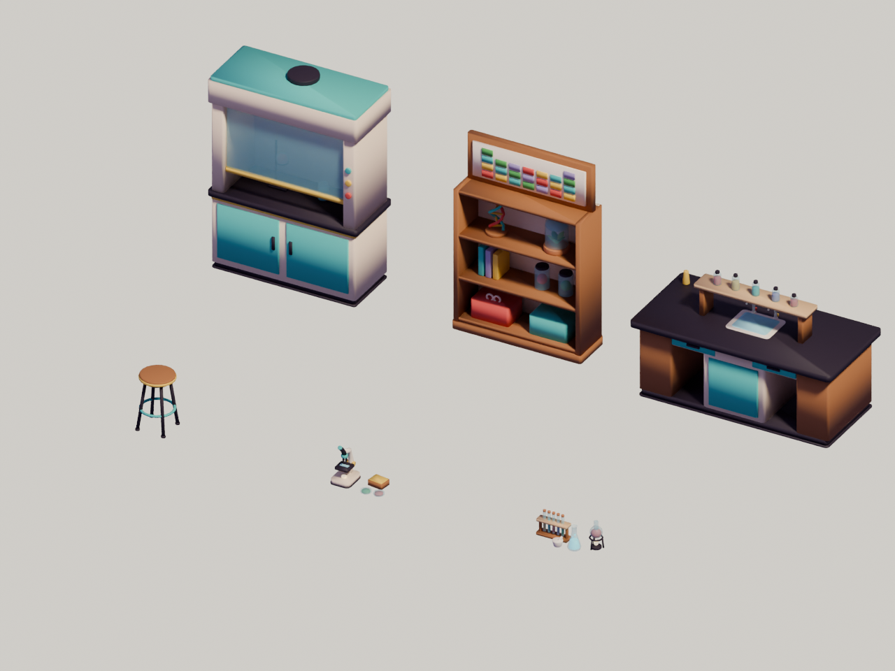
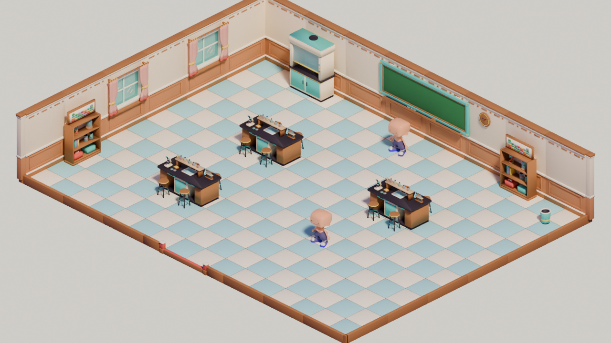

# Other Spaces — Modular Kit (24 assets across Hallway, Schoolyard, Library, Lab)

All four Section 3 **Other spaces (if more than one room)** items from the [asset wishlist](asset-wishlist.md) (`Hallway`, `Schoolyard`, `Library`, `Lab`) are authored as **24 origin-centered, modular 3D assets (6 per space)** in Blender 5.2.2 LTS under [art direction](../../rules/art-direction.md) and [3D world and camera](../../rules/3d-world-and-camera.md). Every piece uses painted-toy beveled silhouettes, matte/satin `metallic = 0.0` palette materials (`Space*`), translucent `BLEND` glass only on display/lab glazing (`SpaceGlassTeal`, `SpaceGlassSky`), semantic mesh prefixes (`Hallway*`, `Yard*`, `Lib*`, `Lab*`), and 20-bit Draco-compressed GLB 2.0 exports (`665,184` B / `649.6` KB combined across all `24` models).

> **Scope note:** This slice delivers the `24` `.blend` masters, `24` Draco-compressed `.glb` runtime assets, structural verification tests, room assembly previews, and visual renders without modifying `src/` or `e2e/`. Multi-room routing and scene builders belong to the runtime follow-up.

## Modular Catalog (`24` masters & `24` Draco GLBs)

### 1. Hallway (`public/models/scenes/hallway/`, `6` assets — `143,912` B)

| Module ID             | Master (`.blend`)                                                                               | Runtime GLB (`.glb`)                                                                  |       Size |  Meshes / Tris | Dimensions / Pivot                                                                                 |
| --------------------- | ----------------------------------------------------------------------------------------------- | ------------------------------------------------------------------------------------- | ---------: | -------------: | -------------------------------------------------------------------------------------------------- |
| `locker-bank`         | [locker-bank.blend](../../assets/blender/environment/hallway/locker-bank.blend)                 | [locker-bank.glb](../../public/models/scenes/hallway/locker-bank.glb)                 | `36,600` B | `12` / `8,412` | `1.52 × 2.09 × 0.70 m`, `Y = 0` base, 3-bay turquoise/coral/butter lockers, ajar door & plant      |
| `water-fountain`      | [water-fountain.blend](../../assets/blender/environment/hallway/water-fountain.blend)           | [water-fountain.glb](../../public/models/scenes/hallway/water-fountain.glb)           | `16,944` B |  `8` / `2,652` | `0.83 × 1.31 × 0.45 m`, `Y = 0` base, dual-height basins, bottle-filler alcove & glowing indicator |
| `hallway-bench`       | [hallway-bench.blend](../../assets/blender/environment/hallway/hallway-bench.blend)             | [hallway-bench.glb](../../public/models/scenes/hallway/hallway-bench.glb)             | `20,440` B |  `8` / `4,520` | `1.60 × 0.86 × 0.50 m`, `Y = 0` base, slatted wood bench, tufted peach cushion & cubby storage     |
| `trophy-display-case` | [trophy-display-case.blend](../../assets/blender/environment/hallway/trophy-display-case.blend) | [trophy-display-case.glb](../../public/models/scenes/hallway/trophy-display-case.glb) | `31,608` B | `10` / `7,538` | `1.56 × 1.99 × 0.50 m`, `Y = 0` base, glazed `SpaceGlassTeal` doors, warm light & cups/medals      |
| `room-signpost`       | [room-signpost.blend](../../assets/blender/environment/hallway/room-signpost.blend)             | [room-signpost.glb](../../public/models/scenes/hallway/room-signpost.glb)             | `23,268` B | `12` / `3,324` | `0.65 × 1.96 × 0.42 m`, `Y = 0` base, 3 directional plaques with 3D book/leaf/flask icons          |
| `hallway-runner-rug`  | [hallway-runner-rug.blend](../../assets/blender/environment/hallway/hallway-runner-rug.blend)   | [hallway-runner-rug.glb](../../public/models/scenes/hallway/hallway-runner-rug.glb)   | `15,052` B |  `7` / `3,240` | `2.55 × 0.04 × 1.18 m`, `Y = 0` base, woven runner with geometric borders, medallions & fringe     |

### 2. Schoolyard (`public/models/scenes/schoolyard/`, `6` assets — `163,032` B)

| Module ID                | Master (`.blend`)                                                                                        | Runtime GLB (`.glb`)                                                                           |       Size |   Meshes / Tris | Dimensions / Pivot                                                                             |
| ------------------------ | -------------------------------------------------------------------------------------------------------- | ---------------------------------------------------------------------------------------------- | ---------: | --------------: | ---------------------------------------------------------------------------------------------- |
| `courtyard-ground-tile`  | [courtyard-ground-tile.blend](../../assets/blender/environment/schoolyard/courtyard-ground-tile.blend)   | [courtyard-ground-tile.glb](../../public/models/scenes/schoolyard/courtyard-ground-tile.glb)   |  `7,508` B |     `5` / `648` | `2.00 × 0.225 × 2.00 m`, walkable top `Y = 0`, turf skirt, terracotta plinth & stepping stones |
| `courtyard-tree`         | [courtyard-tree.blend](../../assets/blender/environment/schoolyard/courtyard-tree.blend)                 | [courtyard-tree.glb](../../public/models/scenes/schoolyard/courtyard-tree.glb)                 | `43,908` B | `12` / `10,144` | `2.36 × 3.24 × 1.90 m`, `Y = 0` base, brick planter ring, multi-cluster canopy & birdhouse     |
| `picnic-table`           | [picnic-table.blend](../../assets/blender/environment/schoolyard/picnic-table.blend)                     | [picnic-table.glb](../../public/models/scenes/schoolyard/picnic-table.glb)                     | `17,036` B |   `7` / `3,312` | `2.08 × 2.29 × 2.08 m`, `Y = 0` base, A-frame plank bench table, striped parasol & lunch props |
| `garden-planter-bench`   | [garden-planter-bench.blend](../../assets/blender/environment/schoolyard/garden-planter-bench.blend)     | [garden-planter-bench.glb](../../public/models/scenes/schoolyard/garden-planter-bench.glb)     | `39,364` B |  `12` / `9,384` | `2.33 × 1.04 × 0.88 m`, `Y = 0` base, brick planter with coping, wooden bench, shrubs & blooms |
| `basketball-hoop`        | [basketball-hoop.blend](../../assets/blender/environment/schoolyard/basketball-hoop.blend)               | [basketball-hoop.glb](../../public/models/scenes/schoolyard/basketball-hoop.glb)               | `19,428` B |   `7` / `3,996` | `1.31 × 3.17 × 1.33 m`, `Y = 0` base, padded pole, backboard, hoop & net + 2-ball side rack    |
| `schoolyard-gazebo-arch` | [schoolyard-gazebo-arch.blend](../../assets/blender/environment/schoolyard/schoolyard-gazebo-arch.blend) | [schoolyard-gazebo-arch.glb](../../public/models/scenes/schoolyard/schoolyard-gazebo-arch.glb) | `35,788` B |  `11` / `8,444` | `2.46 × 2.65 × 1.20 m`, `Y = 0` base, wooden pergola trellis, vines, flower baskets & lantern  |

### 3. Library (`public/models/scenes/library/`, `6` assets — `201,708` B)

| Module ID                  | Master (`.blend`)                                                                                         | Runtime GLB (`.glb`)                                                                            |       Size |   Meshes / Tris | Dimensions / Pivot                                                                                 |
| -------------------------- | --------------------------------------------------------------------------------------------------------- | ----------------------------------------------------------------------------------------------- | ---------: | --------------: | -------------------------------------------------------------------------------------------------- |
| `tall-bookshelf-arch`      | [tall-bookshelf-arch.blend](../../assets/blender/environment/library/tall-bookshelf-arch.blend)           | [tall-bookshelf-arch.glb](../../public/models/scenes/library/tall-bookshelf-arch.glb)           | `73,888` B | `11` / `29,840` | `1.82 × 2.27 × 0.66 m`, `Y = 0` base, 5-shelf arched bookcase, owl bookend & rolling ladder        |
| `reading-table`            | [reading-table.blend](../../assets/blender/environment/library/reading-table.blend)                       | [reading-table.glb](../../public/models/scenes/library/reading-table.glb)                       | `23,140` B |  `11` / `4,032` | `2.20 × 1.14 × 1.12 m`, `Y = 0` base, `0.75 m` study table, twin banker lamps & open/stacked books |
| `reading-nook-armchair`    | [reading-nook-armchair.blend](../../assets/blender/environment/library/reading-nook-armchair.blend)       | [reading-nook-armchair.glb](../../public/models/scenes/library/reading-nook-armchair.glb)       | `20,688` B |   `7` / `4,416` | `1.29 × 0.97 × 0.79 m`, `Y = 0` base, tufted lavender armchair, butter pillow & side table         |
| `librarian-checkout-desk`  | [librarian-checkout-desk.blend](../../assets/blender/environment/library/librarian-checkout-desk.blend)   | [librarian-checkout-desk.glb](../../public/models/scenes/library/librarian-checkout-desk.glb)   | `25,496` B |  `12` / `4,012` | `2.16 × 1.24 × 0.98 m`, `Y = 0` base, L-shaped counter, return slot, monitor, bell & plant         |
| `book-return-cart`         | [book-return-cart.blend](../../assets/blender/environment/library/book-return-cart.blend)                 | [book-return-cart.glb](../../public/models/scenes/library/book-return-cart.glb)                 | `34,620` B |  `9` / `10,464` | `0.88 × 1.05 × 0.44 m`, `Y = 0` base, 3-tier turquoise trolley on casters packed with books        |
| `library-floor-globe-lamp` | [library-floor-globe-lamp.blend](../../assets/blender/environment/library/library-floor-globe-lamp.blend) | [library-floor-globe-lamp.glb](../../public/models/scenes/library/library-floor-globe-lamp.glb) | `24,104` B |  `11` / `3,892` | `1.26 × 1.86 × 0.66 m`, `Y = 0` base, pedestal floor globe + arched peach reading lamp on mat      |

### 4. Lab (`public/models/scenes/lab/`, `6` assets — `156,532` B)

| Module ID                  | Master (`.blend`)                                                                                     | Runtime GLB (`.glb`)                                                                        |                         Size |         Meshes / Tris | Dimensions / Pivot                                                                                 |
| -------------------------- | ----------------------------------------------------------------------------------------------------- | ------------------------------------------------------------------------------------------- | ---------------------------: | --------------------: | -------------------------------------------------------------------------------------------------- |
| `lab-workbench`            | [lab-workbench.blend](../../assets/blender/environment/lab/lab-workbench.blend)                       | [lab-workbench.glb](../../public/models/scenes/lab/lab-workbench.glb)                       |                   `32,468` B |        `11` / `7,068` | `2.20 × 1.36 × 1.06 m`, `Y = 0` base, `0.85 m` slate top, sink, faucets & reagent shelf bridge     |
| `lab-stool`                | [lab-stool.blend](../../assets/blender/environment/lab/lab-stool.blend)                               | [lab-stool.glb](../../public/models/scenes/lab/lab-stool.glb)                               |                   `10,612` B |         `4` / `2,016` | `0.37 × 0.60 × 0.37 m`, `Y = 0` base, splayed slate legs, turquoise footrest & butter-rimmed seat  |
| `microscope-station`       | [microscope-station.blend](../../assets/blender/environment/lab/microscope-station.blend)             | [microscope-station.glb](../../public/models/scenes/lab/microscope-station.glb)             |                   `21,248` B |        `11` / `3,028` | `0.58 × 0.44 × 0.32 m`, `Y = 0` tabletop base, microscope, slide box & 2 agar Petri dishes         |
| `chemistry-glassware-rack` | [chemistry-glassware-rack.blend](../../assets/blender/environment/lab/chemistry-glassware-rack.blend) | [chemistry-glassware-rack.glb](../../public/models/scenes/lab/chemistry-glassware-rack.glb) |                   `32,344` B |        `13` / `5,910` | `0.71 × 0.30 × 0.27 m`, `Y = 0` tabletop base, 5-tube rack, Erlenmeyer, tripod flask & mortar      |
| `fume-hood-cabinet`        | [fume-hood-cabinet.blend](../../assets/blender/environment/lab/fume-hood-cabinet.blend)               | [fume-hood-cabinet.glb](../../public/models/scenes/lab/fume-hood-cabinet.glb)               |                   `20,720` B |         `8` / `3,980` | `1.64 × 2.19 × 0.72 m`, `Y = 0` base, chemical cabinet, sliding `SpaceGlassSky` sash & interior    |
| `science-display-shelf`    | [science-display-shelf.blend](../../assets/blender/environment/lab/science-display-shelf.blend)       | [science-display-shelf.glb](../../public/models/scenes/lab/science-display-shelf.glb)       |                   `38,912` B |        `12` / `8,424` | `1.42 × 2.06 × 0.46 m`, `Y = 0` base, Periodic Table crown, DNA helix, terrarium, binders & crates |
| **Combined Total**         | **24 masters**                                                                                        | **24 Draco GLBs**                                                                           | **`665,184` B (`649.6` KB)** | **`231` / `152,696`** | **All `24` verified via `scripts/assets/test-other-spaces.mjs`**                                   |

- Standalone structural test: [`scripts/assets/test-other-spaces.mjs`](../../scripts/assets/test-other-spaces.mjs).

## Visual Previews

### All `24` Modular Assets Overview (`1280×960`)

### Per-Space Kits & Full Room Assemblies (`1280px` Color)

| Space                        | Kit Close-up (`1280×960`)                                                | Assembled Space (`1280×720`)                                                       |
| ---------------------------- | ------------------------------------------------------------------------ | ---------------------------------------------------------------------------------- |
| **Hallway** (`16 × 8 m`)     |        |        |
| **Schoolyard** (`16 × 12 m`) |  |  |
| **Library** (`16 × 12 m`)    |        |        |
| **Lab** (`16 × 12 m`)        |                |                |

## Three.js Modular Assembly Contract

Every GLB uses `1 unit = 1 meter`, `+Y` up, applied identity transforms, and faces `+Z` in local space:

- **Indoor rooms (`Hallway`, `Library`, `Lab`)**: Reuse `public/models/scenes/classroom/shell/` modules (`floor-tile`, `floor-threshold`, `wall-solid`, `wall-window`, `wall-corner`, `window`, `window-curtains`, `baseboard-wall`, `baseboard-cutaway`, `baseboard-doorway-post`) cleanly across `16 × 8 m` (Hallway) or `16 × 12 m` (Library, Lab).
  - **Lab tabletop snap**: Mount `microscope-station.glb` (`(-0.68, 0.851, +0.24)`) and `chemistry-glassware-rack.glb` (`(+0.64, 0.851, -0.20)`) relative to each `lab-workbench.glb` center, with `lab-stool.glb` seats tucked at `(±0.52, 0, ±0.78)`.
- **Outdoor `Schoolyard` (`16 × 12 m`)**: Tile `courtyard-ground-tile.glb` on a `2.0 × 2.0 m` grid (`Y = 0` walkable turf top, `-0.22 m` earthen plinth) alongside `1.0 × 1.0 m` `floor-tile.glb` warm sand/cream patio pads (`ShellSandTileA` overrides) for central walkways and the basketball half-court.
- **Lighting & Tone Mapping**: Pair with `THREE.SRGBColorSpace`, `THREE.AgXToneMapping`, warm `#FFF0D8` directional key (`intensity ~3.2`), and `#B5A7D6` lavender ambient/fill (`~0.45`), keeping `SpaceGlassTeal` / `SpaceGlassSky` (`BLEND`) meshes `castShadow = false`.

## Palette & Materials

| Material                                                | HEX / Purpose                                                                       |       Roughness | Metallic | Alpha   |
| ------------------------------------------------------- | ----------------------------------------------------------------------------------- | --------------: | -------: | ------- |
| `SpaceCreamLight` / `SpaceCreamPale`                    | `#FFF0D8` / `#FFF9EB` cabinets, coping, pages, ceramics, canopy                     | `0.84` / `0.82` |    `0.0` | `1.0`   |
| `SpaceSand` / `SpaceWoodLight`                          | `#E9C99B` stepping stones, plank tops, ladder rails, reagent shelf                  | `0.82` / `0.78` |    `0.0` | `1.0`   |
| `SpaceTerracotta` / `SpaceBrick`                        | `#C88D65` / `#B8473A` trims, masonry planters, plinths, baskets                     | `0.80` / `0.84` |    `0.0` | `1.0`   |
| `SpaceWood`                                             | `#AF7B52` frames, bookshelves, trunks, pergolas, study tables                       |          `0.78` |    `0.0` | `1.0`   |
| `SpaceCoral` / `SpacePeach`                             | `#E66861` / `#F5B5AB` doors, canopy stripes, hoop rim, bench & shades               | `0.76` / `0.80` |    `0.0` | `1.0`   |
| `SpaceButter`                                           | `#F7D86B` trophies, lamps, safety trims, flowers, pillows                           |          `0.68` |    `0.0` | `1.0`   |
| `SpaceTurquoise` / `SpaceSkyBlue` / `SpaceCerulean`     | `#62CFC7` / `#A9E7F4` / `#75B7DA` drawers, carts, globe oceans, backboard           |   `0.74`–`0.76` |    `0.0` | `1.0`   |
| `SpaceIndigo` / `SpaceLavender`                         | `#5B4F96` / `#B5A7D6` crest plaques, armchair, books, mat borders                   | `0.78` / `0.80` |    `0.0` | `1.0`   |
| `SpaceGrassGreen` / `SpaceLeafGreen` / `SpaceDeepGreen` | `#A6D96A` / `#65B96A` / `#3E8654` turf, tree canopies, shrubs, banker shades        |   `0.82`–`0.84` |    `0.0` | `1.0`   |
| `SpaceSlateDark`                                        | `#382F3F` lab benchtops, hardware, stools, wheels, bottom pads                      |          `0.64` |    `0.0` | `1.0`   |
| `SpaceGlassTeal` / `SpaceGlassSky`                      | `#62CFC7` (`α = 0.30`) / `#A9E7F4` (`α = 0.34`) display doors, fume sash, glassware |          `0.14` |    `0.0` | `BLEND` |
| `SpaceGlowWarm` / `SpaceGlowTeal`                       | `#F7D86B` (`emissive #FFF0D8`) / `#62CFC7` (`emissive #A9E7F4`) lamps & flasks      | `0.40` / `0.38` |    `0.0` | `1.0`   |

Rules: [art direction](../../rules/art-direction.md), [3D world and camera](../../rules/3d-world-and-camera.md).
