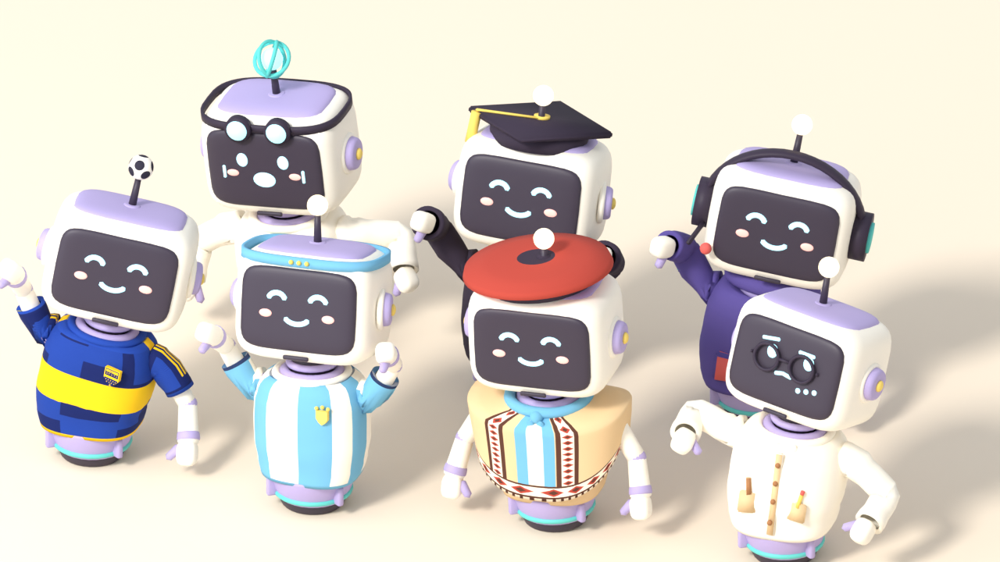
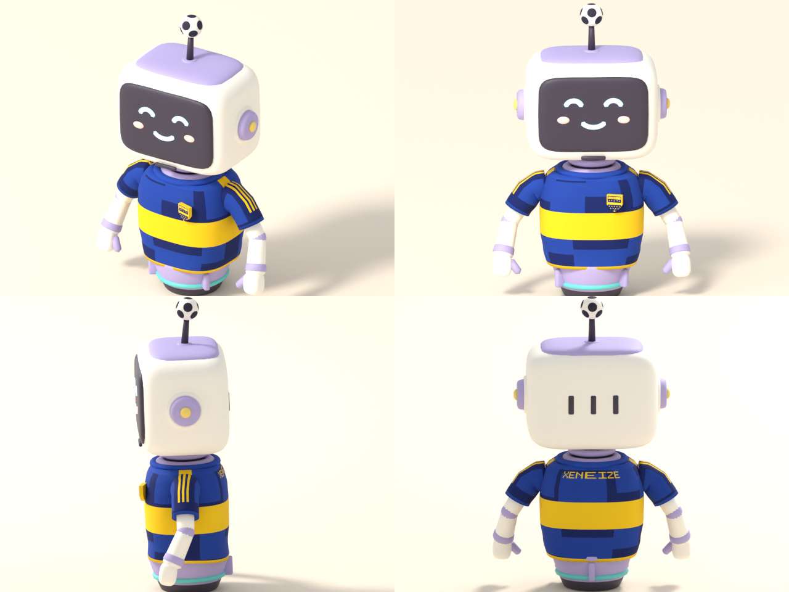
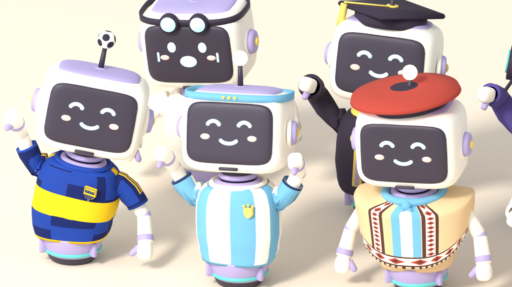
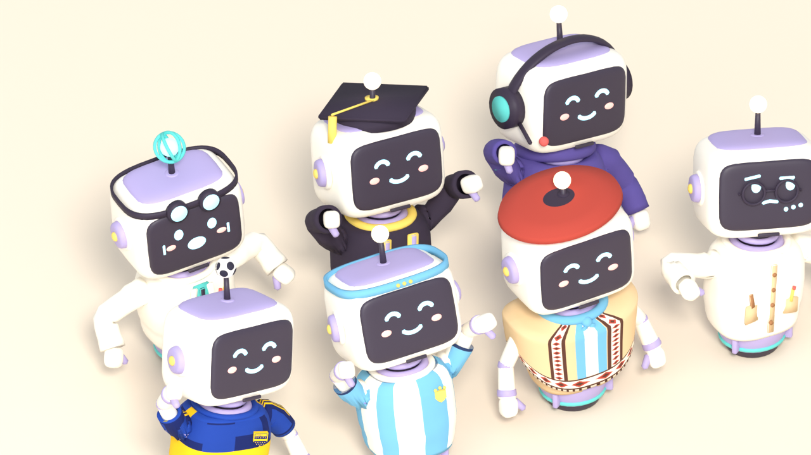
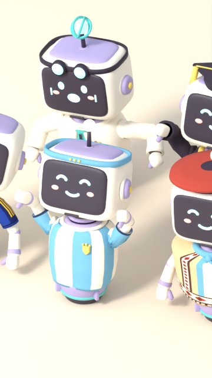

# Tutor Bot Skins — 7 Modular Split-Body Outfits & Accessories

Seven modular, split-body 3D outfit and accessory skins for the Section 5 [Tutor Bot](tutor-bot.md) (`public/models/bot/tutor-bot.glb`), authored in Blender 5.2.2 LTS under [modular avatar assets](../../rules/modular-avatar-assets.md), [art direction](../../rules/art-direction.md), and [3D world and camera](../../rules/3d-world-and-camera.md), checking off `Color or accessory variants (future shop items)` in the [asset wishlist](asset-wishlist.md).

> **Scope note:** This slice delivers the 7 editable `.blend` masters, 7 Draco-compressed `.glb` runtime wearables, `scripts/assets/test-tutor-bot-skins.mjs`, and Cycles evidence renders on `feat/tutor-bot-skins` without modifying `public/models/bot/tutor-bot.glb`, `public/models/bot/bot-station.glb`, `src/`, or `e2e/`. Runtime skin composition (`hiddenSubMeshes` occlusion + skeleton binding) and shop/equip wiring belong to a separate integration follow-up.

## Asset Summary (`458,728` B combined across all 7 skins)

| Skin ID       | Theme / Concept                  | GLB Path                                                                   |     Size (Bytes / KB) | Meshes / Verts | `hiddenSubMeshes` (Split-Body Occlusion)             | Master `.blend`                                                                |
| ------------- | -------------------------------- | -------------------------------------------------------------------------- | --------------------: | -------------: | ---------------------------------------------------- | ------------------------------------------------------------------------------ |
| `boca`        | Boca Juniors ("Xeneize" jersey)  | [skin-boca.glb](../../public/models/bot/skins/skin-boca.glb)               |  `68,192` B (`66.6`)  |    `4` / `3,308` | `['Bot_Torso']`                                      | [skin-boca.blend](../../assets/blender/bot/skins/skin-boca.blend)               |
| `seleccion`   | Selección Campeón (3 stars, #10) | [skin-seleccion.glb](../../public/models/bot/skins/skin-seleccion.glb)     |  `71,860` B (`70.2`)  |    `4` / `3,670` | `['Bot_Torso']`                                      | [skin-seleccion.blend](../../assets/blender/bot/skins/skin-seleccion.blend)     |
| `folklore`    | Matero / Folklore (Argentine)    | [skin-folklore.glb](../../public/models/bot/skins/skin-folklore.glb)       |  `79,104` B (`77.3`)  |    `3` / `4,448` | `['Bot_Torso']`                                      | [skin-folklore.blend](../../assets/blender/bot/skins/skin-folklore.blend)       |
| `guardapolvo` | Guardapolvo escolar              | [skin-guardapolvo.glb](../../public/models/bot/skins/skin-guardapolvo.glb) |  `65,280` B (`63.8`)  |    `4` / `4,388` | `['Bot_Torso', 'Bot_UpperArms', 'Bot_Forearms']`     | [skin-guardapolvo.blend](../../assets/blender/bot/skins/skin-guardapolvo.blend) |
| `scientist`   | Científico (Lab + atom topper)   | [skin-scientist.glb](../../public/models/bot/skins/skin-scientist.glb)     |  `61,612` B (`60.2`)  |    `4` / `4,786` | `['Bot_Torso', 'Bot_UpperArms', 'Bot_Forearms']`     | [skin-scientist.blend](../../assets/blender/bot/skins/skin-scientist.blend)     |
| `graduate`    | Graduado (Birrete & toga)        | [skin-graduate.glb](../../public/models/bot/skins/skin-graduate.glb)       |  `56,352` B (`55.0`)  |    `4` / `3,740` | `['Bot_Torso', 'Bot_UpperArms', 'Bot_Forearms']`     | [skin-graduate.blend](../../assets/blender/bot/skins/skin-graduate.blend)       |
| `gamer`       | Gamer / Streamer                 | [skin-gamer.glb](../../public/models/bot/skins/skin-gamer.glb)             |  `56,324` B (`55.0`)  |    `3` / `3,962` | `['Bot_Torso', 'Bot_UpperArms', 'Bot_Forearms']`     | [skin-gamer.blend](../../assets/blender/bot/skins/skin-gamer.blend)             |

- Standalone structural test: [`scripts/assets/test-tutor-bot-skins.mjs`](../../scripts/assets/test-tutor-bot-skins.mjs).
- Every GLB exports strictly isolated onto the canonical `26`-bone `TutorBotRig` (`max_bone_delta = 0.0`, `0` animation clips, `0` lights, `0` cameras, `0` leaked `Bot_*` base meshes, `<= 3` normalized weights/vertex, `0` unweighted vertices, `metallic = 0.0`, and zero reuse of Michi's `#65B96A` petGreen).

## Sub-Meshes & Visual Design Notes

### 1. `boca` — Boca ("Xeneize")

- **Sub-meshes:** `BotSkin_Boca_Jersey`, `BotSkin_Boca_Collar`, `BotSkin_Boca_Crest`, `BotSkin_Boca_AntennaBall`.
- **Design:** Replicates the 2023/24 home jersey reference photo front and back using a packed `1024×1024` sRGB texture: deep navy (`#0F1F5C`) and horizontal-ribbed royal blue (`#1F44A2`) geometric block patchwork, continuous wide golden-yellow horizontal stripe (`#F6C818`), 3 yellow shoulder stripes, curved yellow bottom hem trim, royal-blue crew collar, left-chest `CABJ` shield crest with stars (`+X`), and golden `XENEIZE` lettering across the upper back nape, paired with a spherical soccer-ball topper weighted `100%` to `DEF-antenna.002`. Website watermarks and third-party commercial/betting sponsors are omitted for classroom readability and IP safety.

### 2. `seleccion` — Selección Campeón

- **Sub-meshes:** `BotSkin_Seleccion_Jersey`, `BotSkin_Seleccion_Collar`, `BotSkin_Seleccion_CrestAndStars`, `BotSkin_Seleccion_Headband`.
- **Design:** Vertical sky-blue (`#75B7DA`) and pale-cream (`#FFF9EB`) striped jersey with short sleeves, cream crew collar, golden left-chest shield topped by 3 champion stars (`#F7D86B`), crisp proportional `"10"` on the back, and a sky-blue forehead champion headband (`100%` `DEF-head`) clear of `Bot_ScreenBezel` and `Bot_Antenna`.

### 3. `folklore` — Matero / Folklore (Argentino)

- **Sub-meshes:** `BotSkin_Folklore_Poncho`, `BotSkin_Folklore_Scarf`, `BotSkin_Folklore_Beret`.
- **Design:** Two-layer torso setup pairing a snug warm-sand under-shirt (seating cleanly on `Bot_HoverBase`) with an authentic Argentine diamond-drape poncho (`#E9C99B`, `#FFF0D8`, `#5C392D`, `#B8473A`, `#75B7DA`) featuring woven *guardas pampas* bands and raised shoulder clearance so `Bot_UpperArms` move freely; a sky-blue *pañuelo criollo* neckerchief with front knot (`DEF-neck` + `DEF-spine.001`); and a plush crimson Argentine *boina de gaucho* (`#B8473A`, `100%` `DEF-head`) with dark rib band and center grommet clearing the antenna stem and warm orb.

### 4. `guardapolvo` — Guardapolvo Escolar

- **Sub-meshes:** `BotSkin_Guardapolvo_Smock`, `BotSkin_Guardapolvo_CollarAndButtons`, `BotSkin_Guardapolvo_PocketAndTools`, `BotSkin_Guardapolvo_Glasses`.
- **Design:** Long-sleeve white-cream (`#FFF9EB`) buttoned school smock (`Bot_Torso`, `Bot_UpperArms`, `Bot_Forearms` hidden; closed wrist cuffs meeting `Bot_Hands`), folded collar, warm sand placket with 4 wood buttons, twin pockets with butter pencil, coral eraser, and wood ruler, plus matte dark-slate round glasses (`#382F3F`, `100%` `DEF-head`) clearing `Bot_Face_*`.

### 5. `scientist` — Científico

- **Sub-meshes:** `BotSkin_Scientist_LabCoat`, `BotSkin_Scientist_InnerShirt`, `BotSkin_Scientist_Goggles`, `BotSkin_Scientist_AtomTopper`.
- **Design:** Open long-sleeve cream lab coat with collar and lapels over a turquoise (`#62CFC7`) shirt and slate tie, breast pocket with coral & butter test tubes, forehead safety goggles (`100%` `DEF-head`), and a glowing 3-ring atom orbit topper (`#A9E7F4` + `#62CFC7`, `100%` `DEF-antenna.002`).

### 6. `graduate` — Graduado

- **Sub-meshes:** `BotSkin_Graduate_Gown`, `BotSkin_Graduate_Stole`, `BotSkin_Graduate_Mortarboard`, `BotSkin_Graduate_Tassel`.
- **Design:** Long-sleeve matte slate-indigo (`#382F3F`) academic gown with butter (`#F7D86B`) and lavender (`#B5A7D6`) graduation stole front/back, beveled square *birrete* perched cleanly around the antenna base (`100%` `DEF-head`), and a hanging gold tassel (`100%` `DEF-head`).

### 7. `gamer` — Gamer / Streamer

- **Sub-meshes:** `BotSkin_Gamer_Hoodie`, `BotSkin_Gamer_Headset`, `BotSkin_Gamer_BoomMic`.
- **Design:** Long-sleeve indigo (`#5B4F96`) pullover hoodie with coral kangaroo pocket, cream drawstrings, turquoise sleeve stripes, and folded rear hood clearing `Bot_Head` tilt, plus an over-head gaming headset arch clearing `Bot_Antenna`, cushioned turquoise earcups over `Bot_EarPods`, and a curved boom mic beside the screen (`100%` `DEF-head`).

## Visual Previews (Cycles)

| View                                                                 | Preview                                                                               |
| -------------------------------------------------------------------- | ------------------------------------------------------------------------------------- |
| All 7 Tutor Bot skins lineup (`1280×720`)                            |            |
| Boca ("Xeneize") 2×2 studio turnaround (`1280×960`)                  |      |
| Argentine collection: Boca, Selección & Folklore (`1280×720`)        |  |
| School & tech skins: Guardapolvo, Scientist, Graduate, Gamer (`1280×720`) |      |
| Extreme pose & split-body clip check (`1280×720`)                    |  |
| Portrait mobile readability check (`360×640`)                        |                              |
| Grayscale value-separation check (`1280×720`)                        |                      |

## Three.js Composition Contract

1. Load base [tutor-bot.glb](../../public/models/bot/tutor-bot.glb) and target `public/models/bot/skins/skin-<id>.glb`.
2. Hide every `Bot_*` mesh listed in the skin's `hiddenSubMeshes` column (`['Bot_Torso']` for short-sleeve/poncho skins; `['Bot_Torso', 'Bot_UpperArms', 'Bot_Forearms']` for long-sleeve skins). Keep `Bot_Face_*` visible so `TutorBotRig`'s stepped face-bone tracks continue driving expressions.
3. Rebind every `SkinnedMesh` in `skin-<id>.glb` onto the base `TutorBotRig` skeleton by bone name (all `26` joints match within `0.0` rest delta) and add the meshes to the bot root group; when switching or unequipping skins, restore hidden `Bot_*` meshes and dispose detached skin geometries/materials/textures.

Rules: [modular avatar assets](../../rules/modular-avatar-assets.md), [art direction](../../rules/art-direction.md), [3D world and camera](../../rules/3d-world-and-camera.md).
