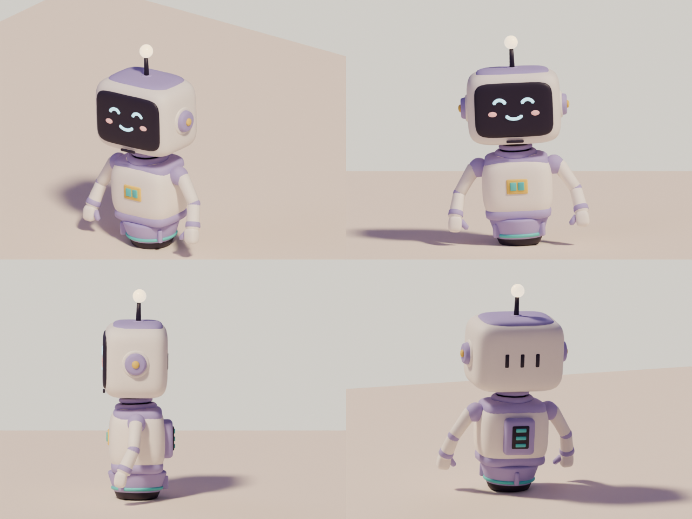
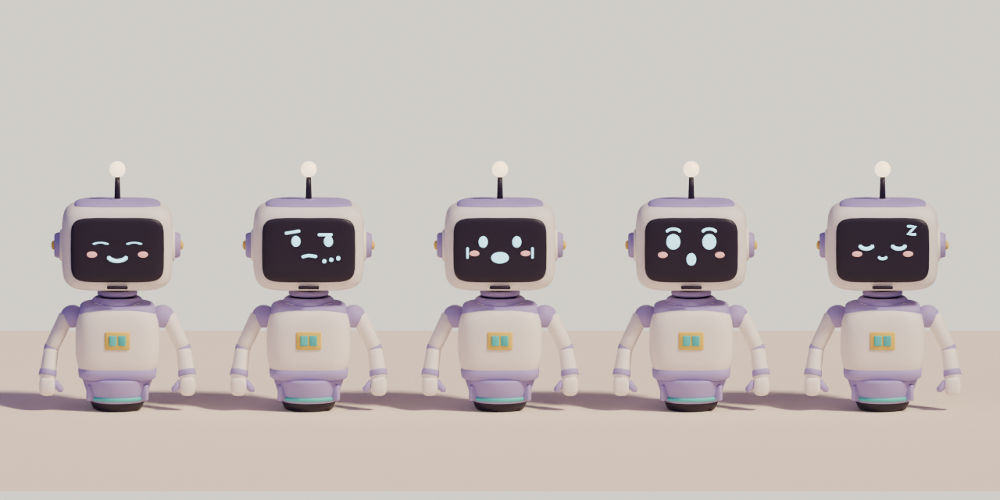
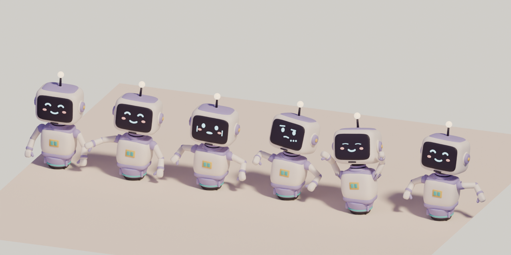
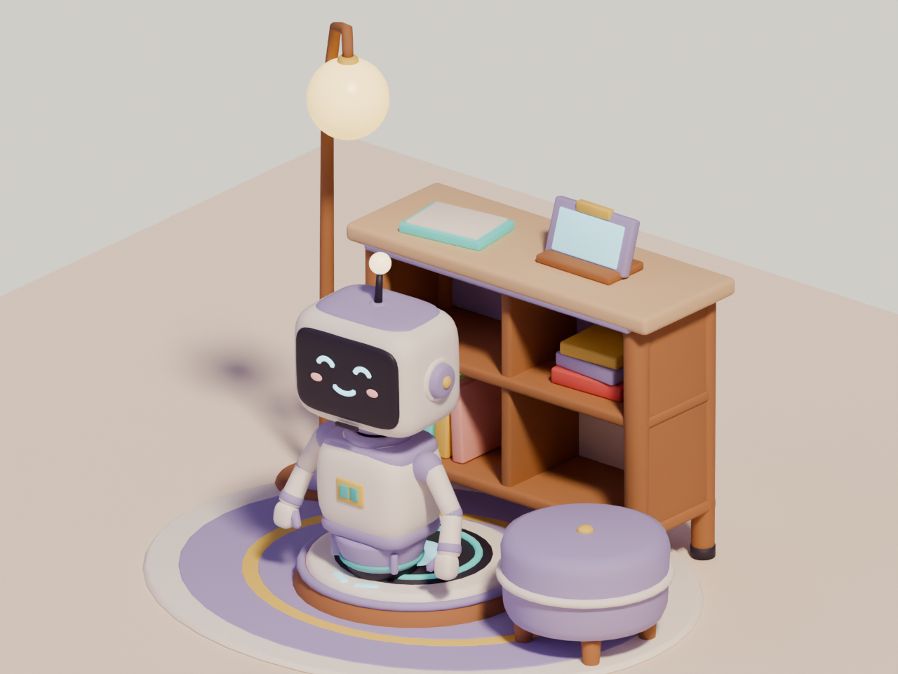
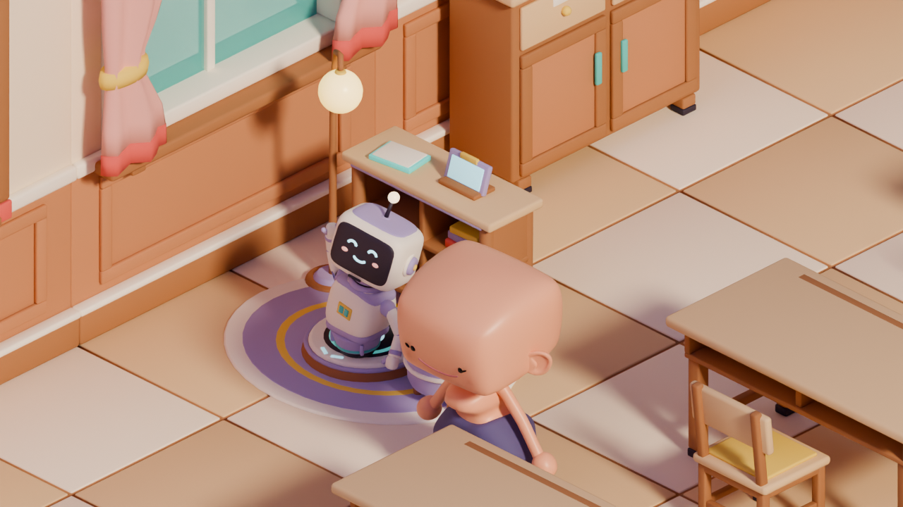
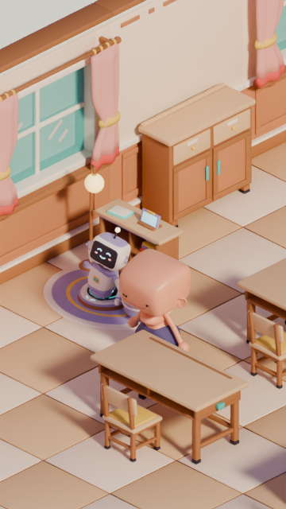
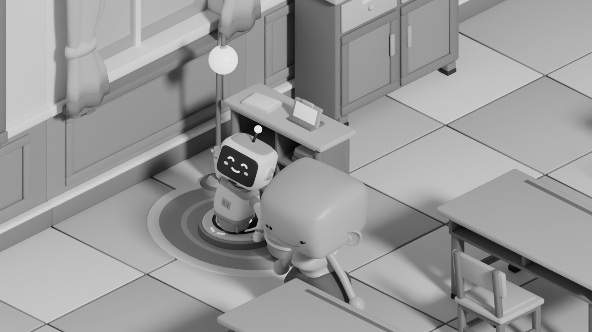

# Tutor Bot, Bot Station & 2D Icon — Modular Section 5 Assets

Complete Section 5 **The bot** asset suite from the [asset wishlist](asset-wishlist.md), authored in Blender 5.2.2 LTS under [art direction](../../rules/art-direction.md), [3D world and camera](../../rules/3d-world-and-camera.md), and [AI bot and daily briefing](../../rules/ai-bot-and-daily-briefing.md). Following the modular rigged character conventions in [modular avatar assets](../../rules/modular-avatar-assets.md), `tutor-bot.glb` splits into `16` semantic `Bot_*` sub-meshes bound to a clean `26`-bone skeleton (`TutorBotRig`) with `5` facial morph targets and `11` exported glTF animations (`6` full-body clips + `5` standalone face-state clips), paired with the lavender Tutor Corner `bot-station.glb` (`9` static `Station_*` meshes) and the vector `2D bot icon` (`public/icons/tutor-bot.svg`).

> **Scope note:** This slice delivers the Section 5 `.blend` masters, Draco-compressed `.glb` runtime assets, 2D SVG icon, structural verification test, and visual Cycles renders on `feat/interactive-objects-assets`, checking off the 14 delivered Section 5 items in [the asset wishlist](asset-wishlist.md) (leaving `Color or accessory variants (future shop items)` unchecked) without modifying `src/`, `e2e/`, or existing classroom/pet assets. Wiring the Tutor Bot and Bot Station into `src/features/world/classroom/build-classroom-scene.ts` and the study/daily-review UI belongs to a separate integration follow-up.

## Asset Summary

| Asset                   | Path                                                            |                     Size |   Meshes / Tris | Skeleton / Morphs / Clips                                                 | Dimensions / Pivot                                                                                                     |
| ----------------------- | --------------------------------------------------------------- | -----------------------: | --------------: | ------------------------------------------------------------------------- | ---------------------------------------------------------------------------------------------------------------------- |
| Tutor Bot master        | [tutor-bot.blend](../../assets/blender/bot/tutor-bot.blend)     |            `3,024,925` B | `16` / `25,544` | `TutorBotRig` (`26` bones) + `5` morphs + `11` NLA clips                  | `0.544 × 0.861 × 0.296 m`, rest grounded `Y = 0`, facing `+Z` in glTF (`-Y` in Blender), origin `(0, 0, 0)`            |
| Tutor Bot GLB (Draco)   | [tutor-bot.glb](../../public/models/bot/tutor-bot.glb)          | `382,208` B (`373.3` KB) | `16` / `25,544` | `26` joints (`1..2` weights/vert, `0` unweighted), `5` morphs, `11` clips | `36.4%` of the `1 MB` (`1,048,576` B) FD8 avatar/character budget; `0` lights, `0` cameras                             |
| Bot Station master      | [bot-station.blend](../../assets/blender/bot/bot-station.blend) |              `818,172` B |  `9` / `11,396` | Static modular corner (`0` bones, `0` animations)                         | `1.532 × 1.350 × 1.278 m` (console height `<= 0.90 m` under window sill), floor `Y = 0`, facing `+Z`, origin `(0,0,0)` |
| Bot Station GLB (Draco) | [bot-station.glb](../../public/models/bot/bot-station.glb)      |   `60,072` B (`58.7` KB) |  `9` / `11,396` | Static Draco GLB (`0` animations, `0` lights, `0` cameras)                | `5.7%` of the `1 MB` FD8 individual limit; dock top at local `(0, 0.095, +0.06)`                                       |
| 2D Bot Icon (SVG)       | [tutor-bot.svg](../../public/icons/tutor-bot.svg)               |                `2,193` B |      Vector SVG | `viewBox="0 0 64 64"`, no scripts or external URLs                        | Friendly lavender/cream portrait matching `Bot_Head` for Study Guide panel & Daily Review modal                        |

- Standalone structural test: [`scripts/assets/test-tutor-bot.mjs`](../../scripts/assets/test-tutor-bot.mjs).
- **Strict separation from Michi (`classroom-pet`)**: Neither `tutor-bot.glb`, `bot-station.glb`, nor `tutor-bot.svg` reuses Michi's `#65B96A` green; the Tutor Bot uses the Tutor Corner lavender `#B5A7D6` + pale cream `#FFF9EB` + glowing sky `#A9E7F4` screen identity and sits on the left-wall sunlit Tutor Corner across the room from Michi's right-wall Pet Corner.

## Tutor Bot Sub-Meshes (`16` semantic `Bot_*` objects)

| Sub-mesh             | Region covered                                                                      | Materials                                                                                       | Morph targets  |
| -------------------- | ----------------------------------------------------------------------------------- | ----------------------------------------------------------------------------------------------- | -------------- |
| `Bot_Head`           | Beveled rounded-cube monitor shell, lavender crown crest, rear vents                | `BotShellTint`, `BotAccentTint`, `BotBezelSlate`                                                | —              |
| `Bot_ScreenBezel`    | Rounded dark slate monitor bezel & chin speaker bar                                 | `BotBezelSlate`                                                                                 | —              |
| `Bot_ScreenBase`     | Gently convex curved LCD screen surface                                             | `BotScreenGlass`                                                                                | —              |
| `Bot_Face_Happy`     | Cheerful `^ ^` curved eyes, `:)` smile, soft peach cheeks                           | `BotFaceGlow`, `BotFaceCheek`                                                                   | `Blink`        |
| `Bot_Face_Thinking`  | Looking-up eyes, quizzical brow, wavy mouth, 3 thought dots (`...`)                 | `BotFaceGlow`                                                                                   | `ThinkPulse`   |
| `Bot_Face_Talking`   | Bright eyes, open talking mouth capsule, flanking wave bars & cheeks                | `BotFaceGlow`, `BotFaceCheek`                                                                   | `MouthTalk`    |
| `Bot_Face_Surprised` | Wide bright circular eyes, lifted brows, small `o` mouth & cheeks                   | `BotFaceGlow`, `BotFaceCheek`                                                                   | `SurprisedPop` |
| `Bot_Face_Sleeping`  | Peaceful downward crescent eyes (`∪ ∪`), calm mouth, floating `Z` & blush           | `BotFaceGlow`, `BotFaceCheek`                                                                   | `SleepFloat`   |
| `Bot_EarPods`        | Paired lavender audio ear-muff pods with cream rings & butter studs                 | `BotAccentTint`, `BotShellTint`, `BotHighlightButter`                                           | —              |
| `Bot_Antenna`        | Lavender base collar, flexible dark stem, glowing butter orb tip                    | `BotAccentTint`, `BotBezelSlate`, `BotGlowWarm`                                                 | —              |
| `Bot_Neck`           | Ribbed flexible collar bridging torso and head cleanly during tilt                  | `BotBezelSlate`, `BotAccentTint`                                                                | —              |
| `Bot_Torso`          | Tapered cream shell, waist/shoulder trim, chest study book badge, rear battery pack | `BotShellTint`, `BotAccentTint`, `BotHighlightButter`, `BotHighlightTurquoise`, `BotBezelSlate` | —              |
| `Bot_UpperArms`      | Lavender shoulder caps, cream upper arms & soft lavender elbow spheres              | `BotAccentTint`, `BotShellTint`                                                                 | —              |
| `Bot_Forearms`       | Cream forearms with lavender wrist cuffs                                            | `BotShellTint`, `BotAccentTint`                                                                 | —              |
| `Bot_Hands`          | Cozy rounded mitten palms with articulated inner thumbs                             | `BotShellTint`, `BotAccentTint`                                                                 | —              |
| `Bot_HoverBase`      | Tapered thruster bell, 3 aerodynamic fins, turquoise ring & warm emitter            | `BotAccentTint`, `BotBezelSlate`, `BotHighlightTurquoise`, `BotGlowWarm`                        | —              |

## Canonical 26-Bone Skeleton (`TutorBotRig`) & Future Shop Anchors

Every joint uses clean English `DEF-*` naming with `1..2` normalized influences per vertex (`0` unweighted vertices) and identity root transforms, ready for future shop accessory variants (`hats`, `glasses`, `scarves`, `badges`) without modifying base geometry:

| Region         | Bones (`TutorBotRig`, 26 total)                                                                      | Primary role & future accessory anchor                          |
| -------------- | ---------------------------------------------------------------------------------------------------- | --------------------------------------------------------------- |
| Root & hover   | `DEF-root` → `DEF-pelvis` → `DEF-thruster`                                                           | Hover bobbing (`IdleHover`, `Celebrate`) & thruster tilt        |
| Spine & neck   | `DEF-spine` → `DEF-spine.001` → `DEF-neck` → `DEF-head`                                              | Torso lean/twist; `DEF-spine.001` badge/cape, `DEF-neck` scarf  |
| Head & antenna | `DEF-ear.L`, `DEF-ear.R`, `DEF-antenna.001` → `DEF-antenna.002` (children of `DEF-head`)             | Ear twitches, springy antenna lag, `DEF-head` crown/hat/visor   |
| Face layers    | `DEF-face_happy`, `DEF-face_thinking`, `DEF-face_talking`, `DEF-face_surprised`, `DEF-face_sleeping` | Stepped screen-plane swap (`0` vs `+18 mm` retraction)          |
| Left arm       | `DEF-shoulder.L` → `DEF-upper_arm.L` → `DEF-forearm.L` → `DEF-hand.L` → `DEF-thumb.L`                | Relaxed rest A-pose, explanatory gestures & hand items          |
| Right arm      | `DEF-shoulder.R` → `DEF-upper_arm.R` → `DEF-forearm.R` → `DEF-hand.R` → `DEF-thumb.R`                | Raised friendly `Wave`, chin-rest `Think`, double V `Celebrate` |

## Facial Screen Expressions, Morph Targets & Animation Clips (`11` total)

- **Clean screen switching**: In rest pose, `Bot_Face_Happy` sits `2.2 mm` proud of `Bot_ScreenBase`, while the other 4 `Bot_Face_*` meshes sit `18 mm` recessed inside the opaque head behind `Bot_ScreenBase`. Stepped (`CONSTANT`) bone translation tracks swap the active expression onto the screen without scale-zero artifacts or rest-pose Z-fighting.
- **5 Morph targets**: `Blink` (`Bot_Face_Happy`), `ThinkPulse` (`Bot_Face_Thinking`), `MouthTalk` (`Bot_Face_Talking`), `SurprisedPop` (`Bot_Face_Surprised`), and `SleepFloat` (`Bot_Face_Sleeping`).
- **6 Core body clips (24 fps)**: `IdleHover` (48f loop, hover + `Blink`), `Wave` (48f, high right-arm wave + head tilt), `Talk` (48f loop, alternating open-palm gestures + `Talking` + `MouthTalk`), `Think` (60f, chin-rest pose + `Thinking` + `ThinkPulse`), `Celebrate` (60f, anticipation dip + high hover jump + double V-cheer + `Surprised` flash → `Happy`), and `Encourage` (60f, empathetic nod + supportive forward gesture).
- **5 Standalone face-state clips (24 fps)**: `Face_Happy`, `Face_Thinking`, `Face_Talking`, `Face_Surprised`, and `Face_Sleeping` (24f each, keying the active face bone + morph animation).

## Bot Station (`bot-station.glb`) — `9` Semantic `Station_*` Meshes

| Sub-mesh               | Role in Tutor Corner                                                                                        |
| ---------------------- | ----------------------------------------------------------------------------------------------------------- |
| `Station_Rug`          | Circular lavender rug (`#B5A7D6`) with cream & butter rings defining the Tutor Corner footprint             |
| `Station_DockPedestal` | Sturdy wood & cream low hover-charge platform (top anchor at local `(0, 0.095, +0.06)` in Three.js)         |
| `Station_ChargeRing`   | Recessed slate pad with glowing turquoise hover ring & sky-blue front chevrons                              |
| `Station_BackConsole`  | Low curved wood/cream study shelf console (`<= 0.78 m` tall, clearing the `1.00 m` classroom window sill)   |
| `Station_Books`        | Upright and stacked colorful study guidebooks & open tabletop notebook                                      |
| `Station_StudySign`    | Tilted lavender & sky-blue study tablet stand with butter header crest                                      |
| `Station_LampStem`     | Curved wood & lavender floor lamp beside the console (`1.24 m` reach, clear of window curtains)             |
| `Station_LampGlobe`    | Soft glowing warm spherical shade (`#FFF0D8` / `#F7D86B`) per [art direction](../../rules/art-direction.md) |
| `Station_Pouf`         | Cozy tufted lavender student seat on rounded wood legs beside the dock                                      |

## Visual Previews

| View                                                                                        | Preview                                                                            |
| ------------------------------------------------------------------------------------------- | ---------------------------------------------------------------------------------- |
| 2×2 studio turnaround (`3/4`, `front`, `side`, `rear`, `1280×960`)                          |             |
| All 5 face/screen expressions (`Happy`, `Thinking`, `Talking`, `Surprised`, `Sleeping`)     |        |
| All 6 animation hero poses (`IdleHover`, `Wave`, `Talk`, `Think`, `Celebrate`, `Encourage`) |  |
| Tutor Bot hovering on the lavender Bot Station (`1280×960`)                                 |               |
| Classroom Tutor Corner scale check beside student avatar & curtains (`1280×720`)            |   |
| Portrait mobile readability check (`360×640`)                                               |              |
| Grayscale value-separation check (`1280×720`)                                               |               |

## Palette & Materials (`metallic = 0.0` throughout)

| Material                | Color / Purpose                                                     | Roughness |
| ----------------------- | ------------------------------------------------------------------- | --------: |
| `BotShellTint`          | `#FFF9EB` pale cream primary shell (future shop tintable)           |    `0.58` |
| `BotAccentTint`         | `#B5A7D6` Tutor Corner lavender (future shop tintable)              |    `0.62` |
| `BotHighlightButter`    | `#F7D86B` chest study badge & ear-pod studs                         |    `0.55` |
| `BotHighlightTurquoise` | `#62CFC7` book emblem, rear battery pips & thruster ring            |    `0.52` |
| `BotBezelSlate`         | `#382F3F` screen bezel, neck/thruster details & antenna stem        |    `0.50` |
| `BotScreenGlass`        | `#2E2A42` curved LCD screen surface                                 |    `0.26` |
| `BotFaceGlow`           | `#A9E7F4` glowing sky-blue eyes, mouth & glyphs (emission `1.35`)   |    `0.25` |
| `BotFaceCheek`          | `#F5B5AB` soft peach rosy cheeks (emission `0.55`)                  |    `0.45` |
| `BotGlowWarm`           | `#F7D86B` / `#FFF0D8` antenna orb & hover emitter (emission `1.60`) |    `0.28` |

## Three.js Integration Contract

- **Transform & scale**: `1 unit = 1 meter`, `+Y` up, grounded `Y = 0.0`, facing `+Z`, identity root transforms.
- **Classroom Tutor Corner placement**: Place `bot-station.glb` at `(-6.95, 0, +1.05)` with `rotation.y = +Math.PI / 2` (facing `+X` into the room under the left window bay, clear of `cabinet` and `bulletin-board`), and mount `tutor-bot.glb` at `(-6.89, 0.095, +1.05)` with `rotation.y = +Math.PI / 2` hovering over `Station_ChargeRing`.
- **Tinting & state**: Clone `BotShellTint` and `BotAccentTint` per instance for future shop variants; drive animations with `THREE.AnimationMixer` (`IdleHover` default, `Wave` on greeting, `Talk` / `Think` / `Celebrate` / `Encourage` on study events, `Face_Sleeping` when idle/exam-blocked).
- **2D UI icon**: Render `/icons/tutor-bot.svg` (`public/icons/tutor-bot.svg`) in the Study Guide panel header and Daily Review modal (`24–64 px`).

Rules: [art direction](../../rules/art-direction.md), [3D world and camera](../../rules/3d-world-and-camera.md), [AI bot and daily briefing](../../rules/ai-bot-and-daily-briefing.md), [modular avatar assets](../../rules/modular-avatar-assets.md).
