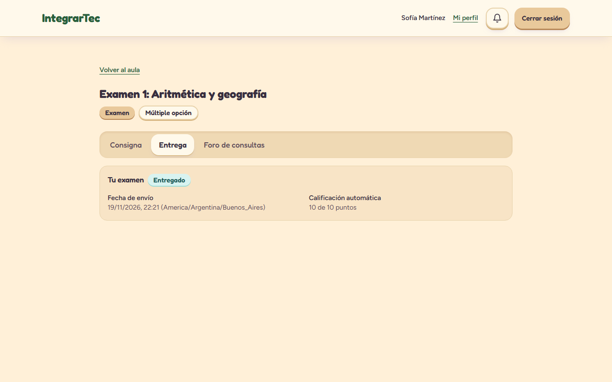
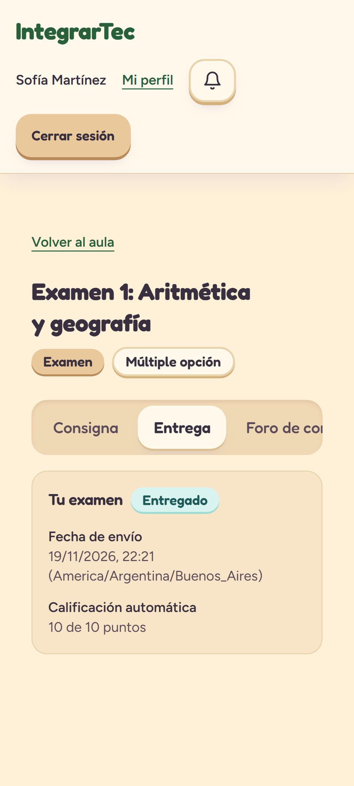

# Student multiple-choice exam answering

The `Entrega` tab of a published `MULTIPLE_CHOICE` activity shows the student
exam answering panel ([#43](https://github.com/Agustin742/integratec-final-front/issues/43),
`HU-ACT-003` part 2/2): one keyboard-operable option group per published
question, a submit confirmation, answer retention across recoverable failures,
and the server-confirmed result. The browser never computes a score and no
correct answer ever reaches the client ([activities and grading
rules](../rules/activities-and-grading.md)). File-submission activities keep
the `#42` `SubmissionPanel`; the module lives in
`src/features/classrooms/activities/exam/`.

## Where it mounts

`ActivityDetailRoute` (`submission/activity-detail-route.tsx`) fills the
`Entrega` tab of `ActivityDetailPage` through `renderSubmissionTab`, branching
on the server-confirmed activity `format`: `MULTIPLE_CHOICE` renders
`ExamAnsweringPanel`, everything else renders the `#42` file submission panel.
The tab stays capability-gated (`participate_activities`), and the questions
rendered come from the student detail response
(`StudentActivityResponseDto`), whose options never expose `isCorrect`
(`RN-06`).

## Requirements mapping

- **`RN-04` (uniform security responses):** every read and write goes through
  the session-authenticated API client; the server alone decides access. A
  `403` renders the students-only refusal copy, a `404` the not-found copy,
  and the private server diagnostics are never rendered.
- **`RN-05` (activity lifecycle and deadlines):** the answering window is
  server authority. The panel shows a display-only pre-check (not open yet /
  closed without late allowance) that disables the send with the reason, while
  the server still rejects out-of-window attempts with `409` and the UI shows
  that outcome — never an assumed one.
  A late-accepted attempt shows the `Entrega tardía` badge from the server's
  `isLate`.
- **`RN-06` (grading and answer privacy):** the client sends answers only
  (`{ questionId, optionId }`); the server grades the attempt and the response
  carries `autoScore`. The result view shows the aggregate
  server-computed score only — no per-question correctness, no correct
  options, no client-side score — and the question list is gone once graded.

## Backend contract (`back#47`, shipped)

[Agustin742/integratec-final-back#47](https://github.com/Agustin742/integratec-final-back/issues/47)
shipped in `back/develop`: multiple-choice answers reuse the file submission
endpoints, and the generated types in `src/api/schema.generated.ts` cover
them. The typed service (`exam-service.ts`) and the jitless Zod schema
(`exam-schema.ts`) sit on those generated types:

- `POST /activities/{activityId}/submissions` is `multipart/form-data` with a
  client-generated `Idempotency-Key` header (one key per answered attempt,
  rotated when the selection changes, reused across retries so the server
  reconciles instead of duplicating the attempt). A multiple-choice activity
  sends only the `answers` field: a JSON-encoded array of
  `{ questionId, optionId }`, one pair per question (at least one). The body is
  a `FormData` returned as-is by the `bodySerializer`, so the browser sets the
  multipart boundary. Responses: `200` idempotent replay (the stored
  submission, never re-scored), `201`, `400`, `401`, `403`, `404`, `409`,
  `413`.
- `GET /activities/{activityId}/submissions/me` returns the stored submission
  (`id`, `activityId`, `submittedAt`, `isLate`, `autoScore`, `status`,
  `answers: [{ questionId, optionId, position }]`) and is not cacheable
  (`staleTime 0`, `gcTime 0`, user+classroom+activity-scoped
  `classroomExamAttemptQueryKey`). The key is kept apart from the file
  submission key because a missing submission reads as `null` here and throws
  in the file read.

The server grades the answers (`autoScore = round(correct / questions ×
maxScore)`, `0..maxScore`) and never returns the correct options. The
submission has no `maxScore`: the panel renders `autoScore` against the
activity detail's `maxScore`. `status` is derived from a teacher grade, so an
auto-scored submission reads `submitted` until a teacher grades it; the badge
shows `Entregado` or `Calificado` from that value.

Error handling branches on status, code and detail field, never on server
message text:

- `409` covers four reasons (window not open, window closed without late
  allowance, a submission already stored under another key, wrong format) with
  the same `activity` detail field, so the reason is not machine-readable. The
  panel reads the own submission after a `409`: a stored submission is shown as
  confirmed, otherwise the generic conflict copy names the possible causes.
- `400` (`answers` or `Idempotency-Key` detail), `403` (staff and parents),
  `404` (unknown, draft or non-member activity) and `413` map to feature copy.
- `GET .../me` answers one generic `404` envelope for "Submission not found"
  and "Activity not found" (same code and message, no details), so a `404`
  reads as "nothing submitted yet"; the activity detail query that mounts the
  panel owns activity existence. `403` and every other failure stay errors.

The stateful MSW store `createExamSubmissionsStore`
(`src/test/msw/handlers.ts`) serves both endpoints with the same status
codes, idempotent replay, window checks, answer validation and the server
scoring formula: correct answers live only inside the store and are never part
of any response. A passing mock is not integration proof; the contract was
also checked against a running backend.

## User-visible states

- **Loading:** the panel consults `GET .../submissions/me` before rendering
  the form (`Consultando tu examen`).
- **Empty:** no published questions renders an honest empty state (nothing to
  answer, consult the teacher); no attempt yet renders the answering form
  with the deadline, late policy and instructions.
- **Error:** read-own failures render the shared error state with retry;
  `403`/`404` never disclose other data.
- **Uncertain:** a network failure or `5xx` on the submit is never treated as
  proof of failure. The panel reconciles with the server first: the stored
  attempt surfaces as confirmed (`Tu examen ya está registrado`), a verified
  nothing-stored outcome offers a retry that keeps the same idempotency key
  and selections, and a failed verification offers only "verify again" —
  never a blind resubmission. Definite server rejections keep the selected
  answers and explain the refusal.
- **Result:** the submitted attempt shows the `Entregado` badge (`Calificado`
  once a teacher grades it), the late badge when the server says so, the
  submit instant in the school time zone, and the automatic score as `X de Y
puntos` (`autoScore` of the activity `maxScore`) — all from the server.

## Accessibility

- Each question is a native `<fieldset>` with a `Pregunta N de M` legend; the
  options are real radio inputs (single selection per question, per the
  contract's one-correct-answer rule) reachable by keyboard, with visible
  focus and a checked style driven by the input state (`has-[:checked]`).
  The inputs are visually hidden inside their `<label>` touch targets, so
  pointer and touch users activate the label card, not a tiny circle.
- The send action asks for confirmation in a dialog (`Confirmar envío`) that
  states the answers cannot be changed and that the server computes the
  grade, with a `Seguir respondiendo` way back.
- Answering copy is centralized in `exam-messages.ts` (`es-AR`), and pending
  work is visibly distinct from confirmed results, including the
  duplicate-activation guard on the whole submit attempt.

## UI evidence

Desktop 1280px, server-confirmed result after submitting
(`e2e/exam-answering.spec.ts`):

Mobile 360px, same state:

All data in the captures is synthetic; the spec produces them with
CSP-violation and page-error monitors and no-horizontal-overflow checks at
both sizes. See [classroom activities](./classroom-activities.md),
[panel integration](./classroom-panels.md), and [activities and grading
rules](../rules/activities-and-grading.md).
