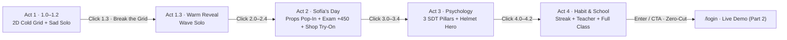

# Interactive 3D Pitch Deck (`/pitch`) — Specification & Storyboard

> [!NOTE]
> **Status: Implemented prototype on `feat/pitch-presentation` (pending user review).**
> This document defines the architecture, timings, visual concepts ("la ilusión del hype"), 3D choreography, character configurations, and click-by-click script alignment for **Part 1 (6 minutes, 4 speakers, no live demo)** of the source script (`c:\Users\matia\OneDrive\Escritorio\guion-presentacion.md`). Part 2 (the 14-minute live demo) is intentionally excluded from the slide deck; the final click transitions directly to `/login` to start Part 2 without window switching.

## Quick Summary

- **Target route:** `/pitch` (public full-viewport 16:9 interactive web stage, lazy-loaded route outside `AppShell` and `RequireAuth`).
- **Scope:** 4 Acts · **17 Click Beats** (`1.0`–`4.2`) · **6:00 total runtime** (~140 words/minute).
- **Resource-saving strategy:** Mount **one persistent** [`WorldCanvas`](../../src/features/world/world-canvas.tsx) (`framing="follow"`, `scopeKey="pitch-deck"`) for the entire 6-minute talk. All `.glb` models load once via `readCachedGlbAsset` ([`3d-assets.md`](../3d-assets.md)); advancing slides never unmounts WebGL or reloads geometry.
- **Implementation folder:** [`src/features/pitch/pitch-deck-page.tsx`](../../src/features/pitch/pitch-deck-page.tsx) (plus modular script, camera rig, 3D stage, HUD overlays, centralized messages, and unit/accessibility tests).
- **Navigation controls:** `Click`, `Space`, or `ArrowRight` advances one beat; `ArrowLeft` steps back; keys `1`–`4` jump to Act 1–4; `T` toggles the speaker cue bar; `Enter` on the final beat navigates to `/login`.

---

## Golden Rules & Visual Foundation ("La Ilusión del Hype")

1. **Honesty Boundary (Rule 1 — No Unimplemented Promises):** Everything spoken and rendered on `/pitch` corresponds to implemented application capabilities ([`documentation-and-decisions.md`](../../rules/documentation-and-decisions.md)). Excluded items from _"Lo que NO se promete"_:
   - Classroom pet "Michi" gameplay or accessories.
   - Parent/guardian tracking tools.
   - Live teacher controls (freeze students, mute, live video calls, collaborative whiteboard).
   - Random lootboxes, gacha, or luck-based roulettes.
2. **Moving Characters + Script Support Text (Rule 2):** Every click combines at least one live animated [`AvatarModel`](../../src/features/world/avatar/avatar-model.tsx) (using the 16 canonical clips in [`avatar-animations.md`](../art/avatar-animations.md)) with low-density _speaker-led_ overlay typography (`--font-display` Fredoka + `--font-body` Figtree from [`tokens.css`](../../src/styles/tokens.css)). Slides reinforce spoken phrases instead of dumping paragraphs.
3. **Single Persistent 3D Stage (Rule 3 — Web Resource Efficiency):** Adapts the `16:9` fixed stage and `transform`/`opacity`-only DOM motion discipline to an integrated React + React Three Fiber scene, keeping GPU memory and CPU load stable on presentation laptops.

### Color Tokens & Emotional Contrast ([`art-direction.md`](../../rules/art-direction.md))

| Phase                              | Palette & Lighting Mood                                                                                        | Purpose in "La Ilusión del Hype"                                                    |
| ---------------------------------- | -------------------------------------------------------------------------------------------------------------- | ----------------------------------------------------------------------------------- |
| **Act 1 (`1.0`–`1.2`)**            | Cold slate `#353849`, deep ink `#382F3F`, muted desaturated `#5C4B59`, dim cool fill                           | Mimics a lifeless video-call grid and amplifies emotional isolation.                |
| **Break the Grid (`1.3`) → Act 4** | Light cream `#FFF0D8`, Pale cream `#FFF9EB`, Sand `#E9C99B`, Wood `#AF7B52`, Lavender ambient shadow `#B5A7D6` | Warm, tactile toy/resin diorama (`WarmLighting`) that physically feels inviting.    |
| **Zone & Pillar Accents**          | Coral `#E66861`, Turquoise `#62CFC7`, Butter `#F7D86B`, Leaf green `#65B96A`, Peach `#F5B5AB`                  | Highlights classroom zones, Self-Determination pillars, points, and earned streaks. |

---

## Five High-Impact "Hype" Mechanics

| ID     | Mechanic                                        | Where Used                 | Technical Execution                                                                                                                                                                                                                                      |
| ------ | ----------------------------------------------- | -------------------------- | -------------------------------------------------------------------------------------------------------------------------------------------------------------------------------------------------------------------------------------------------------- |
| **M1** | **Break the Grid**                              | `1.0` → `1.3`              | A 9-tile 2D dark video-call overlay sits above the preloading `<WorldCanvas>`. On Click `1.3`, the 2D tiles split outward (`transform` + `opacity`) and `WarmLighting` swells in, revealing the live 3D classroom.                                       |
| **M2** | **Pop-In 3D Props**                             | `2.2`, `2.4`, `4.1`        | Real classroom GLBs (`board.glb`, `bookshelf.glb`, `bulletin-board.glb`, `shop-kiosk.glb`) enter via damped scale overshoot (`0 → 1.08 → 1.0` in `useFrame`) paired with floating zone-accent pills.                                                     |
| **M3** | **Hype HUD Micro-Simulations**                  | `2.3`, `2.4`, `3.2`, `4.0` | Synchronized DOM overlays react to character clips: auto-graded exam card (`3/3 100/100`), animated `+450 pts` counter, live 4-item accessory quick-swap on Sofía, and 7-day streak chain.                                                               |
| **M4** | **Dynamic Orthographic Rig (`PitchCameraRig`)** | All acts                   | Smoothly damps (`MathUtils.damp`) look-at target `(x, y, z)` and frustum `visibleHeight` inside `<WorldCanvas framing="follow">` while preserving the isometric `35.264°` elevation and `45°` azimuth. Snaps immediately under `prefers-reduced-motion`. |
| **M5** | **Speaker Teleprompter & Zero-Cut Handoff**     | Bottom bar + `4.2`         | Discreet bottom bar shows active speaker, act window, click dots, and next-click spoken cue. Pressing `Enter` or clicking CTA on `4.2` routes directly to `/login` in the same tab.                                                                      |



---

## Cast of 3D Characters (Contract-Valid Configurations)

All avatar configurations match the valid unions in [`src/features/profile/messages.ts`](../../src/features/profile/messages.ts) and the equippable shop codes in [`accessory-catalog.ts`](../../src/features/world/avatar/accessory-catalog.ts).

| Character   | Role                         | Base `Avatar` Fields                                                                                                          | Equipped Accessories (`AvatarEquipped`)                                                                                                       | Narrative Arc                                                                                                |
| ----------- | ---------------------------- | ----------------------------------------------------------------------------------------------------------------------------- | --------------------------------------------------------------------------------------------------------------------------------------------- | ------------------------------------------------------------------------------------------------------------ |
| **Sofía**   | Protagonist student          | `bodyId: 'female'`, `hairId: 'long-wavy'`, `topId: 'hoodie'`, `hairColor: '#6C4D48'`, `clothingColor: '#5B4F96'`              | Act `2.4` switches `head_crown` / `face_sunglasses` / `back_wings` / `head_astronaut_helmet`; Acts `3.4` & `4.x` keep `head_astronaut_helmet` | Enters her chosen classroom, earns points, chooses and wears the astronaut helmet in front of peers.         |
| **Lucas**   | Lonely student → Classmate A | `bodyId: 'male'`, `hairId: 'classic-short'`, `topId: 'school-sweatshirt'`, `hairColor: '#353849'`, `clothingColor: '#75B7DA'` | None                                                                                                                                          | Opens alone in `Sad` (`1.1`–`1.2`), leads the emotional shift (`Wave` in `1.3`), then joins Sofía as a peer. |
| **Mateo**   | Classmate B                  | `bodyId: 'male'`, `hairId: 'short-curls'`, `topId: 'track-jacket'`, `hairColor: '#AF6D63'`, `clothingColor: '#7EBA8B'`        | `{ back: 'back_backpack' }`                                                                                                                   | Reinforces classroom presence, live peer interaction, and group cheering.                                    |
| **Docente** | Teacher                      | `bodyId: 'male'`, `hairId: 'side-part'`, `topId: 'shirt-and-tie'`, `hairColor: '#6C4D48'`, `clothingColor: '#F4E6D2'`         | `{ face: 'face_round_glasses' }`                                                                                                              | Appears in Act 4 (`TeacherExplain`, `TeacherPoint`) showing unified teaching + Study Guide Bot support.      |

---

## 3D Classroom Props Inventory (`GlbAsset`)

All props are loaded via [`GlbAsset`](../../src/features/world/glb-asset.tsx) directly from `public/models/scenes/classroom/`:

| Prop Key        | GLB Path                                                  | Role in Deck                                         | First Pop-In Click |
| --------------- | --------------------------------------------------------- | ---------------------------------------------------- | ------------------ |
| `board`         | `/models/scenes/classroom/furniture/board.glb`            | Activities & multiple-choice exams                   | `2.2`              |
| `bookshelf`     | `/models/scenes/classroom/furniture/bookshelf.glb`        | Teacher-uploaded study materials & cited bot sources | `2.2`              |
| `bulletinBoard` | `/models/scenes/classroom/interactive/bulletin-board.glb` | Course announcements & notifications                 | `2.2`              |
| `shopKiosk`     | `/models/scenes/classroom/interactive/shop-kiosk.glb`     | Classroom reward shop & accessory goal               | `2.4`              |

---

## Complete Click-by-Click Master Table (17 Beats · 6:00)

| Beat    | Speaker   | Time        | Concept / "Hype" Beat                       | Camera (`visibleHeight`, target `[x, y, z]`) | Visible Characters & Clips                                                                                             | 3D Props                                     | Overlay HUD & Support Text                                                                                                 | Spoken Cue (Script Trigger)                                              |
| ------- | --------- | ----------- | ------------------------------------------- | -------------------------------------------- | ---------------------------------------------------------------------------------------------------------------------- | -------------------------------------------- | -------------------------------------------------------------------------------------------------------------------------- | ------------------------------------------------------------------------ |
| **1.0** | Persona 1 | `0:00–0:25` | Hook: lifeless video grid                   | `5.8`, `[0, 0.9, 0]` (behind grid)           | Lucas preloaded (`Sad`)                                                                                                | None                                         | 9 black video tiles, muted mics, _"Cámara apagada"_                                                                        | _"Piensen en la última clase virtual a la que asistieron..."_            |
| **1.1** | Persona 1 | `0:25–0:50` | Isolation in online learning                | `2.6`, `[0, 0.95, 0]` (close-up)             | Lucas: `Sad`                                                                                                           | None (dim spotlight)                         | Center tile peeks 3D; _"Estudiar en línea es práctico, pero es solitario."_                                                | _"Eso les pasa a miles de chicos todos los días..."_                     |
| **1.2** | Persona 1 | `0:50–1:15` | Disconnection cascade                       | `2.8`, `[0, 0.95, 0]`                        | Lucas: `ShakeHead`                                                                                                     | None                                         | Step pills fade: `Apaga cámara → No entrega → No aparece` + _"Un recordatorio no le da ganas a nadie."_                    | _"Primero apaga la cámara. Después no entrega..."_                       |
| **1.3** | Persona 1 | `1:15–1:30` | **M1 Break the Grid** + Product reveal      | `3.4`, `[0, 0.9, 0]`                         | Lucas: `Wave`                                                                                                          | Warm floor fades in                          | 2D grid shatters; Title: **"Aula Virtual 3D"** + _"¿Y si volver al aula fuera algo que el chico quiere hacer?"_            | _"Entonces nos hicimos una pregunta simple..."_                          |
| **2.0** | Persona 2 | `1:30–1:50` | Sofía enters her space                      | `3.4`, `[-0.2, 0.95, 0]`                     | Sofía: `Walk` → `Wave`                                                                                                 | Warm diorama floor                           | Card _"Sofía · 2do año"_ + style tags (`Peinado`, `Buzo elegido`)                                                          | _"Imaginen a Sofía, alumna de segundo año..."_                           |
| **2.1** | Persona 2 | `1:50–2:10` | Real-time peer presence                     | `4.6`, `[0, 0.9, 0]`                         | Sofía: `Wave`; Lucas: `Idle`; Mateo (`back_backpack`): `Wave`                                                          | Floor                                        | Floating chat pills (_"¡Hola Sofía!"_, _"¿Viste la tarea?"_) + _"Estudiar vuelve a ser con otros."_                        | _"Y no está sola. Sus compañeros están ahí..."_                          |
| **2.2** | Persona 2 | `2:10–2:30` | **M2 Pop-In** Functional classroom zones    | `5.8`, `[0, 1.0, -0.4]`                      | Sofía: `SitWrite`; Lucas: `Idle`; Mateo: `Think`                                                                       | `board`, `bookshelf`, `bulletinBoard` pop in | 4 color-coded zone pills (`Pizarrón · Actividades`, `Estantería · Material`, `Cartelera · Avisos`, `Foro por actividad`)   | _"Cada rincón del aula tiene una función..."_                            |
| **2.3** | Persona 2 | `2:30–2:45` | **M3** Instant grading & merit points       | `3.8`, `[-0.3, 0.95, 0.2]`                   | Sofía: `Clap`; Lucas: `Nod`; Mateo: `Clap`                                                                             | `board` visible                              | Floating exam card (`3/3 Correctas · 100/100`), `+450 pts`, badge _"Por lo que hizo de verdad"_                            | _"Cuando Sofía rinde un examen de opción múltiple..."_                   |
| **2.4** | Persona 2 | `2:45–3:00` | **M3** Shop try-on carousel (4 accessories) | `3.2`, `[0.2, 0.95, 0.3]`                    | Sofía swaps `head_crown` / `face_sunglasses` / `back_wings` / `head_astronaut_helmet` (`Cheer`); Lucas & Mateo: `Clap` | `shopKiosk` pops in                          | Live Shop Pill bar (`Corona` · `Anteojos` · `Alas` · **`Casco de astronauta · 250 pts`**)                                  | _"Con esos puntos puede ir a la tienda del aula..."_                     |
| **3.0** | Persona 3 | `3:00–3:25` | Intrinsic vs. Extrinsic motivation          | `3.8`, `[0, 0.95, 0]`                        | Sofía (`head_astronaut_helmet`): `Think`                                                                               | `board`, `shopKiosk`                         | Dual-card balance: _"Extrínseca (premio)"_ vs. _"Intrínseca (propósito)"_ + _"El premio acompaña al esfuerzo"_             | _"Nada de esto es un adorno. Detrás hay ideas muy estudiadas..."_        |
| **3.1** | Persona 3 | `3:25–3:45` | SDT Pillar 1: **Autonomía**                 | `3.4`, `[-0.5, 0.95, 0]`                     | Sofía swaps live `clothingColor` (`Idle` / `Wave`)                                                                     | `shopKiosk`                                  | Pillar `1/3` Coral `#E66861` active: **"Autonomía"** — _"Elegís cómo te ves: peinado, ropa y colores."_                    | _"Hay una teoría muy conocida... Autonomía, porque el chico elige..."_   |
| **3.2** | Persona 3 | `3:45–4:00` | SDT Pillar 2: **Sentirse capaz**            | `3.4`, `[0, 0.95, 0]`                        | Sofía: `Cheer`; Lucas: `Clap`                                                                                          | `board`                                      | Pillars `1–2` lit, Butter `#F7D86B` active: **"Sentirse capaz"** — progress bar, `+450 pts`, streak, medal badge           | _"Sentirse capaz, porque ve su progreso..."_                             |
| **3.3** | Persona 3 | `4:00–4:15` | SDT Pillar 3: **Pertenencia**               | `4.4`, `[0, 0.95, 0]`                        | Sofía, Lucas, Mateo gathered (`Wave` + `Clap`)                                                                         | `bulletinBoard`                              | All 3 SDT pillars lit, Turquoise `#62CFC7` active: **"Pertenencia"** — _"Cura la soledad de estudiar en línea."_           | _"Y pertenencia, porque está con sus compañeros..."_                     |
| **3.4** | Persona 3 | `4:15–4:30` | Goal-driven effort value                    | `2.8`, `[0, 1.0, 0.2]` (hero close-up)       | Sofía (`head_astronaut_helmet`): `Dance`                                                                               | `shopKiosk` behind                           | Progress-to-goal meter (`100% Meta lograda`) + _"Lo que conseguimos con esfuerzo, lo valoramos mucho más."_                | _"Cuando alguien ahorra para algo que desea..."_                         |
| **4.0** | Persona 4 | `4:30–5:00` | Habit loop & streak integrity               | `4.2`, `[0, 0.95, 0]`                        | Sofía (`head_astronaut_helmet`): `Nod`; Lucas: `SitWrite`; Mateo: `Nod`                                                | `board`                                      | 7-day streak chain (`D1 → D7`) + badge _"Sin ruletas · Sin azar · 100% actividad escolar"_                                 | _"Falta una pieza: el hábito. Cada día que un alumno entrega..."_        |
| **4.1** | Persona 4 | `5:00–5:35` | Value for school, teachers & Study Bot      | `5.0`, `[0, 1.0, -0.2]`                      | Docente (`face_round_glasses`): `TeacherExplain`; Sofía: `RaiseHand`; Lucas & Mateo: `SitWrite`                        | `board`, `bookshelf`, `bulletinBoard`        | 3 value cards: _"Docente: 1 solo lugar"_, _"Alumnos: acompañados"_, _"Asistente: solo material docente + fuentes citadas"_ | _"¿Qué se lleva la escuela? Docentes con un solo lugar..."_              |
| **4.2** | Persona 4 | `5:35–6:00` | Closing manifesto + Zero-cut demo handoff   | `5.2`, `[0, 0.95, 0]`                        | Full cast (Docente, Sofía with helmet, Lucas, Mateo) all in `Wave`                                                     | All 4 props framed                           | Closing quote hero card + CTA **"Y ahora se lo mostramos en vivo → (`/login`)"**                                           | _"No queremos que los chicos pasen más tiempo frente a una pantalla..."_ |

---

## Per-Act Storyboards & Visual Layouts

### Act 1 · Persona 1 — Gancho y Problema (`0:00 – 1:30`, Clicks `1.0`–`1.3`)

#### Concept & Timing

- **Goal:** Establish visceral contrast between today's passive video-call classrooms and the warmth of a shared 3D room.
- **Pacing:** ~22 seconds per beat (`1.0`–`1.2`), ending with a crisp 15-second emotional turn at `1.3`.

#### Visual Stage Layout (`1.0–1.2` vs `1.3`)

```text
Clicks 1.0 – 1.2 (2D Cold Video Grid)        Click 1.3 (Break the Grid -> Warm 3D)
+------------------------------------+       +------------------------------------+
| [cam off]   [cam off]   [cam off]  |       |  "¿Y si volver al aula fuera algo  |
| [cam off] [ 3D Lucas ]  [cam off]  |  ==>  |   que el chico quiere hacer?"      |
| [cam off]   [Sad 3D]    [cam off]  |       |        [  Warm 3D Diorama  ]       |
|                                    |       |         Lucas: Wave (3D)           |
| "Apaga cámara -> No entrega ->     |       |       "Aula Virtual 3D"            |
|  No aparece"                       |       |                                    |
+------------------------------------+       +------------------------------------+
```

---

### Act 2 · Persona 2 — Un Día en la Vida de Sofía (`1:30 – 3:00`, Clicks `2.0`–`2.4`)

#### Concept & Timing

- **Goal:** Walk the audience through concrete, already-built product mechanics through Sofía's eyes—avatar identity, real-time peers, room corners, instant exam points, and goal-oriented shop accessories.
- **3D Choreography:**
  - `2.0`: Sofía stands at `[0, 0, 0.2]` (`Walk` → `Wave`).
  - `2.1`: Lucas arrives at `[-1.5, 0, -0.4]` and Mateo (`back_backpack`) at `[1.5, 0, -0.4]`.
  - `2.2`: `board.glb` (`[0, 0, -2.6]`), `bookshelf.glb` (`[-2.8, 0, -2.2]`), and `bulletin-board.glb` (`[2.8, 0, -2.2]`) pop in with zone accent tags (`Turquoise`, `Butter`, `Coral`).
  - `2.3`: Exam HUD shows `3/3` + `+450 pts`; Sofía plays `Clap`.
  - `2.4`: `shop-kiosk.glb` pops in at `[2.4, 0, 0.2]`; Sofía swaps `head_crown` / `face_sunglasses` / `back_wings` / `head_astronaut_helmet` (`Cheer`), demonstrating live modular avatar composition (`composeAvatar()`).

#### Visual Stage Layout (`2.2`–`2.4`)

```text
+------------------------------------------------------------------------+
| [Turquoise: Pizarrón]     [Butter: Estantería]    [Coral: Cartelera]   |
|     [board.glb]             [bookshelf.glb]       [bulletin-board.glb] |
|                                                                        |
|        Lucas (Clap)        Sofía (Cheer + Helmet)      Shop Kiosk      |
|                                                         [shop-kiosk]   |
|  +-------------------------+   +------------------------------------+  |
|  | Examen: 3/3       +450pt|   | Probador: Corona|Lentes|Alas|Casco |  |
|  +-------------------------+   +------------------------------------+  |
+------------------------------------------------------------------------+
```

---

### Act 3 · Persona 3 — La Psicología Detrás del Aula (`3:00 – 4:30`, Clicks `3.0`–`3.4`)

#### Concept & Timing

- **Goal:** Ground the gamification in real educational psychology so the jury sees intentional design, not shallow game gimmicks:
  1. **Intrinsic vs. Extrinsic Balance (`3.0`):** Rewards follow real academic effort, never passive login.
  2. **Self-Determination Theory (`3.1`–`3.3`):** **Autonomía** (self-expression), **Sentirse capaz** (immediate feedback + visible progress), **Pertenencia** (live social presence).
  3. **Effort Justification (`3.4`):** Saving points toward the astronaut helmet makes the achievement personally meaningful.

#### Visual Stage Layout (`3.1`–`3.4`)

```text
+------------------------------------------------------------------------+
|  [1. AUTONOMÍA #E66861]  [2. SENTIRSE CAPAZ #F7D86B]  [3. PERTENENCIA] |
|                                                                        |
|           Lucas (Wave)       Sofía (Dance / Cheer)     Mateo (Clap)    |
|                              [Casco de Astronauta]                     |
|                                                                        |
|                "Lo que conseguimos con esfuerzo,                       |
|                     lo valoramos mucho más."                           |
+------------------------------------------------------------------------+
```

---

### Act 4 · Persona 4 — Hábito, Escuela y Cierre (`4:30 – 6:00`, Clicks `4.0`–`4.2`)

#### Concept & Timing

- **Goal:** Close with sustainable daily habits (streak chain, zero randomness), institutional value (unified teacher tools + material-grounded Study Guide Bot with cited sources), and a memorable emotional closing line leading straight into the live demo.
- **3D Choreography:**
  - `4.0`: 7-day streak chain overlay + `Nod`/`SitWrite` across students.
  - `4.1`: Docente (`face_round_glasses`, `shirt-and-tie`) joins at `[-1.2, 0, -0.8]` executing `TeacherExplain` beside `board.glb` and `bookshelf.glb`.
  - `4.2`: Teacher + 3 Students line up facing camera (`rotationY` toward isometric front) all playing `Wave`.

---

## Maintenance Guide & How to Customize the Pitch

All presentation logic lives under [`src/features/pitch/`](../../src/features/pitch/) so any future script tweak, camera framing, or visual adjustment can be made in a single place:

1. **Intro Screen Before Meet ([`pitch-intro-screen.tsx`](../../src/features/pitch/pitch-intro-screen.tsx)):**
   - Displays the product title, brief hook, animated classroom emblem, and start button before entering the Meet simulation (`1.0`).
   - Edit copy in `pitchMessages.intro` inside [`messages.ts`](../../src/features/pitch/messages.ts).
2. **Beats, Dialogues & Camera Planes ([`pitch-script.ts`](../../src/features/pitch/pitch-script.ts)):**
   - `PITCH_BEATS` defines all 17 slides (`1.0`–`4.2`). No literal speaker script paragraphs are shown on screen; each beat uses visual scenes, `actors[id].speech` overhead bubbles, and concise Keynote cards.
   - Speech bubbles stay synchronized with their character's 3D head projection and wait until the character settles (`data-settled="true"`) before appearing.
3. **Classroom Props & Interactive Close-Ups (`PITCH_PROP_SPECS` & `PITCH_FOCUS_SPECS` in [`pitch-script.ts`](../../src/features/pitch/pitch-script.ts)):**
   - `PITCH_PROP_SPECS` places every classroom `.glb` inside the `12.8 m × 8.4 m` diorama without wall or furniture clipping (`board`, `bulletinBoard`, and `garlands` are `wallMounted: true` flush against the North wall at `Z = -4.08`).
   - `PITCH_FOCUS_SPECS` defines interactive close-ups for `board` (Pizarrón), `bookshelf` (Biblioteca), `workTables` (Mesas de trabajo), `bulletinBoard` (Cartelera y foro), `trophyShelf` (Vitrina de logros), and `shopKiosk` (Tienda del aula). Clicking either the HUD chip or the 3D object itself zooms the camera in and shows what it is, where it sits, and what it does.
4. **Rapid Character & Teacher Personalization (`PITCH_SHOP_ITEMS` & `PITCH_AUTONOMY_SWATCHES` in [`pitch-script.ts`](../../src/features/pitch/pitch-script.ts)):**
   - Beat `2.4` (`shop-carousel`) and Beat `3.1` (`sdt-autonomy`) rapidly cycle complete combinations of clothing, hairstyles, glasses, headphones, backpacks, crowns, helmets, and the **Teacher View (`Vista Docente`)** (`docente` with smock, shirt-and-tie, winter coat, glasses, and graduation cap).
5. **Final Classroom Loading Screen & Live Deploy URL ([`pitch-config.ts`](../../src/features/pitch/pitch-config.ts) & [`pitch-launch-screen.tsx`](../../src/features/pitch/pitch-launch-screen.tsx)):**
   - On the final slide (`4.2`), clicking the CTA button, clicking the stage, scrolling forward, or pressing `ArrowRight` / `Space` / `Enter` opens `PitchLaunchScreen` (_"Cargando Aula Virtual en vivo…"_), and once the progress bar completes (`PITCH_LAUNCH_LOADING_MS = 950`), redirects to `PITCH_LIVE_DEPLOY_URL`.
6. **Self-Contained Single-File HTML ([`presentacion-aula-virtual.html`](./presentacion-aula-virtual.html) & [`scripts/pitch/build-standalone-pitch.mjs`](../../scripts/pitch/build-standalone-pitch.mjs)):**
   - Double-clicking `docs/pitch/presentacion-aula-virtual.html` (or root [`pitch.html`](../../pitch.html)) opens the full 3D presentation directly in the browser over `file:///` without needing a local server, Node.js, or internet access (all 83 `.glb` models, Draco WebAssembly decoder, React, Three.js, styles, and fonts are embedded inside).
   - After modifying any file under `src/features/pitch/`, regenerate the standalone HTML bundle by running `node scripts/pitch/build-standalone-pitch.mjs`.

---

## Pull Request Notes — Switching to the Production Deploy Link

> [!IMPORTANT]
> **Action Required When Opening/Merging the PR:**
> Before merging or presenting from the deployed environment, update `PITCH_LIVE_DEPLOY_URL` in [`src/features/pitch/pitch-config.ts`](../../src/features/pitch/pitch-config.ts) from `'/login'` to the live deployed application URL (e.g., `'https://integratec-final-front.vercel.app/login'`).

### Ready-to-Use PR Description Template

```markdown
## Summary

- Adds the interactive 16:9 3D pitch presentation at `/pitch` (and standalone `pitch.html`) covering the 6–8 minute product introduction before the live demo.
- Includes the branded intro screen before the Meet simulation, synchronized overhead character dialogues, collision-free 3D classroom layout, interactive close-up focus points (`board`, `bookshelf`, `workTables`, `bulletinBoard`, `trophyShelf`, `shopKiosk`), and rapid multi-character personalization including the Teacher View (`Vista Docente`).
- Adds the rapid classroom loading screen (`PitchLaunchScreen`) at the end of slide `4.2` (triggered on click, next slide advance, or CTA button) that transitions directly into the live deploy.

## Deploy Link Configuration (Action on PR Open)

- [ ] Replace `PITCH_LIVE_DEPLOY_URL = '/login'` in `src/features/pitch/pitch-config.ts` with the final production deploy URL so the closing loading screen lands directly on the deployed classroom login.
```

---

## Rehearsal & Implementation Checklist

- [x] **Branch baseline:** Work branched from `origin/develop` (`820351d`) on `feat/pitch-presentation`.
- [x] **Avatar compatibility:** Verified all cast base avatars, shop packs, autonomy presets, and teacher personalization options against `isHairAllowed`, `isTopAllowed`, and `resolveAccessory`.
- [x] **Intro & Final Loading Screen:** Intro screen precedes the Meet grid (`1.0`), and advancing or clicking on the final slide (`4.2`) runs the rapid classroom loading screen before navigating to `PITCH_LIVE_DEPLOY_URL`.
- [x] **Timing check:** Full 17-beat flow designed for a dynamic `6:00–8:00` runtime before the live product demonstration.
- [x] **Verification gates:** `pnpm lint`, `pnpm typecheck`, `pnpm test`, `pnpm format:check`, and `python3 scripts/ci/check_docs.py`.
