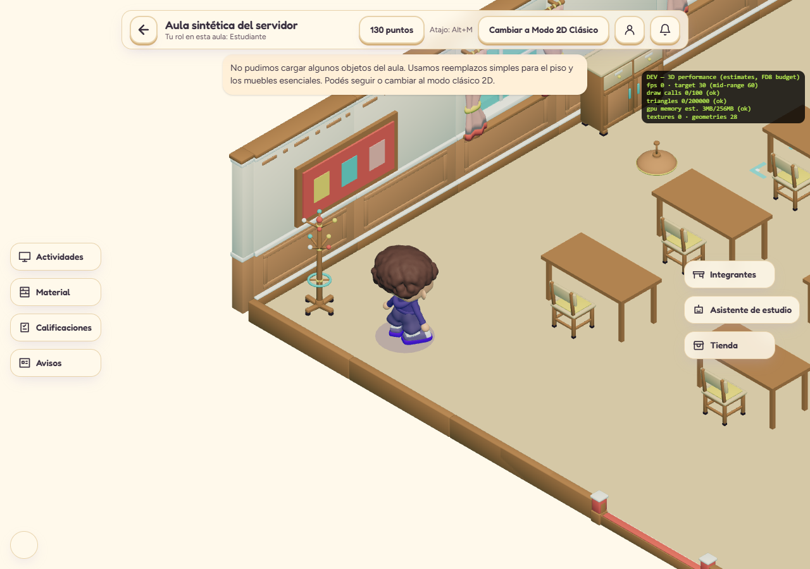
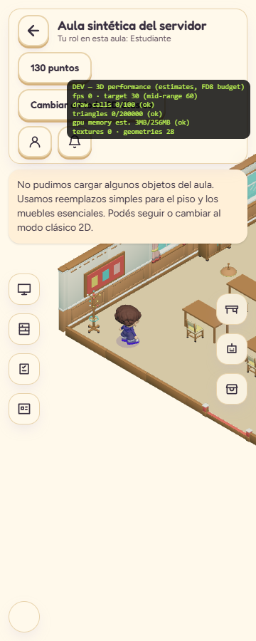

# PR 136: frontend verified, integration gates still open

The reconciled candidate passes Node 22 source checks and the complete hardware-browser suite (173 passed, one intentional skip). Recovery captures are recorded below. Live-backend integration, geometry-budget acceptance and representative school-device performance remain open; this is not merge or deployment approval.

## Review the narrow changes first

| Review surface                                                                                                                      | What to verify                                                                                                                                                                                       |
| ----------------------------------------------------------------------------------------------------------------------------------- | ---------------------------------------------------------------------------------------------------------------------------------------------------------------------------------------------------- |
| `src/features/world/classroom/build-classroom-scene.ts`, `classroom-scene.tsx`, `classroom-world.tsx`, `classroom-interactables.ts` | Failed floor/desk modules restore only their own placeholders; successful furniture stays intact. Recovery is scoped to the scene, including classroom changes; picking remains compatible.          |
| `src/features/classrooms/classroom-3d-stage.tsx`, `src/features/world/messages.ts`                                                  | Partial asset failure exposes the localized `role=status` message without replacing the entire classroom.                                                                                            |
| Classroom recovery, scene, kit and stage tests beside those files                                                                   | Scope reset, partial failure and successful-module preservation remain protected.                                                                                                                    |
| `e2e/profile.spec.ts`                                                                                                               | Mock avatar-style ownership catalog restores the paid owned Rastas selection while unowned Mohawk stays locked; product ownership guards are unchanged.                                              |
| `e2e/study-materials.spec.ts`, `src/features/classrooms/materials/material-schema.ts`, `src/api/schema.generated.ts`                | Reconciliation preserves develop's module-aware material flows and the candidate's avatar IDs and nullable `moduleId` default. Generated contract auto-merged; it was not manually regenerated here. |

Both tracker histories were preserved with consent. An independent source review reported no concrete integration regression. Plan risk item 3 (API/picking integration) received source review, **not** full runtime acceptance. Models and original Blender assets were not optimized or changed by the recovery work.

## Evidence ledger

| Check                        | Observed result and boundary                                                                                                                                                                                                                                       |
| ---------------------------- | ------------------------------------------------------------------------------------------------------------------------------------------------------------------------------------------------------------------------------------------------------------------ |
| Node 22.23.4                 | 2,019 unit tests across 187 files passed. Lint, types, build, security, format, docs (115 documents, including this guide) and whitespace checks passed on the reconciled candidate.                                                                                                     |
| Affected E2E                 | 42/42 desktop/mobile tests passed using real D3D11 on RTX 4070 SUPER, with the same assertions/timeouts and zero retries. This is not a full-suite pass.                                                                                                           |
| Earlier default-renderer run | 35/42 passed, seven failed under SwiftShader. Hardware success is diagnostic evidence, not grounds to dismiss those failures unconditionally.                                                                                                                      |
| Full hardware E2E            | 173 passed, one intentionally skipped, exit 0. The mobile reference-overlay measurement is desktop-only by existing test design; it was not newly disabled. Same assertions/timeouts/projects and zero retries.                                                    |
| Python CI                    | 10 tests, 16 assertion failures involving stderr and missing `/tmp` pollution under Git Bash. These failures remain disclosed, not counted as passes.                                                                                                              |
| Windows default `pnpm e2e`   | Preview startup fed `pnpm.exe` to Node and failed. Tests used an explicit preview-server workaround, not the broken default launcher.                                                                                                                              |
| Visual evidence              | Four actual built-showcase captures: normal/combined failure at 1280px/360px. All completed on D3D11 with no document overflow. Recovery status and retained furniture were visually inspected. Diagnostic overlay and framing limitations remain, as noted below. |

The hardware override is the ignored, **session-local** `odd/previews/pr136-hardware-e2e/playwright.config.ts`. It imports the original config and selects D3D11; it does not change assertions, timeouts or retries. This ignored path and local runtime setup are not a universally reproducible repository command.

## Visual evidence

The actual built-showcase candidate was served on an isolated local preview after the full suite finished. The one-shot capture used Node 22, hardware D3D11 and synthetic API/session data. Combined-failure views abort only `floor-tile.glb` and `student-desk.glb`; loaded chairs, walls, windows, cabinet and coat rack remain visible. The floor becomes a plain surface and desks use simple scene-owned geometry.

- Normal comparison: [1280px](assets/classroom-recovery/normal-1280.png), [360px](assets/classroom-recovery/normal-360.png).
- [Capture report](assets/classroom-recovery/capture-report.json): four completed captures, no document overflow, renderer and injected failures recorded. Console resource errors include intentionally blocked asset/realtime requests; they are not a clean-console claim.

The `role=status` notice is readable at both widths. The showcase diagnostic overlay still overlaps mobile header controls, and classroom framing clips the right side. These captures do not establish a clean production mobile layout or school-device performance; the overlay's initial zero readings are not performance measurements. No original model was modified and no image was cosmetically edited to hide limitations. The local capture script/config under `odd/` are intentionally untracked.

## Remaining approval gates

- Backend PR 146 was merged, but HTTP/realtime test URLs and explicit disposable-data consent are still missing. Avatar, shop, equipment and realtime integration are unverified; a merged backend is not a verified deployment.
- Sampled submitted geometry is 257,490 triangles against the 200,000 budget. The runtime comparison did not collect the required 60 samples, so it produced no valid FPS result. Geometry strategy or an exception needs a team decision; no optimization was applied or authorized.
- Retain the tooling failures and showcase mobile-layout limitations above in the approval discussion. Do not infer live external links or deployed success from local evidence.

Policy references: [quality and verification](../rules/quality-and-testing.md), [documentation and decisions](../rules/documentation-and-decisions.md), [UI evidence/accessibility](../rules/ui-and-accessibility.md), [3D budget](../rules/3d-world-and-camera.md), [AI accountability](../rules/ai-usage.md). Trackers, plan status and final approval remain parent-owned.
