# Routing

React Router (FD4) runs in data mode: `createBrowserRouter` with `RouterProvider` in `src/main.tsx`, and `createMemoryRouter` in tests. The route table is one function, `createAppRoutes()` in `src/app/router/routes.tsx`, shared by both.

## Route table

| Path                                        | Guard                   | Module                                          |
| ------------------------------------------- | ----------------------- | ----------------------------------------------- |
| `/login`                                    | `PublicOnly`            | `src/app/pages/login-page`                      |
| `/register`                                 | `PublicOnly`            | `src/app/pages/register-page`                   |
| `/password-reset`                           | none (signed in or out) | `src/app/pages/password-reset-page`             |
| `/invitations/accept`                       | none (signed in or out) | `src/app/pages/invitation-accept-page`          |
| `/`                                         | `RequireAuth`           | `src/app/pages/home-page`                       |
| `/profile`                                  | `RequireAuth`           | `src/app/pages/profile-page`                    |
| `/chats`, `/chats/:classroomId`             | `RequireAuth`           | `src/app/pages/chats-page`                      |
| `/classrooms/:classroomId`                  | `RequireAuth`           | `src/features/classrooms/classroom-workspace`   |
| `/classrooms/:classroomId/panels/:panelKey` | `RequireAuth`           | `src/features/classrooms/classroom-panel-route` |
| `/dev/ui`                                   | none, dev/showcase only | `src/app/ui-foundations`                        |
| `*`                                         | none                    | `NotFoundPage` (static import)                  |

Every page is a lazy route module (`lazy: { Component }`), so its chunk loads when it is first matched. The `/dev/ui` route exists only when `__UI_SHOWCASE__` is true (dev server and the `showcase` build used by the browser suite); a production build drops it and its chunk.

## Layouts

Two pathless layout routes sit under the root route. Both mount the single toast host and a `main` landmark with the same id, and focus after navigation is handled once above them (`RouterRoot`), so moving between layouts (for example login to home) is still announced.

- `AuthLayout` (`/login`, `/register`, `/password-reset`, `/invitations/accept`): a split screen with no sidebar. The brand panel (the only `h1`, the product name, a one-line value statement and the decorative [3D welcome scene](3d-assets.md#welcome-scene-on-the-public-screens)) comes first in the DOM, so on phones it stacks above the content and on wide screens it sits on the right. The form column is `[data-auth-slot]`: feature screens render their form inside it and inherit its width and surface.
- `AppShell` (everything else, including the `*` catch-all): `BaseLayout` (skip link, banner with the only `h1`, `main`) and `<Outlet />`. It has no sidebar: navigation arrives with the features that need it, and an empty aside is not rendered. When `snapshot.status === 'authenticated'`, the banner displays the signed-in user's `displayName`, the `Mi perfil` link to `/profile`, the `Mensajes` link to `/chats` (only for users with chats, with the unread badge, see [classroom chat](./ui-chat.md#all-chats-page-and-navbar-entry)), the notification bell and the `Cerrar sesión` action; signed-out views (including `*` 404) never render signed-in controls. The showcase at `/dev/ui` is reached by URL only; nothing links to it.

Pages use `h2` for their title. The not found, forbidden and error views share `StatusView` (a decorative scene from `src/components/illustrations/scenes.tsx`, title, explanation, actions) and take the width of whichever layout hosts them.

The table leaves room for the parent area (extended scope): it mounts as its own branch next to the protected one, with its own guard. It is not implemented. The [classroom foundation](./classroom-workspace.md) is context-only: a returned parent role grants no tools or panel navigation.

## Account registration (`/register`)

The `/register` route (`src/app/pages/register-page.tsx`, rendering `RegisterForm` from `src/features/auth/register-form.tsx`) guides visitors through choosing their initial organizational path before signing in:

- **Path options:** `INDEPENDENT_TEACHER` (personal teaching space), `SCHOOL` (provisions a new institution via the conditional `schoolName` field), and `INVITATION` (hides account creation inputs and links directly to `/invitations/accept` without duplicating invitation acceptance logic).
- **Contract and feedback:** `registerFormSchema` mirrors the backend `RegisterRequestDto` rules in `es-AR`, clears passwords on every failed attempt, relies on `useProtectedSubmit` to prevent duplicate requests, validates the `201 Created` payload with `registerResponseSchema` before showing the `role="status"` confirmed structure view, and offers a CTA to `/login` preserving only `safeSessionRedirect`-approved `?next=` targets. See [threat-model.md](./threat-model.md) for the security boundary analysis.

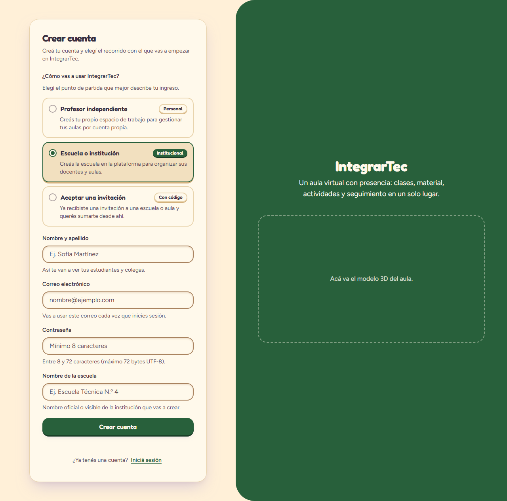

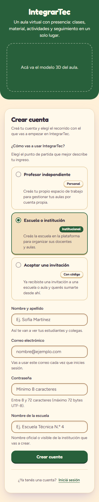

## Login (`/login`)

The `/login` route (`src/app/pages/login-page.tsx`, rendering `LoginForm` from `src/features/auth/login-form.tsx`) authenticates users through `SessionController.login()` while keeping return targets safe:

- **Validation and error isolation:** `loginFormSchema` trims and lowercases `email` without trimming `password`, enforces the UTF-8 72-byte bcrypt ceiling, clears the password input (`shouldDirty: true`) on every submit outcome, guards dirty inputs across browser tab close and in-app link clicks (`useUnsavedChangesGuard`), and maps `LoginFailureReason` into centralized `es-AR` messages (`401` renders a generic credential error, while `429`, network, and unexpected failures remain distinct).
- **Return target and navigation:** Shows contextual return notice when `?next=` passes `safeSessionRedirect`, and propagates only approved return targets to `/password-reset` and `/register` links via `buildAuthReturnHref`. See [threat-model.md](./threat-model.md) and [session lifecycle](./session-lifecycle.md) for details.

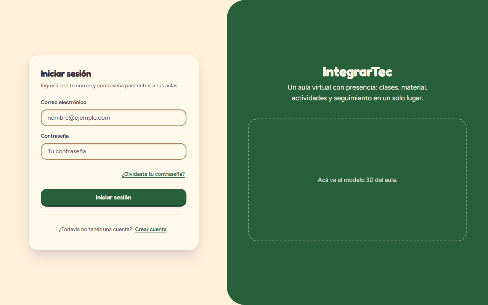

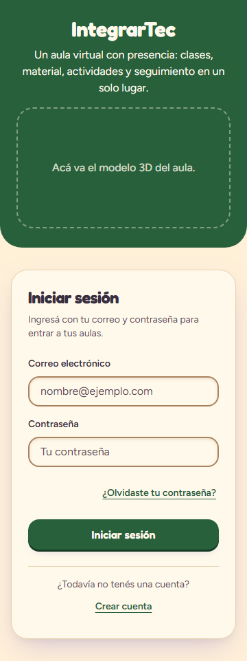

## Password reset (`/password-reset`)

The `/password-reset` route (`src/app/pages/password-reset-page.tsx`, rendering `PasswordResetForm` from `src/features/auth/password-reset-form.tsx`) is reachable signed in or out and switches between request mode and confirmation mode based on query parameters:

- **Request mode (`/password-reset`):** Sends `POST /auth/password-reset/request` (`credentials: 'omit'`, `redirect: 'error'`) and displays an identical `role="status"` confirmation message for any accepted `202` submission without revealing account existence, focusing the confirmation heading for assistive technology.
- **Confirmation mode (`/password-reset?token=<token>`):** Latches the parsed state in React component memory and immediately scrubs `?token=` from the URL via `replace` navigation (preserving safe `?next=` parameters and marking only a non-secret `resetTokenScrubbed` flag so neither URL history, `window.history.state`, nor `Referer` headers retain the token). Browser Back or explicit `/password-reset` links return cleanly to request mode, and `useUnsavedChangesGuard` protects unsaved `email` or `newPassword` inputs across in-app links. Rejects empty, whitespace-only, overlong, or repeated `?token=` query parameters immediately without calling the API. Valid submissions send `POST /auth/password-reset/confirm` expecting `204 No Content`, clear the password input (`shouldDirty: true`), separate expired/used `400` token rejections from policy validation and uncertain `429`/network/`5xx` outcomes, and focus the confirmation heading on success with a CTA back to `/login`.

Successful confirmation calls the existing session controller logout path, synchronously clearing local credentials and private caches before showing success. Server logout is best-effort because password reset already revokes sessions by contract. Cancelled requests (including session transitions or leaving the reset view) do not show success or a failure alert; other errors retain the shared form error contract. Caller abort signals fence completion alongside the session middleware's epoch guards, so late reset responses cannot clear a newer session.

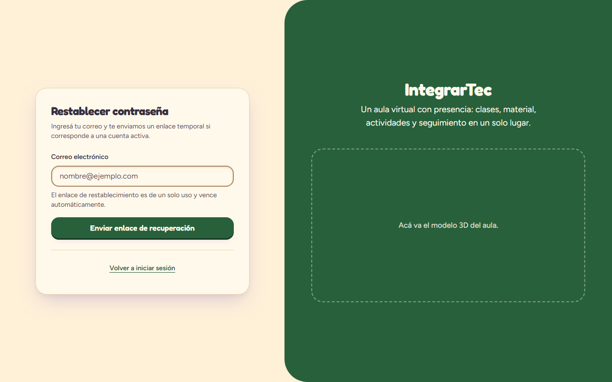

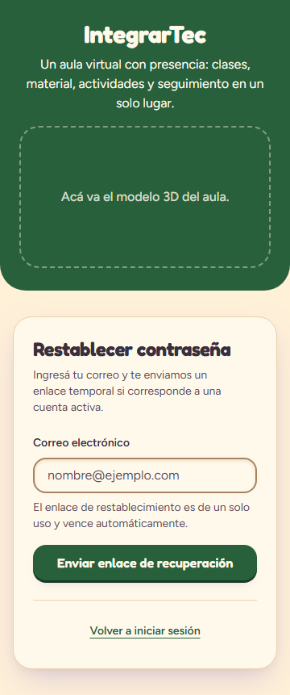

## Invitation acceptance & join by classroom code (`/invitations/accept`)

The `/invitations/accept` route (`src/app/pages/invitation-accept-page.tsx`, rendering `InvitationAcceptView` from `src/features/classrooms/invitation-accept-view.tsx`) is mounted inside `AuthLayout` outside `PublicOnly` and `RequireAuth`, and branches explicitly on session state:

- **Unauthenticated gate (`status === 'unauthenticated'`):** Renders no classroom data, invitation form, or join-by-code inputs, and exposes explicit links to `/login?next=...` and `/register?next=...` carrying only `safeSessionRedirect`-approved return locations (`/invitations/accept` or single-parameter `/invitations/accept?token=<token>`). After signing in, `PublicOnly` automatically returns the user to `/invitations/accept`. If a session definitively expires after URL scrubbing, the gate rebuilds the canonical return target from the validated in-memory token, dropping unrelated query parameters and fragments. Login/register links carry that approved target; no token or code is stored in browser storage or history state. Reauthentication requires fresh confirmation and shows only the current account.
- **Email invitation mode (`status === 'authenticated'` with `?token=`):** Latches the validated query token in React component state and immediately removes `?token=` from the URL via `replace` navigation with a non-secret `invitationTokenScrubbed` marker (`TM-006`). Requires explicit user confirmation before sending `POST /invitations/accept`, never blocks acceptance on account email mismatch, guards concurrent clicks, and maps invalid/expired/revoked/used (`400`/`404`), conflict (`409`), rate-limit (`429`), and network failures to privacy-safe `es-AR` alerts.
- **Join-by-code mode (`status === 'authenticated'`):** Presents a single alphanumeric code field (`POST /classrooms/join`) with no role selector (student role only), preserves typed input on failure for correction, and never persists codes in client storage. On `200`/`201` success, invalidates user classroom queries and navigates to `/classrooms/:classroomId` passing transient `joinOutcome` state so `ClassroomWorkspace` displays an accessible `role="status"` enrollment banner (differentiating new enrollment from idempotent `alreadyMember: true` re-join and showing the assigned desk).

The enrollment confirmation banner on `/classrooms/:classroomId` is one-shot: the workspace latches the validated outcome from router state, then clears it with a `replace` navigation to the same URL, so reloads and back/forward never replay it and classroom, membership and desk identifiers do not remain in `history.state`.

A transport failure after either join POST leaves enrollment **uncertain**: the server may have committed before the response was lost. The shared message asks users to check their classrooms before trying again; no automatic retry, rollback guarantee, success banner, or classroom navigation follows that failure. Mock tests cover this feedback, not real-backend reconciliation.

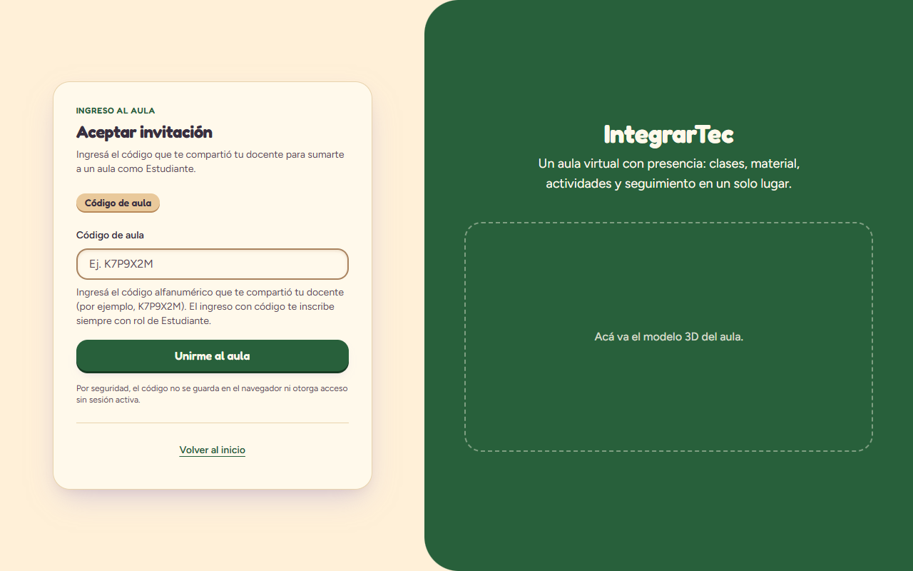

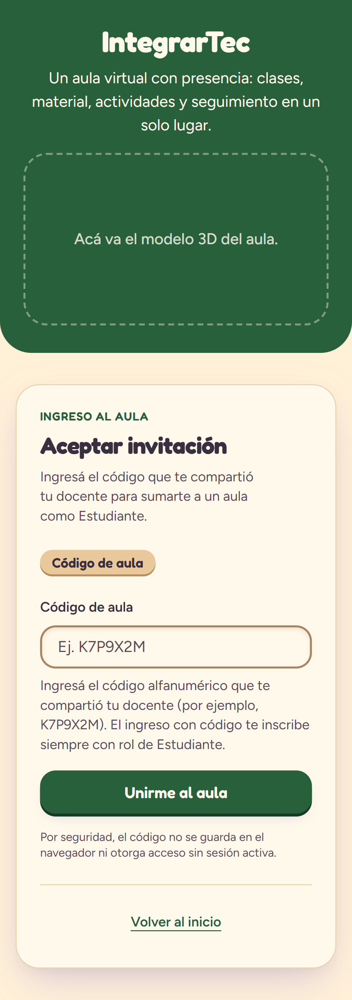

## Classroom directory and management

The `/` protected route (`src/app/pages/home-page.tsx`, rendering `ClassroomListPage` from `src/features/classrooms/classroom-list-page.tsx` and `ClassroomFormDialog` from `src/features/classrooms/classroom-form.tsx`) serves as the authenticated classroom directory:

- **Server-authoritative listing & states:** Fetches `GET /me/classrooms` through user-scoped TanStack Query keys (`classroomListQueryKey(userId, params)`) and distinguishes loading (`LoadingState`), empty (`EmptyState` offering `"Crear mi primera aula"` when creation has not been denied), initial failure (`ErrorState` with retry), and stale refresh failure (`StaleDataNotice` preserving confirmed data). Each classroom card displays the server-returned `myRole`, organizational path (`Escuela` or `Docente independiente`), and modality (`Modalidad escolar (con familias)` or `Educación de adultos`), plus an entry link to `/classrooms/:classroomId`.
- **Capability gating & active context:** Creation and `"Configurar aula"` controls are offered only when server-returned `capabilities` include `configure_classroom`; `STUDENT` and `PARENT` views omit create/edit controls, and any forced `403 FORBIDDEN` response displays a clear forbidden alert and reconciles stale controls. When an account holds memberships across multiple organizational contexts (independent teacher and/or schools), an active context switcher filters the visible classrooms and discards unsaved dialog drafts on switch or account change.
- **Creation, configuration & reconciliation:** `classroomFormSchema` enforces jitless Zod validation matching backend `VisibleText` limits (`name` 1–120, optional `subject` 1–200, `adultMode`, optional `schoolId` UUID when belonging to multiple schools) while explaining adult-mode rules on parent links. `useProtectedSubmit` blocks duplicate submissions and `useUnsavedChangesGuard` protects unsaved edits; uncertain outcomes (`5xx`, network failures, malformed `2xx`) keep user input intact without claiming rollback and automatically refetch `GET /me/classrooms` before retry.

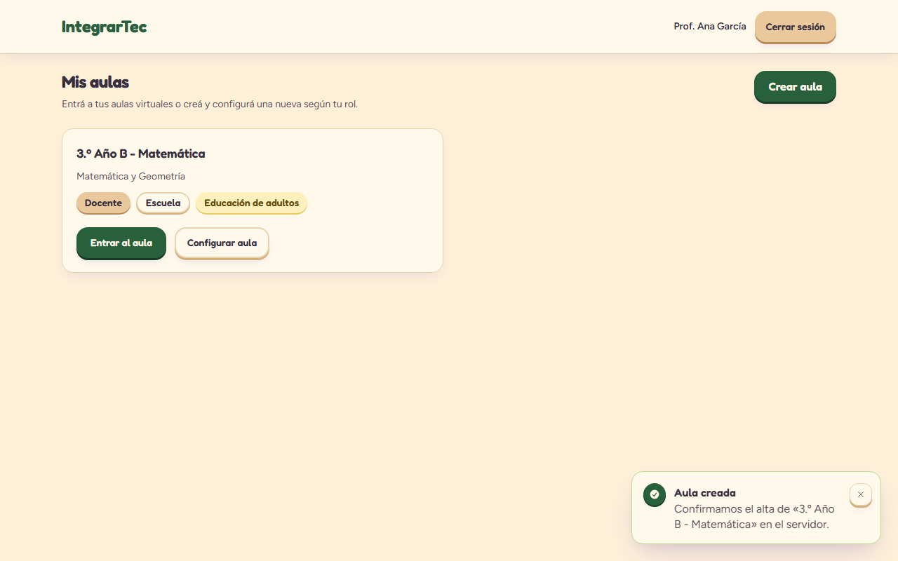

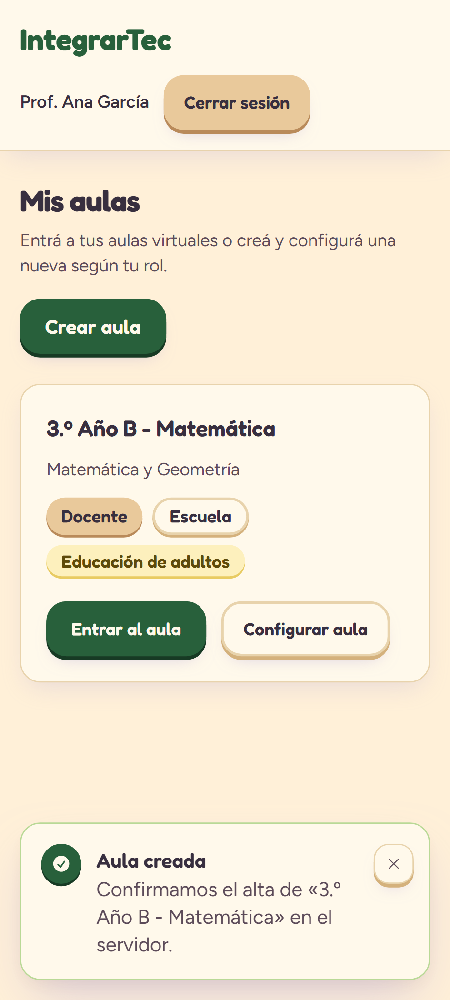

## Profile and base avatar (`/profile`)

The `/profile` route (`src/app/pages/profile-page.tsx`, rendering `ProfileView` from `src/features/profile/profile-view.tsx`) is protected by `RequireAuth` and lets signed-in users update their display name and base avatar configuration (`HU-AUT-003` part 1/2):

- **Authoritative load and cache isolation:** `useOwnProfile` reads `GET /users/me` under a user-scoped query key (`ownProfileQueryKey`), keeping loading, error-with-retry, and stale-data states distinct. Confirmed updates write back to the query cache and update `SessionController.applyConfirmedProfile` so the `AppShell` header reflects the new `displayName` immediately without a reload.
- **Display name and base avatar forms:** `DisplayNameForm` (`PATCH /users/me/profile`) and `AvatarForm` (`PATCH /users/me/avatar`) use explicit save triggers, `useProtectedSubmit` duplicate-submit protection, and `useUnsavedChangesGuard` / `useBlocker` unsaved-draft protection. Avatar choices (`bodyId`, `hairId`, `topId`, `hairColor`, `clothingColor`) are driven strictly by the contract (`AvatarDto`) and rendered in a 2D/DOM `AvatarPreview` with distinct saved vs. unsaved-draft indicators.
- **Rejections and uncertain writes:** `400` validation errors and `403` rejections preserve both the user's draft and the last confirmed server state. Network or unreadable write responses reconcile against `GET /users/me` before claiming success or repeating a write.
- **Layout:** the own avatar (front view) is always in sight: sticky beside the options from `768px`, stuck on top of them on phones. The options column starts with the display name, then the `Cuerpo`, `Pelo`, `Ropa` and `Accesorios` tabs (one panel at a time, arrow keys move between them). The streak and the read-only email close the page; medals are not shown here.
- **Picture choices:** bodies, hair styles, tops and accessories are cards with the shop thumbnails (`AvatarThumbnail`) drawn on the chosen body; colors are swatches. Style cards use the saved hair and clothing colors, so trying a color does not redraw them. The chosen or equipped card has a frame, a check and a word. Only the open tab (and, in accessories, the chosen part) draws pictures.
- **Locked items:** unowned styles and unbought accessories are marked and link to the shop of the chosen student classroom (`/classrooms/{id}/panels/shop`), or to `/` without one.
- **Two ways of saving:** the base avatar is a draft until `Guardar avatar`; the save bar stays reachable on every tab while there is something unsaved, and a field the server rejects opens its tab. Accessories (head, face, back, hand, neck, ears, desk decor) belong to a classroom and save at once; the preview wears those of the chosen classroom.
- **Preview animation:** the 3D character waves, rests on `Idle` and repeats, sharing the timing of the [welcome scene](3d-assets.md#welcome-scene-on-the-public-screens); under `prefers-reduced-motion` it holds one pose. It is lazy-loaded and falls back to the 2D preview, which shows the base avatar only.
- **Preview boundary:** The original SVG follows the [avatar art direction](../rules/art-direction.md#avatars) with a wide rounded-cube head, soft volume, readable hair/clothing silhouettes and no dark exterior outlines. It renders the same five contract fields; its fixed skin appearance is not an editable or persisted skin-tone option. The renderer can be replaced independently of the forms. The 3D preview/rendering belongs to part 2/2; equipping purchased items belongs to `HU-ESP-004`.
- **Verification boundary:** Unit tests use an MSW profile store and the Playwright profile scenario intercepts API calls with in-memory server state. Reload checks demonstrate the frontend reloading confirmed values from a simulated server, not persistence in a real database or on another device. Live-backend, cross-session and cross-device persistence remain integration checks pending backend availability.

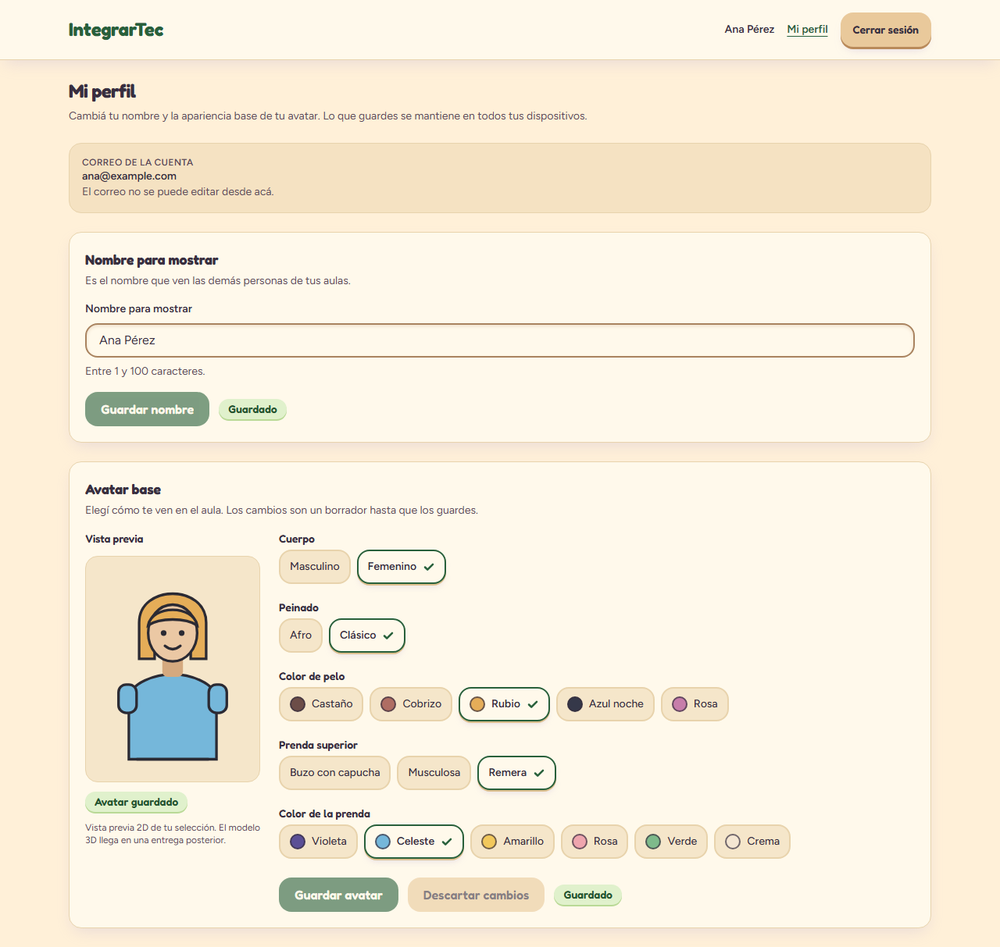

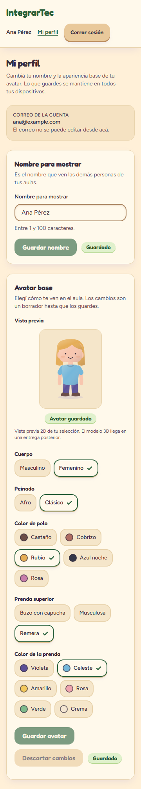

## Guards

Guards are components that read `useSessionSnapshot()`; auth is not decided in loaders, because the session is asynchronous and owned by the session controller (see [session lifecycle](./session-lifecycle.md)).

- `RequireAuth` wraps the protected branch. `initializing` shows loading, `unauthenticated` redirects to `/login?next=<path>`, `unable-to-verify` shows a retry state, and only `authenticated` renders the nested routes. Protected content is never rendered before the session resolves.
- `PublicOnly` wraps login and register. A signed-in user is sent to the return target. Password reset and invitation acceptance remain reachable in either session state.
- The return target goes through `safeSessionRedirect` both when written and when read, so a hostile `?next=` degrades to `/`. Repeated `next` parameters count as absent.

A 403 or 404 from a resource never reaches the guards, so it cannot cause a login redirect loop.

## Errors, not found and forbidden

- `RootErrorBoundary` sits above the layouts. It is plain markup on purpose (no shared component, no scene) so it still renders if a shared primitive is what broke; it is styled with token utility classes only. It has no skip link because it has no layout.
- `RouteErrorBoundary` sits inside each layout, so a page error replaces only the page area and the banner and toasts stay.
- `classifyRouteError` maps what was thrown to one of: not found (404), forbidden (403), stale chunk (a failed lazy import, offers a full reload) or unexpected (generic error with "Reintentar"). A 401 is never handled here; the session layer owns it.
- Throw `notFound()` or `forbidden()` (from `route-errors.ts`) in a page, hook or loader to show those views. Error text, stack and server data are never rendered.

## Capability gate

Role-aware routes use `useClassroomCapabilities(classroomId)` (`GET /classrooms/{id}`, nothing persisted, keyed by user and classroom) through `RequireCapability`:

```tsx
{
  path: 'classrooms/:classroomId/moderation',
  element: <RequireCapability capability="moderate_chat" />,
  children: [{ index: true, lazy: { Component: ... } }],
}
```

It shows loading while pending, forbidden when the server did not grant the capability (or on 403), not found on 404 (a foreign classroom looks like a missing one), and the generic error for anything else. A missing or empty classroom id is not found. An explicit `classroomId` prop overrides the `:classroomId` param. It never redirects.

## Accessibility

- The skip link from `BaseLayout` targets `main` (`id="main-content"`, `tabIndex={-1}`) on every route inside the shell.
- After a client-side navigation that changes the pathname, focus moves to the new page's heading, or to `main` when it has none (`useFocusOnNavigation` in `src/app/router/focus-on-navigation.tsx`, mounted by `RouterRoot` above both layouts). It does not run until the initial session and any guard redirect have resolved. Subsequent pathname changes move focus for both push and replace navigation, including signing in from the initial login page; search or hash changes keep focus. The `protected` and `public-only` route IDs identify the session guards for initial-load focus settlement; preserve them when extending the table. Moving focus to the heading is what makes screen readers announce the new page.
- `document.title` is `<page> · IntegrarTec`, written only by `useDocumentTitle` (`document-title.ts`). Pages get it through `PlaceholderPage`; the error views call it directly. Because each view titles itself, a forbidden or error view never inherits the title of the route that failed.

## Add a protected route

1. Add the route to the `protected` branch in `createAppRoutes` (or use `protectedRoutes` in tests) as a lazy module, and render a heading with `PlaceholderPage` or call `useDocumentTitle` yourself.
2. If it needs a capability, nest it under `RequireCapability`.
3. To let login return the user to it, add its exact path to `APPROVED_DESTINATIONS` in `src/session/redirect.ts`. Today `/` and `/invitations/accept` (including single-parameter `/invitations/accept?token=<token>` targets validated against length and character bounds) are approved; any other path falls back to `/`. Dynamic classroom paths are deliberately not approved in this foundation; opening one while signed out leads to login with `/` as the safe return destination. Expanding that allowlist needs a separate scoped change. `safeSessionRedirect` takes an optional allowlist only so tests can prove forwarding; application code never passes it.
4. Add tests with `createMemoryRouter(createAppRoutes({ protectedRoutes }))`.

## Hosting requirement for deep links

The app is served at the domain root (no `basename`) and uses browser history, so opening `/login` or `/dev/ui` directly requests that path from the host. The host must rewrite paths without a file extension to `/index.html` with status 200. On AWS Amplify Hosting this is the rewrite rule:

- Source: `</^[^.]+$|\.(?!(css|gif|ico|jpg|js|png|txt|svg|woff|woff2|ttf|map|json|webp|wasm)$)([^.]+$)/>`
- Target: `/index.html`
- Type: `200 (Rewrite)`

The rule is not in `customHttp.yml` (that file only holds response headers); it is configured on the hosting side: the Amplify app's rewrite rule is managed in the backend repository's Terraform (issue #22), so keep this expression and that configuration identical. Until it is in place, a hard load of any route other than `/` returns the host's 404.
