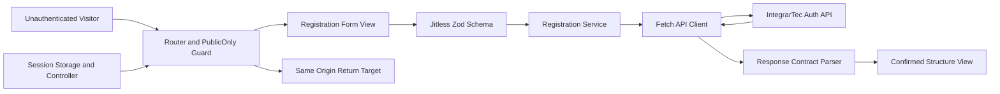

# Threat Model — IntegrarTec Frontend (Authentication & Registration)

## Executive summary

This threat model covers the public authentication and account-registration surface introduced for GitHub issue `#27` (`HU-AUT-001`) in `integratec-final-front`, focusing on `/register`, client-side validation (`src/features/auth/register-schema.ts`), API transport (`src/features/auth/register-service.ts`, `src/api/client.ts`), route guards (`src/app/router/guards.tsx`, `src/app/router/return-target.ts`), and runtime security boundaries (`src/config/security-headers.ts`, `src/session/`).

The primary risks on this public unauthenticated boundary are: (1) spoofing confirmed organizational provisioning (`SCHOOL` creation or workspace setup) in the UI without server confirmation, (2) open redirects via tampered `?next=` parameters carried across `/register` -> `/login`, (3) credential exposure through client-side storage, URL query strings, or unsafe retry loops, (4) account enumeration or conflicting-state confusion on `409 CONFLICT` responses, and (5) XSS or CSP regressions caused by JIT-compiled validation libraries or unsafe DOM sinks.

## Scope and assumptions

- **In scope:**
  - Public route `/register` guarded by `PublicOnly` in `src/app/router/routes.tsx` and rendered via `src/app/pages/register-page.tsx`.
  - Registration form state, Zod schema validation, DTO transformation, and confirmed-state rendering in `src/features/auth/`.
  - HTTP transport to `POST /auth/register` via `TypedApiClient` (`src/api/client.ts`) and error mapping via `src/api/errors.ts`.
  - Cross-screen navigation from `/register` to `/invitations/accept` and `/login` preserving validated `next` return targets (`src/app/router/return-target.ts`).
  - Browser runtime defenses configured in `src/config/security-headers.ts` and documented in [security.md](./security.md).
- **Out of scope:**
  - Backend database integrity, password hashing, email uniqueness enforcement, and transactional provisioning inside `integratec-final-back`.
  - Invitation token cryptographic verification and join-by-code flows (`#31` / `HU-AUL-002`) and login/password-reset flows (`#28` / `HU-AUT-002`).
- **Assumptions:**
  - The backend `POST /auth/register` endpoint is the sole authority for email uniqueness, password policy enforcement, and `SCHOOL` slug/record creation, returning `201 Created` with `RegisterResponseDto` and **no** session tokens.
  - Hosting serves the CSP and HTTP security headers defined in `src/config/security-headers.ts` (`script-src 'self'`, no `'unsafe-eval'`, `form-action 'self'`, `frame-ancestors 'none'`).

## System model

Trust boundaries crossed during registration:

1. **Untrusted input -> Client runtime:** User-supplied form fields (`displayName`, `email`, `password`, `path`, `schoolName`) and URL search parameters (`?next=`) enter `RegisterPage` and `readReturnTarget`.
2. **Client runtime -> Unauthenticated API edge:** `registerAccount` serializes `RegisterRequestDto` over HTTPS (`POST /auth/register`) with `credentials: 'omit'` and `redirect: 'error'`.
3. **Backend response -> Privileged UI state:** Unverified JSON from `POST /auth/register` is parsed against `registerResponseSchema` before transitioning `/register` from editable form state to the confirmed organizational view.

## Assets and security objectives

| Asset                                | Security Objective                    | Consequences if Compromised                                                                            |
| ------------------------------------ | ------------------------------------- | ------------------------------------------------------------------------------------------------------ |
| Raw user password in memory          | Confidentiality, zero persistence     | Credential theft if stored in `sessionStorage`, `localStorage`, URL, logs, or retained after error     |
| Registration confirmation state      | Integrity (server authority)          | User misled into believing a school or teacher workspace was created when `POST /auth/register` failed |
| Post-auth navigation target (`next`) | Integrity (same-origin restriction)   | Phishing / open redirect sending newly registered user to an external origin upon sign-in              |
| Browser DOM and CSP boundary         | Integrity (XSS resistance)            | Script injection or CSP failure breaking form rendering under strict `script-src 'self'`               |
| User email existence signal          | Confidentiality (reduced enumeration) | Automated probing determining whether an address already holds an account                              |

## Attacker model

- **Passive / active network or link attacker:** Crafts malicious links targeting `/register?next=...` to redirect users to attacker-controlled origins after registration and login.
- **Automated prober / abusive visitor:** Submits repeated registrations to probe existing emails (`409`), exhaust school slug generation, or trigger duplicate submissions via rapid double-clicks.
- **Malformed upstream / compromised proxy response:** Returns HTTP `200`/`201` with missing `school` metadata when `path === 'SCHOOL'`, unexpected HTML error bodies, or HTTP `3xx` redirects on an API endpoint.
- **Accidental internal regression:** Developer adds `'unsafe-eval'`-dependent Zod mode, writes form drafts with passwords to storage, or logs form payloads in telemetry.

## Entry points and attack surfaces

| Entry Point / Surface                  | Mechanism                                                                                   | Exposure               |
| -------------------------------------- | ------------------------------------------------------------------------------------------- | ---------------------- |
| Route `/register` query string         | `useSearchParams()` + `readReturnTarget()` in `src/app/router/return-target.ts`             | Public unauthenticated |
| Registration form inputs               | React Hook Form + `FormField` (`displayName`, `email`, `password`, `path`, `schoolName`)    | Public unauthenticated |
| Path handoff to invitations            | Link/navigation from `INVITATION` card to `/invitations/accept`                             | Public unauthenticated |
| `POST /auth/register` request/response | `client.POST('/auth/register', ...)` wrapped by `requestApi()` and `registerResponseSchema` | Public unauthenticated |
| CSP runtime environment                | `z.config({ jitless: true })` and strict CSP headers in `src/config/security-headers.ts`    | Browser runtime        |

## Top abuse paths

1. **Open redirect via `?next=` propagation (`TM-001`):** Attacker sends `/register?next=https://evil.example` or `/register?next=//evil.example`. If `/register` copies raw `searchParams.get('next')` into the `/login` CTA or invitation link without `readReturnTarget`, an attacker chains registration into an external phishing redirect after login.
2. **Phantom confirmation on failed or malformed provisioning (`TM-002`):** Network error, `500`, or a malformed `201` payload lacking `school` for `path === 'SCHOOL'` transitions the UI into "confirmed" state, convincing a school admin their tenant exists when nothing was saved.
3. **Password retention across errors or storage (`TM-003`):** On `400`/`409`/`500` responses, the user leaves the browser tab open with the plaintext password populated in React state, or a draft-saving helper writes the password to `sessionStorage`/`localStorage` or logs it.
4. **CSP runtime violation breaking client validation (`TM-004`):** Zod v4 defaults to JIT compilation (`new Function`) in environments that allow it; importing schemas in a module without `z.config({ jitless: true })` can fail under strict `script-src 'self'` CSP in production.
5. **Credential / duplicate submission via double-submit or redirect (`TM-005`):** Double-clicking "Crear cuenta" while `POST /auth/register` is in flight sends parallel requests causing `409` slug/email collisions, or a proxy `302` silently forwards credentials cross-origin.

## Threat model table

| ID       | Threat / Abuse Path                                                    | Affected Assets / Surface                                                | Likelihood | Impact | Risk   | Existing & Required Mitigations                                                                                                                                                                                | Verification                                                                                                       |
| -------- | ---------------------------------------------------------------------- | ------------------------------------------------------------------------ | ---------- | ------ | ------ | -------------------------------------------------------------------------------------------------------------------------------------------------------------------------------------------------------------- | ------------------------------------------------------------------------------------------------------------------ |
| `TM-001` | Open redirect via tampered `?next=` query parameter                    | `readReturnTarget`, `/register` -> `/login` CTA                          | Medium     | High   | High   | Parse `?next=` strictly through `readReturnTarget()` (`src/app/router/return-target.ts`), which permits only relative `/` paths without `//`, `\`, or auth-route loops; drop invalid targets silently          | Unit/RTL test verifying invalid `?next=` is stripped and valid `?next=%2F` is preserved                            |
| `TM-002` | Spoofed confirmation UI on API failure or malformed `201`              | Registration state machine (`RegisterForm`), `RegisterResponseDto`       | Low        | High   | Medium | Transition to `role="status"` confirmed view strictly after `registerResponseSchema.safeParse` succeeds, including refinement requiring `school` object when `path === 'SCHOOL'`                               | Unit test on `registerResponseSchema` and RTL tests for `500`, network error, and malformed `201`                  |
| `TM-003` | Password retention in state/storage/logs after submit failure          | Password field state, browser storage                                    | Medium     | Medium | Medium | Clear `password` field immediately in `catch` on any submit error while keeping non-secret fields; never persist form values in `storage.ts`; never emit PII/passwords in `ApiError` or console logs           | RTL test asserting `password.value === ''` after `409`, `400`, and `500` errors while `email`/`displayName` remain |
| `TM-004` | CSP violation from JIT schema compilation under `script-src 'self'`    | `src/features/auth/register-schema.ts`, `src/config/security-headers.ts` | Medium     | Medium | Medium | Enforce `z.config({ jitless: true })` in `register-schema.ts`; verify zero CSP console/page errors during showcase E2E run                                                                                     | `pnpm security:check` + Playwright `e2e/register.spec.ts` CSP violation listener                                   |
| `TM-005` | Duplicate concurrent submission & cross-origin redirect leak           | Submit button, `client.POST('/auth/register')`                           | Medium     | Medium | Medium | Guard submit handler synchronously via `useProtectedSubmit` (`submittingRef` + busy button state); force `credentials: 'omit'` and `redirect: 'error'` on `POST /auth/register`                                | RTL test verifying double-click fires 1 HTTP request; service unit test asserting fetch options                    |
| `TM-006` | Ambiguous `409 CONFLICT` or enumeration leakage in UI copy             | Email field error, backend `409` messages                                | Medium     | Medium | Medium | Translate `409` email vs slug conflicts into neutral centralized `es-AR` copy in `register-service.ts` without echoing internal details, encouraging login/recovery without implying duplicate record creation | Unit test + RTL test verifying `409` email conflict vs slug conflict mapping                                       |
| `TM-007` | XSS injection through echoed user or school names in confirmation view | `displayName`, `school.name`, `Alert` rendering                          | Low        | High   | Medium | Render all server-returned strings strictly as React text nodes (no `dangerouslySetInnerHTML`, no `innerHTML`), validated by `registerResponseSchema` non-empty strings                                        | Code review (`rules/security.md`) + `pnpm lint`                                                                    |
| `TM-008` | Unsolicited token persistence or auto-login on unverified endpoint     | `src/session/`, `POST /auth/register`                                    | Low        | High   | Medium | Registration consumes only `RegisterResponseDto` (`id`, `email`, `displayName`, `path`, `school?`, `createdAt`), writes zero tokens to `SessionController` or `storage.ts`, and links explicitly to `/login`   | Unit test verifying `registerResponseSchema` output shape and absence of `sessionStorage` writes                   |

## Criticality calibration

- **High risk (`TM-001`):** External redirection after registration/login requires only a crafted link and directly enables credential phishing against new users.
- **Medium risk (`TM-002`..`TM-008`):** Mitigated by architectural invariants (`PublicOnly`, `credentials: 'omit'`, `redirect: 'error'`, React text rendering, Zod runtime parsing, and `useProtectedSubmit`) plus mandatory unit, RTL, and Playwright checks.

## Focus paths for security review

1. `src/features/auth/register-schema.ts` — verify `z.config({ jitless: true })`, password `<= 72` UTF-8 byte check without `.trim()`, and `registerResponseSchema` super-refinement requiring `school` when `path === 'SCHOOL'`.
2. `src/features/auth/register-service.ts` — verify `credentials: 'omit'`, `redirect: 'error'`, `AbortError` rethrow, and safe `400`/`409`/`5xx` `ApiError` translation without exposing raw stack/internal fields.
3. `src/features/auth/register-form.tsx` — verify password clearing on every failure path, safe `?next=` propagation via `readReturnTarget`, and confirmed UI gating on verified server response only.
4. `src/app/router/return-target.ts` & `src/app/router/guards.tsx` — confirm `PublicOnly` prevents authenticated users from lingering on `/register` and validates return targets consistently.

## Notes on use

Update this document whenever `/login` (`#28`), password reset, or `/invitations/accept` (`#31`) introduces new public unauthenticated forms, token handling, or session-creation flows on top of `src/features/auth/` and `src/session/`.
