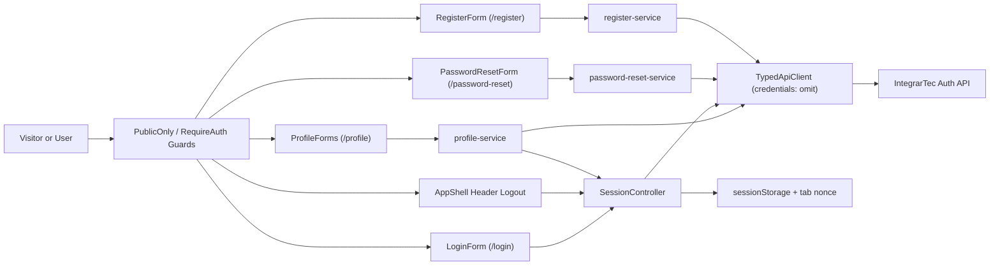

# Threat Model — IntegrarTec Frontend (Auth, Session, Profile & Classroom Boundaries)

## Executive summary

This threat model covers the public authentication routes (`/register`, `/login`, `/password-reset`), student classroom onboarding (`/invitations/accept` for `#31`), authenticated session teardown (`AppShell` logout), the authenticated own-profile surface (`/profile`, `ProfileView`), and authenticated classroom list/create/configure flows (`/`, `ClassroomListPage`, `ClassroomForm`) in `integratec-final-front` (`#27`, `#28`, `#29`, `#30`, and `#31`). Core defenses focus on client-side validation (`src/features/auth/`, `src/features/profile/`, `src/features/classrooms/`, including `join-schema.ts`), typed REST transport (`src/session/`, `src/api/client.ts`, `src/features/classrooms/join-service.ts`), open-redirect controls (`src/app/router/return-target.ts`, `src/session/redirect.ts`), user/context cache isolation (`src/api/query-keys.ts`, `SessionProvider`), server-derived capability gating (`capabilities.includes('configure_classroom')`), and CSP headers (`src/config/security-headers.ts`).

The highest-risk threats on this boundary are: (1) open redirects via tampered `?next=` query parameters across `/login`, `/register`, `/password-reset`, and `/invitations/accept`, (2) credential, invitation token, or classroom code retention or exposure in browser storage, URLs, `window.history.state`, or React state on failure, (3) enumeration leaks across login (`401`), password-reset request (`202`), reset confirmation (`400`), invitation acceptance, or join-by-code (`400`/`404`/`409`), (4) incomplete local cache/UI teardown on unconfirmed logout or active-context switch, (5) spoofed success confirmation or corrupted saved state when server writes fail or return malformed responses, (6) adopting another user's profile or leaking cross-account cache entries, and (7) unauthorized classroom creation/configuration attempts or cross-organization confusion (`schoolId` vs independent path).

## Scope and assumptions

- **In scope:**
  - Public unauthenticated screens guarded by `PublicOnly`: `/register` (`src/features/auth/register-form.tsx`), `/login` (`src/features/auth/login-form.tsx`), and `/password-reset` (`src/features/auth/password-reset-form.tsx`).
  - Student invitation acceptance and classroom join-by-code screen (`/invitations/accept`, `src/features/classrooms/invitation-accept-view.tsx`) and service (`src/features/classrooms/join-service.ts`) for `POST /invitations/accept` and `POST /classrooms/join`.
  - Password-reset transport (`src/features/auth/password-reset-service.ts`) for `POST /auth/password-reset/request` and `POST /auth/password-reset/confirm`.
  - Protected classroom list, active-context switcher, and creation/configuration surfaces on `/` (`src/features/classrooms/classroom-list-page.tsx`, `src/features/classrooms/classroom-form.tsx`, `src/features/classrooms/classroom-service.ts`, `src/features/classrooms/classroom-schema.ts`) consuming `GET /me/classrooms`, `POST /classrooms`, and `PATCH /classrooms/{id}`.
  - Colyseus realtime classroom client wrapper and React lifecycle hook (`src/realtime/client.ts`, `src/realtime/use-classroom-realtime.ts`) consuming `VITE_REALTIME_URL` (`F05`), `SessionController` token/refresh (`F08`), and synced backend contracts (`src/realtime/contracts.generated.ts`, `src/realtime/room-state.generated.ts`, `src/realtime/avatar.generated.ts`).
  - Session lifecycle controller (`src/session/controller.ts`), transport (`src/session/transport.ts`), React cache cleanup (`src/session/provider.tsx`), scoped query keys (`src/api/query-keys.ts`), and `AppShell` logout trigger (`src/app/router/app-shell.tsx`).
  - Safe destination validation (`src/app/router/return-target.ts`, `src/session/redirect.ts`) and strict CSP config (`src/config/security-headers.ts`).
  - Authenticated route `/profile` guarded by `RequireAuth`: display-name and base-avatar forms, per-form save-status state machine, and 2D preview (`src/features/profile/`, `src/app/pages/profile-page.tsx`).
  - Own-profile transport validation (`profileSchema`, `avatarSchema` in `src/session/transport.ts`) and confirmed-profile adoption into the session snapshot (`SessionController.applyConfirmedProfile`).
  - User-scoped own-profile cache key (`ownProfileQueryKey` in `src/api/query-keys.ts`) and its logout eviction.
- **Out of scope:**
  - Backend password hashing, rate-limiting counters, reset/invitation token cryptography, join-code generation/revocation, email delivery, and server-side RBAC/XOR invariants in `integratec-final-back`.
  - Staff invitation and classroom join-code management (`HU-AUL-002` part 2/2).
  - Classroom workspace panels (`#26`, covered in `docs/classroom-workspace.md`).
- **Assumptions:**
  - Backend enforces constant-information responses on `/auth/login` (`401`), `/auth/password-reset/request` (`202`), and `/auth/password-reset/confirm` (`400 BAD_REQUEST`), and emits reset links using `/password-reset?token=<opaqueToken>`.
  - Backend enforces server-side `SCHOOL` vs `INDEPENDENT_TEACHER` XOR ownership, role checks (`403 FORBIDDEN` for students/parents, `404 NOT_FOUND` for unrelated schools/classrooms), and returns authoritative `myRole` and `capabilities` on every classroom item.
  - Hosting serves the strict CSP headers generated by `src/config/security-headers.ts` (`script-src 'self'`, `frame-ancestors 'none'`).
  - The backend owns authorization and validation for `PATCH /users/me/profile` and `PATCH /users/me/avatar`; the authenticated identity, not any browser-supplied identifier, decides whose profile is written (`rules/avatars-and-customization.md`).

## System model

Trust boundaries:

1. **URL & form inputs -> Client state:** Query params (`?next=`, `?token=`) and user credentials enter auth routes as untrusted input.
2. **Client runtime -> API:** Auth mutations enforce `credentials: 'omit'`, `redirect: 'error'`, and explicit `Authorization: Bearer` applies only to `POST /auth/logout`, `GET /users/me`, and the `PATCH /users/me/profile` / `PATCH /users/me/avatar` own-profile writes.
3. **Auth responses -> Session / Cache / UI state:** Login verifies `/users/me` before setting `authenticated`; logout clears `sessionStorage` and TanStack caches before awaiting the server; reset/registration require verified status/schema before showing success; profile writes adopt the server-confirmed response only after schema validation, an authenticated snapshot, and a user-id match, and an uncertain write reconciles with `GET /users/me` before claiming success.

## Assets and security objectives

| Asset                                      | Security Objective                         | Consequence if Compromised                                                                                   |
| ------------------------------------------ | ------------------------------------------ | ------------------------------------------------------------------------------------------------------------ |
| Plaintext password & reset token           | Confidentiality, zero persistence          | Account takeover if saved to storage, logs, or retained after error                                          |
| Bearer access/refresh token pair           | Confidentiality, tab scoping               | Session hijack or stale cross-user cache leak on logout                                                      |
| Post-auth navigation target (`?next=`)     | Integrity (allowlist enforcement)          | Phishing / open redirect after login or password reset                                                       |
| Enumeration neutrality (`401`/`202`/`400`) | Confidentiality                            | Attackers discovering registered accounts or whether a reset token existed                                   |
| Local logout & confirmation truth          | Integrity                                  | Protected data left visible after logout or false claim of server logout                                     |
| Own-profile data & confirmed avatar        | Integrity (server authority, user scoping) | Cross-account appearance, UI claiming rejected or uncertain writes as saved, or lost confirmed configuration |

## Threat model table

| ID       | Threat / Abuse Path                                                                             | Affected Surface                                                   | Risk   | Existing & Required Mitigations                                                                                                                                                                                                                                                                                                                                                                                                              | Verification                                                                                                                                                  |
| -------- | ----------------------------------------------------------------------------------------------- | ------------------------------------------------------------------ | ------ | -------------------------------------------------------------------------------------------------------------------------------------------------------------------------------------------------------------------------------------------------------------------------------------------------------------------------------------------------------------------------------------------------------------------------------------------- | ------------------------------------------------------------------------------------------------------------------------------------------------------------- |
| `TM-001` | Open redirect via tampered `?next=` across auth routes                                          | `return-target.ts`, `/login`, `/register`, `/password-reset`       | High   | Single-value check + exact allowlist via `safeSessionRedirect()` on read, write, and cross-link generation (`buildAuthReturnHref`); rejected targets are stripped                                                                                                                                                                                                                                                                            | Unit tests in `return-target.test.ts`; RTL tests in `login-page.test.tsx`                                                                                     |
| `TM-002` | Enumeration leaks on login failure, reset request, or bad token                                 | `LoginForm`, `PasswordResetForm`, services                         | Medium | `401` renders a single generic `FormRootError` without field highlights; reset request `202` shows identical confirmation for any email; reset confirm `400` uses one expired/invalid copy                                                                                                                                                                                                                                                   | RTL tests in `login-page.test.tsx`, `password-reset-page.test.tsx`                                                                                            |
| `TM-003` | Password retained in React state or storage after submit failure                                | `RegisterForm`, `LoginForm`, `PasswordResetForm`                   | Medium | Clear password / `newPassword` immediately in `catch` / completion; never persist form values in `sessionStorage` or logs; distinguish `429` and network errors cleanly                                                                                                                                                                                                                                                                      | RTL tests checking empty password input after `401`/`400`/`5xx`/network                                                                                       |
| `TM-004` | Stale protected UI or false server-logout claim after sign-out                                  | `AppShell`, `SessionController.logout`, `SessionProvider`          | High   | `controller.logout()` synchronously transitions `unauthenticated`, wipes `sessionStorage`, cancels queries, clears caches, and deduplicates concurrent `logout()` calls so rapid double-clicks cannot abort server revocation (`AppShell` `isLoggingOutRef`); toast uses distinct copy when `serverConfirmed === false`                                                                                                                      | Unit tests (`controller.test.ts`), RTL tests (`app-shell.test.tsx`), E2E                                                                                      |
| `TM-005` | Phantom confirmation on failed/`200`-proxy reset or registration                                | `register-service.ts`, `password-reset-service.ts`                 | Medium | Require exact `201`+Zod schema (`register`), `202`+Zod schema (`reset request`), `204` (`reset confirm`); report outcome-uncertain copy on `5xx`/network; guard double-submit via `useProtectedSubmit`                                                                                                                                                                                                                                       | Service unit tests (`register-schema.test.ts`, `password-reset-service.test.ts`)                                                                              |
| `TM-006` | CSP violation (`new Function`), XSS, or URL/`history.state` token exposure                      | Auth & join schemas, UI rendering, `security-headers.ts`           | Medium | Enforce `z.config({ jitless: true })` on every schema; render text only as React nodes; latch `?token=` into React memory and scrub it from the URL via `replace` navigation with a non-secret `location.state` marker on `/password-reset` and authenticated `/invitations/accept` (never persisting the token in `window.history.state` or `Referer` headers)                                                                              | `pnpm security:check`, `pnpm lint`, RTL/Playwright URL-scrub & CSP monitors                                                                                   |
| `TM-007` | Expired session redirect loop or `403` bounce to `/login`                                       | `RequireAuth`, `AppShell`, `src/session/middleware.ts`             | Medium | Only `401` (with failed refresh) invalidates session to `/login?next=`; `403` stops inside route/resource boundaries and never triggers `RequireAuth` redirect                                                                                                                                                                                                                                                                               | Guard & middleware tests (`guards.test.tsx`, `middleware.test.ts`)                                                                                            |
| `TM-008` | Adopting another user's profile via stale response or unscoped cache                            | `SessionController.applyConfirmedProfile`, `ownProfileQueryKey`    | Medium | `applyConfirmedProfile` ignores payloads unless the snapshot is `authenticated`, the profile id matches the signed-in user, and `profileSchema` parses; user and avatar are frozen; the cache key is scoped by user id and evicted at logout                                                                                                                                                                                                 | Controller unit tests (`controller.test.ts`) and profile service/RTL tests                                                                                    |
| `TM-009` | Spoofed saved-status on rejected, malformed, or uncertain write                                 | `saveDisplayName`, `saveAvatar`, `SaveStatus`                      | Medium | Confirmed status only after 2xx plus `profileSchema`/`avatarSchema` parse; a malformed 2xx is reported as an uncertain write and reconciled via `GET /users/me` before claiming success or repeating; `403`/`400` keep the draft and the last confirmed state                                                                                                                                                                                | RTL tests for `403`/`400` draft preservation and uncertain-write reconciliation (`profile-page.test.tsx`)                                                     |
| `TM-010` | XSS or CSP violation through `displayName` or avatar strings rendered in the shell or preview   | AppShell banner, avatar preview, schemas                           | Medium | All server strings render as React text nodes; `profileSchema`/`avatarSchema` validate shapes and limits under `z.config({ jitless: true })`; strict CSP headers                                                                                                                                                                                                                                                                             | `pnpm lint` code review, E2E pageerror/CSP monitors                                                                                                           |
| `TM-011` | Rejected or superseded write overwrites the last confirmed configuration                        | Draft state, `GET /users/me` reconciliation                        | Medium | A failed update never replaces the last confirmed snapshot with an invalid preview; after uncertain writes the screen re-reads `GET /users/me`; logout/account change evicts the user-scoped cache                                                                                                                                                                                                                                           | RTL reload and rejection tests, E2E edit-then-reload flow (`e2e/profile.spec.ts`)                                                                             |
| `TM-012` | Unauthorized classroom creation/configuration controls or foreign resource disclosure           | `ClassroomListPage`, `ClassroomForm`, `classroom-service.ts`       | High   | Offer edit controls only when server-returned `capabilities` include `'configure_classroom'`; suppress create controls when loaded contexts lack `'configure_classroom'`; map forced `403` to forbidden state and hide creation CTA for that user; map `404` to non-disclosing not-found copy                                                                                                                                                | Service tests (`classroom-service.test.ts`), RTL role/403/404 tests (`classroom-list-page.test.tsx`), Playwright E2E                                          |
| `TM-013` | Cross-account or cross-context cache/draft bleed when switching membership contexts             | `query-keys.ts`, `ClassroomListPage`, `ClassroomForm`              | High   | Key list queries by `classroomListQueryKey(userId, params)` and detail queries by `classroomDetailQueryKey(userId, id)`; key classroom UI/form state by `${userId}:${activeContext}` so switching context discards unsaved drafts and isolates prior-context items                                                                                                                                                                           | Query key isolation tests (`classroom-service.test.ts`), context-switch RTL tests (`classroom-list-page.test.tsx`)                                            |
| `TM-014` | Phantom classroom creation/update or duplicate writes after `5xx`/network/malformed `2xx`       | `classroom-service.ts`, `classroom-schema.ts`, `ClassroomForm`     | Medium | Validate `201`/`200` payloads with jitless Zod schemas; prevent double-submits via `useProtectedSubmit`; keep form editable without claiming rollback on `5xx`/network/malformed `2xx` and invalidate/refetch `GET /me/classrooms` to reconcile server truth before retry                                                                                                                                                                    | Service uncertainty tests (`classroom-service.test.ts`), RTL uncertain-outcome & reconciliation tests (`classroom-list-page.test.tsx`)                        |
| `TM-015` | Unauthorized roster disclosure, wrong-ID removal, or phantom removal confirmation               | `ClassroomRosterPanel`, `roster-service.ts`, `query-keys.ts`       | High   | Enforce user- and classroom-scoped `classroomRosterQueryKey`; map `403`/`404` on `GET /roster` without showing cached rows and invalidate `classroomDetailQueryKey` on `404`; send `DELETE /classrooms/{id}/students/{student.userId}` (`204`), keep inline confirmation open and reconcile roster on uncertain failures                                                                                                                     | Service tests (`roster-service.test.ts`), RTL & F16 SSE revocation tests (`classroom-roster-panel.test.tsx`), Playwright E2E (`e2e/classroom-roster.spec.ts`) |
| `TM-016` | Access token leaked in Colyseus join options/URLs or unbounded refresh loops on `401`           | `src/realtime/client.ts`, `src/session/controller.ts`              | High   | Set `client.auth.token` on the Colyseus SDK (`Authorization: Bearer` header on matchmaking per `FD3`) and pass only `{ classroomId }` in join options; on `401` / expired token, refresh via `SessionController.refreshAccessToken()` and retry join at most once (`bounded`), surfacing safe rejection reasons without protected data                                                                                                       | Fake-room unit tests (`src/realtime/client.test.ts`), session controller tests (`src/session/controller.test.ts`)                                             |
| `TM-017` | Live room connection, listeners, or late messages surviving logout, classroom switch, or `4001` | `src/realtime/client.ts`, `src/realtime/use-classroom-realtime.ts` | High   | Increment connection `epoch` on `disconnect()`, classroom switch, logout (`registerCleanup` / `useSessionCleanup`), or `CLOSE_CODE_ACCESS_REVOKED` (`4001`); leave room, clear listeners, and drop any late callbacks/messages from prior epochs or sequence numbers                                                                                                                                                                         | Lifecycle & isolation unit/RTL tests (`src/realtime/client.test.ts`, `src/realtime/use-classroom-realtime.test.tsx`)                                          |
| `TM-018` | False presence certainty on outage/rejection or crash on unknown/malformed realtime messages    | `src/realtime/client.ts`                                           | Medium | Expose explicit state machine (`connecting`, `connected`, `reconnecting`, `rejected`, `lost-access`, `disconnected`) and `presenceUncertain = status !== 'connected'`; distinguish `4001` (`lost-access`), `4002` (`rejected`), and `4100` (`disconnected`); validate outgoing `avatarInputSchema` (jitless) and ignore unknown incoming messages safely                                                                                     | State-machine, close-code, and message guard tests (`src/realtime/client.test.ts`)                                                                            |
| `TM-019` | Disallowed or oversized file uploaded / phantom item shown on server rejection (`400`/`413`)    | `material-schema.ts`, `material-service.ts`, `MaterialUpload`      | Medium | Pre-check MIME (`application/pdf`, `image/png`, `image/jpeg`), non-empty size, and `<= 10 MiB` client-side for UX while keeping server authoritative; only append/invalidate list after confirmed `201` + `materialDtoSchema` parse; render server `400`/`413`/`403` rejection without adding item                                                                                                                                           | Schema/service tests (`material-service.test.ts`), RTL upload rejection tests (`material-panel.test.tsx`)                                                     |
| `TM-020` | Public URL construction, logging, or persistence of short-lived signed download URLs            | `material-service.ts`, `material-list.tsx`                         | High   | Request signed URL on-demand via `GET /classrooms/{id}/materials/{materialId}/download`; validate `http`/`https` via `materialDownloadDtoSchema`; never construct public file URLs, never store `url` in React state/storage/logs, and open with `noopener,noreferrer`                                                                                                                                                                       | Service & RTL download tests (`material-service.test.ts`, `material-panel.test.tsx`)                                                                          |
| `TM-021` | Duplicate upload on `503`/network timeout or cross-classroom/user material cache leak           | `query-keys.ts`, `material-service.ts`, `MaterialPanel`            | Medium | Key queries by `classroomMaterialsQueryKey(userId, classroomId, params)` and evict on logout; classify `503`/network/malformed `201` as uncertain (`isUncertainMaterialError`), trigger list reconciliation before retry, and gate upload/remove controls by `capabilities.includes('publish_content')`                                                                                                                                      | Query key isolation & `503`/role-gating tests (`material-service.test.ts`, `material-panel.test.tsx`)                                                         |
| `TM-022` | Unauthenticated invitation/code bypass, client code persistence, or classroom enumeration       | `/invitations/accept`, `join-service.ts`, `redirect.ts`            | High   | Require signed-in session before rendering invitation confirmation or join-by-code form; constrain `/invitations/accept?token=` return targets to canonical single-parameter tokens (`<= 128` chars, no whitespace/control/hash); never store join codes in `sessionStorage`/`localStorage`; suppress raw server error details across `400`/`404`/`409`/`429`; require Zod-verified response before navigating to `/classrooms/:classroomId` | Unit tests (`redirect.test.ts`, `join-service.test.ts`), RTL (`invitation-accept-page.test.tsx`), Playwright E2E (`join-classroom.spec.ts`)                   |
| `TM-023` | Cross-classroom/user activity cache bleed or exposure of draft/answer keys to students/parents  | `ActivitiesPanel`, `ActivityDetailPage`, `query-keys.ts`           | High   | Key queries by `classroomActivitiesQueryKey` and `classroomActivityDetailQueryKey` scoped to `(userId, classroomId)` and evict on logout; clear cached list on `403`/`404` refetch; hide staff state filter and review tab when `!can('publish_content')`; render `Correcta` only when `isCorrect` is returned by the server (`TeacherActivityResponseDto`)                                                                                  | Service & RTL role/403/404 tests (`activity-service.test.ts`, `activities-panel.test.tsx`), Playwright E2E (`e2e/activities-inbox.spec.ts`)                   |
| `TM-024` | Client-clock deadline manipulation or browser-timezone shift on activity due dates              | `ActivitiesPanel`, `ActivityDetailPage`, `src/lib/dates.ts`        | Medium | Format `dueAt` and `opensAt` strictly via `formatDeadline(iso, { timeZone: activity.timeZone })` showing the server-returned school IANA `timeZone`, never computing overdue/open states from `Date.now()`                                                                                                                                                                                                                                   | Service & RTL timezone-conversion tests (`activities-panel.test.tsx`)                                                                                         |

### Join recovery boundaries (#31)

- After definitive session loss, the invitation gate rebuilds only the canonical approved return from the validated in-memory token through the existing redirect helpers. Untrusted extra query parameters/fragments are discarded; token/code storage and secret history state remain prohibited. Login/register URLs temporarily carry the approved invitation return, and authenticated arrival scrubs the token again. This is not a guarantee that auth URLs never contain invitation tokens.
- Reauthentication removes the previous account's private UI and requires explicit acceptance under the new identity. Revoked/used invitations, another account's consumed invitation, and revoked codes show neither classroom data nor an enrollment banner.
- A lost POST response does not prove rollback. Both join paths report uncertainty, ask users to check their classrooms before retrying, and do not automatically replay the write or navigate as if it succeeded. MSW checks prove frontend handling only, not backend membership state.

## Focus paths for security review

1. `src/session/controller.ts` & `src/session/transport.ts` — verify `LoginFailureReason` leaks no raw transport messages and `logout()` clears local state before awaiting `POST /auth/logout`.
2. `src/features/auth/login-schema.ts`, `src/features/auth/password-reset-schema.ts`, `src/features/auth/password-reset-service.ts` — verify jitless Zod config, untrimmed password handling, `credentials: 'omit'`, `redirect: 'error'`, and strict `202`/`204` validation.
3. `src/features/auth/login-form.tsx`, `src/features/auth/password-reset-form.tsx`, `src/app/router/app-shell.tsx` — verify password clearing, `401`/`429`/network error separation, `serverConfirmed === false` logout messaging, and safe `?next=` propagation.
4. `src/app/router/return-target.ts` & `src/app/router/guards.tsx` — confirm `buildAuthReturnHref` and `readReturnTarget` delegate strictly to `safeSessionRedirect`.
5. `src/features/profile/profile-service.ts` — verify uncertain-write classification, `profileSchema`/`avatarSchema` response gating, and `403`/`400` translation that never presents a rejected draft as saved.
6. `src/session/controller.ts` (`applyConfirmedProfile`) — verify authenticated-status, user-id, and schema guards plus frozen user/avatar adoption.
7. `src/api/query-keys.ts` — verify `ownProfileQueryKey` user scoping and logout eviction.
8. `src/features/classrooms/classroom-schema.ts`, `src/features/classrooms/classroom-service.ts`, `src/features/classrooms/classroom-list-page.tsx`, & `src/features/classrooms/classroom-form.tsx` — confirm jitless schemas, capability-derived gating, `403`/`404` separation, user/context cache isolation, and server reconciliation on uncertain writes.
9. `src/features/classrooms/roster-schema.ts`, `src/features/classrooms/roster-service.ts`, & `src/features/classrooms/classroom-roster-panel.tsx` — confirm jitless roster schemas, `userId`-addressed `DELETE`, inline confirmation history copy, revoked-access cleanup, and server reconciliation on uncertain removal.
10. `src/realtime/client.ts`, `src/realtime/use-classroom-realtime.ts`, & `src/session/controller.ts` (`getAccessToken`, `refreshAccessToken`) — verify `client.auth.token` Bearer transport, single-retry refresh bound, `4001`/`4002`/`4100` classification, epoch-guarded listener/message cleanup on logout and classroom switches, and honest `presenceUncertain` reporting.
11. `src/features/classrooms/materials/material-schema.ts`, `src/features/classrooms/materials/material-service.ts`, & `src/features/classrooms/materials/material-panel.tsx` — confirm jitless schemas, `publish_content` capability gating, non-persisted signed download URLs, and `503`/network reconciliation.
12. `src/features/classrooms/join-schema.ts`, `src/features/classrooms/join-service.ts`, & `src/features/classrooms/invitation-accept-view.tsx` — verify auth gate before acceptance/join, URL `?token=` scrubbing on authenticated arrival, zero storage persistence of join codes, and privacy-safe `400`/`404`/`409`/`429` mapping.
