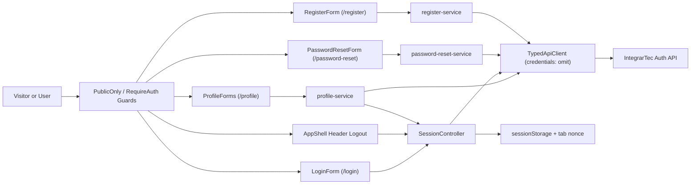

# Threat Model — IntegrarTec Frontend (Authentication, Session Lifecycle, and Profile Configuration)

## Executive summary

This threat model covers the public authentication routes (`/register`, `/login`, `/password-reset`), authenticated session teardown (`AppShell` logout), and the authenticated own-profile surface `/profile` (`#29`, `HU-AUT-003` part 1/2) in `integratec-final-front` (`#27`, `#28`, and `#29`). Core defenses focus on client-side validation (`src/features/auth/`, `src/features/profile/`), typed REST transport (`src/session/`, `src/api/client.ts`), open-redirect controls (`src/app/router/return-target.ts`, `src/session/redirect.ts`), cache teardown (`SessionProvider`) with user-scoped own-profile cache eviction, and CSP headers (`src/config/security-headers.ts`).

The highest-risk threats on this boundary are: (1) open redirects via tampered `?next=` query parameters across `/login`, `/register`, and `/password-reset`, (2) credential retention or token exposure in browser storage, URLs, or React state on failure, (3) enumeration leaks across login (`401`), password-reset request (`202`), or reset confirmation (`400`), (4) incomplete local cache/UI teardown on unconfirmed logout, and (5) spoofed success confirmation when server writes fail or return malformed responses. The profile boundary adds: (6) adopting another user's profile from a stale response or unscoped cache, (7) spoofed saved-status or destroyed confirmed configuration on rejected, malformed, or uncertain writes, and (8) injection or cross-account cache leaks through profile values rendered in the shell.

## Scope and assumptions

- **In scope:**
  - Public unauthenticated screens guarded by `PublicOnly`: `/register` (`src/features/auth/register-form.tsx`), `/login` (`src/features/auth/login-form.tsx`), and `/password-reset` (`src/features/auth/password-reset-form.tsx`).
  - Password-reset transport (`src/features/auth/password-reset-service.ts`) for `POST /auth/password-reset/request` and `POST /auth/password-reset/confirm`.
  - Session lifecycle controller (`src/session/controller.ts`), transport (`src/session/transport.ts`), React cache cleanup (`src/session/provider.tsx`), and `AppShell` logout trigger (`src/app/router/app-shell.tsx`).
  - Safe destination validation (`src/app/router/return-target.ts`, `src/session/redirect.ts`) and strict CSP config (`src/config/security-headers.ts`).
  - Authenticated route `/profile` guarded by `RequireAuth`: display-name and base-avatar forms, per-form save-status state machine, and 2D preview (`src/features/profile/`, `src/app/pages/profile-page.tsx`).
  - Own-profile transport validation (`profileSchema`, `avatarSchema` in `src/session/transport.ts`) and confirmed-profile adoption into the session snapshot (`SessionController.applyConfirmedProfile`).
  - User-scoped own-profile cache key (`ownProfileQueryKey` in `src/api/query-keys.ts`) and its logout eviction.
- **Out of scope:**
  - Backend password hashing, rate-limiting counters, reset-token cryptography, and email delivery in `integratec-final-back`.
  - Invitation token verification and classroom join flows (`#31`).
- **Assumptions:**
  - Backend enforces constant-information responses on `/auth/login` (`401`), `/auth/password-reset/request` (`202`), and `/auth/password-reset/confirm` (`400 BAD_REQUEST`), and emits reset links using `/password-reset?token=<opaqueToken>`.
  - Hosting serves the strict CSP headers generated by `src/config/security-headers.ts` (`script-src 'self'`, `frame-ancestors 'none'`).
  - The backend owns authorization and validation for `PATCH /users/me/profile` and `PATCH /users/me/avatar`; the authenticated identity, not any browser-supplied identifier, decides whose profile is written (`rules/avatars-and-customization.md`).

## System model

Trust boundaries:

1. **URL & form inputs -> Client state:** Query params (`?next=`, `?token=`) and user credentials enter auth routes as untrusted input.
2. **Client runtime -> API:** Auth mutations enforce `credentials: 'omit'`, `redirect: 'error'`, and explicit `Authorization: Bearer` applies only to `POST /auth/logout`, `GET /users/me`, and the `PATCH /users/me/profile` / `PATCH /users/me/avatar` own-profile writes.
3. **Auth responses -> Session / Cache / UI state:** Login verifies `/users/me` before setting `authenticated`; logout clears `sessionStorage` and TanStack caches before awaiting the server; reset/registration require verified status/schema before showing success; profile writes adopt the server-confirmed response only after schema validation, an authenticated snapshot, and a user-id match, and an uncertain write reconciles with `GET /users/me` before claiming success.

## Assets and security objectives

| Asset                                      | Security Objective                         | Consequence if Compromised                                                                                   |
| ------------------------------------------ | ------------------------------------------ | ------------------------------------------------------------------------------------------------------------ |
| Plaintext password & reset token           | Confidentiality, zero persistence          | Account takeover if saved to storage, logs, or retained after error                                          |
| Bearer access/refresh token pair           | Confidentiality, tab scoping               | Session hijack or stale cross-user cache leak on logout                                                      |
| Post-auth navigation target (`?next=`)     | Integrity (allowlist enforcement)          | Phishing / open redirect after login or password reset                                                       |
| Enumeration neutrality (`401`/`202`/`400`) | Confidentiality                            | Attackers discovering registered accounts or whether a reset token existed                                   |
| Local logout & confirmation truth          | Integrity                                  | Protected data left visible after logout or false claim of server logout                                     |
| Own-profile data & confirmed avatar        | Integrity (server authority, user scoping) | Cross-account appearance, UI claiming rejected or uncertain writes as saved, or lost confirmed configuration |

## Threat model table

| ID       | Threat / Abuse Path                                                                           | Affected Surface                                                | Risk   | Existing & Required Mitigations                                                                                                                                                                                                                                                                                         | Verification                                                                                              |
| -------- | --------------------------------------------------------------------------------------------- | --------------------------------------------------------------- | ------ | ----------------------------------------------------------------------------------------------------------------------------------------------------------------------------------------------------------------------------------------------------------------------------------------------------------------------- | --------------------------------------------------------------------------------------------------------- |
| `TM-001` | Open redirect via tampered `?next=` across auth routes                                        | `return-target.ts`, `/login`, `/register`, `/password-reset`    | High   | Single-value check + exact allowlist via `safeSessionRedirect()` on read, write, and cross-link generation (`buildAuthReturnHref`); rejected targets are stripped                                                                                                                                                       | Unit tests in `return-target.test.ts`; RTL tests in `login-page.test.tsx`                                 |
| `TM-002` | Enumeration leaks on login failure, reset request, or bad token                               | `LoginForm`, `PasswordResetForm`, services                      | Medium | `401` renders a single generic `FormRootError` without field highlights; reset request `202` shows identical confirmation for any email; reset confirm `400` uses one expired/invalid copy                                                                                                                              | RTL tests in `login-page.test.tsx`, `password-reset-page.test.tsx`                                        |
| `TM-003` | Password retained in React state or storage after submit failure                              | `RegisterForm`, `LoginForm`, `PasswordResetForm`                | Medium | Clear password / `newPassword` immediately in `catch` / completion; never persist form values in `sessionStorage` or logs; distinguish `429` and network errors cleanly                                                                                                                                                 | RTL tests checking empty password input after `401`/`400`/`5xx`/network                                   |
| `TM-004` | Stale protected UI or false server-logout claim after sign-out                                | `AppShell`, `SessionController.logout`, `SessionProvider`       | High   | `controller.logout()` synchronously transitions `unauthenticated`, wipes `sessionStorage`, cancels queries, clears caches, and deduplicates concurrent `logout()` calls so rapid double-clicks cannot abort server revocation (`AppShell` `isLoggingOutRef`); toast uses distinct copy when `serverConfirmed === false` | Unit tests (`controller.test.ts`), RTL tests (`app-shell.test.tsx`), E2E                                  |
| `TM-005` | Phantom confirmation on failed/`200`-proxy reset or registration                              | `register-service.ts`, `password-reset-service.ts`              | Medium | Require exact `201`+Zod schema (`register`), `202`+Zod schema (`reset request`), `204` (`reset confirm`); report outcome-uncertain copy on `5xx`/network; guard double-submit via `useProtectedSubmit`                                                                                                                  | Service unit tests (`register-schema.test.ts`, `password-reset-service.test.ts`)                          |
| `TM-006` | CSP violation (`new Function`), XSS, or URL/`history.state` token exposure                    | Auth schemas, UI rendering, `security-headers.ts`               | Medium | Enforce `z.config({ jitless: true })` on every schema; render text only as React nodes; latch `?token=` into React memory and scrub it from the URL via `replace` navigation with a non-secret `location.state` marker (never persisting the token in `window.history.state` or `Referer` headers)                      | `pnpm security:check`, `pnpm lint`, RTL/Playwright URL-scrub & CSP monitors                               |
| `TM-007` | Expired session redirect loop or `403` bounce to `/login`                                     | `RequireAuth`, `AppShell`, `src/session/middleware.ts`          | Medium | Only `401` (with failed refresh) invalidates session to `/login?next=`; `403` stops inside route/resource boundaries and never triggers `RequireAuth` redirect                                                                                                                                                          | Guard & middleware tests (`guards.test.tsx`, `middleware.test.ts`)                                        |
| `TM-008` | Adopting another user's profile via stale response or unscoped cache                          | `SessionController.applyConfirmedProfile`, `ownProfileQueryKey` | Medium | `applyConfirmedProfile` ignores payloads unless the snapshot is `authenticated`, the profile id matches the signed-in user, and `profileSchema` parses; user and avatar are frozen; the cache key is scoped by user id and evicted at logout                                                                            | Controller unit tests (`controller.test.ts`) and profile service/RTL tests                                |
| `TM-009` | Spoofed saved-status on rejected, malformed, or uncertain write                               | `saveDisplayName`, `saveAvatar`, `SaveStatus`                   | Medium | Confirmed status only after 2xx plus `profileSchema`/`avatarSchema` parse; a malformed 2xx is reported as an uncertain write and reconciled via `GET /users/me` before claiming success or repeating; `403`/`400` keep the draft and the last confirmed state                                                           | RTL tests for `403`/`400` draft preservation and uncertain-write reconciliation (`profile-page.test.tsx`) |
| `TM-010` | XSS or CSP violation through `displayName` or avatar strings rendered in the shell or preview | AppShell banner, avatar preview, schemas                        | Medium | All server strings render as React text nodes; `profileSchema`/`avatarSchema` validate shapes and limits under `z.config({ jitless: true })`; strict CSP headers                                                                                                                                                        | `pnpm lint` code review, E2E pageerror/CSP monitors                                                       |
| `TM-011` | Rejected or superseded write overwrites the last confirmed configuration                      | Draft state, `GET /users/me` reconciliation                     | Medium | A failed update never replaces the last confirmed snapshot with an invalid preview; after uncertain writes the screen re-reads `GET /users/me`; logout/account change evicts the user-scoped cache                                                                                                                      | RTL reload and rejection tests, E2E edit-then-reload flow (`e2e/profile.spec.ts`)                         |

## Focus paths for security review

1. `src/session/controller.ts` & `src/session/transport.ts` — verify `LoginFailureReason` leaks no raw transport messages and `logout()` clears local state before awaiting `POST /auth/logout`.
2. `src/features/auth/login-schema.ts`, `src/features/auth/password-reset-schema.ts`, `src/features/auth/password-reset-service.ts` — verify jitless Zod config, untrimmed password handling, `credentials: 'omit'`, `redirect: 'error'`, and strict `202`/`204` validation.
3. `src/features/auth/login-form.tsx`, `src/features/auth/password-reset-form.tsx`, `src/app/router/app-shell.tsx` — verify password clearing, `401`/`429`/network error separation, `serverConfirmed === false` logout messaging, and safe `?next=` propagation.
4. `src/app/router/return-target.ts` & `src/app/router/guards.tsx` — confirm `buildAuthReturnHref` and `readReturnTarget` delegate strictly to `safeSessionRedirect`.
5. `src/features/profile/profile-service.ts` — verify uncertain-write classification, `profileSchema`/`avatarSchema` response gating, and `403`/`400` translation that never presents a rejected draft as saved.
6. `src/session/controller.ts` (`applyConfirmedProfile`) — verify authenticated-status, user-id, and schema guards plus frozen user/avatar adoption.
7. `src/api/query-keys.ts` — verify `ownProfileQueryKey` user scoping and logout eviction.
