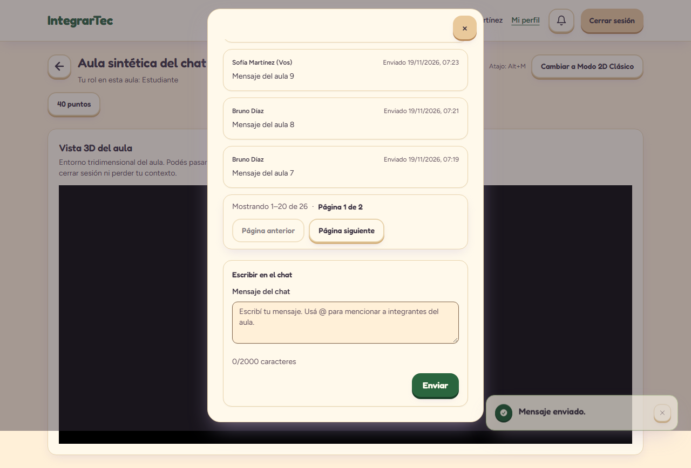
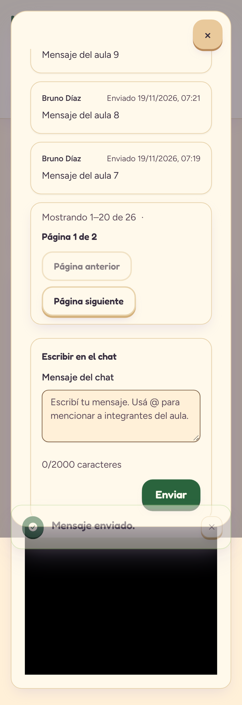

# Classroom chat panel

The classroom chat is the per-classroom conversation channel of `HU-COM-002`
([#51](https://github.com/Agustin742/integratec-final-front/issues/51)).
Members with chat access read the server-confirmed, paginated history, send
plain-text messages with `@mention` autocomplete, and teacher-level staff hide
individual messages with a confirmed, audited moderation. Parents are never
offered this chat. Every displayed value comes from the server; the client
never fabricates, aggregates, or broadcasts anything on its own authority
([communication and notifications](../rules/communication-and-notifications.md)).

## Where it mounts

`ChatPanel` (with its composer slot) registers under the server `chat` panel
key in `classroomPanelCatalog`
([classroom panels](./classroom-panels.md)), so it opens from the same 2D
Classic Mode navigation buttons and URL intents
(`/classrooms/{id}/panels/chat`) as every other panel. A 3D chat object is not
required by the issue. Panel visibility comes only from the server's
`availablePanels` on `GET /classrooms/{id}`; the panel content then branches
on the server-resolved `myRole`:

| Caller role                   | Content                                                                                                             |
| ----------------------------- | ------------------------------------------------------------------------------------------------------------------- |
| `STUDENT`                     | Full history (visible rows) + composer (disabled with the reason while muted)                                       |
| `TEACHER` / `OWNER` / `ADMIN` | Full history incl. hidden rows with their moderation audit + composer (send allowed while muted) + hide controls    |
| `PARENT`                      | Denied up front, without issuing any chat or directory request; the panel explains that families do not participate |

## Read side: paginated history

`src/features/classrooms/chat/chat-panel.tsx`:

- History comes from `GET /classrooms/{id}/messages` (`ChatController_list`,
  20 rows per page, server-fixed order `createdAt DESC, id DESC`, latest
  first). Repeated ids from a revalidated page are deduplicated by their
  server identity; ordering is never recomputed client-side.
- Author labels come from the optional `GET /classrooms/{id}/members`
  directory lookup (`list_directory`-capable callers only): display names and
  a `Docente` badge for staff rows, a `(Vos)` marker on the signed-in
  member's own rows. Absent, denied or failed lookups degrade to neutral
  labels (`Integrante del aula`), never to guesses.
- Message bodies are untrusted content rendered as plain text nodes (never
  `dangerouslySetInnerHTML`), preserving whitespace with `break-words`
  ([security](../rules/security.md)).
- States use the shared feedback primitives: loading, empty
  (`Todavía no hay mensajes en el chat`), stale (background refresh failed,
  confirmed rows kept with a notice), forbidden (`403`) and not-found (`404`)
  without revealing whether the resource exists, and an out-of-range page
  state with a back-to-first-page action. A terminal `403`/`404` also
  revalidates the classroom context once so a lost permission does not keep
  serving a stale denied page.

## Live seam

The committed contract has no per-message chat broadcast yet (backend
[back #48](https://github.com/Agustin742/integratec-final-back/issues/48) is
open). Live updates arrive through the existing workspace SSE
`classroom.context-invalidated` revalidation seam
([context invalidation B](./classroom-workspace.md#context-invalidation-b)):
every observed invalidation hint cancels obsolete REST and revalidates all
chat queries of that user and classroom (history and suggestion sources share
the `chat` query domain). Confirmed sends and moderation hides reconcile the
same way. No realtime protocol is invented here; when back #48 lands, the
panel will keep REST as the rendering authority
([communication and notifications](../rules/communication-and-notifications.md)).

## Composer

`src/features/classrooms/chat/chat-composer.tsx`:

- Contract limits: 1–2000 characters after trimming, multiline
  `\n`/`\r`/`\t` allowed, other control characters rejected before the
  request. Only `body` is sent; the server assigns author, instant and
  mention resolution.
- `@mention` autocomplete: typing `@` plus a prefix queries
  `GET /classrooms/{id}/members` with the `q` case-insensitive display-name
  prefix filter (backend decision D12), offered as a keyboard-accessible
  listbox (ArrowDown/ArrowUp/Enter/Escape, focus returns to the textarea).
  Selecting a suggestion inserts `@DisplayName ` as plain text; the server
  resolves or ignores it. Suggestions never expose users outside the roster
  the server returns.
- Pending sends show an explicit notice; the message only becomes history
  after the server confirms (201), and the draft clears only then. Definite
  rejections keep the draft: a `429` is shown as the rate-limit feedback, a
  `400` maps onto the body field. Transport-uncertain outcomes keep the draft,
  reconcile the history against the server, and report the uncertainty —
  never a blind retry
  ([error handling](../rules/error-handling-and-feedback.md)).
- Typing in the composer never triggers world movement or shortcuts: the
  workspace shortcut listener ignores editable targets and open dialogs.

## Muted chat

`chatMuted` is server-owned context on the classroom detail. While muted,
students get a disabled composer with the reason (`El chat está silenciado`)
and no send control, but the confirmed history stays readable;
teacher-level staff keep the active composer. The disabled control is never
the enforcement: a send that still reaches the server is rejected and that
outcome is presented, with the explanation always coming from the revalidated
context, never from a `403` body.

## Moderation

Teacher-level staff (server-granted `moderate_chat` on this classroom) see an
`Ocultar` action on visible rows. `DELETE /classrooms/{id}/messages/{messageId}`
(`ChatController_hide`) is a logical, idempotent staff-only moderation:

- A confirmation dialog quotes the exact message; nothing changes before the
  server answers. While a confirmation is open, every row control is
  disabled so at most one moderation is in flight.
- A definite `204` reconciles the history first and then closes the dialog,
  leaving the row badged `Ocultado` with its audit (`Ocultado por … el …`).
  The row is never deleted, so staff keep reading it.
- Students receive only visible rows from the server, so hidden messages
  simply vanish from their view; no client-side filtering decides it.
- A later server denial shows the failure, closes the dialog and revalidates
  the classroom context so a lost permission removes the control. Uncertain
  outcomes reconcile against the revalidated history before any retry.

Message editing by authors, automatic content filtering, student reporting
and per-student muting are not established and do not appear as UI
([communication and notifications](../rules/communication-and-notifications.md));
mute controls themselves belong to `HU-VIV-002` (extended) and are out of
scope for #51.

## Accessibility notes

- The history list, composer region and suggestion listbox carry explicit
  accessible names; pending sends, sent confirmations and suggestion
  availability are announced through visually hidden live regions.
- Hide controls are named with the author and instant of the target row, so
  the action is unambiguous for screen-reader users; focus returns to the
  row control when a moderation is denied and to the history list when the
  row's control is gone after a confirmed hide.
- Composer and dialog actions keep the shared 44px minimum target height, and
  the muted state explains itself instead of only disabling the control
  ([UI and accessibility](../rules/ui-and-accessibility.md)).

## Contract and mocks

Frontend types are generated from the backend's committed OpenAPI document
(`pnpm api:sync`; chat REST from back #38, member directory from back #52),
and the feature layer validates every response with jitless Zod schemas
mirroring the backend DTOs (`ChatMessageDto`, `ChatHistoryMessageDto`,
directory rows). The stateful MSW store in `src/test/msw/handlers.ts`
(`createClassroomChatStore`) serves contract-shaped fixtures with
`403`/`404`/`429`, muted, and uncertain-write failure options so UI work and
tests run against the committed contract (FD9). A passing mock is not
integration proof.

## UI evidence

Desktop 1280px, student chat panel with confirmed history and composer after
a server-confirmed send:

Mobile 360px, same panel and composer:

