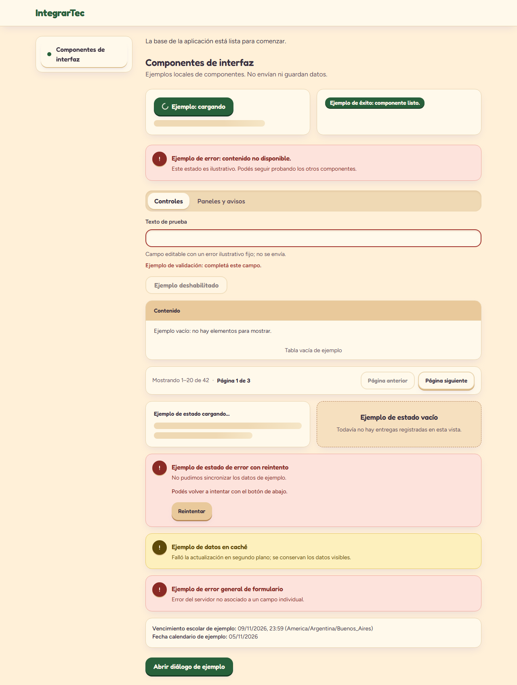
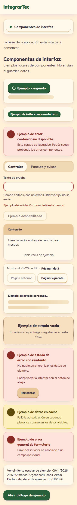

# UI feedback and tables

Use these local primitives for feedback, decorative loading placeholders and
semantic tables. They reuse the warm [foundation tokens](ui-foundations.md) and
`cn`/CVA helpers. Import named exports directly from lowercase files in
`src/components/ui/`; there is no barrel. Native props, including React 19 refs,
are passed through. Callers supply centralized es-AR content; these components do
not fabricate messages or data. For form interactions, see [UI controls](ui-controls.md).

## Display and tables

- `Alert`, `AlertTitle`, `AlertDescription`: default polite `status`; destructive
  variant defaults to urgent `alert`. Override `role` for static content or other
  announcement needs. `AlertTitle` renders `h2` by default and accepts
  `as="h3"`…`as="h6"` so the alert can sit under an existing section title
  without breaking heading order. Supply actionable failure text; do not
  duplicate the same live announcement.
- `Badge` (`BadgeProps`): non-interactive span with `default`, `secondary`,
  `destructive`, or `outline` variant. Communicate state in text, not color alone.
- `Skeleton`: decorative, `aria-hidden`, caller-sized using `className`; pulse is
  motion-safe only. Put loading copy and `aria-busy` on the containing view rather
  than announcing each placeholder. Never put focusable content inside it.
- `Table` (`TableProps`): native table inside a keyboard-focusable horizontal
  overflow region. Required `containerLabel` names that region; name the table
  separately with `TableCaption` or `aria-label`. The surrounding flex/grid layout
  must allow shrinking (`min-w-0`). `className` styles the table, not its container.
  Exports: `TableHeader`, `TableBody`, `TableFooter`, `TableRow`, `TableHead`,
  `TableCell`, `TableCaption`. `TableHead` defaults to `scope="col"`; use
  `scope="row"` for row headers. Native props support `colSpan` and complex header
  associations. Loading, empty, error and data rows are caller-owned; no data
  fetching, sorting or pagination is included.

## Shared state, pagination, and date/time primitives

- `src/components/feedback/states.tsx` (`LoadingState`, `EmptyState`,
  `ErrorState`, `StaleDataNotice`, `LiveRegion`) provides visually and
  programmatically distinct observable states per
  [error handling and feedback](../rules/error-handling-and-feedback.md).
  `LoadingState` marks `role="status"` and `aria-busy="true"` while keeping
  `Skeleton` placeholders decorative; `ErrorState` maps `ApiError.userMessage`,
  presents a next action, and supports a bounded `onRetry` callback;
  `StaleDataNotice` warns when a background refresh fails while preserving
  existing content; `LiveRegion` announces async outcomes (`polite` or
  `assertive`).
- `src/components/pagination/pagination.ts` and `pagination-controls.tsx`
  (`normalizePaginationQuery`, `createPaginatedQueryKey`, `getPaginationMeta`,
  `PaginationControls`) match the backend offset pagination contract
  (`{ items, page, pageSize, total }`, query `{ page, pageSize, sort }`).
- `src/lib/dates.ts` (`formatInstant`, `formatDeadline`, `formatDateOnly`)
  formats instants and deadlines in `es-AR` (`DEFAULT_SCHOOL_TIME_ZONE =
'America/Argentina/Buenos_Aires'` with the time zone indicated per FD11) and
  formats `YYYY-MM-DD` calendar dates in `UTC` so browser offsets never shift
  the displayed day ([data and time](../rules/data-and-time.md)).

## Verification boundary

The colocated `display.test.tsx` exercises status/error announcements, explicit
roles, non-interactive badges, decorative loading, table captions/headers, empty
rows and axe checks (excluding contrast in jsdom). Focusing the overflow region
and checking its classes do not prove actual scrolling or viewport fit.

Existing global focus and reduced-motion styles remain unchanged. Semantic color
pairs reuse the tested foundation tokens; this is not a new visual contrast
measurement. Browser keyboard access, actual overflow at 360px/desktop, contrast on
rendered backgrounds, layout integration, full regression checks and build remain
parent integration checks. See [UI accessibility](../rules/ui-and-accessibility.md)
and [quality requirements](../rules/quality-and-testing.md).

## Tactile styling

`Badge` is a chunky Fredoka pill with a 2px bevel and adds `success`, `info`, `warning` and `danger` variants (dark ink on a light palette tint). `Alert` adds `success`, `info` and `warning`; every variant uses a tinted surface (no side stripe), a decorative round icon chip and a Fredoka title; only `destructive` defaults to `role="alert"`. `Table` sits in a rounded clay panel with a Fredoka header on sand, roomier cells, warm dividers and a row hover tint. `Skeleton` is a warm sand shimmer that only animates under `motion-safe`. Contrast pairs: [foundations](ui-foundations.md#tactile-design-resin-keys-and-clay-panels).
