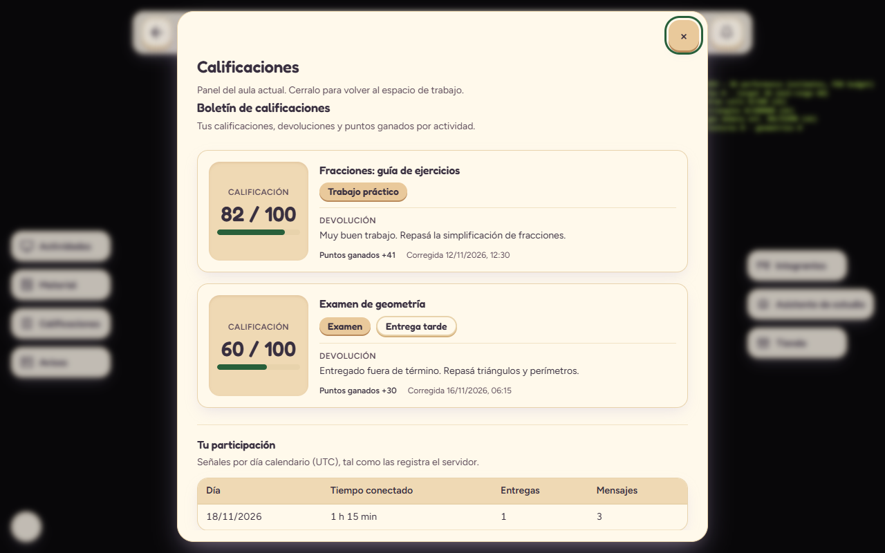
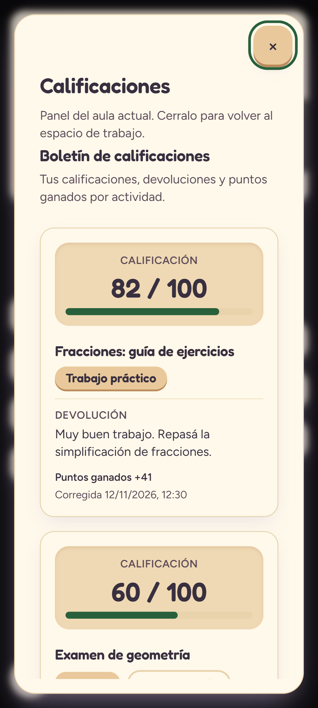

# Student report card and teacher tracking panel

The grades panel shows the server-confirmed academic history of one classroom
([#46](https://github.com/Agustin742/integratec-final-front/issues/46),
`HU-ACT-005`). Students read their report card — grades, written feedback,
points earned per activity — plus their own raw participation metrics and the
wallet component. Teaching staff read a raw per-student metrics table. Every
displayed value comes from the server; the client never computes, grades, or
aggregates ([activities and grading](../rules/activities-and-grading.md)).

## Where it mounts

`GradesPanel` registers under the server `grades` panel key in
`classroomPanelCatalog`
([classroom panels](./classroom-panels.md)), so it opens from the same 2D
navigation buttons, 3D desk/report-card entry points, and URL intents
(`/classrooms/{id}/panels/grades`) as every other panel. Panel visibility comes
only from the server's `availablePanels` (granted through the `view_metrics`
capability), and the panel content branches on the server-resolved `myRole`
from `GET /classrooms/{id}`:

| Caller role                   | Content                                                                                                                                           |
| ----------------------------- | ------------------------------------------------------------------------------------------------------------------------------------------------- |
| `STUDENT`                     | Student report card + own daily metrics + wallet section                                                                                          |
| `OWNER` / `ADMIN` / `TEACHER` | Classroom tracking table (per-student raw totals)                                                                                                 |
| `PARENT`                      | The student endpoints answer `403` until `HU-ACT-006` (extended) lands; the refusal is shown honestly as a forbidden state, never fabricated data |

## Student view

`src/features/classrooms/grades/grades-panel.tsx` (`StudentGradesView`):

- Report card: one card per graded activity from
  `GET /classrooms/{id}/me/report-card` (latest grading first, server-paged):
  activity title frozen at grading time, type badge (`TP` / `EXAM`),
  score as `score / maxScore` (0-100 scale), the grader's feedback verbatim,
  signed net points, an `Entrega tarde` badge for late submissions, and the
  grading instant (`formatInstant`, `es-AR`, school timezone per FD11).
- Own participation: daily rows from
  `GET /classrooms/{id}/me/activity-metrics` (latest UTC day first). The day is
  a date-only value formatted in UTC so the browser timezone never shifts it
  ([data and time](../rules/data-and-time.md)); connected seconds render as a
  signed-text duration (`2 h 5 min`), never as a color-coded level. No
  composite level exists yet (backend gap 17 is open), so none is shown.
- Wallet section: the read-only `WalletPanel` from the points feature
  ([wallet](./ui-wallet.md)) embedded under its own heading.
- Loading, empty (no graded activities yet / no participation yet), stale
  (background refresh failed, confirmed data kept with a notice), forbidden
  (`403`) and not-found (`404`) states use the shared feedback primitives.
  `403`/`404` hide all private content and clear inactive cached pages of that
  scope; `404` also invalidates the classroom detail so a foreign classroom
  stays not found.

## Teacher view

`TeacherMetricsView` for `OWNER` / `ADMIN` / `TEACHER`:

- One table row per active enrolled student from
  `GET /classrooms/{id}/activity-metrics` (server-ordered by display name):
  display name as the row header, connected seconds, submissions, messages,
  graded and ungraded submission counts — all raw server values; the client
  shows no combined level because the aggregation formula is an open decision.
- The contract exposes no sort or filter parameters, so the panel offers none;
  only `PaginationControls` beyond one page.
- Empty classroom, loading, stale, forbidden and not-found states as above. A
  foreign classroom is always presented as not found, never revealed as
  existing.

## Contract and mocks

The three endpoints are read-only and require no request body. Frontend types
are generated from the backend's committed OpenAPI document
(`pnpm api:sync -- --branch feat/36-activity-metrics`, backend PR #105), and MSW
handlers `createStudentReportCardHandler`, `createOwnDailyMetricsHandler` and
`createClassroomMetricsHandler` (`src/test/msw/handlers.ts`) serve synthetic
contract-shaped fixtures with `400`/`401`/`403`/`404` failure options, so UI
work runs before the backend implementation lands (FD9). A passing mock is not
integration proof.

## UI evidence

Desktop 1280px, student view (report card section):

Mobile 360px, student view (report card section):

