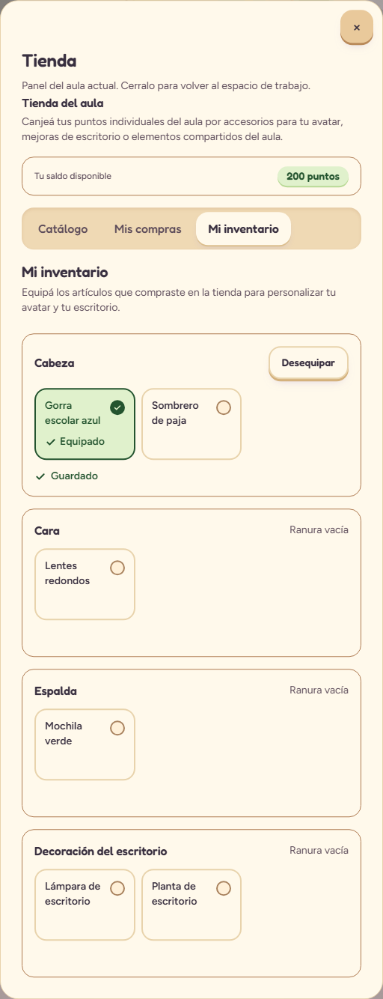

# Inventory Selector (`HU-ESP-004`, part 1/2)

The 2D inventory selector lets enrolled students inspect their classroom-scoped purchased avatar accessories (`head`, `face`, `back`) and desk upgrades (`desk_decor`) and equip or unequip them per slot against the NestJS equipment endpoints.

## Access points

- **Classroom workspace (`shop` panel):** Open the `Tienda del aula` panel (2D mode or 3D stage) and switch to the **Mi inventario** tab (`ShopPanel` -> `InventoryPanel`).
- **Profile (`/profile`):** The **Inventario por aula** section (`ProfileInventorySection`) lists the user's enrolled student classrooms and mounts `InventoryPanel` for the selected classroom.

## Behavior and authority

- **Student-only:** Non-student roles (`TEACHER`, `PARENT`) see a clear student-only notice and never trigger equipment reads or writes; private equipment cache entries are evicted if the student role is absent or revoked.
- **Server authority:** `GET /classrooms/{id}/me/equipment` and `PUT /classrooms/{id}/me/equipment/{slot}` are the source of truth. Each slot shows distinct pending (`Guardando…`), confirmed (`Guardado`), and rejected states.
- **403 / unowned and uncertain outcomes:** A `403` rejection (such as attempting to equip an unowned item) displays a clear alert and leaves the confirmed equipped state unchanged. Uncertain (`5xx` / network / malformed `2xx`) outcomes trigger authoritative cache invalidation to reconcile with the server.

## Visual evidence

| Desktop (`1280px`)                                        | Mobile (`360px`)                                        |
| --------------------------------------------------------- | ------------------------------------------------------- |
|  |  |

## Out of scope (part 1/2)

- 3D rendering of equipped accessories on avatars or desks (`part 2/2`).
- Pet accessories (`HU-GAM-004`, extended).
