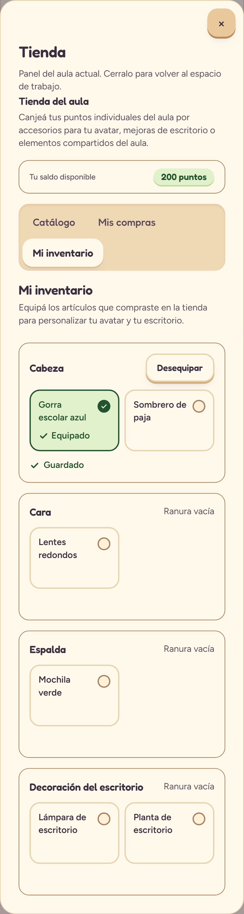

# Inventory Selector (`HU-ESP-004`, part 1/2)

The 2D inventory selector lets enrolled students inspect their classroom-scoped purchased avatar accessories (`head`, `face`, `back`, `hand`, `neck`, `ears`) and desk upgrades (`desk_decor`) and equip or unequip them per slot against the NestJS equipment endpoints.

## Access points

- **Classroom workspace (`shop` panel):** Open the `Tienda del aula` panel (2D mode or 3D stage) and switch to the **Mi inventario** tab (`ShopPanel` -> `InventoryPanel`).
- **Profile (`/profile`):** The **Inventario por aula** section (`ProfileInventorySection`) lists the user's enrolled student classrooms and mounts `InventoryPanel` for the selected classroom.

## Behavior and authority

- **Student-only:** Non-student roles (`TEACHER`, `PARENT`) see a clear student-only notice and never trigger equipment reads or writes; private equipment cache entries are evicted if the student role is absent or revoked.
- **Server authority:** `GET /classrooms/{id}/me/equipment` and `PUT /classrooms/{id}/me/equipment/{slot}` are the source of truth. Each slot shows distinct pending (`Guardando…`), confirmed (`Guardado`), and rejected states.
- **403 / unowned and uncertain outcomes:** A `403` rejection (such as attempting to equip an unowned item) displays a clear alert and leaves the confirmed equipped state unchanged. Uncertain (`5xx` / network / malformed `2xx`) outcomes trigger authoritative cache invalidation to reconcile with the server.

## Slot selector

- **Slot resolution:** each purchased item is offered in the slot declared by its catalog item `metadata.slot` (mirrors the back end `deriveSlotForItem`). Items without a valid slot are not offered.
- **Complete data:** every purchase page and every catalog page is loaded through a bounded `fetchAllPages` (at most 50 pages of 100), so no purchased item is missing from the grid.
- **Per-slot grid:** each slot is a `role="radiogroup"` and each item a tile (`button role="radio"`) with a roving tabindex. Arrow keys move focus; Enter, Space, or a click equips the item. The equipped tile shows "Equipado" with an icon, and an explicit "Desequipar" button empties the slot. An empty slot shows a hint.
- **Per-slot status region:** "Guardando…" while pending, "Guardado" cleared after 4 s, and errors kept until the next interaction.
- **Concurrent equips:** when several slots are saved at once, each confirmation merges only its own slot into the cached equipment state, so one response never overwrites another slot.
- **Heading focus:** `InventoryPanel` takes `focusHeadingOnMount` (default off). No current mount (the shop tab and the profile section) enables it, so opening the panel never moves focus; it exists for a future standalone route.

## Visual evidence

| Desktop (`1280px`)                                        | Mobile (`360px`)                                        |
| --------------------------------------------------------- | ------------------------------------------------------- |
|  |  |

## Out of scope (part 1/2)

- 3D rendering of equipped accessories on avatars or desks (`part 2/2`).
- Pet accessories (`HU-GAM-004`, extended).
